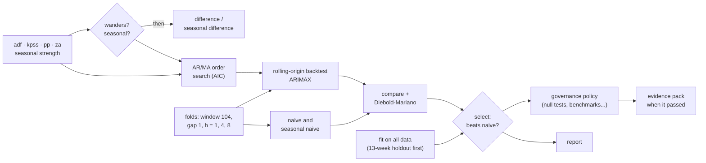
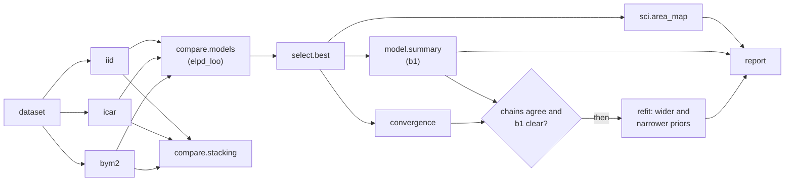
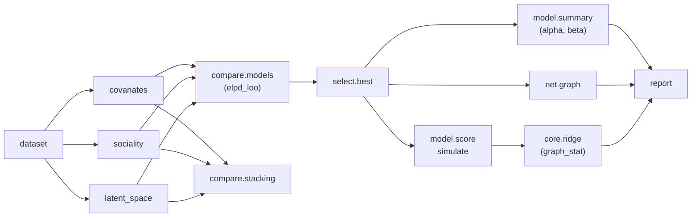
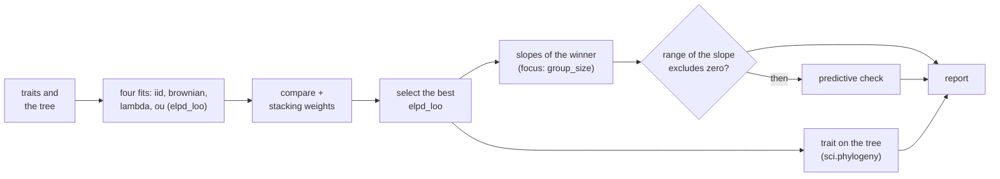
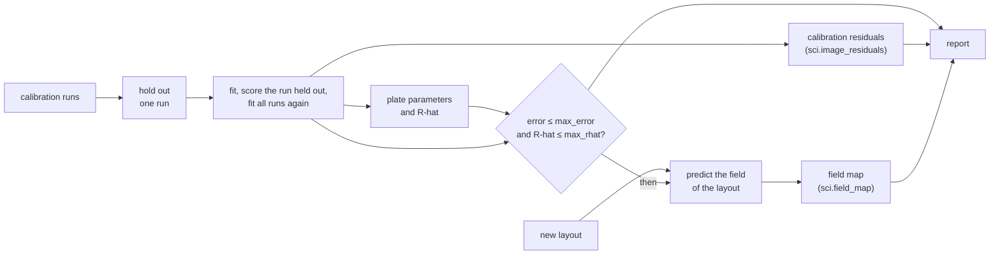

# Workflow cookbook <span class="mapi-badge">v0.5</span>

This page gives nine complete analyses. Each analysis is one YAML document. You can save,
run and schedule it, and give it to a colleague. The tests of the documentation validate each
document on this page against the node catalog and run it from start to end. Thus the
documents that you copy operate correctly. For the format, see
[Workflows](../concepts/workflows.md). For all nodes, see the
[node reference](../reference/workflow-nodes.md). For short parts with one pattern each, see
the [workflows guide](workflows.md#cookbook).

| Recipe | The question it answers |
|---|---|
| [Is my weekly KPI ready to forecast?](#readiness-to-arimax) | Does the series need differencing? Which ARIMA orders are correct? Is ARIMAX better than a naive forecast on honest backtests? Can we use it? |
| [Do these series move together?](#varvecm-cointegration) | Do some series have a long-run relation (VECM), or a relation only in their changes (VAR)? Does one series help to predict a different series? |
| [Which forecasting model?](#forecast-bake-off) | Which of SARIMAX, ARIMA, ETS and Theta forecasts best on the same folds? Is the advantage of the winner more than chance? |
| [Which spatial model for a disease map?](#disease-map-which-spatial-model) | Do the areas share their risk with their neighbours (iid, ICAR or BYM2)? Does the effect of the covariate stay clear in the best model, also with different priors? |
| [Which model explains the ties of a network?](#network-ties-which-model) | Do shared traits explain the ties, or do the activity of each node and a hidden map also help? Can the best model make networks like the real network? |
| [Does an effect across species stay when the tree is in the model?](#trait-regression-across-species) | Which correlation of relatives (none, Brownian motion, Pagel's lambda, Ornstein-Uhlenbeck) predicts best? Is the slope of the predictor clear of zero in the winner? |
| [Can I trust a calibration to design with it?](#calibrate-then-design) | What are the material and the losses of a heated plate? Does the calibration predict a run that it did not see? What temperature field does a new heater layout give? |
| [Can I trust this Bayesian model?](#bayesian-workflow-audit) | Do the priors make sense? Do the chains agree? Does the model make data like my data? Do the priors set the results? Does the model find known values? |
| [Where does my image model go wrong?](#image-model-check) | Do the predicted images look like the observed image? Where on the image are the residuals large? |

## Readiness to ARIMAX

**In plain words.** Before you trust a forecast, you must know four things:

- If the series "wanders". If it does, you must model its changes, not its levels.
- How much of the past is important.
- If the model forecasts better than the obvious rule "next week is like this week".
- If the model found a real effect, not noise.

This workflow answers each question with the standard statistical tool. It records each
decision with the numbers that caused it. It keeps the model only if the model is better than
the benchmarks. It also records the governance evidence.

**For the statistician.** ADF, KPSS, Phillips-Perron and Zivot-Andrews (one endogenous break)
decide `d` with a conservative rule: difference the series unless the evidence for
stationarity is clear on the two sides. Seasonal strength (STL) decides `D`. The ARMA orders
come from a grid of information criteria over `p ≤ max_p`, `q ≤ max_q`. The workflow fits
each point as ARIMA(p, d, q) on the levels. Thus the model estimates `d`, and does not apply
it to data that is already differenced. The report shows ACF/PACF for the reader.

The backtest is a rolling origin with a fixed training window, a gap and some horizons. The
workflow scores ARIMAX and the naive and seasonal-naive benchmarks on the same folds. A
Diebold-Mariano test with the Harvey-Leybourne-Newbold correction tells if the difference in
squared errors at horizon 1 is significant. `select.best` keeps the model only if its MAE is
better than each benchmark in `must_beat`.



### The document

```yaml
--8<-- "cookbook_readiness_arimax.yaml"
```

Copy these three details into your own workflows:

- **Alternatives keep the graph honest.** `diff` reads `[sdiff.data, inputs.data]`. This is
  the seasonally differenced series if that node ran. If not, it is the raw series. `acf`
  uses the series with the most processing that exists. The workflow calculates nothing two
  times. If the workflow does not take a branch, nothing breaks: skipped nodes are
  *skipped*, not failed.
- **Decisions move as values.** `$expr: "[nodes.order.best_p, if(nodes.wanders.value, 1, 0), nodes.order.best_q]"`
  changes the search result and the branch decision into the `order` of the model. The
  server parses the expression language and never uses `eval` on it. The run records each
  value that it read.
- **The fit has its own holdout.** `split.holdout` keeps the last 13 weeks out of the first
  fit (`mode: evaluate_then_refit`). Thus the governance checks that need unseen data have
  it. These checks are the null tests, the naive benchmark and the holdout accuracy. Then the
  workflow fits the model again on all the data.

### Run it with the CLI

```bash
--8<-- "cli_v05.sh:workflow"
```

`mapi workflows init` writes the `ts_readiness_arimax` template of the gallery with your
name and project. This template is the same analysis with an expanding-window backtest. To
get the rolling origin and the evidence pack, save the document above as
`weekly-readiness.yaml` instead. `--watch` shows the status of each node during the run. On a
terminal, it draws the status again in the same place. In a log, it writes one line for each
change. At the end, it shows the summary.

The output below is from a real run on a local stack. It is the second run on this data. The
unit-root tests, the holdout split and the fit did not change after the first run. Thus the
run **used them again from its cache** and did not calculate them again (the output is
shortened):

```text
started workflow run run_01m53hawnnyn7cyeptj70cxkk0 of workflow://growth/weekly-readiness
following workflow run run_01m53hawnnyn7cyeptj70cxkk0 (23 nodes)
  run started
  adf cached
  kpss cached
  pp cached
  za cached
  seas cached
  folds queued
  holdout cached
  wanders took the then arm
  seasonal took the else arm
  sdiff skipped: branch 'seasonal' took the else path
  …
  backtest succeeded
  compare succeeded
  select succeeded
  dm succeeded
  governance succeeded
  trusted took the then arm
  pack succeeded
  run succeeded

 node       ┃ kind       ┃ status      ┃ took  ┃ found
━━━━━━━━━━━━╇━━━━━━━━━━━━╇━━━━━━━━━━━━━╇━━━━━━━╇━━━━━━━━━━━━━━━━━━━━━━━━━━━━━━━━━━━━━━━━━━━━━━━━━━━━━━
 adf        │ test       │ ✓ cached    │ 0.0s  │ The series wanders: consider differencing it. (cached
            │            │             │       │ from run_01m53h6m9np4gtfzvrkwrr4bh9)
 za         │ test       │ ✓ cached    │ 0.0s  │ The series wanders even allowing for one break:
            │            │             │       │ consider differencing it. (cached from …)
 seas       │ test       │ ✓ cached    │ 0.0s  │ No clear repeating pattern was found. (cached from …)
 wanders    │ branch     │ ✓ succeeded │ 0.0s  │ took the then arm
 order      │ search     │ ✓ succeeded │ 22.9s │ {"best_p": 1, "best_q": 1}
 sdiff      │ transform  │ – skipped   │ 0.0s  │ branch 'seasonal' took the else path
 dm         │ compare    │ ✓ succeeded │ 18.7s │ The difference between backtest and naive at
            │            │             │       │ horizon 1 is possibly luck.
 acf        │ test       │ ✓ succeeded │ 13.4s │ No past period is related to the present beyond
            │            │             │       │ chance.
 select     │ select     │ ✓ succeeded │ 0.0s  │ backtest has the best average error (1.78) and beats
            │            │             │       │ every benchmark (the strongest, naiv…
 governance │ governance │ ✓ succeeded │ 48.5s │ Every blocking check passed (7 check(s) ran);
            │            │             │       │ warnings on null.permutation_target, stabil…
 …
Decisions
 branch   ┃ arm  ┃ condition                                   ┃ read
━━━━━━━━━━╇━━━━━━╇━━━━━━━━━━━━━━━━━━━━━━━━━━━━━━━━━━━━━━━━━━━━━╇━━━━━━━━━━━━━━━━━━━━━━━━━━━━━━━━━
 wanders  │ then │ (not nodes.adf.reject or nodes.kpss.reject) │ {"nodes.pp.reject": false,
          │      │ and not (nodes.pp.reject and                │ "nodes.za.reject": false,
          │      │ nodes.za.reject)                            │ "nodes.adf.reject": false,
          │      │                                             │ "nodes.kpss.reject": true}
 seasonal │ else │ nodes.seas.seasonal                         │ {"nodes.seas.seasonal": false}
 trusted  │ then │ nodes.governance.passed                     │ {"nodes.governance.passed": true}
Outputs
 output   ┃ type          ┃ where
━━━━━━━━━━╇━━━━━━━━━━━━━━━╇━━━━━━━━━━━━━━━━━━━━━━━━━━━━━━━━━━━━━━━━━━━
 model    │ model_version │ model://growth/wf-weekly-readiness-fit@v1
 …
```

The full run took 1.6 minutes on a laptop. The live board goes to standard error, and the
summary goes to standard output. Thus `mapi workflows run … --watch > summary.txt` keeps only
the summary.

Then examine the results, download them and run the workflow automatically:

```bash
--8<-- "cli_v05.sh:inspect"
```

```bash
--8<-- "cli_v05.sh:automate"
```

### Run it with the Python client

Do these steps:

1. Validate the file on the server. The server saves nothing.
2. Make the workflow, or save a new revision.
3. Run the workflow.
4. Follow the live events.

```python
--8<-- "client_v05.py:validate"
```

```python
--8<-- "client_v05.py:run"
```

Read the results. They include the verdict of each test, each branch with the values that it
read, the selected orders and the Diebold-Mariano verdict. They also tell why the workflow
selected the model or did not select it:

```python
--8<-- "client_v05.py:inspect"
```

The governance node measured the selected model against the policy that applies. Because
`submit: true` is set, it recorded a validation of that model version:

```python
--8<-- "client_v05.py:governance"
```

This is the output on a live local stack, from the first run of the walkthrough on this data:

```text
passed
validated
data.quality                 pass    No data problems found (156 periods of history).
convergence                  pass    The fit reported no convergence problems.
baseline.beats_naive         pass    On the 13 held-out periods the model's error is 25% lower than 'same as last period' (the strongest simple benchmark).
holdout.accuracy             pass    On data it was not fitted on, the model's average percentage error is 1.8% (limit 15%).
residuals.whiteness          pass    No pattern is left in the errors (Ljung-Box p = 0.39 at 10 lags).
null.permutation_target      pass    The model did better on held-out data (skill 0.236) than all 20 fits with the drivers price shuffled in blocks of 7 (the result untouched) (p = 0.048).
stability.rolling_params     fail    ar.L1 changes a lot across windows of history (variation 1205%): the relationship may not be stable over time.
```

Read the output as a reviewer does. On unseen weeks, the model is 25% better than naive. Its
errors have no pattern. It forecasts better than each fit with the price driver shuffled in
time. But the AR coefficient is not stable across windows.

That check *failed*, but the version is still `validated`. The status of a check and its
severity are different things. The default forecast policy sets stability to *information*,
so the check does not block. The reviewer can see it in the record and in the evidence pack.
A stricter policy (see [governance](governance.md)) makes the check block. Then this model
needs more history or a simpler specification. This is the purpose: the evidence is written,
and the decision is explicit.

!!! note "What the shuffle test measures on a random walk"
    The model has a driver. Thus the test shuffles the driver in blocks and does not change
    the result. It scores each fit by its skill against the null forecast on the held-out
    weeks. Persistence ("next week is like this week") helps the shuffled fits exactly as much
    as it helps the real fit. Thus the test measures what the driver adds to persistence. For
    a model without drivers, the test uses shuffled changes of the series
    ([null tests explained](null-tests.md)).

Then keep the workflow up to date:

```python
--8<-- "client_v05.py:automate"
```

## VAR/VECM cointegration

**In plain words.** Some series wander but stay together. Examples are the prices of close
substitutes, sales and distribution, and income and consumption. If they have a relation, a
model that knows the relation (an error-correction model) forecasts better. It also tells you
how fast a gap closes. If they do not have a relation, model their changes. In the two cases,
find out if one series helps to predict a different series.

**For the statistician.** The Johansen trace test (at 5%) on the levels decides the branch.
If the series have a relation, `search.coint_rank` selects the rank. Then the workflow fits a
VECM with `k_ar_diff: 1` on the levels. If the series do not have a relation, the workflow
differences them. Then AIC selects the VAR lag order up to `maxlags`, and the workflow fits a
VAR on the changes. If the workflow took the changes (the first alternative), it tests Granger
causality on them. If not, it tests on the levels. The forecast node uses the model that
exists, with the related data.

```yaml
--8<-- "cookbook_var_vecm.yaml"
```

The data keeps the series along one dimension, with one value for each series and period
(`value(series, quarter)`). This is the layout of `ts.var` and `ts.vecm`. To ingest a wide
sheet, use the `wide` mapping. Run the workflow as the first recipe, with the two parameters
that it needs:

```bash
mapi workflows apply macro-system.yaml
mapi workflows run macro-system -i data=dataset://growth/us_macro@latest \
  -p target=realcons -p driver=realgdp --watch
```

```python
run = api.workflows.run(
    wf.id,
    inputs={"data": "dataset://growth/us_macro@latest"},
    params={"target": "realcons", "driver": "realgdp", "maxlags": 4},
    wait=True,
)
nodes = {n.node_id: n for n in run.nodes}
print(nodes["johansen"].result["verdict_plain"])  # "The series share at least one long-run relationship."
print(nodes["granger"].result["verdict_plain"])   # "Past values of the driver help predict the result."
print([n.node_id for n in run.nodes if n.status.value == "skipped"])  # the branch not taken
```

A run on a laptop used three simulated weekly series. Two of the series have the same
stochastic trend (`target=a`, `driver=b`). The run printed the two verdicts above and
`['diff', 'lags', 'var']`. The Johansen trace statistic (69.1) set the rank to 1, and the VECM
branch ran. Granger found that `b` helps to predict `a` (p = 0.0015). See
[Macro and VAR analysis](../use-cases.md#macro-and-var-analysis).

The [Model Explorer](model-explorer.md) shows the impulse responses, the variance
decomposition, the Granger table and the Johansen table of the fitted model
(`mapi explore model … -s irf -s fevd`).

## Forecast bake-off

**In plain words.** If you do not know which forecast method is correct for your data, let
the methods compete fairly. They use the same history, the same cut-off points, the same
horizons and the same naive benchmarks. Keep the winner only if it is clearly better than a
simple method.

**For the statistician.** The plan is an expanding window with `n_folds` origins, one each 4
periods. The workflow scores each horizon. SARIMAX(1,1,1)(0,1,0)₅₂, ARIMA(0,1,1),
damped-trend ETS and Theta compete against naive, seasonal-naive and drift. MASE puts them in
sequence. MASE has no scale, so you can compare series of different sizes. Two
Diebold-Mariano tests (absolute loss, horizon 1) compare the leaders with the benchmark.
`select.best` needs a 5% MASE improvement over each benchmark. Only then does the branch fit
the winner again.

```yaml
--8<-- "cookbook_forecast_bakeoff.yaml"
```

```bash
mapi workflows apply forecast-bakeoff.yaml
mapi workflows run forecast-bakeoff -i data=dataset://growth/weekly_sales@latest \
  -p 'horizons=[1,4]' -p n_folds=6 --watch
mapi workflows node "$RUN" compare      # the league table
mapi workflows node "$RUN" best         # who won, and whether they beat naive by 5%
```

On a short series with much noise, the usual result is the honest result: *"ets is the best
model (0.0456) but does not beat naive.drift by the required 5%: no model is selected."* The
workflow skips the `refit` node, and the report tells why. Thus nobody ships a model that only
looks clever.

## Disease map: which spatial model?

**In plain words.** A disease map shows the risk in each area, for example in each district.
Small areas have few cases, so their raw rates have much noise. A model can let adjacent areas
share their risk. This makes the estimates of small areas more stable. But is this correct for
your data? And does it change your answer about a cause, for example the percentage of people
who work outdoors?

This workflow fits three models, from independent areas to areas that share their risk. Then it keeps the model that predicts best. It tells you if
the effect of the covariate is clear, and if the effect stays clear with different priors.

**For the statistician.** Each rung is `sci.areal_bym2`, Poisson(E exp(b0 + b1 x + u)), on all
the data. The area effects u are `iid`, `icar` or `bym2`. Each fit keeps the pointwise PSIS-LOO
values (`evaluate: {metrics: [elpd_loo]}`), so the rungs are scored on the same areas.
`compare.models` ranks them by `elpd_loo`. `compare.stacking` gives the stacking weights (Yao
et al. 2018). `select.best` keeps the rung with the largest `elpd_loo`. `model.summary` gives
the HDI of b1 (`hdi_prob`). `governance.check` (`convergence`) reads R-hat of the winner. If
the check does not fail and the HDI excludes zero, the workflow fits the winner again with
the prior widths of b0, b1 and sigma multiplied and divided by `prior_scale`.



### The document

```yaml
--8<-- "cookbook_sci_spatial_ladder.yaml"
```

The document is the `sci_spatial_ladder` template of the gallery. A test makes sure that the
two stay the same. Copy these three details into your own workflows:

- **The winner sets the next fit.** `kind: {$expr: nodes.best.selected}` gives the id of the
  winner (`iid`, `icar` or `bym2`) to the refits. The id of each rung is also its `kind`.
- **One fit configuration for all rungs.** The YAML anchor `&fit` gives the same draws, chains
  and seed to each rung. Thus the rungs differ only in their area effects.
- **The workflow writes the priors out.** `governance.check` with `sensitivity.prior` finds
  only prior widths with names such as `prior_sigma`. The prior widths of `sci.areal_bym2` are
  `intercept_sd`, `slope_sd` and `sigma_scale`. Thus the workflow fits the model again with
  these widths, and `model.summary` shows the effect for each fit.

### Get the data

The workflow needs counts, expected counts, one covariate, an adjacency matrix and the outline
of each area. The `e18` export makes this dataset from the Scottish lip cancer data of
pymc-challenges. See [Export the data of a case study](../reference/models.md#export-the-data-of-a-case-study).

```bash
python -m mapi_plugin_science.export e18 --challenges ~/pymc-challenges/data --out scotland.nc
mapi datasets upload scotland.nc --name scotland_lip_cancer
```

If your names are different, give them in the `bind` parameter. For example,
`-p 'bind={"dims": {"area": "county", "area_": "county_"}, "vars": {"covariate": "smokers"}}'`.

### Run it with the CLI

```bash
mapi workflows init sci_spatial_ladder --name disease-map-ladder   # writes disease-map-ladder.yaml
mapi workflows apply disease-map-ladder.yaml
mapi workflows run disease-map-ladder \
  -i data=dataset://epidemiology/scotland_lip_cancer@latest -p engine=nutpie --watch
RUN=$(mapi --json workflows runs disease-map-ladder -n 1 | jq -r '.[0].run_id')
mapi workflows node "$RUN" compare    # the rungs, best first
mapi workflows node "$RUN" weights    # the stacking weights
mapi workflows node "$RUN" clear      # is the covariate effect clear?
```

The defaults fit 4 chains of 1000 draws after 1000 warm-up steps. To get a fast first look,
use `-p draws=300 -p tune=300`. Then do the full run before you use the results.

### Run it with the Python client

```python
from mapi_client import Client

api = Client()
workflow = api.workflows.create(template="sci_spatial_ladder")
run = api.workflows.run(
    workflow.id,
    inputs={"data": "dataset://epidemiology/scotland_lip_cancer@latest"},
    params={"engine": "nutpie"},
    wait=True,
)
nodes = {n.node_id: n for n in run.nodes}
print(nodes["compare"].result["ranking"])  # for example ['bym2', 'icar', 'iid']
print(nodes["weights"].result["weights"])  # the stacking weight of each rung
print(nodes["clear"].result["arm"])        # then: the effect is clear
for fit in ("effect", "effect_wide", "effect_narrow"):  # skipped when the effect is not clear
    if nodes[fit].result:
        print(fit, nodes[fit].result["params"]["b1"])
```

On a laptop, `LocalRunner` runs the same document in-process. Use the science registry, so
that the runner knows the `sci.*` models:

```python
from mapi_plugin_science.areal_data import areal_dataset
from mapi_spec.workflow_templates import instantiate_template
from mapi_workflows.runtime.local import LocalRunner
from mapi_workflows.testing import science_registry

spec = instantiate_template("sci_spatial_ladder", name="disease-map", project="epidemiology")
res = LocalRunner(registry=science_registry()).run(
    spec, inputs={"data": areal_dataset()}, params={"draws": 500, "tune": 500}
)
print(res.node("best").result["reason_plain"])
```

### Read the outputs

| Output | Node | What it tells you |
|---|---|---|
| `comparison` | `compare` | The rungs from the best `elpd_loo` to the worst. A difference of less than about two standard errors is not clear. |
| `weights` | `weights` | The stacking weights. A weight near 1 shows that one rung predicts best on almost all areas. Weights that are spread show that a mix of rungs predicts better than one rung. |
| `effect` | `effect` | The mean, the HDI, R-hat and the bulk ESS of b0, b1 and sigma in the best rung. b1 is the change in the log risk for one `covariate_scale` (10 units) of the covariate. |
| (decision) | `clear` | `then` if the convergence check does not fail and the HDI of b1 excludes zero. The report gives the reason in plain words. |
| (tables) | `effect_wide`, `effect_narrow` | b1 with wider and narrower priors. If the two HDIs also exclude zero, the effect comes from the data, not from the priors. |
| `convergence` | `converged` | The largest R-hat of the best rung. A `fail` sends `clear` to the else arm. Then fit with more draws or more warm-up steps. |
| `map` | `map` | The mean and the sd of the relative risk of each area, and the probability that it is above 1. |
| `report` | `report` | All the tables, the decision and the map, with a summary in plain words. |

On the Scottish data, the E18 notebook gets b1 = 0.67 with independent areas, 0.37 with ICAR
and 0.40 with BYM2. Thus, when the neighbours share their risk, the effect of outdoor work
becomes smaller, but it stays clear.

## Network ties: which model?

**In plain words.** In a network, some pairs of nodes have a tie, for example two lawyers who
work together. Shared traits can explain the ties: two lawyers in the same office work
together more often. But some lawyers work with many colleagues, and groups form for other
reasons.

This workflow fits three models of the ties. The first model uses only the shared
traits. The second model adds the activity of each node. The third model adds a hidden map of
the group. The workflow keeps the model that predicts best. Then it simulates new networks
from that model. The workflow does not calculate the statistics of the real network. To
compare, calculate them from your data yourself (the E21 tutorial shows a table of them).

**For the statistician.** Each rung is `sci.network_latent_space`, a Bernoulli-logit model of
the pairs i < j. `covariates` uses alpha + x β. `sociality` adds s_i + s_j. `latent_space` also
subtracts the distance ‖z_i − z_j‖ between Procrustes-aligned positions. The log-likelihood is
over the observed pairs, in the same order for each rung. Thus `elpd_loo` is
leave-one-pair-out, and `compare.stacking` can weigh the rungs. `model.score` in `simulate`
mode draws whole graphs from the best rung. It gives `graph_stat(statistic)` for each graph:
density, sd and maximum of the degree, isolates, triangles, transitivity, ties without shared
partners (`esp0`), mean geodesic and the share of unreachable pairs.



### The document

```yaml
--8<-- "cookbook_sci_network_ladder.yaml"
```

The document is the `sci_network_ladder` template of the gallery. Two details are important:

- **The YAML merge key keeps the rungs the same.** `settings: {<<: *rung, kind: sociality}`
  changes only `kind`. The rungs use the same `node_groups` and `latent_dims`.
- **`group: draws` keeps `n_sims` graphs.** The score request asks for `n_sims` draws
  (`output.draws`). The node outputs these draws, not all the posterior draws.

### Get the data

The workflow needs a symmetric table of ties, the pair values and (optional) a group code for
each node. The `e21` export makes this dataset from the law firm data of pymc-challenges
(71 lawyers).

```bash
python -m mapi_plugin_science.export e21 --challenges ~/pymc-challenges/data --out lazega.nc
mapi datasets upload lazega.nc --name lazega_coworkers
```

If your dataset has no group code, use `-p node_groups=false` and remove `node_group` from the
`bind` parameter.

### Run it with the CLI

```bash
mapi workflows init sci_network_ladder --name coworker-ladder   # writes coworker-ladder.yaml
mapi workflows apply coworker-ladder.yaml
mapi workflows run coworker-ladder \
  -i data=dataset://sociology/lazega_coworkers@latest -p engine=nutpie --watch
RUN=$(mapi --json workflows runs coworker-ladder -n 1 | jq -r '.[0].run_id')
mapi workflows node "$RUN" compare    # the rungs, best first
mapi workflows node "$RUN" effects    # alpha and beta[...] of the best rung
mapi workflows output "$RUN" simulate scores --out graph_stats.zarr.zip
```

### Run it with the Python client

```python
from mapi_client import Client

api = Client()
workflow = api.workflows.create(template="sci_network_ladder")
run = api.workflows.run(
    workflow.id,
    inputs={"data": "dataset://sociology/lazega_coworkers@latest"},
    params={"engine": "nutpie", "n_sims": 1000},
    wait=True,
)
nodes = {n.node_id: n for n in run.nodes}
print(nodes["best"].result["reason_plain"])
print(nodes["effects"].result["params"]["beta[same_office]"])
print(nodes["simulate"].result)  # mode, group and the variables of the simulated networks
```

### Read the outputs

| Output | Node | What it tells you |
|---|---|---|
| `comparison` | `compare` | The rungs from the best `elpd_loo` to the worst |
| `weights` | `weights` | The stacking weights of the rungs |
| `effects` | `effects` | alpha and each pair effect `beta[<pair value>]` of the best rung, with the HDI. A positive effect makes a tie more probable. |
| `graph` | `graph` | The network with the tie probabilities of the best rung (a graph and a matrix) |
| `simulations` | `simulate` | `graph_stat(statistic)` of each simulated network |
| `ppc` | `ppc` | The spread of the density and the transitivity of the simulated networks |
| `report` | `report` | All the tables and the two plots, with a summary in plain words |

Compare the spread in the `ppc` plot with the statistics of your network. If the value of
your network is far from the spread, the model does not make networks like yours. On the law
firm data, the E21 notebook gets `elpd_loo` −894.2 with covariates only, −763.4 with
sociality and −761.6 with the latent space.

## Trait regression across species

**In plain words.** Close relatives are similar because they share most of their history. If
you use each species as an independent data point, an effect can look clear only because
related species are near each other. This recipe fits the same regression four times. The
first fit ignores the tree. The other three fits let relatives share part of their residual.

The workflow keeps the fit that predicts best. Then it tells you if the effect that you ask
about is clear of zero in that fit. It reports a clear effect only with a check that the fit
agrees with the data.

**For the statistician.** `sci.phylo_regression` regresses the log of the trait on the log of
each predictor (standardised). The four fits differ only in the residual `kind`:

- `iid`: no tree, `K = σ²I`.
- `brownian`: Brownian motion on the tree, `K = σ²R`. `R` is the shared branch length of two
  tips divided by the depth of the tree.
- `lambda`: Pagel's lambda, `K = σ²(λR + (1 − λ)I)`.
- `ou`: Ornstein-Uhlenbeck on the patristic distance.

Each fit stores the leave-one-out density of each species given the other species. Thus
`elpd_loo` compares the four kinds correctly. `compare.models` ranks them by `elpd_loo`,
`compare.stacking` gives the stacking weights and `select.best` keeps the highest `elpd_loo`.
`model.summary` with `focus` reads the slope of one predictor of the winner. The branch tests
if the HDI of that slope excludes zero. Only then does `evaluate.ppc` compare the predictions
of the winner with the observed traits.



### The document

```yaml
--8<-- "cookbook_sci_phylo_signal.yaml"
```

The recipe reads one dataset. The traits are on a `species` dim. The tree is on a `node` dim:
`parent`, `branch_length`, `is_tip` and `tip_label`. The tip labels are the labels of
`species`. The workflow binds the target of the dataset (for example `brain`) to the `trait`
of the model. The `predictors` are names of variables in your dataset. The `focus` is one of
them.

To try the recipe, export the E23 case study and upload it as `primates301` in the project
`biology`:

```bash
python -m mapi_plugin_science.export e23 --challenges ~/pymc-challenges/data --out primates301.nc
# or the simulated data of the model (you do not need pymc-challenges)
python -m mapi_plugin_science.export e23 --synthetic --out primates301.nc
mapi datasets upload primates301.nc --name primates301
```

### Run it with the CLI

```bash
mapi workflows init sci_phylo_signal --name primate-brains   # writes primate-brains.yaml
mapi workflows apply primate-brains.yaml
mapi workflows run primate-brains -i data=dataset://biology/primates301@latest \
  -p 'predictors=["body","group_size"]' -p focus=group_size --watch
RUN=$(mapi --json workflows runs primate-brains -n 1 | jq -r '.[0].run_id')
mapi workflows node "$RUN" compare   # the four fits, the best elpd_loo first
mapi workflows node "$RUN" slope     # the slopes of the winner and the focus value
```

### Run it with the Python client

```python
from pathlib import Path

from mapi_client import Client

api = Client()  # MAPI_URL, the `mapi login` sign-in (or MAPI_TOKEN) and MAPI_PROJECT
workflow, revision = api.workflows.upsert(Path("primate-brains.yaml"))
run = api.workflows.run(
    workflow.id,
    inputs={"data": "dataset://biology/primates301@latest"},
    params={"predictors": ["body", "group_size"], "focus": "group_size"},
    wait=True,
)
nodes = {n.node_id: n for n in run.nodes}
print(nodes["compare"].result["ranking"])  # ['lambda', 'ou', 'brownian', 'iid']
print(nodes["weights"].result["weights"])  # the stacking weight of each fit
focus = nodes["slope"].result["focus"]
print(focus["mean"], focus["hdi_low"], focus["hdi_high"], focus["p_positive"])
print(nodes["clear"].result["arm"])  # "else": the range of the slope includes zero
```

### Read the outputs

A local run (`LocalRunner`) of the recipe with its default settings (4 chains of 1000 draws)
on the 186 primates of the `primates301` dataset (E23) took 3.3 minutes on a laptop. It gave these results:

| Node | Result |
|---|---|
| `iid`, `brownian`, `lambda`, `ou` | `elpd_loo` 15.0, 90.5, 129.9 and 91.2. The notebook gives 130 for lambda. |
| `weights` | lambda 1.00. The other fits get no weight. |
| `best` | "Pagel's lambda has the best elpd_loo (130) of 4 candidate(s)." |
| `slope` | `slope[body]` 0.766 (94% range 0.710 to 0.823), as the notebook. `slope[group_size]` 0.027 (94% range −0.010 to 0.066), `p_positive` 0.91. `max_rhat` 1.001, no divergences. |
| `clear` | The else arm: the range of the slope includes zero. `ppc` is skipped. |

Read the results in this sequence:

1. **The ranking.** A large gap between `iid` and the other fits shows that relatives are
   similar. Here the tree adds 115 to `elpd_loo`.
2. **The weights.** If one fit gets all the weight, the winner is clear. If the weight is
   divided, more than one correlation agrees with the data. Then the slope of the winner is
   only one of some possible answers.
3. **The decision.** The `focus` value gives the slope, its range and `p_positive`. In E23 the
   effect of group size is positive in 91% of the draws, but the 94% range includes zero.
   Thus the data do not show a clear effect of group size on brain size when the model
   includes the tree.
4. **The plot.** The `tree` output (`sci.phylogeny`) shows the tree with the observed and the
   predicted trait of each species. Look for clades where the predictions are far from the
   observations.

The `report` output has the decision, the three tables, the plot and the predictive check
(when it ran).

## Calibrate, then design

**In plain words.** A heated plate conducts heat in its plane and loses heat through its faces
and its edges. Some calibration runs with a known heater and some thermocouples tell how much
heat the plate conducts and loses. The calibrated model can then predict the temperature of
each point of the plate for a heater layout that you did not build.

Before you trust such a prediction, test the calibration on a run that it did not see. This
recipe holds out one calibration run, fits the other runs and predicts the run held out. It
predicts the new layout only if that error is small and the sampler converged.

**For the statistician.** `sci.heat_plate` solves the 2-D steady heat equation
`A(θ) u = η q` on the finite-volume grid of the data. `θ` is the conductivity `k`, the face
and edge loss coefficients `h` and `h_edge`, and the heater efficiency `η`. `split.holdout`
holds out one random run (`leave_group_out`, `n: 1`). `model.fit` with
`mode: evaluate_then_refit` fits the other runs and scores the run held out (`rmse`, `mae`,
`coverage_90`). Then it fits all the runs again. `model.summary` gives the parameters and
`max_rhat`. The branch needs `rmse ≤ max_error` and `max_rhat ≤ max_rhat`. The field is
linear in the heater power, so `model.score` (`predict`) gives the posterior draws of the
expected field of each new run. These draws have no sensor noise. `plot.render` draws them
with `sci.field_map`, one frame for each run.



### The document

```yaml
--8<-- "cookbook_sci_calibrate_then_design.yaml"
```

The recipe reads two datasets:

- `data`: the calibration runs. `heater_power(run, y, x)` in W and `temperature(run, y, x)`
  in degC on a regular grid in cm. `temperature` has no value where there is no thermocouple.
  The `run` dim needs the policy `new_levels`, because the fit does not see the run held out.
  Use three runs or more.
- `layout` (optional): the new heater layouts. `heater_power(run, y, x)` on the same grid,
  with new run labels. If you do not give a layout, the workflow predicts the calibration
  runs.

If the names in your datasets are different, give `bind`. The split and the map read the
names of the `run`, `y` and `x` dims from `bind`. To try the recipe, export the E51 case
study and make a layout with two 5 W heaters:

```bash
python -m mapi_plugin_science.export e51 --out heat_plate_e51.nc
mapi datasets upload heat_plate_e51.nc --name heat_plate_e51
```

```python
import xarray as xr

cal = xr.load_dataset("heat_plate_e51.nc")  # heater_w(run, y_cm, x_cm), 3 runs, 24 x 12 grid
power = xr.zeros_like(cal["heater_w"].isel(run=[0])).assign_coords(run=["two_heaters"])
power[0, 3, 5] = power[0, 8, 18] = 5.0  # two 5 W heaters (row, column)
xr.Dataset({"heater_w": power}).to_netcdf("heat_plate_layout.nc")
```

Then upload `heat_plate_layout.nc` with `mapi datasets upload heat_plate_layout.nc --name
heat_plate_layout`.

### Run it with the CLI

```bash
mapi workflows init sci_calibrate_then_design --name heat-plate-design
mapi workflows apply heat-plate-design.yaml
mapi workflows run heat-plate-design \
  -i data=dataset://engineering/heat_plate_e51@latest \
  -i layout=dataset://engineering/heat_plate_layout@latest \
  -p 'bind={"dims": {"y": "y_cm", "x": "x_cm"}, "vars": {"heater_power": "heater_w", "temperature": "reading_c"}}' \
  --watch
RUN=$(mapi --json workflows runs heat-plate-design -n 1 | jq -r '.[0].run_id')
mapi workflows node "$RUN" fit     # the error on the run held out
mapi workflows node "$RUN" plate   # k, h, h_edge, eta, sigma and the spread length
```

### Run it with the Python client

```python
from pathlib import Path

from mapi_client import Client

api = Client()
workflow, revision = api.workflows.upsert(Path("heat-plate-design.yaml"))
run = api.workflows.run(
    workflow.id,
    inputs={
        "data": "dataset://engineering/heat_plate_e51@latest",
        "layout": "dataset://engineering/heat_plate_layout@latest",
    },
    params={
        "bind": {
            "dims": {"y": "y_cm", "x": "x_cm"},
            "vars": {"heater_power": "heater_w", "temperature": "reading_c"},
        }
    },
    wait=True,
)
nodes = {n.node_id: n for n in run.nodes}
print(nodes["fit"].result["metrics"])  # rmse, mae and coverage_90 on the run held out
print(nodes["plate"].result["params"]["k"])  # the conductivity, with its range and R-hat
print(nodes["good"].result["arm"])  # "then": the workflow predicted the layout
```

### Read the outputs

A local run (`LocalRunner`) of the recipe with its default settings (4 chains of 1000 draws,
the `pymc` engine) on the E51 calibration and the layout above took 14 minutes on a busy
laptop. It gave these results:

| Node | Result |
|---|---|
| `holdout` | The fit did not see the run `cal1`. |
| `fit` | On `cal1`: `rmse` 0.12 degC, `mae` 0.09 degC, `coverage_90` 1.0. The thermocouples have a noise of 0.2 degC. |
| `plate` | `k` 59.2 W/m/K (94% range 53.7 to 63.9), `h` 9.05, `eta` 0.91, `sigma` 0.19 degC and `spread_length` 12.8 cm. The notebook gives 59.3, 9.07, 0.91, 0.19 and 12.9 cm. `max_rhat` 1.002, 8 divergences. |
| `good` | The then arm: the error and R-hat are in their limits. |
| `design`, `field` | The expected field of `two_heaters`. The hottest point is 33.3 degC, at x = 30.8 cm and y = 14.2 cm. |

Read the results in this sequence:

1. **The error on the run held out.** This is the error of a prediction for a heater layout
   that the fit did not see. That is the same task as the design. An `rmse` near the noise
   of the thermocouples shows that the calibration predicts new layouts well.
2. **The parameters.** `k`, `h` and `eta` are strongly correlated, because a stronger heater
   and a stronger loss can give the same readings. The range of `spread_length` is narrower
   (1% of its value, against 5% for `k`). The data fix how far the heat spreads, and that
   controls the field.
3. **Convergence.** The branch reads only `max_rhat`. `n_divergent` in the `plate` result
   shows the divergent transitions (8 here, 2 in the notebook). If there are many, set a
   higher `target_accept` in the `fit` node.
4. **The maps.** The `residuals` plot shows the calibration readings against the fit. The
   `field` plot shows the mean and the sd of the predicted field, one frame for each new
   run. A large sd far from the thermocouples shows where more sensors help.

If the branch takes the else arm, the workflow skips `design` and `field`. The report tells
you to add calibration runs or thermocouples.

## Bayesian workflow audit

**In plain words.** A Bayesian model gives ranges, not only numbers. Before you use the
ranges, do the checks of a careful Bayesian workflow:

- Can the model make data like your data before it sees the data (the priors)?
- Do the chains of the sampler agree (R-hat and the effective sample size)?
- Can the fitted model make data like your data (the posterior predictive check)?
- Do the results change much when the priors are wider or narrower?
- Does the model find known values in data that it simulated?

This workflow does all five checks on one model and writes one report with the plots. It
works with each model that gives posterior draws. You give the model, its settings and the
binding as parameters, the same as in a model spec.

**For the statistician.** The fit keeps `prior_predictive.draws` prior predictive draws
(500 by default) for `core.prior_predictive`. `model.summary` gives the rank-normalised
split R-hat and the bulk ESS of all the posterior values. The branch `converged` needs R-hat
under `rhat_max` (1.01) and the ESS at or over `min_ess` (400, that is 100 for each of 4
chains). Only then do the other checks run:

- `evaluate.ppc`: the coverage of the 50% and 90% ranges, the PIT distance and the p-value
  of `statistic` (sd by default).
- `governance.check` with `sensitivity.prior`: refits with the prior widths times each of
  `prior_scales`.
- `governance.check` with `recovery.simulated`: `n_sims` refits on targets that the fit
  simulated.

The branch `trusted` needs `ppc.ok` and no `fail` or `error` from the two refit checks. A
check that does not apply to the model (`skipped`) does not block. The plots use
`on_failure: continue`. If a recipe cannot read the model, the report tells why, and the
audit continues. The defaults are for real use: 4 chains of 1000 draws after 1000 tuning
steps. The recovery check fits the model `n_sims` more times, at the refit budget of the
governance run.

### The document

```yaml
--8<-- "cookbook_bayes_workflow_audit.yaml"
```

!!! note
    A model that cannot sample its priors (for example `sci.areal_bym2`, because of its
    ICAR prior) fails the fit when the run asks for prior draws. For such a model, set
    `prior_predictive` to `{}`. The branch `has_prior` then skips the prior plot.

### Get the data

The examples audit a hierarchical model of radon in homes. The test data of the tabular
plugin has a simulated version: 64 homes in 8 counties, with `log_radon`, `floor` and
`county_idx` for each home and `log_uranium` for each county. Write it to a file and upload it
in the project `environment`:

```bash
python -c "from mapi_plugin_tabular.datasets import RADON_SCHEMA, radon_dataset; \
ds = radon_dataset(); ds.attrs['mapi_schema'] = RADON_SCHEMA.model_dump_json(exclude_none=True); \
ds.to_netcdf('radon_homes.nc')"
mapi datasets upload radon_homes.nc --name radon_homes
```

### Run it with the CLI

```bash
mapi workflows init bayes_workflow_audit --name radon-audit   # writes radon-audit.yaml
mapi workflows apply radon-audit.yaml -m "audit of the radon model"
mapi workflows run radon-audit \
  --input data=dataset://environment/radon_homes@latest \
  --param model=tabular.hierarchical_glm@^1 \
  --param 'settings={"group_dim": "county", "covariates": ["floor"], "group_covariates": ["log_uranium"]}' \
  --param 'bind={"dims": {"obs": "home"}, "vars": {"y": "log_radon"}}' \
  --param 'vars=["intercept", "beta", "sigma"]' \
  --watch
RUN=$(mapi --json workflows runs radon-audit -n 1 | jq -r '.[0].run_id')
mapi workflows status "$RUN"                  # each decision and what each check found
mapi workflows node "$RUN" summary            # R-hat, ESS and the range of each parameter
mapi workflows node "$RUN" recovery           # the recovery check and its evidence
```

### Run it with the Python client

```python
from mapi_client import Client

api = Client()
workflow = api.workflows.create(template="bayes_workflow_audit")
run = api.workflows.run(
    workflow.id,
    inputs={"data": "dataset://environment/radon_homes@latest"},
    params={
        "model": "tabular.hierarchical_glm@^1",
        "settings": {"group_dim": "county", "covariates": ["floor"],
                     "group_covariates": ["log_uranium"]},
        "bind": {"dims": {"obs": "home"}, "vars": {"y": "log_radon"}},
        "vars": ["intercept", "beta", "sigma"],
    },
    wait=True,
)
nodes = {n.node_id: n for n in run.nodes}
print(nodes["converged"].result["arm"])        # "then": the chains agree
print(nodes["ppc"].result["verdict_plain"])    # the posterior predictive check in words
print(nodes["sensitivity"].result["message_plain"])
print(nodes["recovery"].result["message_plain"])
print(nodes["trusted"].result["arm"])          # "then": no check failed
report = run.outputs["report"].inline          # mapi.report/v1 with the plots in it
```

### Read the outputs

| Output | What it tells you |
|---|---|
| `has_prior`, `converged`, `trusted` | The three decisions, with the values that each condition read. The report starts with their plain words. |
| `summary` (table) | The mean, sd, 94% HDI, R-hat and bulk ESS of each parameter (the first 200 values). The result also has `max_rhat`, `min_ess` and `n_divergent`. |
| `prior_plot` | The data that the priors can make (grey) and your data (black). If your data is far from the grey curves, the priors are on the wrong scale. |
| `pair_plot` | The draws of two parameters at a time. Red points are divergent transitions. Look at funnels and strong correlations. |
| `ppc`, `ppc_plot` | The share of the observations in the 50% and 90% ranges, the PIT distance, and the p-value of the statistic. `ok` is true when all of them pass. |
| `sensitivity` | The largest relative change of a key estimate when the priors change. Above 0.2 is `warn`, above 0.5 is `fail`. `skipped` if the settings do not set the priors. |
| `recovery` | How often the 90% ranges contained the known values in the simulated data (target 90%). |
| `estimates` | The posterior forest of the parameters. It shows only when no check failed. |

If the chains do not agree, the workflow skips the checks and the report tells you to fit with
more draws and tuning steps, or to change the model. A run on a laptop audited the radon model
(8 counties, 64 homes, 2 chains of 100 draws for the test). R-hat was below 1.07 and 91% of
the homes were in the 90% ranges. The sensitivity check gave `warn` (the uranium effect moved
by 41% with priors two times narrower), recovery gave `pass` and the branch `trusted` took the
`then` arm.

## Image model check

**In plain words.** When a model predicts a full image, a table of numbers does not show
where the model is wrong. This workflow fits the model and puts its predicted images next to
the observed image. It shows the residuals as maps, so that you can see the areas where the
model does not agree with the data. Use it for a sky map (`sci.cmb_field`), a lensed galaxy
(`sci.strong_lens`), a Turing pattern (`sci.turing_pattern`) or a different model that
predicts an image.

**For the statistician.** The plots read the in-sample predictions of the model
(`source: predictions`) with the observed image as `observed_data`:

- `sci.image_residuals` shows the observed image, the posterior predictive mean, the residual
  and the normalised residual (obs − mean) / √(sd² + σ²), with a histogram against N(0, 1).
- `sci.ppc_image_grid` shows the observed image next to `n_draws` predicted images on one
  colour scale. With `shuffle: true` the observed image has a random position, and the
  caption gives the answer.
- `evaluate.ppc` pools all the pixels: the coverage of the 50% and 90% ranges, the PIT
  distance and a p-value. It needs 10 or more predictive draws. If it fails, the report tells
  why and the plots stay.

The parameters `var` and `frame` select the image variable and the dim of the slider when the
recipes cannot find them.

### The document

```yaml
--8<-- "cookbook_sci_image_model_check.yaml"
```

### Get the data

The examples use the simulated data of the E80 and E79 exports: a mock strong lens and a
small CMB patch. Upload the lens in the project `astronomy` and the CMB patch in the project
`science`. These are the names of the suggested specs of the two exports.

```bash
python -m mapi_plugin_science.export e80 --synthetic --out mock_lens.nc
mapi datasets upload mock_lens.nc --name mock_lens          # in the project astronomy
python -m mapi_plugin_science.export e79 --synthetic --out cmb_synthetic.nc
mapi datasets upload cmb_synthetic.nc --name cmb_synthetic  # in the project science
```

### Run it with the CLI

```bash
mapi workflows init sci_image_model_check --name lens-check   # writes lens-check.yaml
mapi workflows apply lens-check.yaml
mapi workflows run lens-check \
  --input data=dataset://astronomy/mock_lens@latest \
  --param model=sci.strong_lens@^1 \
  --param 'settings={"pixel_scale": 0.1, "subsample": 1, "lens_light_components": 1, "external_shear": false}' \
  --param shuffle=true \
  --watch
RUN=$(mapi --json workflows runs lens-check -n 1 | jq -r '.[0].run_id')
mapi workflows node "$RUN" ppc                # coverage, PIT distance and the p-value
mapi --json workflows node "$RUN" residuals | jq '.outputs.plot.inline' > residuals.json   # the plot
```

### Run it with the Python client

```python
workflow = api.workflows.create(template="sci_image_model_check")
run = api.workflows.run(
    workflow.id,
    inputs={"data": "dataset://science/cmb_synthetic@latest"},
    params={"model": "sci.cmb_field@^1", "var": "sky",
            "settings": {"pixel_arcmin": 7.5, "beam_fwhm_arcmin": 5.0, "border": 4}},
    wait=True,
)
nodes = {n.node_id: n for n in run.nodes}
print(nodes["residuals"].result["title"])      # "Residuals of sky"
print(nodes["ppc"].result["coverage_90"])      # the share of the pixels in the 90% ranges
report = run.outputs["report"].inline          # the table, the scores and the two plots
```

### Read the outputs

| Output | What it tells you |
|---|---|
| `residuals` | Four maps on the image grid. The normalised residuals must look like noise with sd near 1. A pattern (a ring, an edge, a blob) shows structure that the model does not have. |
| `grid` | The observed image and the predicted images. If the model fits, the observed image looks like one of them. |
| `ppc` | The coverage of the 50% and 90% ranges over all the pixels, the PIT distance and `ok`. |
| `summary` | The parameters, R-hat and the bulk ESS. |

A run on a laptop checked the mock lens of `sci.strong_lens` (24 × 24 pixels, 2 chains of 100
draws for the test). 92% of the pixels were in the 90% ranges, the PIT distance was 0.03
(limit 0.06) and `ok` was true.

## Read a grid search in the run page <span class="mapi-badge">v0.11</span> { #grid-search-tracking }

A `search.grid` node logs each grid point in its search run. Thus you can see the scores of
the points while the search runs, and compare them after it ends.

A sandboxed `search.grid` node has two runs. The search run comes first. It does the
backtest of each grid point and keeps the data in the table below. Then the node fits the
winner again on all the data in a second run, the refit run. After the search, the `run_id`
of the node is the refit run. The refit run does not have the grid data. The search run is
always the first item in the `child_runs` of the node.

| What | Name in the run |
|---|---|
| The settings of point `i` | The params `trial.<i>.<pointer>`, for example `trial.3.adstock/l_max = 4` |
| The search | The params `grid.metric`, `grid.direction`, `grid.points` and `grid.nested` |
| The scores of point `i` | The metrics `mae`, `rmse`, `mape`, `smape`, `mase` and `coverage_90` (when present), with step `i` |
| Nested search | The inner scores have the labels `stage=inner` and `fold=<j>`. The outer scores have `stage=outer` and step `j`. |
| The winner | The metric `best_<metric>` (for example `best_rmse`) and the tag `grid.best_point` |
| A point that failed | A `warning` log line with the field `point` |

On the workflow run page, open the node. Then open the first run in **Runs** (the search
run). The **Metrics** tab shows the score of each point as a curve over the point number.
The **Params** tab lists the `trial.*` params. Type `trial.3.` in the filter to see the
settings of one point. With the CLI:

```bash
mapi workflows node "$RUN" grid               # "child runs": the search run comes first
SEARCH_RUN=$(mapi --json workflows node "$RUN" grid | jq -r '.child_runs[0]')
mapi runs metrics "$SEARCH_RUN" --key rmse    # the score of each grid point
mapi runs params "$SEARCH_RUN"                # the trial.* params
```

A `model.backtest` node logs the metrics of each fold as scalars with the label `fold`.

## Make your own

1. Start from the recipe that is nearest to your analysis. Use
   `mapi workflows init <template>`, or copy a document above.
2. Find nodes with `mapi workflows nodes-catalog --kind test`. To see the About card, ports
   and parameters of one node, use `--about test.kpss`.
3. Validate the document after each change. Before anything runs,
   `mapi workflows validate my.yaml` shows each problem with a JSON pointer.
4. Save the workflow (`apply`).
5. Run the workflow with `--watch`.
6. Read the summary.
7. Add a schedule or a dataset trigger to run the workflow automatically.
8. Add a governance gate to the workflow.
