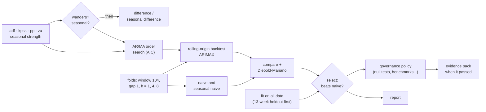
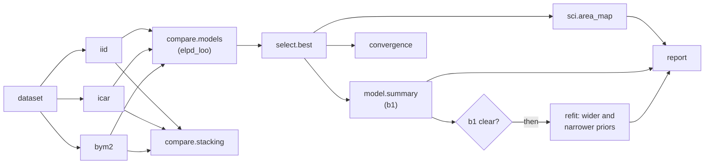
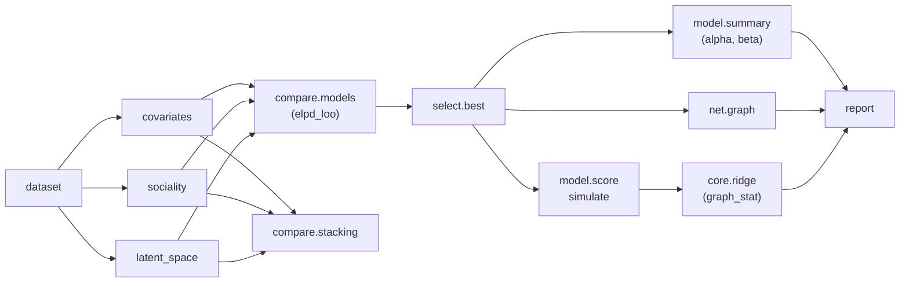

# Workflow cookbook <span class="mapi-badge">v0.5</span>

This page gives five complete analyses. Each analysis is one YAML document. You can save,
run and schedule it, and give it to a colleague. The tests of the documentation validate each
document on this page against the node catalog and run it from start to end. Thus the
documents that you copy operate correctly. For the format, see
[Workflows](../concepts/workflows.md). For all nodes, see the
[node reference](../reference/workflow-nodes.md). For short parts with one pattern each, see
the [workflows guide](workflows.md#cookbook).

| Recipe | The question it answers |
|---|---|
| [Is my weekly KPI ready to forecast?](#readiness-to-arimax) | Does the series need differencing? Which ARIMA orders are correct? Is ARIMAX better than a naive forecast on honest backtests? Can we use it? |
| [Do these series move together?](#varvecm-cointegration) | Do some series have a long-run relation (VECM), or a relation only in their changes (VAR)? Does one series help to predict a different series? |
| [Which forecasting model?](#forecast-bake-off) | Which of SARIMAX, ARIMA, ETS and Theta forecasts best on the same folds? Is the advantage of the winner more than chance? |
| [Which spatial model for a disease map?](#disease-map-which-spatial-model) | Do the areas share their risk with their neighbours (iid, ICAR or BYM2)? Does the effect of the covariate stay clear in the best model, also with different priors? |
| [Which model explains the ties of a network?](#network-ties-which-model) | Do shared traits explain the ties, or do the activity of each node and a hidden map also help? Can the best model make networks like the real network? |

## Readiness to ARIMAX

**In plain words.** Before you trust a forecast, you must know four things:

- If the series "wanders". If it does, you must model its changes, not its levels.
- How much of the past is important.
- If the model forecasts better than the obvious rule "next week is like this week".
- If the model found a real effect, not noise.

This workflow answers each question with the standard statistical tool. It records each
decision with the numbers that caused it. It keeps the model only if the model is better than
the benchmarks. It also records the governance evidence.

**For the statistician.** ADF, KPSS, Phillips-Perron and Zivot-Andrews (one endogenous break)
decide `d` with a conservative rule: difference the series unless the evidence for
stationarity is clear on the two sides. Seasonal strength (STL) decides `D`. The ARMA orders
come from a grid of information criteria over `p ≤ max_p`, `q ≤ max_q`. The workflow fits
each point as ARIMA(p, d, q) on the levels. Thus the model estimates `d`, and does not apply
it to data that is already differenced. The report shows ACF/PACF for the reader.

The backtest is a rolling origin with a fixed training window, a gap and some horizons. The
workflow scores ARIMAX and the naive and seasonal-naive benchmarks on the same folds. A
Diebold-Mariano test with the Harvey-Leybourne-Newbold correction tells if the difference in
squared errors at horizon 1 is significant. `select.best` keeps the model only if its MAE is
better than each benchmark in `must_beat`.



### The document

```yaml
--8<-- "cookbook_readiness_arimax.yaml"
```

Copy these three details into your own workflows:

- **Alternatives keep the graph honest.** `diff` reads `[sdiff.data, inputs.data]`. This is
  the seasonally differenced series if that node ran. If not, it is the raw series. `acf`
  uses the series with the most processing that exists. The workflow calculates nothing two
  times. If the workflow does not take a branch, nothing breaks: skipped nodes are
  *skipped*, not failed.
- **Decisions move as values.** `$expr: "[nodes.order.best_p, if(nodes.wanders.value, 1, 0), nodes.order.best_q]"`
  changes the search result and the branch decision into the `order` of the model. The
  server parses the expression language and never uses `eval` on it. The run records each
  value that it read.
- **The fit has its own holdout.** `split.holdout` keeps the last 13 weeks out of the first
  fit (`mode: evaluate_then_refit`). Thus the governance checks that need unseen data have
  it. These checks are the null tests, the naive benchmark and the holdout accuracy. Then the
  workflow fits the model again on all the data.

### Run it with the CLI

```bash
--8<-- "cli_v05.sh:workflow"
```

`mapi workflows init` writes the `ts_readiness_arimax` template of the gallery with your
name and project. This template is the same analysis with an expanding-window backtest. To
get the rolling origin and the evidence pack, save the document above as
`weekly-readiness.yaml` instead. `--watch` shows the status of each node during the run. On a
terminal, it draws the status again in the same place. In a log, it writes one line for each
change. At the end, it shows the summary.

The output below is from a real run on a local stack. It is the second run on this data. The
unit-root tests, the holdout split and the fit did not change after the first run. Thus the
run **used them again from its cache** and did not calculate them again (the output is
shortened):

```text
started workflow run run_01m53hawnnyn7cyeptj70cxkk0 of workflow://growth/weekly-readiness
following workflow run run_01m53hawnnyn7cyeptj70cxkk0 (23 nodes)
  run started
  adf cached
  kpss cached
  pp cached
  za cached
  seas cached
  folds queued
  holdout cached
  wanders took the then arm
  seasonal took the else arm
  sdiff skipped: branch 'seasonal' took the else path
  …
  backtest succeeded
  compare succeeded
  select succeeded
  dm succeeded
  governance succeeded
  trusted took the then arm
  pack succeeded
  run succeeded

 node       ┃ kind       ┃ status      ┃ took  ┃ found
━━━━━━━━━━━━╇━━━━━━━━━━━━╇━━━━━━━━━━━━━╇━━━━━━━╇━━━━━━━━━━━━━━━━━━━━━━━━━━━━━━━━━━━━━━━━━━━━━━━━━━━━━━
 adf        │ test       │ ✓ cached    │ 0.0s  │ The series wanders: consider differencing it. (cached
            │            │             │       │ from run_01m53h6m9np4gtfzvrkwrr4bh9)
 za         │ test       │ ✓ cached    │ 0.0s  │ The series wanders even allowing for one break:
            │            │             │       │ consider differencing it. (cached from …)
 seas       │ test       │ ✓ cached    │ 0.0s  │ No clear repeating pattern was found. (cached from …)
 wanders    │ branch     │ ✓ succeeded │ 0.0s  │ took the then arm
 order      │ search     │ ✓ succeeded │ 22.9s │ {"best_p": 1, "best_q": 1}
 sdiff      │ transform  │ – skipped   │ 0.0s  │ branch 'seasonal' took the else path
 dm         │ compare    │ ✓ succeeded │ 18.7s │ The difference between backtest and naive at
            │            │             │       │ horizon 1 is possibly luck.
 acf        │ test       │ ✓ succeeded │ 13.4s │ No past period is related to the present beyond
            │            │             │       │ chance.
 select     │ select     │ ✓ succeeded │ 0.0s  │ backtest has the best average error (1.78) and beats
            │            │             │       │ every benchmark (the strongest, naiv…
 governance │ governance │ ✓ succeeded │ 48.5s │ Every blocking check passed (7 check(s) ran);
            │            │             │       │ warnings on null.permutation_target, stabil…
 …
Decisions
 branch   ┃ arm  ┃ condition                                   ┃ read
━━━━━━━━━━╇━━━━━━╇━━━━━━━━━━━━━━━━━━━━━━━━━━━━━━━━━━━━━━━━━━━━━╇━━━━━━━━━━━━━━━━━━━━━━━━━━━━━━━━━
 wanders  │ then │ (not nodes.adf.reject or nodes.kpss.reject) │ {"nodes.pp.reject": false,
          │      │ and not (nodes.pp.reject and                │ "nodes.za.reject": false,
          │      │ nodes.za.reject)                            │ "nodes.adf.reject": false,
          │      │                                             │ "nodes.kpss.reject": true}
 seasonal │ else │ nodes.seas.seasonal                         │ {"nodes.seas.seasonal": false}
 trusted  │ then │ nodes.governance.passed                     │ {"nodes.governance.passed": true}
Outputs
 output   ┃ type          ┃ where
━━━━━━━━━━╇━━━━━━━━━━━━━━━╇━━━━━━━━━━━━━━━━━━━━━━━━━━━━━━━━━━━━━━━━━━━
 model    │ model_version │ model://growth/wf-weekly-readiness-fit@v1
 …
```

The full run took 1.6 minutes on a laptop. The live board goes to standard error, and the
summary goes to standard output. Thus `mapi workflows run … --watch > summary.txt` keeps only
the summary.

Then examine the results, download them and run the workflow automatically:

```bash
--8<-- "cli_v05.sh:inspect"
```

```bash
--8<-- "cli_v05.sh:automate"
```

### Run it with the Python client

Do these steps:

1. Validate the file on the server. The server saves nothing.
2. Make the workflow, or save a new revision.
3. Run the workflow.
4. Follow the live events.

```python
--8<-- "client_v05.py:validate"
```

```python
--8<-- "client_v05.py:run"
```

Read the results. They include the verdict of each test, each branch with the values that it
read, the selected orders and the Diebold-Mariano verdict. They also tell why the workflow
selected the model or did not select it:

```python
--8<-- "client_v05.py:inspect"
```

The governance node measured the selected model against the policy that applies. Because
`submit: true` is set, it recorded a validation of that model version:

```python
--8<-- "client_v05.py:governance"
```

This is the output on a live local stack, from the first run of the walkthrough on this data:

```text
passed
validated
data.quality                 pass    No data problems found (156 periods of history).
convergence                  pass    The fit reported no convergence problems.
baseline.beats_naive         pass    On the 13 held-out periods the model's error is 25% lower than 'same as last period' (the strongest simple benchmark).
holdout.accuracy             pass    On data it was not fitted on, the model's average percentage error is 1.8% (limit 15%).
residuals.whiteness          pass    No pattern is left in the errors (Ljung-Box p = 0.39 at 10 lags).
null.permutation_target      pass    The model did better on held-out data (skill 0.236) than all 20 fits with the drivers price shuffled in blocks of 7 (the result untouched) (p = 0.048).
stability.rolling_params     fail    ar.L1 changes a lot across windows of history (variation 1205%): the relationship may not be stable over time.
```

Read the output as a reviewer does. On unseen weeks, the model is 25% better than naive. Its
errors have no pattern. It forecasts better than each fit with the price driver shuffled in
time. But the AR coefficient is not stable across windows.

That check *failed*, but the version is still `validated`. The status of a check and its
severity are different things. The default forecast policy sets stability to *information*,
so the check does not block. The reviewer can see it in the record and in the evidence pack.
A stricter policy (see [governance](governance.md)) makes the check block. Then this model
needs more history or a simpler specification. This is the purpose: the evidence is written,
and the decision is explicit.

!!! note "What the shuffle test measures on a random walk"
    The model has a driver. Thus the test shuffles the driver in blocks and does not change
    the result. It scores each fit by its skill against the null forecast on the held-out
    weeks. Persistence ("next week is like this week") helps the shuffled fits exactly as much
    as it helps the real fit. Thus the test measures what the driver adds to persistence. For
    a model without drivers, the test uses shuffled changes of the series
    ([null tests explained](null-tests.md)).

Then keep the workflow up to date:

```python
--8<-- "client_v05.py:automate"
```

## VAR/VECM cointegration

**In plain words.** Some series wander but stay together. Examples are the prices of close
substitutes, sales and distribution, and income and consumption. If they have a relation, a
model that knows the relation (an error-correction model) forecasts better. It also tells you
how fast a gap closes. If they do not have a relation, model their changes. In the two cases,
find out if one series helps to predict a different series.

**For the statistician.** The Johansen trace test (at 5%) on the levels decides the branch.
If the series have a relation, `search.coint_rank` selects the rank. Then the workflow fits a
VECM with `k_ar_diff: 1` on the levels. If the series do not have a relation, the workflow
differences them. Then AIC selects the VAR lag order up to `maxlags`, and the workflow fits a
VAR on the changes. If the workflow took the changes (the first alternative), it tests Granger
causality on them. If not, it tests on the levels. The forecast node uses the model that
exists, with the related data.

```yaml
--8<-- "cookbook_var_vecm.yaml"
```

The data keeps the series along one dimension, with one value for each series and period
(`value(series, quarter)`). This is the layout of `ts.var` and `ts.vecm`. To ingest a wide
sheet, use the `wide` mapping. Run the workflow as the first recipe, with the two parameters
that it needs:

```bash
mapi workflows apply macro-system.yaml
mapi workflows run macro-system -i data=dataset://growth/us_macro@latest \
  -p target=realcons -p driver=realgdp --watch
```

```python
run = api.workflows.run(
    wf.id,
    inputs={"data": "dataset://growth/us_macro@latest"},
    params={"target": "realcons", "driver": "realgdp", "maxlags": 4},
    wait=True,
)
nodes = {n.node_id: n for n in run.nodes}
print(nodes["johansen"].result["verdict_plain"])  # "The series share at least one long-run relationship."
print(nodes["granger"].result["verdict_plain"])   # "Past values of the driver help predict the result."
print([n.node_id for n in run.nodes if n.status.value == "skipped"])  # the branch not taken
```

A run on a laptop used three simulated weekly series. Two of the series have the same
stochastic trend (`target=a`, `driver=b`). The run printed the two verdicts above and
`['diff', 'lags', 'var']`. The Johansen trace statistic (69.1) set the rank to 1, and the VECM
branch ran. Granger found that `b` helps to predict `a` (p = 0.0015). See
[Macro and VAR analysis](../use-cases.md#macro-and-var-analysis).

The [Model Explorer](model-explorer.md) shows the impulse responses, the variance
decomposition, the Granger table and the Johansen table of the fitted model
(`mapi explore model … -s irf -s fevd`).

## Forecast bake-off

**In plain words.** If you do not know which forecast method is correct for your data, let
the methods compete fairly. They use the same history, the same cut-off points, the same
horizons and the same naive benchmarks. Keep the winner only if it is clearly better than a
simple method.

**For the statistician.** The plan is an expanding window with `n_folds` origins, one each 4
periods. The workflow scores each horizon. SARIMAX(1,1,1)(0,1,0)₅₂, ARIMA(0,1,1),
damped-trend ETS and Theta compete against naive, seasonal-naive and drift. MASE puts them in
sequence. MASE has no scale, so you can compare series of different sizes. Two
Diebold-Mariano tests (absolute loss, horizon 1) compare the leaders with the benchmark.
`select.best` needs a 5% MASE improvement over each benchmark. Only then does the branch fit
the winner again.

```yaml
--8<-- "cookbook_forecast_bakeoff.yaml"
```

```bash
mapi workflows apply forecast-bakeoff.yaml
mapi workflows run forecast-bakeoff -i data=dataset://growth/weekly_sales@latest \
  -p 'horizons=[1,4]' -p n_folds=6 --watch
mapi workflows node "$RUN" compare      # the league table
mapi workflows node "$RUN" best         # who won, and whether they beat naive by 5%
```

On a short series with much noise, the usual result is the honest result: *"ets is the best
model (0.0456) but does not beat naive.drift by the required 5%: no model is selected."* The
workflow skips the `refit` node, and the report tells why. Thus nobody ships a model that only
looks clever.

## Disease map: which spatial model?

**In plain words.** A disease map shows the risk in each area, for example in each district.
Small areas have few cases, so their raw rates have much noise. A model can let adjacent areas
share their risk. This makes the estimates of small areas more stable. But is this correct for
your data? And does it change your answer about a cause, for example the percentage of people
who work outdoors?

This workflow fits three models, from independent areas to areas that share their risk. Then it keeps the model that predicts best. It tells you if
the effect of the covariate is clear, and if the effect stays clear with different priors.

**For the statistician.** Each rung is `sci.areal_bym2`, Poisson(E exp(b0 + b1 x + u)), on all
the data. The area effects u are `iid`, `icar` or `bym2`. Each fit keeps the pointwise PSIS-LOO
values (`evaluate: {metrics: [elpd_loo]}`), so the rungs are scored on the same areas.
`compare.models` ranks them by `elpd_loo`. `compare.stacking` gives the stacking weights (Yao
et al. 2018). `select.best` keeps the rung with the largest `elpd_loo`. `model.summary` gives
the HDI of b1 (`hdi_prob`). If the HDI excludes zero, the workflow fits the winner again with
the prior widths of b0, b1 and sigma multiplied and divided by `prior_scale`.



### The document

```yaml
--8<-- "cookbook_sci_spatial_ladder.yaml"
```

The document is the `sci_spatial_ladder` template of the gallery. A test makes sure that the
two stay the same. Copy these three details into your own workflows:

- **The winner sets the next fit.** `kind: {$expr: nodes.best.selected}` gives the id of the
  winner (`iid`, `icar` or `bym2`) to the refits. The id of each rung is also its `kind`.
- **One fit configuration for all rungs.** The YAML anchor `&fit` gives the same draws, chains
  and seed to each rung. Thus the rungs differ only in their area effects.
- **The workflow writes the priors out.** `governance.check` with `sensitivity.prior` finds
  only prior widths with names such as `prior_sigma`. The prior widths of `sci.areal_bym2` are
  `intercept_sd`, `slope_sd` and `sigma_scale`. Thus the workflow fits the model again with
  these widths, and `model.summary` shows the effect for each fit.

### Get the data

The workflow needs counts, expected counts, one covariate, an adjacency matrix and the outline
of each area. The `e18` export makes this dataset from the Scottish lip cancer data of
pymc-challenges. See [Export the data of a case study](../reference/models.md#export-the-data-of-a-case-study).

```bash
python -m mapi_plugin_science.export e18 --challenges ~/pymc-challenges/data --out scotland.nc
mapi datasets upload scotland.nc --name scotland_lip_cancer
```

If your names are different, give them in the `bind` parameter. For example,
`-p 'bind={"dims": {"area": "county", "area_": "county_"}, "vars": {"covariate": "smokers"}}'`.

### Run it with the CLI

```bash
mapi workflows init sci_spatial_ladder --name disease-map-ladder   # writes disease-map-ladder.yaml
mapi workflows apply disease-map-ladder.yaml
mapi workflows run disease-map-ladder \
  -i data=dataset://epidemiology/scotland_lip_cancer@latest -p engine=nutpie --watch
RUN=$(mapi --json workflows runs disease-map-ladder -n 1 | jq -r '.[0].run_id')
mapi workflows node "$RUN" compare    # the rungs, best first
mapi workflows node "$RUN" weights    # the stacking weights
mapi workflows node "$RUN" clear      # is the covariate effect clear?
```

The defaults fit 4 chains of 1000 draws after 1000 warm-up steps. To get a fast first look,
use `-p draws=300 -p tune=300`. Then do the full run before you use the results.

### Run it with the Python client

```python
from mapi_client import Client

api = Client()
workflow = api.workflows.create(template="sci_spatial_ladder")
run = api.workflows.run(
    workflow.id,
    inputs={"data": "dataset://epidemiology/scotland_lip_cancer@latest"},
    params={"engine": "nutpie"},
    wait=True,
)
nodes = {n.node_id: n for n in run.nodes}
print(nodes["compare"].result["ranking"])  # for example ['bym2', 'icar', 'iid']
print(nodes["weights"].result["weights"])  # the stacking weight of each rung
print(nodes["clear"].result["arm"])        # then: the effect is clear
for fit in ("effect", "effect_wide", "effect_narrow"):  # skipped when the effect is not clear
    if nodes[fit].result:
        print(fit, nodes[fit].result["params"]["b1"])
```

On a laptop, `LocalRunner` runs the same document in-process. Use the science registry, so
that the runner knows the `sci.*` models:

```python
from mapi_plugin_science.areal_data import areal_dataset
from mapi_spec.workflow_templates import instantiate_template
from mapi_workflows.runtime.local import LocalRunner
from mapi_workflows.testing import science_registry

spec = instantiate_template("sci_spatial_ladder", name="disease-map", project="epidemiology")
res = LocalRunner(registry=science_registry()).run(
    spec, inputs={"data": areal_dataset()}, params={"draws": 500, "tune": 500}
)
print(res.node("best").result["reason_plain"])
```

### Read the outputs

| Output | Node | What it tells you |
|---|---|---|
| `comparison` | `compare` | The rungs from the best `elpd_loo` to the worst. A difference of less than about two standard errors is not clear. |
| `weights` | `weights` | The stacking weights. A weight near 1 shows that one rung predicts best on almost all areas. Weights that are spread show that a mix of rungs predicts better than one rung. |
| `effect` | `effect` | The mean, the HDI, R-hat and the bulk ESS of b0, b1 and sigma in the best rung. b1 is the change in the log risk for one `covariate_scale` (10 units) of the covariate. |
| (decision) | `clear` | `then` if the HDI of b1 excludes zero. The report gives the reason in plain words. |
| (tables) | `effect_wide`, `effect_narrow` | b1 with wider and narrower priors. If the two HDIs also exclude zero, the effect comes from the data, not from the priors. |
| `convergence` | `converged` | The largest R-hat of the best rung. A `fail` tells you to fit with more draws or more warm-up steps. |
| `map` | `map` | The mean and the sd of the relative risk of each area, and the probability that it is above 1. |
| `report` | `report` | All the tables, the decision and the map, with a summary in plain words. |

On the Scottish data, the E18 notebook gets b1 = 0.67 with independent areas, 0.37 with ICAR
and 0.40 with BYM2. Thus, when the neighbours share their risk, the effect of outdoor work
becomes smaller, but it stays clear.

## Network ties: which model?

**In plain words.** In a network, some pairs of nodes have a tie, for example two lawyers who
work together. Shared traits can explain the ties: two lawyers in the same office work
together more often. But some lawyers work with many colleagues, and groups form for other
reasons.

This workflow fits three models of the ties. The first model uses only the shared
traits. The second model adds the activity of each node. The third model adds a hidden map of
the group. The workflow keeps the model that predicts best. Then it simulates new networks
from that model, so that you can compare them with the real network.

**For the statistician.** Each rung is `sci.network_latent_space`, a Bernoulli-logit model of
the pairs i < j. `covariates` uses alpha + x β. `sociality` adds s_i + s_j. `latent_space` also
subtracts the distance ‖z_i − z_j‖ between Procrustes-aligned positions. The log-likelihood is
over the observed pairs, in the same order for each rung. Thus `elpd_loo` is
leave-one-pair-out, and `compare.stacking` can weigh the rungs. `model.score` in `simulate`
mode draws whole graphs from the best rung. It gives `graph_stat(statistic)` for each graph:
density, sd and maximum of the degree, isolates, triangles, transitivity, ties without shared
partners (`esp0`), mean geodesic and the share of unreachable pairs.



### The document

```yaml
--8<-- "cookbook_sci_network_ladder.yaml"
```

The document is the `sci_network_ladder` template of the gallery. Two details are important:

- **The YAML merge key keeps the rungs the same.** `settings: {<<: *rung, kind: sociality}`
  changes only `kind`. The rungs use the same `node_groups` and `latent_dims`.
- **`group: draws` keeps `n_sims` graphs.** The score request asks for `n_sims` draws
  (`output.draws`). The node outputs these draws, not all the posterior draws.

### Get the data

The workflow needs a symmetric table of ties, the pair values and (optional) a group code for
each node. The `e21` export makes this dataset from the law firm data of pymc-challenges
(71 lawyers).

```bash
python -m mapi_plugin_science.export e21 --challenges ~/pymc-challenges/data --out lazega.nc
mapi datasets upload lazega.nc --name lazega_coworkers
```

If your dataset has no group code, use `-p node_groups=false` and remove `node_group` from the
`bind` parameter.

### Run it with the CLI

```bash
mapi workflows init sci_network_ladder --name coworker-ladder   # writes coworker-ladder.yaml
mapi workflows apply coworker-ladder.yaml
mapi workflows run coworker-ladder \
  -i data=dataset://sociology/lazega_coworkers@latest -p engine=nutpie --watch
RUN=$(mapi --json workflows runs coworker-ladder -n 1 | jq -r '.[0].run_id')
mapi workflows node "$RUN" compare    # the rungs, best first
mapi workflows node "$RUN" effects    # alpha and beta[...] of the best rung
mapi workflows output "$RUN" simulate scores --out graph_stats.zarr.zip
```

### Run it with the Python client

```python
from mapi_client import Client

api = Client()
workflow = api.workflows.create(template="sci_network_ladder")
run = api.workflows.run(
    workflow.id,
    inputs={"data": "dataset://sociology/lazega_coworkers@latest"},
    params={"engine": "nutpie", "n_sims": 1000},
    wait=True,
)
nodes = {n.node_id: n for n in run.nodes}
print(nodes["best"].result["reason_plain"])
print(nodes["effects"].result["params"]["beta[same_office]"])
print(nodes["simulate"].result)  # mode, group and the variables of the simulated networks
```

### Read the outputs

| Output | Node | What it tells you |
|---|---|---|
| `comparison` | `compare` | The rungs from the best `elpd_loo` to the worst |
| `weights` | `weights` | The stacking weights of the rungs |
| `effects` | `effects` | alpha and each pair effect `beta[<pair value>]` of the best rung, with the HDI. A positive effect makes a tie more probable. |
| `graph` | `graph` | The network with the tie probabilities of the best rung (a graph and a matrix) |
| `simulations` | `simulate` | `graph_stat(statistic)` of each simulated network |
| `ppc` | `ppc` | The spread of the density and the transitivity of the simulated networks |
| `report` | `report` | All the tables and the two plots, with a summary in plain words |

Compare the spread in the `ppc` plot with the statistics of your network. If the value of
your network is far from the spread, the model does not make networks like yours. On the law
firm data, the E21 notebook gets `elpd_loo` −894.2 with covariates only, −763.4 with
sociality and −761.6 with the latent space.

## Make your own

1. Start from the recipe that is nearest to your analysis. Use
   `mapi workflows init <template>`, or copy a document above.
2. Find nodes with `mapi workflows nodes-catalog --kind test`. To see the About card, ports
   and parameters of one node, use `--about test.kpss`.
3. Validate the document after each change. Before anything runs,
   `mapi workflows validate my.yaml` shows each problem with a JSON pointer.
4. Save the workflow (`apply`).
5. Run the workflow with `--watch`.
6. Read the summary.
7. Add a schedule or a dataset trigger to run the workflow automatically.
8. Add a governance gate to the workflow.
