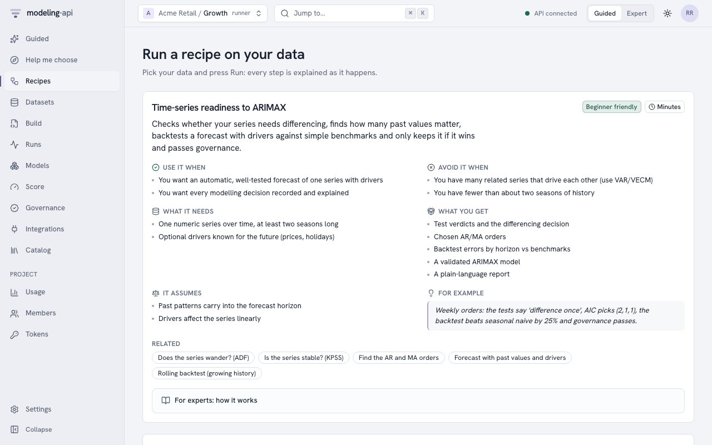
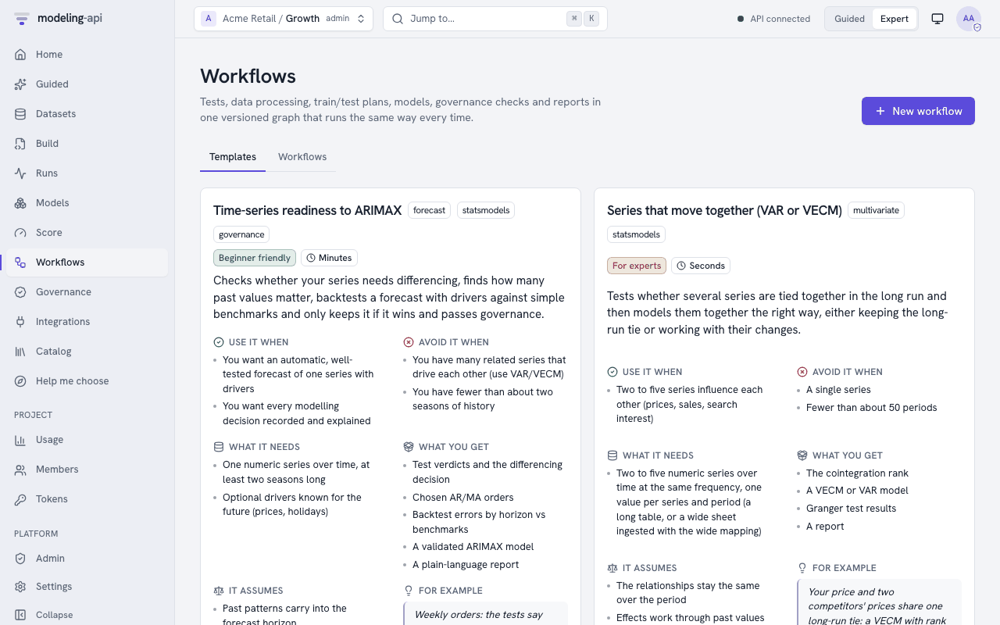
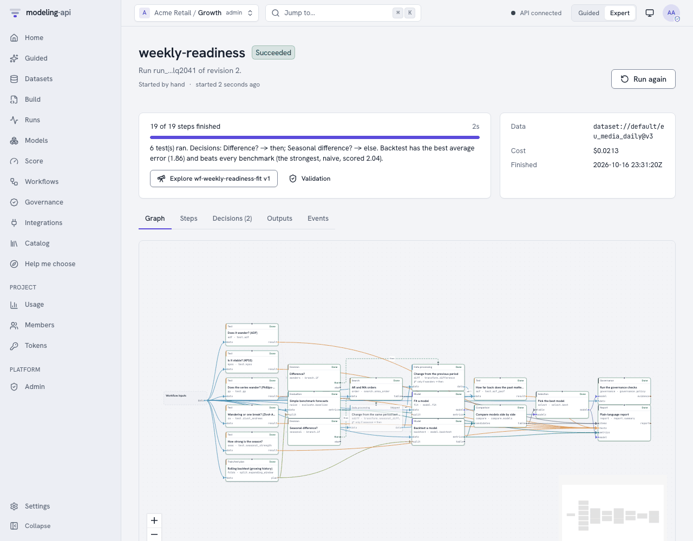
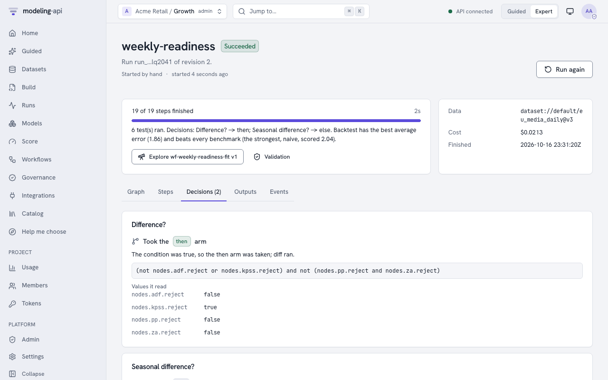
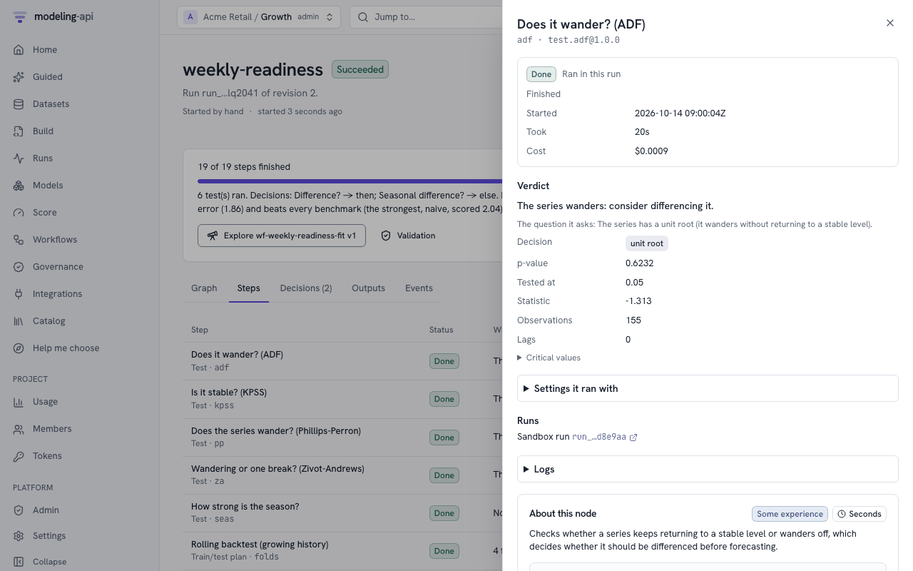
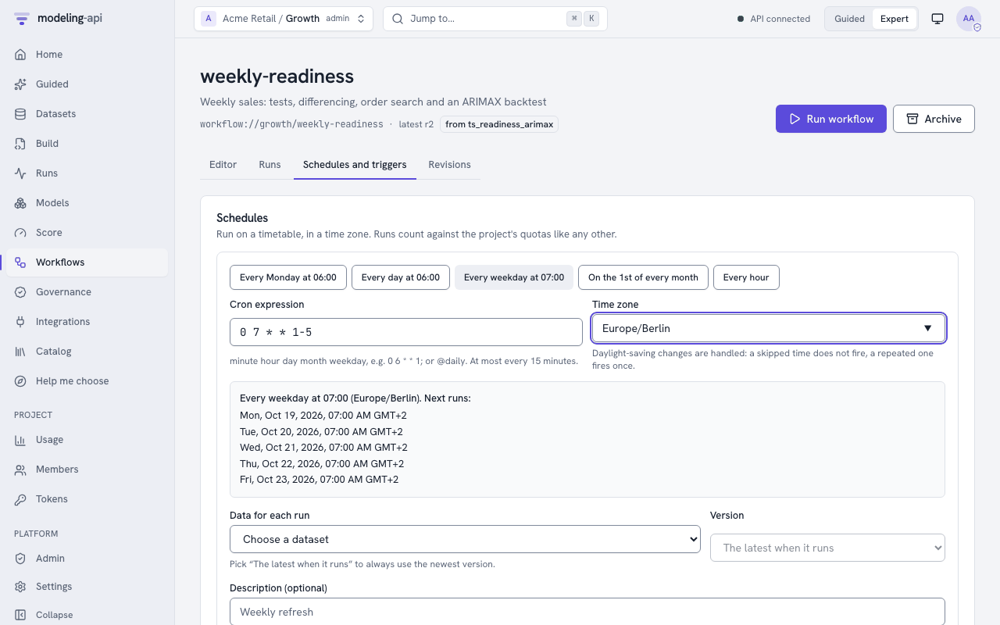

# Workflows <span class="mapi-badge">v0.5</span>

A workflow connects statistical tests, data processing, train/test plans, models, governance
checks and reports into one graph. The graph runs the same way each time. This guide gives
the practical information:

- How to start from the gallery.
- The canonical "readiness → ARIMAX" document, line by line.
- A cookbook of patterns.
- Where each node runs.
- How to schedule runs and how to monitor them.

The [Workflows concept page](../concepts/workflows.md) gives the full data about the document
format, the condition language and the validation. The
[node reference](../reference/workflow-nodes.md) lists all nodes with their About cards,
ports, parameters and result fields.

| You want to | Go to |
|---|---|
| Run an analysis that is ready to use | [Start from the gallery](#start-from-the-gallery) |
| Build, run and monitor workflows in the browser | [In the web app](#in-the-web-app) |
| Understand the canonical example | [The canonical workflow](#the-canonical-workflow) |
| Build your own workflow | [Cookbook](#cookbook) |
| Know what runs where and what it costs | [Where nodes run](#where-nodes-run) |
| Run it automatically | [Schedules and triggers](#schedules-and-triggers) |
| Try it in a notebook without a server | [Run it locally](#run-it-locally) |
| Copy a complete analysis that has tests | [Workflow cookbook](workflow-cookbook.md) |
| Control it from Python or a terminal | `api.workflows` ([client](python-client.md#workflows-governance-and-explorers)), `mapi workflows` ([CLI](cli.md#workflows-governance-and-explorers)) |

## Start from the gallery

The gallery has four templates. Each template has an About card in plain language
(`GET /v1/workflow-templates`):

| Template | Select it when |
|---|---|
| `ts_readiness_arimax` | You have one weekly or daily KPI and you want an ARIMAX forecast that you can defend. The tests decide the differencing. A search selects the AR and MA orders. A backtest shows that the model is better than naive forecasts. |
| `var_vecm_cointegration` | Some series move together (for example sales, price and distribution). You want to know if they have a long-run relation before you select a VECM or a VAR. |
| `mmm_governed` | You need a marketing mix model that must pass the governance policy before a person uses it. |
| `forecast_bakeoff` | You do not know which forecast model is correct for the data. SARIMAX, ETS, Theta and a smooth trend compete on the same folds. |

When you make a workflow from a template, the server copies the template document into your
project as revision 1. After that, the workflow is yours and you can edit it.

```bash
# create it (the name and project come from the request's project)
api POST /v1/workflows -d '{"template": "ts_readiness_arimax"}' | jq '{id, ref, latest_revision}'

# run it on the latest version of a dataset, overriding a few parameters
api POST "/v1/workflows/$WF/runs" -H "Idempotency-Key: $(uuidgen)" -d '{
  "inputs": {"data": "dataset://growth/weekly_sales@latest"},
  "params": {"drivers": ["price"], "n_folds": 4, "gap": 1, "horizons": [1, 4, 8]}
}' | jq '{run_id, status}'

# follow it: each node, each branch decision, then the result
api GET "/v1/workflow-runs/$RUN" | jq '.nodes[] | {node_id, status, result}'
```

`api` is the helper of the [HTTP API guide](http-api.md). It adds the token and the project
header. To do the same from the command line, use `mapi workflows create --template
ts_readiness_arimax`, then `mapi workflows run ts-readiness-arimax -i
data=dataset://growth/weekly_sales@latest -p 'drivers=["price"]' --watch`. From Python, use
`api.workflows.create(template="ts_readiness_arimax")` and `api.workflows.run(...)`. The
server resolves `@latest` when the run starts and records it as an exact version. Thus you
can make the run again with the same result: `GET /v1/workflow-runs/{run_id}` shows
`dataset://growth/weekly_sales@v7`.

When you start a run, the server answers `202` with the view of the run. If you start a run
with an `Idempotency-Key` that you used before, the server returns the first run (`200`). It
does not start a different run.

## In the web app

To open the workflows of the project and the gallery, click **Workflows** in the sidebar
(++g++ then ++w++). All the functions below use the same endpoints as the remaining part of
this guide.

### Recipes for Guided users

In Guided mode, the sidebar item shows **Recipes**, and the page opens on the recipes. The
recipes are the gallery templates as About cards. Each card tells in plain words:

- What the recipe does.
- When to use it and when not to use it.
- What it needs and what it gives.
- A very small example.

**Run on my data** asks for a dataset. It also asks for the settings that the recipe cannot
guess, but only when the recipe needs them (for example, the drivers of the marketing-mix
recipe). The other settings are under *Fine-tune*. The first run makes the workflow of the
project from the template. Subsequent runs use that workflow again. The Data Explorer of
data over time shows the readiness recipe with that data already selected (*Check it is ready
to forecast*). Then the run page shows each step in plain words when the step is complete. It
also shows the decisions and the summary of the report.

{ .mapi-shot }

### Start from a template (Expert)

**Use this template** opens a wizard that has three steps:

1. The About card of the template and the name of the workflow.
2. The parameters. The app saves them as the defaults of the workflow. Each run can change
   them.
3. The default data for the run. The app saves it as the default reference of the input.
   Schedules use it, and runs that start without data use it.

The app makes the workflow as revision 1.

{ .mapi-shot }

### The editor

The **Editor** tab of a workflow has three panes. On wide screens the panes are side by side.
On narrow screens they are one above the other.

{ .mapi-shot }

| Pane | What it does |
|---|---|
| **Nodes** (the palette) | Shows all nodes of `GET /v1/catalog/workflow-nodes` in groups by kind. Each kind and each node has its About card. You can search by name, by id or by purpose. To add a node, drag it onto the canvas. Or, select it and push **Add** (this is the keyboard method). |
| **Canvas** | Shows the graph. The color of a data edge shows the port type. If a port has alternatives, the edges have numbers (*alt 1*, *alt 2*). Dashed edges go from the **then**/**else** arm of a branch to the top edge of the nodes that the arm controls. Dotted edges show results that a condition or `$expr` reads. To bind an output to an input, drag from the output to the input. The canvas refuses an edge between ports of different types, a node that feeds itself and a cycle. It shows the reason above the canvas. To remove a node or an edge, select it and push ++delete++. Each node shows the number of problems that it has. Your browser keeps the node positions, and only your browser keeps them (**Tidy layout** removes them). The document never keeps them. |
| **Node editor** | Shows the selected node: its About card, its id and label, and each input port with its type and its sources in sequence. You can add a source, change the sequence of alternatives and disconnect a source. It also shows the branch arm that controls the node (**When it runs**). It shows the settings: a form that the app makes from the JSON Schema of the node. Each field can also use a workflow **parameter** or an **expression**. Then it shows how the node runs: retries, time limit, failure handling and caching. A model node selects its model from the catalog, with the About card of the model. `governance.check` selects a check. `subworkflow.run` selects a saved workflow and revision. The inputs and outputs of that workflow become the ports of the node. If you select no node, the pane edits the description, parameters, inputs, outputs and run limits of the workflow. |

A **branch** node has a condition editor. Write the condition. Insert results of upstream
nodes (`nodes.adf.reject`) or parameters from the list. The server does a check of the
condition while you type (`POST /v1/workflows:validate`, with the issue at
`/nodes/<i>/with/condition`). The browser never calculates a condition.

**YAML** and **JSON** show the same document in the code editor. Markers show the problems
that the server found. When the text is a correct workflow, an edit there updates the canvas
immediately. Until then, the canvas keeps the last version that it could read and tells why.
The app does a check of each change immediately. The status shows *Ready to run* or
*N problems*. The **Problems** list goes to the node of each problem.

Undo and redo operate across all three views. **Save revision** (++cmd+s++) saves the next
revision with a message. The app also saves a revision that has problems, but that revision
cannot run. If a different person saved a newer revision in the meantime, the app refuses the
save and keeps your draft. **Revisions** lists all revisions with their verdicts. You can
open a revision in the editor or compare two revisions side by side.

### Running and watching

**Run workflow** binds the inputs. An input is a dataset from the project: the latest version
at the time of the run, or an exact version. You can change the parameters for this run only.
The app starts the run with an `Idempotency-Key`. The run page follows
`GET /v1/workflow-runs/{run_id}/events` live. If the connection stops, the page continues
with `Last-Event-ID`. The run page has these tabs:

- **Graph**: the canvas with the status of each node (waiting, queued, running, done, reused,
  skipped, failed, cancelled).
- **Steps**: each node in plain words. It shows the verdict and the meaning of a decision
  ("The tests found that the series wanders ..., so it was differenced"). It also shows why
  the run did not need a node, and how long the node took. A comparison or a selection
  identifies its candidates by their step labels ("ARIMAX").
- **Decisions**: the plain explanation of each branch and the steps that it ran or skipped.
  It also shows the verdicts of the earlier steps that it read ("What decided it"). Under
  *For experts: the condition*, it shows the expression and the values that it read. This
  section is open in Expert mode and closed in a Guided recipe.
- **Outputs** and **Events**: the outputs of the run (the app shows the report) and the event
  log.

{ .mapi-shot }

{ .mapi-shot }

To open the drawer of a step, select the step. The drawer shows:

- If the step ran or used an earlier result again. If it used an earlier result, a link goes
  to the run that made that result.
- The test verdict: the statistic, the p-value and the decision. For panels, it shows them
  for each series.
- The outputs: tables, scores, train/test folds, reports, governance evidence, charts in the
  plot sandbox, and a download for file outputs (for example, derived datasets).
- The settings of the step.
- Its sandbox run, its fits or its child workflow runs, with their logs.
- Its cost.

**Cancel run** stops a workflow that runs and its children. When the run stops, the app shows
the cost of the run.

{ .mapi-shot }

You can open a model that the run fitted in the
[Model Explorer](model-explorer.md#in-the-web-app). The link **Explore *name* vN** is in these
locations:

- Below the summary of the run, when the run is successful.
- Next to the runs of the fit step.
- On each `model_version` output.

The link has a **Validation** link to the validations of that version. The lineage in the
Model Explorer has a link back to this run.

### Schedules and triggers in the app

**Schedules and triggers** adds a schedule from presets or from a cron expression, in a time
zone. It shows the next five run times exactly as the server calculates them. It skips
daylight-saving gaps, and it fires repeated times only once. If an expression fires more
frequently than each 15 minutes, the app refuses it before it sends it. You can pause and
delete schedules. A **trigger** runs the workflow each time a selected dataset gets a new
version. The trigger binds the dataset to one of the dataset inputs and runs after a
debounce.

{ .mapi-shot }

## The canonical workflow

This is the `ts_readiness_arimax` template exactly as the server keeps it. The docs build
makes sure that the two are identical:

```yaml
--8<-- "workflow_ts_readiness_arimax.yaml"
```

This list explains the document from the top:

`params`
:   All values that a user can change for each run. Each value has a type, a default and
    limits. If a run sends `{"alpha": "x"}`, the server refuses it with `422` and the pointer
    `/params/alpha`. The server also refuses a number that is more than 1e15 or less than
    -1e15, because conditions and `$expr` calculate with parameters.

`seas`, `seasonal` and `sdiff`
:   The seasonal decision is first (as `nsdiffs` is before `ndiffs`). The seasonal strength
    of the raw series decides if the workflow takes a seasonal difference. The seasonal
    difference runs only on the `then` arm of `seasonal`. If the workflow does not take the
    arm, the node is **skipped**. It is not failed.

`adf`, `kpss`, `pp`, `za`
:   Four unit-root tests on the seasonally differenced series. If there is no seasonal
    difference, the tests use the raw series. `data: [sdiff.data, inputs.data]` is a list of
    **alternatives**: the workflow uses the first node that ran. A test of the raw levels of
    a seasonal series finds the seasonal unit root. Thus it adds a first difference on top
    of the seasonal difference, and the series gets too much differencing.
    The null hypothesis of ADF and Phillips-Perron is "the series wanders". The null
    hypothesis of KPSS is "the series is stable", so its decision labels go in the opposite
    direction. Zivot-Andrews accepts one structural break. Each test returns a
    `StatTestResult` with a `verdict_plain` sentence.

`cand` and `overdiff`
:   A guard against too much differencing: a trial first difference and its
    autocorrelations. If the lag-1 autocorrelation is less than -0.5 after differencing, it
    shows a unit root that does not exist.

`wanders` (`branch.if`)
:   `(not nodes.adf.reject or nodes.kpss.reject) and not (nodes.pp.reject and nodes.za.reject)
    and nodes.overdiff.acf[1] > -0.5` means this: difference the series unless the evidence
    for stationarity is clear. Never difference when differencing gives too much
    differencing. The safe expression language parses the condition (it never uses `eval`).
    The run records which values it read, so you can audit the decision later.

`diff`
:   The first difference of the same alternatives, on the `then` arm of `wanders`. `acf`
    uses three alternatives, so it always uses the series that has the most processing.

`order` (`search.arma_order`)
:   A grid of information criteria over AR orders `0..max_p` and MA orders `0..max_q`.
    `d` and `D` give the differencing decisions to the search. Thus the search scores
    exactly the model that the workflow fits: ARIMA(p, d, q)(0, D, 0) with the season length,
    on the raw series. The `split` port has the plan of the backtest. With this plan, the
    search uses only the periods before the first test window. Thus the backtest stays out
    of sample.

`folds` (`split.expanding_window`)
:   An expanding-window plan. It has `n_folds` origins, with `step: 4` periods between them.
    It has a `gap` between the training and the test, for data that arrives late. It scores
    each horizon in `horizons` separately. The server calculates the folds from the number of
    periods only.

`backtest` and `naive`
:   The workflow fits the ARIMAX model again on each fold. It also makes naive and
    seasonal-naive forecasts on the **same** folds. `$expr` makes the `settings` from
    upstream results.

`compare`, `fit`, `select`
:   `compare.models` puts the candidates in sequence by MAE. `select.best` keeps the fitted
    ARIMAX only if it is better than each benchmark in `must_beat` (here `naive`) by at least
    `margin`. If not, the workflow stops with a plain explanation (`reason_plain`).

`governance`
:   Runs the governance policy that applies to the project and makes an evidence record. The
    policy includes null tests, residual checks, stability and other checks (see
    [Governance](../concepts/governance.md)). The result shows `passed` and lists
    `failed_checks`. The report shows the two. The
    [gate recipe](#gate-on-governance-and-keep-the-evidence) stops a workflow on a failure.

`report` and `outputs`
:   A `mapi.report/v1` document with a section for each test, decision, table and metric.
    `outputs` gives the names of the values that the run returns. A parent workflow can read
    these values.

## Cookbook

Each recipe is a part of `nodes:`. Paste it into a document that declares
`inputs: {data: {type: dataset}}`. Before you save, validate the document with
`POST /v1/workflows:validate`. The server returns each problem with a JSON pointer.

### Difference only when the tests say so

```yaml
- {id: adf, use: test.adf, inputs: {data: inputs.data}}
- {id: kpss, use: test.kpss, inputs: {data: inputs.data}}
- id: wanders
  use: branch.if
  with:
    condition: "not nodes.adf.reject or nodes.kpss.reject"
    # optional: what each path means, for the run report and the run monitor
    explain_then: The tests found that the series wanders, so it was differenced.
    explain_else: The tests found that the series is steady, so it was used as it is.
- {id: diff, use: transform.difference, inputs: {data: inputs.data}, when: wanders.then}
# downstream nodes take the differenced series if it exists, else the original
- {id: lb, use: test.ljung_box, inputs: {data: [diff.data, inputs.data]}}
```

The run records `explain_then` and `explain_else` (each has a maximum of 300 characters)
with the decision (`BranchDecision.explain_plain`). They are the first part of the summary of
the report. Without them, the summary shows "Difference? yes". The gallery templates set the
two values.

If a node needs `diff.data` *without* an alternative, the workflow skips that node together
with `diff`. To run a node only when the workflow did not change the series, add
`when: wanders.else` to the node.

### Pick AR and MA terms

```yaml
- {id: acf, use: test.acf_pacf, inputs: {data: [diff.data, inputs.data]}, with: {max_order: 4}}
- id: order
  use: search.arma_order
  inputs: {data: inputs.data}
  with: {d: {$expr: "if(nodes.wanders.value, 1, 0)"}, max_p: 4, max_q: 4, criterion: bic}
- id: fit
  use: model.fit
  inputs: {data: inputs.data}
  with:
    model: ts.sarimax@^1
    settings:
      order: {$expr: "[nodes.order.best_p, if(nodes.wanders.value, 1, 0), nodes.order.best_q]"}
```

`acf` gives possible orders from the significant autocorrelations (`suggested_p`,
`suggested_q`). Its result is fast to read. `search.arma_order` fits each candidate, and the
model must use its result. `search.sarima_order` adds seasonal orders.
`search.var_lag_order` selects the lag length of a VAR. `search.coint_rank` selects the
cointegration rank of a VECM.

### Honest train/test plans

```yaml
# 6 expanding folds, 2 periods between training and test, horizons 1, 4 and 13
- id: folds
  use: split.expanding_window
  inputs: {data: inputs.data}
  with: {n_folds: 6, step: 4, gap: 2, horizons: [1, 4, 13]}

# tune on the inner folds of each outer training window, score on the outer test windows
- id: nested
  use: split.nested
  inputs: {data: inputs.data}
  with:
    outer: {kind: expanding_window, n_folds: 4, horizons: [4]}
    inner: {kind: rolling_origin, n_folds: 3, window: 52, horizons: [4]}

# hold out whole markets (MMM, geo experiments)
- {id: geo, use: split.geo_holdout, inputs: {data: inputs.data}, with: {n: 2, seed: 7}}
```

`split.blocked_kfold` and `split.purged_kfold` cut continuous blocks (with a purge gap) for
models that do not forecast. A plan is a `split_plan` value. Give the same plan to each
`model.backtest`, `evaluate.baseline` and `search.grid` node that you want to compare.

If `search.grid` gets a `split.nested` plan, it does nested cross-validation. Each outer fold
selects its grid point on its own inner folds. The node fits that point again on the outer
training window and scores it on the outer test window. `best_score` is the score of those
outer forecasts (the honest error of the tuned model). `outer_scores` and
`selected_per_fold` show each fold. `best_settings` is the point that the outer folds
selected most frequently. `model.backtest` on a nested plan scores its outer folds.

### Beat the benchmarks, or stop

```yaml
- {id: naive, use: evaluate.baseline, inputs: {data: inputs.data, split: folds.plan},
   with: {methods: [naive, seasonal_naive, drift], season: 52}}
- {id: bt, use: model.backtest, inputs: {data: inputs.data, split: folds.plan},
   with: {model: ts.sarimax@^1, settings: {order: [1, 1, 1]}}}
- {id: compare, use: compare.models, inputs: {candidates: [bt.metrics, naive.metrics]},
   with: {metric: mase}}
- {id: dm, use: compare.diebold_mariano, inputs: {a: bt.metrics, b: naive.metrics},
   with: {loss: squared, horizon: 4}}
- {id: fit, use: model.fit, inputs: {data: inputs.data},
   with: {model: ts.sarimax@^1, settings: {order: [1, 1, 1]}}}
- {id: select, use: select.best, inputs: {table: compare.table, models: [fit.model]},
   with: {metric: mase, must_beat: [naive, seasonal_naive], margin: 0.05}}
```

`compare.diebold_mariano` tests if the difference in forecast errors is more than chance. It
uses the Harvey-Leybourne-Newbold small-sample correction. If there is no single winner,
`select.threshold` keeps the rows of a comparison table that are in the limits (`max`,
`min`).

### Long-run relationships: VECM or VAR

```yaml
- {id: joh, use: test.johansen, inputs: {data: inputs.data}}
- {id: tied, use: branch.if,
   with: {condition: "nodes.joh.rank > 0 and nodes.joh.rank < len(nodes.joh.trace_stats)"}}
- {id: vecm, use: model.fit, inputs: {data: inputs.data}, when: tied.then,
   with: {model: ts.vecm@^1, settings: {coint_rank: {$expr: "nodes.joh.rank"}}}}
- {id: stable, use: branch.if, when: tied.else,
   with: {condition: "nodes.joh.rank >= len(nodes.joh.trace_stats)"}}
- {id: d, use: transform.difference, inputs: {data: inputs.data}, when: stable.else}
- {id: lags, use: search.var_lag_order, inputs: {data: [d.data, inputs.data]}, when: tied.else}
- {id: var, use: model.fit, inputs: {data: [d.data, inputs.data]}, when: tied.else,
   with: {model: ts.var@^1, settings: {lags: {$expr: "nodes.lags.best_lag"}}}}
```

If the Johansen rank is equal to the number of series, each series is already stable (for
example, growth rates or changes). Then there is no error to correct, and `ts.vecm` refuses
that rank. Thus the workflow fits the VAR on the levels. Rank 0 means separate random walks.
Then the workflow fits the VAR on the changes. A VAR that is fitted on the output of
`transform.difference` forecasts the changes, not the levels. It cannot update its forecast
with actuals, because the endpoint does not difference the data that you send. The model has
the label `mapi.io/data-space: transformed`, the server refuses actuals, and each answer
shows a warning ([Forecasts with actuals](../concepts/forecasting-with-actuals.md#which-models-can)).

The data keeps the series along one dimension, with one value for each series and period
(`value(series, quarter)`). This is the layout of the statsmodels multivariate models. To
ingest a wide sheet, use the `wide` mapping. The tests and searches use all series of that
dimension, or the series in `vars` (labels such as `[sales, price]`). The model nodes bind
the `variable` dimension of the models to it. The `var_vecm_cointegration` template is the
complete version, with Granger tests and a report.

### Search model settings on a plan

```yaml
- id: grid
  use: search.grid
  inputs: {data: inputs.data, split: folds.plan}
  with:
    model: ts.sarimax@^1
    settings: {order: [1, 1, 1]}
    grid: {"/order/0": [0, 1, 2], "/order/2": [0, 1, 2]}   # JSON pointers into settings
    metric: rmse
    max_points: 9
```

The node does a backtest of each grid point on the plan. `best` is the winning settings,
fitted again on all the data (`best_settings`, `best_score` in the result). If a grid has
more points than `max_points`, the node fails (`WORKFLOW_INVALID`) before it fits a point.

### Gate on governance and keep the evidence

```yaml
- {id: gov, use: governance.policy, inputs: {model: select.model, data: inputs.data},
   with: {submit: true}}
- {id: approved, use: branch.if, with: {condition: "nodes.gov.passed"}}
- {id: pack, use: report.evidence_pack, inputs: {model: select.model, evidence: gov.evidence},
   when: approved.then}
```

`governance.policy` records the result of each check of the policy that applies (or of the
policy in `policy`) as evidence. It does not fail when a check fails, so it also keeps the
evidence of a rejected model. Because of the branch, all nodes after it depend on the
verdict. `governance.check` runs one check with its own thresholds. This is useful while you
design a policy.

The checks are the implementations of the platform. They are the same as the checks of a
validation request. The node measures them in its sandbox, on the model and its data. The
policy that applies is the policy that the project or tenant set for the model family. The
default policies of the platform apply until you add your own policies.

If `submit: true` is set and the model passes, the server records a validation of that model
version. The status is `validated`, or `awaiting_approval` if the policy needs a reviewer
(see [governance](governance.md)). The `policy` of a node only adds to the policies that
apply. The tenant floor and the policies of the project always apply. The server records the
validation as submitted by the person who started the run, or by the person who made its
schedule or trigger. Thus that person cannot approve it. The server never caches governance
nodes: the checks run again on each run.

### Reuse a workflow as a node

```yaml
# workflow "readiness" declares  outputs: {stationary: wanders.result, report: report.report}
- id: ready
  use: subworkflow.run
  inputs: {data: inputs.data}
  with: {workflow: "workflow://growth/readiness@r3", params: {alpha: 0.01}}
- {id: summary, use: report.summary, inputs: {items: [ready.report]}}
```

The child runs as a separate workflow run (`trigger: parent`). It has its own page, and it
stops when the server cancels its parent. Its ports are the `outputs` of the child. Pin a
revision (`@r3`). Then a subsequent edit of the child does not change the parent without
notice. You can also use `@latest`. If a workflow runs itself, directly or through a
different workflow, it fails with `WORKFLOW_INVALID`. Sub-workflows can go a maximum of 8
levels deep.

### Check and weigh Bayesian models

```yaml
# fit_a and fit_b are model.fit nodes of two model variants on the same data, each with
#   evaluate: {metrics: [elpd_loo]}
- {id: weights, use: compare.stacking, inputs: {candidates: [fit_a.metrics, fit_b.metrics]}}
- {id: s, use: model.summary, inputs: {model: fit_b.model},
   with: {vars: [beta, sigma], hdi_prob: 0.9}}
- {id: ppc, use: evaluate.ppc, inputs: {model: fit_b.model},
   with: {statistic: sd, n_draws: 400}}
- {id: robust, use: branch.if,
   with: {condition: "nodes.s.params['beta[0]'].hdi_low > 0 and nodes.s.max_rhat < 1.01 and nodes.ppc.ok"}}
- {id: report, use: report.summary, when: robust.then,
   inputs: {items: [weights.table, s.table], metrics: [ppc.metrics]}}
```

These three nodes need a Bayesian model, that is a model that gives draws. For a model
that gives only point estimates, they fail with `CAPABILITY_UNSUPPORTED`.

**`model.summary`** gives the mean, the sd, the HDI bounds (`hdi_low`, `hdi_high`), R-hat
and the bulk effective sample size (`ess_bulk`) of each parameter in `vars`. If `vars` is
empty, it uses all the parameters. The node gives each element of a vector parameter as a
separate entry, with the labels of its dimensions in brackets (`beta[north]`, or
`gamma[north, 2024]` for two dimensions). Conditions read an entry with brackets and quotes:
`nodes.s.params['beta[north]'].hdi_low`. A scalar parameter also has a short form:
`nodes.s.params.sigma.mean`. The result also gives `max_rhat`, `min_ess` and `n_divergent`
(`null` if the model does not record divergences). Thus you can stop a workflow when the
sampler did not converge. The node gives a maximum of 200 entries. If there are more, it
sets `truncated` and shows a warning. `max_rhat` and `min_ess` always check all the values
of the variables in `vars` (a maximum of 20 000), also the values that the table does not
keep. Above 20 000 values, the node shows a warning.

**`evaluate.ppc`** simulates new data from the model on its fit data (the `predict` score
mode with predictive draws) and compares the simulated data with the observed target:

| Result | Meaning |
|---|---|
| `coverage_50`, `coverage_90` | The share of observed values in the central 50% and 90% range of their simulated values |
| `pit_ks` | The distance between the PIT values and a uniform distribution (0 is best) |
| `p_values` | For each target, P(T(simulated) ≥ T(observed)) for the statistic T in `statistic` (`mean`, `sd`, `max` or `min`) |
| `ok` | True if each coverage is in `coverage_tolerance` (0.1) of its level, the p-value is between `p_min` and `1 - p_min` (0.025), and `pit_ks` is less than `pit_ks_max` (default 1.36 / √n) |

The check uses the data that the model learned from. Thus a model that is too flexible can
pass. Use a holdout and `evaluate.metrics` to measure the accuracy on new data. The
`metrics` output contains the coverages, `pit_ks` and `ppc_p_<statistic>`, so
`compare.models` can compare them.

**`compare.stacking`** gives each candidate a weight. A mix of the candidates with these
weights gives the best leave-one-out predictions (stacking, Yao and others 2018). Each
candidate must come from a `model.fit` node with `evaluate: {metrics: [elpd_loo]}` (or
`elpd_waic` with `metric: elpd_waic`). That fit keeps the elpd value of each data point
(for a maximum of 10 000 points). The result gives `weights` (they add up to 1), `best` (the
candidate with the largest weight) and `pseudo_bma` (the pseudo-BMA+ weights from a
Bayesian bootstrap). Set `method: pseudo_bma_plus` to use the pseudo-BMA+ weights as
`weights`. If a candidate has no values for each point (more than 10 000 points), or the
candidates have different numbers of points, the node cannot do stacking. Then it gives
pseudo-BMA weights from elpd and its standard error, `method` is `pseudo_bma_se`, and
`note_plain` and a warning tell you why. All candidates must use the same data points in the
same order. The node cannot find a difference in order.

### Score a model and draw plots

```yaml
- id: sims
  use: model.score
  inputs: {model: fit0.model}
  with: {mode: predict}             # predict, simulate, forecast or counterfactual
- id: fan
  use: plot.render
  label: Fit and forecast
  inputs: {data: sims.scores}
  with: {recipe: core.ppc_fan, settings: {levels: [0.5, 0.9]}}
- id: fitted
  use: plot.render
  inputs: {model: fit0.model}
  with: {recipe: core.fit_vs_actual, source: predictions}
- id: fc
  use: model.forecast
  inputs: {model: fit0.model}
  with: {horizon: 8}
- id: report
  use: report.summary
  inputs: {tests: [adf.result], plots: [fan.plot, fitted.plot, fc.plot]}
```

`model.score` runs a score mode of the model, the same as a score run. `request` gives the
other fields of the score request (`horizon`, `output`, `select`, `interventions`, `seed`,
`future_covariates`). Without `data`, the node scores the fit data. For a forecast, `data`
gives the future drivers, and the default horizon is 12 periods. The `scores` output is a
dataset: the draws if the model gives draws, else the `summary` (statistics along a `stat`
dimension). To get a different group of the score result, set `group` (for example
`predictions`). Result fields: `mode`, `n_vars`, `group` and `representation`. If the model
cannot do the mode, the node fails with `CAPABILITY_UNSUPPORTED`.

`plot.render` draws a recipe of the [plot catalog](../reference/plots.md). Put the id in
`recipe` (`core.ppc_fan` or `core.ppc_fan@^1`), and the settings of the recipe in `settings`.
All recipe ids of the catalog work, plugin recipes too. The node needs a `model` or a `data`
input, or both. With `source: auto` (the default), it tries these inputs in this sequence:

1. The dataset on `data` (for example the `scores` of `model.score`).
2. The bundle of the model on `model` (posterior draws, observed data).
3. The in-sample predictions of the model, with the observed target as `observed_data`.

Set `source` to `data`, `model` or `predictions` to use only one of them. The result fields
are `recipe` (the id and version that drew the plot), `kind` (`vega-lite` or `plotly`),
`source` and `bytes`. If no input has the data that the recipe needs, the node fails with
`SCHEMA_INVALID`, and the reason of each input is in the error. The validation of the
workflow finds an unknown recipe id (`REF_UNRESOLVED` on `/nodes/<i>/with/recipe`). The
recipe checks its `settings` only when the node runs. A plot that is larger than 1 MiB fails with `PAYLOAD_TOO_LARGE`: use
fewer draws, panels or frames in the settings of the recipe.

`model.forecast` also draws its fan chart (`core.ppc_fan`) on its `plot` output.
`evaluate.residuals` draws the errors over time (`core.residuals_over_time`). If these plots
cannot be drawn, the node gives a warning and has no `plot` output. Its other outputs do not
change.

`report.summary` adds a `plot` section for each plot on its `plots` port. The section
contains the plot (`plot`) and its caption (`text`). Only the JSON report and the web run
view show these sections. The HTML report does not show them. A plot that is larger than 256 KB, or
plots after the first 1 MiB of plots, stay in the node output. Then the section tells which
node has the plot. The run view in the web app shows the plots of the nodes and of the
report.

A plot output is a `PlotSpec` document with its datasets in the document (`inline_arrow`).
The sandbox puts a plot of up to 256 KB in the node result. It writes a larger plot to
`out/<port>.json`, and the server reads it back (up to `MAPI_WORKFLOW_MAX_JSON_OUTPUT_BYTES`).
The server puts each plot output through the plot sanitizer before it keeps it, and again
each time it sends it. A plot that the sanitizer refuses fails its node with `PLOT_UNSAFE`.

### Tree datasets

A workflow input can be a tree dataset (a dataset version with groups, or an `xr.DataTree`
in the local runner). `model.fit` and `model.backtest` take `nodes` and `join`, as a spec's
`data` block does:

```yaml
- id: fit
  use: model.fit
  inputs: {data: inputs.data}
  with:
    model: toy.tree_linear@^1
    nodes: {sales: {path: /sales}, media: {path: /media}}
    join: inner                       # exact (default), inner or outer
```

The model reads the merged variables of the selected nodes. A tree-input model also gets the
whole tree. `model.score`, `model.forecast` and `plot.render` (`source: predictions`) select
the same nodes from a tree on their `data` input, and give a tree-input model the tree of that
input, not the tree of its fit. With `source: data`, `plot.render` reads all the groups of a
tree input (for example `geometry` for `sci.area_map` or `tree` for `sci.phylogeny`).

Limits:

- A backtest of a tree dataset gives the full tree to each fold. A tree-input model that
  reads its target from the tree can see the test window. The node shows a warning.
- `search.grid` has no `nodes` parameter.

### Failures, retries and time limits

```yaml
- id: za
  use: test.zivot_andrews
  inputs: {data: inputs.data}
  retries: 1            # retry once on a transient failure (0-3)
  timeout: 20m          # this node's limit (default: the server's workflow_node_timeout_s)
  on_failure: continue  # treat a failure like a skip: downstream alternatives still work
  cache: false          # always recompute
execution: {max_parallel: 4, timeout: 2h}
```

`execution` applies to the full run. It sets how many nodes run at the same time. It also
sets a deadline. After the deadline, the run fails with `TIMEOUT`. If a node fails and it
does not have `on_failure: continue`, the run fails. Then the server cancels the nodes that
wait, stops the nodes that run, and gives the name of the node in the `error` of the run.

If a condition or `$expr` cannot calculate on the data that it reads, its node fails with
`EXPRESSION_ERROR`. For example, a number is too large, or the values are nested too deeply.
If the orchestrator cannot move a run forward, the run fails with `INTERNAL_ERROR`. Then the
server stops the children of the run that run. This does not stop other runs.

## Where nodes run

The control plane never decodes your data. Each node implementation declares where it runs
(`runs_in` in the node catalog):

| Runs in | Nodes | How |
|---|---|---|
| The orchestrator | `branch.if`, `compare.models`, `select.best`, `select.threshold`, `report.summary`, `report.evidence_pack` | Only on the JSON results of upstream nodes, in the API process. There is no child run and no cost. |
| A sandboxed `workflow_node` run | tests, transforms, splits, order searches, `model.backtest`, `model.forecast`, `model.summary`, `model.score`, `plot.render`, `evaluate.*`, `compare.diebold_mariano`, `compare.stacking`, `governance.*` | A child run on the same executor and isolation as fits. It reads its inputs through signed URLs that are pinned to a generation. It writes a result. The finalizer does a check of that result. |
| A child `fit` run | `model.fit`, and the winner of `search.grid` (after a `workflow_node` run scored the grid) | A usual fit of a stored spec with the name `wf-<workflow>-<node>`. Thus the model version is a usual model version (scoring, endpoints, approvals). |
| A child workflow run | `subworkflow.run` | The child workflow, with its own nodes. |

Two important results of this:

- **Derived datasets are real datasets.** The server registers the differenced series of node
  `diff` of workflow `ts-readiness` as `dataset://<project>/wf-ts-readiness-diff@vN`. You can
  open it in the Data explorer or start a different workflow from it. These datasets do not
  fire dataset triggers, so a workflow cannot trigger itself.
- **Fitted models keep their preprocessing.** When `model.fit` reads the output of a
  `transform.steps` node, the server writes the steps into the stored spec before the model.
  Thus, when you score new data, the model uses the same preprocessing. Differencing nodes
  are the exception. For them, give `d` (or `order`) to the model, as the canonical template
  does.

The `cost` of the run is the sum of the costs of its child runs. Orchestrator nodes have no
cost. Each node lists its child runs (`child_runs`, one for each attempt). They are usual
runs with a `parent_run_id` and the labels `workflow` and `workflow-node`.

### Caching

Each node has a cache key. The key contains the implementation and its version, the resolved
parameters and the identity of the inputs (dataset content hashes, model versions, upstream
keys). If a project already has a successful result with the same key, the server marks the
node as `cached`. Then `cached_from` gives the name of the run that made the result, and no
child run starts. If you change one parameter of the final report, only the report runs
again. To calculate all nodes again, start a run with `"use_cache": false`. Or, set
`cache: false` on a node.

## Watching a run

| Endpoint | What you get |
|---|---|
| `GET /v1/workflow-runs/{run_id}` | The status, each node (status, attempt, result, outputs, child runs, timing), the branch decisions with the values that they read, the outputs, the error and the cost |
| `GET /v1/workflow-runs/{run_id}/nodes/{node_id}` | The details of one node |
| `GET /v1/workflow-runs/{run_id}/nodes/{node_id}/outputs/{port}` | A signed download link for a file output (a derived dataset, or a table that is too large to show inline) |
| `GET /v1/workflow-runs/{run_id}/events` | The event log as JSON, or as server-sent events with `Accept: text/event-stream`. The stream sends a `snapshot` first. Use `Last-Event-ID` to continue. The stream sends `end` when the run is complete. |
| `POST /v1/workflow-runs/{run_id}:cancel` | Cancels the run and each child that runs. The status is `cancelling` until the children stop. |

When a run is complete, the server sends the `workflow.run.succeeded` or `workflow.run.failed`
[webhook](endpoints-and-webhooks.md). The webhook contains the run id, the workflow revision,
the status and the outputs.

## Schedules and triggers

```bash
# every Monday at 06:00 Berlin time, on the latest data
api POST "/v1/workflows/$WF/schedules" -d '{
  "cron": "0 6 * * 1", "timezone": "Europe/Berlin",
  "inputs": {"data": "dataset://growth/weekly_sales@latest"},
  "description": "Weekly refresh"
}' | jq '{id, next_run_at}'

# whenever weekly_sales gets a new version (wait 10 minutes for more uploads first)
api POST "/v1/workflows/$WF/triggers" -d '{
  "dataset": "dataset://growth/weekly_sales", "input": "data", "debounce_seconds": 600
}'
```

- A **schedule** fires one time for each due time, in its time zone. This includes
  daylight-saving changes. The server refuses expressions that fire more frequently than each
  15 minutes. It also refuses unknown time zones. To pause a schedule, send `PATCH` with
  `{"active": false}`. `last_run_id` and `next_run_at` show the status of the schedule.
- A **trigger** binds a new dataset version to one of the inputs of the workflow. If some
  versions arrive in `debounce_seconds` of each other, they start one run, on the newest
  version.
- Runs that schedules and triggers start have `trigger: schedule` or
  `trigger: dataset.version.created`, and the schedule id or trigger id. The audit log
  records them as the platform that acts for the person who made the schedule. They count
  against the quotas of the project, as all other runs do.
- These runs run as the person who made the schedule. If an API token made the schedule, they
  run as the owner of the token. The creator possibly cannot run workflows in the project
  any more. For example, the creator is removed, or has a role below `runner`, or the token
  is revoked or expired. In this case, the schedule or trigger pauses itself
  (`active: false`, audited). It does not fire.

## Run it locally

The same engine runs in a Python process. This is the fastest method to develop a workflow on
a dataset that you have in memory. `LocalRunner` runs each node in threads. It obeys
branches, alternatives, retries, timeouts and cancellation. It keeps results in a memory
cache:

```python
--8<-- "workflows_local.py:run"
```

```python
--8<-- "workflows_local.py:inspect"
```

```python
--8<-- "workflows_local.py:cache"
```

The example uses `mapi_workflows.testing.test_registry()`. It contains the real statsmodels
models (`ts.sarimax`, `ts.var`, `ts.vecm`, ...), the toy models of the SDK and the built-in
steps (install `mapi-workflows[testing]`). `mapi_sdk.default_registry()` gives all installed
plugins. `LocalRunner(governance=GovernanceServices(...))` gives the policy resolver for
governance nodes. The check runners are the installed check runners. `mapi-runner` exports
all checks through the `mapi.governance_checks` entry point. Use `runners=` to add or
replace some check runners.

## Limits and settings

| Setting | Default | Meaning |
|---|---|---|
| `MAPI_WORKFLOW_TICK_S` | 1.0 | How frequently the orchestrator moves active runs forward |
| `MAPI_WORKFLOW_MAX_ACTIVE_RUNS` | 20 | The number of runs that a project can have at the same time, sub-workflow runs included. More runs get `429`. A `subworkflow.run` node above this limit fails with `QUOTA_EXCEEDED`. |
| `MAPI_WORKFLOW_MAX_SCHEDULES` | 20 | Active schedules for each project |
| `MAPI_WORKFLOW_MAX_TRIGGERS` | 20 | Active triggers for each project |
| `MAPI_WORKFLOW_NODE_TIMEOUT_S` | 1800 | The timeout of a node that does not have its own `timeout` |
| `MAPI_WORKFLOW_MAX_JSON_OUTPUT_BYTES` | 1 MiB | The largest JSON output that a node can return |

A document has a maximum of 200 nodes. A condition has a maximum of 2000 characters.
Workflows, revisions, runs, node runs, events, schedules and triggers are tenant data with
row-level security, as all other data are.

## Known limitations in v0.5

- A backtest of a tree dataset gives the full tree to each fold (see
  [Tree datasets](#tree-datasets)). `search.grid` has no `nodes` parameter.
- The HTML report does not show `plot` sections. The JSON report and the web run view show
  them.

- Detrending, STL adjustment and lag/lead features are not separate nodes. Use
  `transform.steps` with the preprocessing steps of the catalog.
- In the web editor, each browser keeps the node positions as a view preference. The document
  has no place for them. The ports of a sub-workflow show when the app loads its revision.
- The [Python client](python-client.md#workflows-governance-and-explorers) and the
  [CLI](cli.md#workflows-governance-and-explorers) can do all workflow operations. The
  screens of the web app are in [In the web app](#in-the-web-app).
