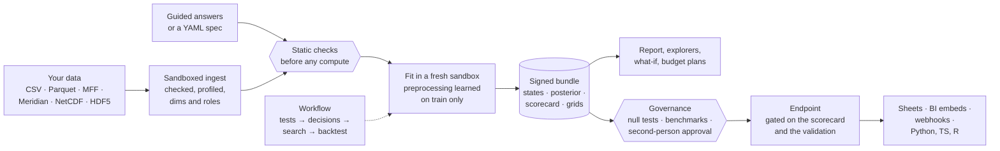
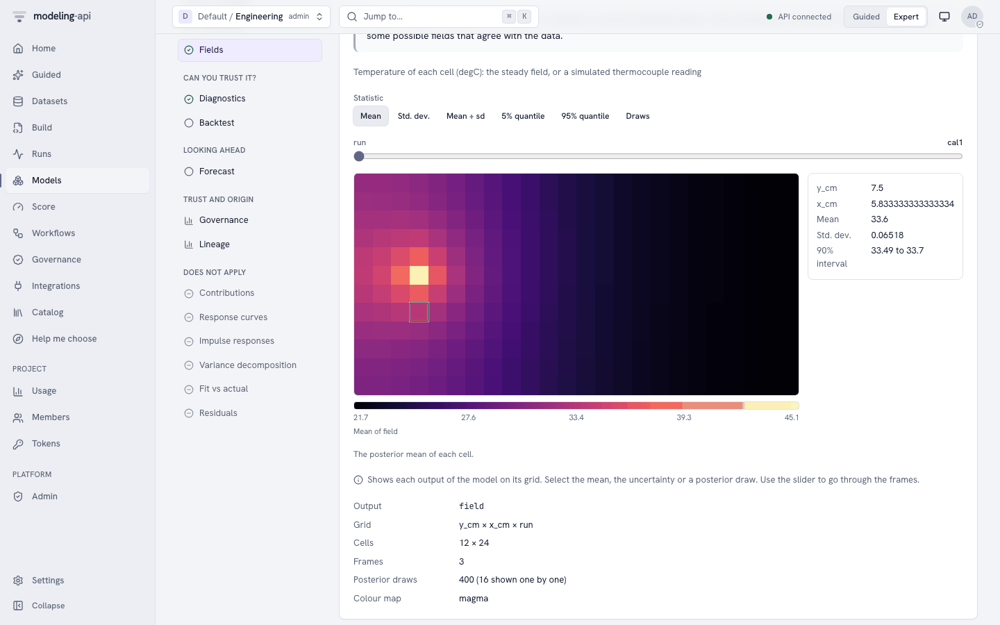
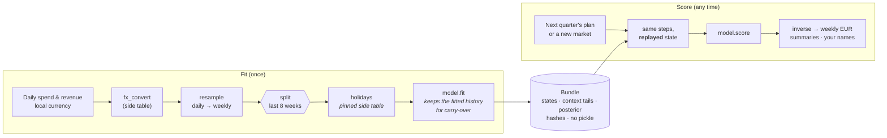

<div class="mapi-hero" markdown>
<div markdown>
<p class="mapi-tagline">Guided mode for analysts · exact control for data scientists · honest uncertainty · one safe platform</p>

# Trustworthy models,<br>from spreadsheet to endpoint.

<p>modeling-api fits Bayesian and classical models of data that has <strong>named
dimensions</strong> (market × channel × week, store × product × day, household × trip). It
also fits science models of <strong>images, fields, maps and graphs</strong>. The models
answer questions in the units that your business uses. An analyst uploads a spreadsheet and
gets a report, a sanity scorecard and instant what-if sliders. A data scientist writes a small
spec or some lines of Python and gets the same model behind a versioned endpoint. Each call
uses the same fitted preprocessing again, exactly.</p>

<p>Full analyses (tests, decisions, models and benchmarks) run as versioned
<strong>workflows</strong>. A model goes live only after it is better than <strong>shuffled
data, fake drivers and a naive forecast</strong>. Each run occurs in a new sandbox, and each result tells how sure it is.</p>

[Your first MMM in Guided mode](guides/guided-tutorial.md){ .md-button .md-button--primary }
[Quickstart for data scientists](getting-started/quickstart.md){ .md-button }
[What's new in 0.9](whats-new-0.9.md){ .md-button }

</div>

</div>

!!! success "v0.9: the science gallery"
    The science plugin now has **15 models** from the pymc-challenges case studies, for
    images, fields, maps and graphs. **14 new plot recipes** draw maps, networks, trees,
    polar charts, image checks and colour swatches. **New workflow nodes** give posterior
    summaries, posterior predictive checks, stacking weights, scores and plots in a run.
    **Six new recipes** use them, for example a ladder of spatial models and a Bayesian
    workflow audit.

    Each ported case has a **tutorial** that does the analysis of the notebook in the web
    app. The **export helper** `python -m mapi_plugin_science.export` writes the data of a
    case to a file that you can upload.

    [What's new in 0.9](whats-new-0.9.md) ·
    [The science tutorials](tutorials/pymc-challenges/index.md)

!!! info "Since 0.5"
    - **v0.6:** a spec builder. The YAML editor completes names, and a Visual view shows the
      same spec as blocks ([Build](guides/web-ui.md#build)).
    - **v0.7:** the first four science models. An output can be a 2-D field, and the Model
      Explorer shows it with its uncertainty.
    - **v0.8:** tree datasets. A NetCDF-4 or HDF5 file keeps its groups, and a version can
      combine many files ([Tree datasets](guides/tree-data.md)).
    - **v0.5:** workflows, governance with null tests, Data and Model Explorers,
      mmm-framework and twelve statsmodels models ([What's new in 0.5](whats-new-0.5.md)).

## Two ways in, one model

<div class="mapi-personas" markdown>
<div class="mapi-persona" markdown>

### :material-compass-outline: Analysts

<p class="mapi-promise">Upload → report → scenario in minutes, with honest uncertainty.</p>

- Select what you want to learn. Answer questions such as "which column is revenue?". The
  platform suggests the answer and tells you why.
- Tell what you already believe ("TV returns 1.5 to 4 per euro"), or enter a lift test.
- Read a report in plain words. A **sanity scorecard** tells you if you can trust it.
- Move the **what-if sliders**. Your browser gives the answers. The range stays honest when
  some channels move at the same time. "Run exact" asks the full model.
- Share a live chart, or put the model in a Google Sheet.
- If you are not sure which model to use, use **Help me choose**. It asks some questions and
  explains its recommendations. Each option has an *About* card in plain words.

[:octicons-arrow-right-24: Your first analysis in Guided mode](guides/guided-tutorial.md)

</div>
<div class="mapi-persona mapi-persona--expert" markdown>

### :material-code-braces: Data scientists

<p class="mapi-promise">Any PyMC, scikit-learn or forecasting model. The same preprocessing, exactly. Endpoints in one click.</p>

- A PyMC model is one `build()` method. An sklearn model is one `estimator()`. Built-in
  marketing-mix, forecasting, demand and choice models are ready to use. So are 15
  science models for images, fields, maps and graphs.
- Steps **learn on the training data only**. At score time, the platform **replays** them
  and does not fit them again. This applies to forecasts, new markets and counterfactuals.
- Uncertainty is a primary part of each result: draws, quantiles or intervals. Each one has
  the aggregations that are valid for it.
- Promote a version to an **endpoint** through the scorecard gate. Copy a snippet for
  Python, TypeScript, curl, R, Apps Script or a notebook.
- Automate the statistics with **workflows** of tests, branches, searches, backtests and
  governance checks. Posterior summaries, predictive checks, stacking weights and plots are
  nodes too. Run them live from `mapi workflows run --watch` or `api.workflows`.

[:octicons-arrow-right-24: Quickstart: zero to first model](getting-started/quickstart.md) ·
[Workflow cookbook](guides/workflow-cookbook.md) ·
[Science tutorials](tutorials/pymc-challenges/index.md)

</div>
</div>

The two groups edit the same `ModelSpec`. Each Guided screen has **View as YAML**. The
changes of an expert come back to Guided mode with no loss.
[Who it is for, and who it is not for](why.md).

## How it works



1. **Your data stays labelled.** The upload becomes an `xr.Dataset` with named dims, roles and
   units. No later part of the process uses the position of the data.
2. **Mistakes fail early.** Examples are a spec that leaks the holdout, a forecast past the
   limit of the model, or a market that the model did not see. You get typed errors before
   any compute.
3. **The fit learns, and the score replays.** Each preprocessing step stores what it learned.
   Thus a forecast or a new market goes through exactly the same transformations. Then the
   result goes back into your units.
4. **The platform checks results two times.** It compares the outputs with the checksums of
   the storage, and it signs them. The scorecard checks convergence, holdout error and
   plausibility.
5. **Models must show that they are good.** A governance policy applies null tests and
   benchmarks to each version and records the evidence. If you ask, it waits for a second
   person. Endpoints can refuse all versions that are not validated.
6. **Other tools connect to an endpoint, not to a file.** Promote a better model, and all
   integrations use it. Roll back with one call.
7. **Full analyses repeat automatically.** A workflow runs the tests, decisions, fits and
   checks again each Monday, or when the data changes. It uses again each step whose inputs
   did not change.

## Your first MMM in Guided mode

This section shows the full path of a geo marketing-mix model. The path starts with a
spreadsheet of weekly spend and revenue by region. It ends with a budget scenario. The times
are from an automated "tester" on a laptop. The platform used almost all of this time. The
full path took **135 seconds** from upload to scenario.

<div class="mapi-path" markdown>

1. **Choose "Geo marketing mix"**. Then drop your CSV file on the page. The platform makes a
   profile of each column *in your browser*. It suggests which column is revenue and which
   columns are spend. It also tells why. *(5 s)*
2. **Say what you believe**, if you have beliefs. For example, give an ROI range for each
   channel, or a lift test. *Preview what this means* shows it in business units before the
   fit. *(22 s, optional)*
3. **Fit the model.** The progress shows in plain language. The platform tests the model on
   weeks that it did not see. Then it fits the model again on all the data. *(80 s)*
4. **Read the results.** You see the ROI and share of each channel with 90% ranges. You also
   see the sanity scorecard, with the next action for each check. *(instant)*
5. **Ask "what if"**. Move search +20%. The change in revenue and its range show immediately.
   *Run exact* confirms the result with the full model. *(30 s with the exact run and a
   forecast)*
6. **Share it**. Put the model live as an endpoint, or share a chart with a link.

</div>

[:octicons-arrow-right-24: The full tutorial, with screenshots](guides/guided-tutorial.md) ·
[From a spreadsheet to a draft, with curl](guides/guided-data.md)

<div class="mapi-shots" markdown>

<figure markdown>
[{ .mapi-shot loading=lazy }](guides/guided-tutorial.md#1-choose-what-you-want-to-learn)
<figcaption>Templates: start from the question, not from the model.</figcaption>
</figure>

<figure markdown>
[{ .mapi-shot loading=lazy }](guides/guided-tutorial.md#2-your-data)
<figcaption>Your data: suggested answers, each with its reason.</figcaption>
</figure>

<figure markdown>
[{ .mapi-shot loading=lazy }](guides/guided-tutorial.md#3-what-you-believe)
<figcaption>Beliefs: ROI ranges and lift tests, with a preview in business units.</figcaption>
</figure>

<figure markdown>
[{ .mapi-shot loading=lazy }](guides/guided-tutorial.md#5-results-and-the-sanity-scorecard)
<figcaption>Results: each number with the range that it can really be in.</figcaption>
</figure>

<figure markdown>
[{ .mapi-shot loading=lazy }](guides/guided-tutorial.md#5-results-and-the-sanity-scorecard)
<figcaption>Scorecard: can you trust it, and what to do if you cannot.</figcaption>
</figure>

<figure markdown>
[{ .mapi-shot loading=lazy }](guides/guided-tutorial.md#6-what-if)
<figcaption>What if: instant answers from a response curve for each draw.</figcaption>
</figure>

</div>

## What's new in v0.9

<div class="grid cards" markdown>

-   :material-atom-variant:{ .lg .middle } **15 science models**

    ---

    Heat equations, Turing patterns, STORM frames, small images, colour names, the CMB sky,
    disease maps, networks, graphical models, phylogenies and angles. Each model comes from
    a pymc-challenges case study and has tests against the real data of its notebook.

    [:octicons-arrow-right-24: Scientific models](reference/models.md#scientific-models-mapi-plugin-science)

-   :material-map-outline:{ .lg .middle } **Maps, networks, trees and images**

    ---

    14 new plot recipes, for example area maps, network graphs, phylogenies, polar roses, image residuals,
    predictive image grids, colour swatches, power spectra, point patterns, corner plots and
    calibration plots. The catalog now has 36 recipes.

    [:octicons-arrow-right-24: The plot catalog](reference/plots.md#scientific-model-pack-sci)

-   :material-graph-outline:{ .lg .middle } **The Bayesian workflow as a workflow**

    ---

    New nodes give posterior summaries, posterior predictive checks, stacking weights,
    scores and plots. Six new recipes use them: model ladders, a convergence-gated audit and
    calibrate-then-design.

    [:octicons-arrow-right-24: Complex workflows](tutorials/complex-workflows.md)

-   :material-school-outline:{ .lg .middle } **A tutorial for each case**

    ---

    Fifteen tutorials do the analysis of a notebook in the web app, with no PyMC code. The
    export helper writes the data of the notebook to a file that you can upload.

    [:octicons-arrow-right-24: pymc-challenges in the web app](tutorials/pymc-challenges/index.md)

</div>

<div class="mapi-shots" markdown>

<figure markdown>
[{ .mapi-shot loading=lazy }](tutorials/pymc-challenges/e18-scottish-lip-cancer.md)
<figcaption>Disease map: the risk of each district, with its uncertainty.</figcaption>
</figure>

<figure markdown>
[{ .mapi-shot loading=lazy }](tutorials/pymc-challenges/e21-law-firm-network.md)
<figcaption>Networks: the ties of a law firm on a latent map.</figcaption>
</figure>

<figure markdown>
[{ .mapi-shot loading=lazy }](tutorials/pymc-challenges/e51-heat-plate-design.md)
<figcaption>Fields: the temperature of a heated plate, from a heat equation.</figcaption>
</figure>

<figure markdown>
[{ .mapi-shot loading=lazy }](tutorials/complex-workflows.md)
<figcaption>Recipes: a ladder of spatial models, compared by elpd_loo, in one report.</figcaption>
</figure>

</div>

[:octicons-arrow-right-24: Everything that is new in 0.9](whats-new-0.9.md)

## What came in v0.5

<div class="grid cards" markdown>

-   :material-graph-outline:{ .lg .middle } **Workflows that think like a statistician**

    ---

    Unit roots → differencing → AR/MA orders → rolling-origin backtest → ARIMAX vs naive →
    select → governance. All of these steps are one versioned YAML graph. The graph has live
    node status, a cache, schedules and dataset triggers. It has seventeen statistical tests,
    seven split plans and Diebold-Mariano.

    [:octicons-arrow-right-24: Workflow cookbook](guides/workflow-cookbook.md)

-   :material-shield-check-outline:{ .lg .middle } **Models must beat noise**

    ---

    Governance policies have these checks: shuffled-target and placebo-regressor null tests,
    naive benchmarks, residual whiteness, stability, signs and prior sensitivity. They also
    have approval by a second person and evidence packs. Endpoints refuse models that are
    not validated.

    [:octicons-arrow-right-24: Can you trust this model?](guides/null-tests.md)

-   :material-magnify-scan:{ .lg .middle } **Data and Model Explorers**

    ---

    Before you make a model, see stationarity, cross-correlation with the KPI, STL, VIF and
    quality warnings. After the fit, see parameters, residual tests, IRF/FEVD, forecasts,
    backtests and side-by-side comparisons.

    [:octicons-arrow-right-24: Explore a dataset](guides/data-explorer.md)

-   :material-chart-bell-curve-cumulative:{ .lg .middle } **mmm-framework MMMs and budget plans**

    ---

    `mmm.bayesian` pools over geos and products. `mmm.frequentist` fits in seconds. You get
    business priors and lift tests. The platform optimises budgets from the posterior with
    risk objectives.

    [:octicons-arrow-right-24: Marketing-mix models](models/mmm-framework.md)

-   :material-chart-timeline-variant:{ .lg .middle } **Twelve statsmodels models**

    ---

    The models go from SARIMAX to VECM and Markov switching. They have future drivers,
    prediction intervals, impulse responses and cointegration tests.

    [:octicons-arrow-right-24: statsmodels models](models/statsmodels.md)

-   :material-help-circle-outline:{ .lg .middle } **About cards and Help me choose**

    ---

    Each model, step, node, check and template explains itself in plain words. Eight
    questions give a ranked shortlist with reasons. Use the web app, `mapi choose` or
    `api.catalog.recommend()`.

    [:octicons-arrow-right-24: Choosing a model](guides/choosing-a-model.md)

</div>

### See it at work

<div class="mapi-shots" markdown>

<figure markdown>
[{ .mapi-shot loading=lazy }](guides/workflows.md#the-editor)
<figcaption>Workflows: tests, decisions, searches, backtests and governance in one graph, with typed ports.</figcaption>
</figure>

<figure markdown>
[{ .mapi-shot loading=lazy }](guides/workflows.md#running-and-watching)
<figcaption>Run monitor: each step, decision and verdict live, with the cost of the run.</figcaption>
</figure>

<figure markdown>
[{ .mapi-shot loading=lazy }](guides/governance.md#validating-a-model-version)
<figcaption>Governance: checks, evidence and the approval of a second person.</figcaption>
</figure>

<figure markdown>
[{ .mapi-shot loading=lazy }](guides/null-tests.md)
<figcaption>Null tests: the real model must be better than the same model fitted on shuffled results.</figcaption>
</figure>

<figure markdown>
[{ .mapi-shot loading=lazy }](guides/data-explorer.md)
<figcaption>Data Explorer: a plain verdict that tells if each series wanders.</figcaption>
</figure>

<figure markdown>
[{ .mapi-shot loading=lazy }](tutorials/optimise-a-budget.md)
<figcaption>Budget plans: mmm-framework plans from the posterior, with the frontier.</figcaption>
</figure>

</div>

[:octicons-arrow-right-24: Everything that is new in 0.5](whats-new-0.5.md)

## What came in v0.4

<div class="grid cards" markdown>

-   :material-compass-outline:{ .lg .middle } **Guided mode**

    ---

    Guided mode has four templates (geo marketing mix, weekly forecast, demand by store,
    customer choice). It finds the roles of columns and has MFF and Meridian presets. You can
    open drafts as YAML. A lock can keep a project in Guided mode only.

    [:octicons-arrow-right-24: Tutorial](guides/guided-tutorial.md)

-   :material-scale-balance:{ .lg .middle } **Business priors and lift tests**

    ---

    A sandbox translates ROI or contribution-share ranges into model priors. A
    prior-predictive preview shows the result. Experiments go into the likelihood as
    calibration.

    [:octicons-arrow-right-24: Guided modelling](guides/guided-modelling.md)

-   :material-clipboard-check-outline:{ .lg .middle } **Sanity scorecard and promotion gate**

    ---

    The scorecard has checks for convergence, holdout error and coverage, plausibility and
    data. Each check is in plain words. A pass goes live. A warn needs an audited reason from
    an admin. The gate blocks a fail.

    [:octicons-arrow-right-24: The gate](concepts/integrations.md#promotion-gate)

-   :material-tune-variant:{ .lg .middle } **What-if, forecasts, counterfactuals**

    ---

    The sliders use response curves that the platform calculates before, for each posterior
    draw. Thus the bands stay joint and honest. "Run exact" scores the full model with common
    random numbers.

    [:octicons-arrow-right-24: What if…](guides/guided-tutorial.md#6-what-if)

-   :material-api:{ .lg .middle } **Endpoints, aliases and snippets**

    ---

    Each use gets a stable alias, with history and rollback. Each endpoint has a frozen input
    contract with an example call, and `score:<alias>` tokens. The platform makes code in
    seven flavours.

    [:octicons-arrow-right-24: Integrations hub](guides/integrations-hub.md)

-   :material-webhook:{ .lg .middle } **Signed webhooks**

    ---

    The events are `run.*`, `model.version.ready`, `endpoint.promoted` and `score.completed`.
    They are HMAC-signed and go through an SSRF guard. The platform tries them again if they
    fail, logs them, and can send them again.

    [:octicons-arrow-right-24: Receive webhooks](guides/webhook-receivers.md)

-   :material-chart-box-plus-outline:{ .lg .middle } **Embeds and static renders**

    ---

    Chart links are read-only and expire. Use them in Notion, Slack, Looker Studio or Power
    BI. The sandbox also renders PNG, SVG or PDF files.

    [:octicons-arrow-right-24: Embed a chart](tutorials/embed-a-chart.md)

-   :material-google-spreadsheet:{ .lg .middle } **Google Sheets**

    ---

    A card on each endpoint makes an Apps Script. The script writes a forecast into a sheet
    each morning. Its token has a scope of that one endpoint only.

    [:octicons-arrow-right-24: Connect Sheets](tutorials/google-sheets.md)

-   :material-account-check-outline:{ .lg .middle } **Sign-up and the data lifecycle**

    ---

    Users can make their own workspaces, with e-mail verification and abuse controls. There
    is a GDPR export and a tenant deletion that purges all stores. There is also a Cloud
    Armor policy.

    [:octicons-arrow-right-24: Deleting and exporting data](guides/data-deletion.md)

-   :material-cart-outline:{ .lg .middle } **A customer-choice model**

    ---

    `choice.multinomial_logit` is a conditional logit with household effects. It has
    categorical holdout metrics: the log score, Brier, and the hit rate compared with a guess
    of the favourite each time.

    [:octicons-arrow-right-24: Use cases](use-cases.md#customer-choice)

-   :material-console:{ .lg .middle } **Client and CLI for all of it**

    ---

    `api.endpoint("…").score(ds)` returns an `xarray.Dataset`. From a terminal,
    `mapi endpoints`, `webhooks`, `plots`, `guided`, `priors` and `tenant` do the other
    tasks.

    [:octicons-arrow-right-24: The Python client](guides/python-client.md)

</div>

## Measured, not promised

The v0.9 values come from fits of the real data of the pymc-challenges notebooks. We got the
first two values in the web app on a local dev stack, with the sandboxed runner
([E18 tutorial](tutorials/pymc-challenges/e18-scottish-lip-cancer.md)):

<div class="mapi-stats" markdown>
<div class="mapi-stat"><strong>46 s</strong><span>the sci_spatial_ladder recipe on the 56 districts of Scotland: three spatial models, the comparison, the stacking weights, two refits with other priors and the report</span></div>
<div class="mapi-stat"><strong>−153.0</strong><span>the elpd_loo of the BYM2 disease map in the web app. The notebook gives −152.7.</span></div>
<div class="mapi-stat"><strong>129.9</strong><span>the elpd_loo of Pagel's lambda, the model that sci_phylo_signal selects for 186 primates. The notebook gives 130.</span></div>
</div>

We measured the values below on an 8-core laptop against the full stack. The fits were real
fits in the sandboxed runner. The v0.5 journeys used the data and settings of [M3.5 verification](operations/m35-verification.md):

<div class="mapi-stats" markdown>
<div class="mapi-stat"><strong>37–40 s</strong><span>the canonical workflow: 19 nodes from unit-root tests to governance, through the orchestrator and the sandboxed runner</span></div>
<div class="mapi-stat"><strong>p = 0.7–0.95</strong><span>an ARIMAX fitted on pure noise, compared with 19 fits on shuffled data. The validation fails. Promotion gives NOT_VALIDATED.</span></div>
<div class="mapi-stat"><strong>0.1 %</strong><span>of the result that a model fitted on real signal gave to three fake noise drivers</span></div>
<div class="mapi-stat"><strong>26 s</strong><span>a validation with the null tests: 19 fits on shuffled data plus 3 fake drivers</span></div>
<div class="mapi-stat"><strong>10–16 s</strong><span>an mmm-framework budget plan with a 5-point efficient frontier, in the sandbox</span></div>
</div>

These runs found eight defects that unit, integration and mocked-browser tests did not find.
We repaired each defect and added a regression test before the release. The v0.4 journey used
the data of [M3 verification](operations/m3-verification.md):

<div class="mapi-stats" markdown>
<div class="mapi-stat"><strong>135 s</strong><span>upload → report → scenario, done by a script. The fit used 79 s.</span></div>
<div class="mapi-stat"><strong>0.08 %</strong><span>the difference between the instant slider and the exact model, for TV at half budget (−454,590 vs −454,241, exact sd 14,003)</span></div>
<div class="mapi-stat"><strong>0.01 %</strong><span>the difference between "TV off" from the grid and an exact counterfactual run (−1,046,519 vs −1,046,414)</span></div>
<div class="mapi-stat"><strong>76–81 %</strong><span>of each translated prior is in the 80% ROI range that the analyst gave</span></div>
<div class="mapi-stat"><strong>0 objects</strong><span>stay in five buckets after a tenant deletion (285 before). The platform keeps only the audit log and the cost ledger.</span></div>
</div>

We did not measure these items yet: real testers, a real Google Cloud project and public
workspaces with Docker isolation ([what remains](operations/m3-verification.md#what-remains-unverified)).

## Connect it to everything

<div class="mapi-shots" markdown>

<figure markdown>
[{ .mapi-shot loading=lazy }](guides/integrations-hub.md)
<figcaption>Integrations: Sheets, BI and webhooks in a few steps.</figcaption>
</figure>

<figure markdown>
[{ .mapi-shot loading=lazy }](guides/integrations-hub.md#an-endpoints-page)
<figcaption>Endpoints: one alias, and each promotion and rollback with its reason.</figcaption>
</figure>

<figure markdown>
[{ .mapi-shot loading=lazy }](guides/integrations-hub.md#an-endpoints-page)
<figcaption>Snippets: Python, TypeScript, curl, R, Apps Script, notebook.</figcaption>
</figure>

<figure markdown>
[{ .mapi-shot loading=lazy }](tutorials/embed-a-chart.md)
<figcaption>Embeds: a read-only chart for a dashboard or a document. You can revoke it at any time.</figcaption>
</figure>

</div>

```python
--8<-- "client_integrations.py:score"
```

[:octicons-arrow-right-24: Tutorials](tutorials/index.md) ·
[Use cases](use-cases.md) ·
[The Python client](guides/python-client.md)

## The core idea: fit with preprocessing, score with the *same* preprocessing

The same pipeline object runs at fit time and at score time. At fit time, each step
**learns** its state from the training data. At score time, it **replays** that state. Steps
that look back in time store a small tail for each group. Thus a forecast sees exactly the
history that the model used for the fit.



=== "What you write"

    ```yaml
    pipeline:
      - {id: to_eur, use: core.fx_convert@^1, with: {vars: [y, spend], table: fx, ...}}
      - {id: weekly, use: core.resample@^1,   with: {dim: time, freq: W-SUN, how: sum}}
      - {id: hols,   use: core.holidays@^1,   with: {table: holidays, along: time}}
    model:
      use: mmm.bayesian@^1                 # mmm-framework: scaling and carry-over inside
      settings: {hierarchy: {pool_over: [geo]}, new_levels: hyperprior}
      fit: {mode: evaluate_then_refit}
    ```

=== "What the platform does"

    1. The platform checks the full spec **statically**. It checks names, dims, settings and
       units at each stage. It also checks where the split occurs, and if a step can learn
       from the holdout (`LEAKAGE_RISK`).
    2. It fits each stateful step on the **training weeks only**, and then fits the model.
       Then it scores the holdout **through the same path that a forecast uses** and records
       the metrics.
    3. It fits again on all weeks, so that forecasts start from the latest data. Then it
       writes a bundle with each state, context tail and hash.

=== "What you get back"

    - Forecasts in **weekly EUR**, not in "model units". The model reports its own units. The
      units stop at the weekly resample, because you cannot get daily values back from weekly
      sums. The `output_space` (`model-owned`) and `units` attributes of the output tell this.
    - A new market that comes from the fitted **hyperprior**. Its range is honestly wider than
      the range of a known market.
    - What-if deltas that share their noise with the baseline (common random numbers). Thus
      the delta shows the change, not the sampling noise.

This is the same model in plain Python, without a server. The test suite runs each snippet
on this site:

```python
--8<-- "quickstart.py:fit"
```

```python
--8<-- "quickstart.py:errors"
```

## Secure by design

The platform can run models and data from persons that it does not trust. The most important
controls are not settings that you can forget to set. They are part of how the platform works.
[The security model](concepts/security.md) tells what each control stops. It also tells what
we must still verify in the cloud.

<div class="grid cards" markdown>

-   :material-cube-scan:{ .lg .middle } **A fresh sandbox per run**

    ---

    Each ingest, fit, score and render runs in its own sandbox (a microVM on Cloud Run Jobs).
    The sandbox has no secrets. Its only network access is signed URLs to its own objects. The
    code enforces the placement by trust tier.

-   :material-domain:{ .lg .middle } **Tenants never see each other**

    ---

    Each table has PostgreSQL row-level security. It is pinned for each transaction, and it
    fails closed. The platform checks roles at each request. Operators manage the platform,
    but they do not read tenant data.

-   :material-check-decagram-outline:{ .lg .middle } **Outputs are claims**

    ---

    The platform compares the outputs of a run with the hashes and generations of the store.
    Then it copies the outputs to a location where runs cannot write, and signs them. It makes
    download links only after it verifies the signature.

-   :material-shield-link-variant-outline:{ .lg .middle } **Integrations that cannot be turned against you**

    ---

    Webhooks are HMAC-signed. They go through an SSRF guard that pins the checked address.
    Embed links show only platform recipes and have no credential. You can revoke them.
    Snippets never contain a secret.

-   :material-cash-lock:{ .lg .middle } **Compute you can see and cap**

    ---

    Quotas are in vCPU-seconds for each token, tenant and platform. Each token that calls an
    endpoint has a budget. Each run shows a cost. There is a global spend cap and an audited
    kill switch.

-   :material-file-lock-outline:{ .lg .middle } **No pickle, anywhere**

    ---

    Bundles are single zarr zips plus JSON sidecars. Native models are skops (allow-listed
    types) or xgboost JSON. Each file has CRC32C, MD5 and SHA-256 values. The platform
    verifies them when it reads the file.

</div>

## Run it for many teams

One deployment serves many organisations. Users sign up, or sign in with their own identity
provider. They work in the projects where they have a role, and they see the cost of their
compute. Operators manage the platform, but they never read the data of a tenant.

<div class="mapi-shots" markdown>

<figure markdown>
[{ .mapi-shot loading=lazy }](guides/authentication.md#browser-sign-in)
<figcaption>Tenants and projects: your role in each project, and the trust tier of each tenant.</figcaption>
</figure>

<figure markdown>
[{ .mapi-shot loading=lazy }](guides/administration.md#cost-and-usage)
<figcaption>Usage: the metered cost of each run, by token and resource class, against each quota.</figcaption>
</figure>

<figure markdown>
[{ .mapi-shot loading=lazy }](guides/data-deletion.md)
<figcaption>Your data: a GDPR export, and a deletion that purges all stores.</figcaption>
</figure>

</div>

[:octicons-arrow-right-24: Administration](guides/administration.md) ·
[Deploy on your laptop or Google Cloud](operations/index.md) ·
[Roadmap: what comes next](roadmap/index.md)
