<div class="mapi-hero" markdown>
<div markdown>
<p class="mapi-tagline">Guided for analysts · exact for data scientists · honest uncertainty · one safe platform</p>

# Trustworthy models,<br>from spreadsheet to endpoint.

<p>modeling-api fits Bayesian and classical models of data with <strong>named
dimensions</strong> (market × channel × week, store × product × day, household × trip) and
answers questions with them in the units your business uses. An analyst uploads a spreadsheet
and gets a report, a sanity scorecard and instant what-if sliders. A data scientist writes a
small spec or a few lines of Python and gets the same model behind a versioned endpoint,
with the fitted preprocessing replayed exactly on every call. Every run happens in a fresh
sandbox, and every result says how sure it is.</p>

[Your first MMM in Guided mode](guides/guided-tutorial.md){ .md-button .md-button--primary }
[Quickstart for data scientists](getting-started/quickstart.md){ .md-button }
[Why modeling-api?](why.md){ .md-button }

</div>

</div>

!!! success "v0.4: Guided mode and integrations"
    Analysts get **Guided mode**: templates, questions instead of a column mapper, beliefs as
    ROI ranges and lift tests, a sanity scorecard, what-if sliders and forecasts. Other
    applications get **endpoints** promoted through the scorecard, code snippets, signed
    **webhooks**, **embeddable charts**, Google Sheets and an **Atlas** budget optimiser.
    Every number on this page was measured on a laptop running the whole stack
    ([M3 verification](operations/m3-verification.md)); the cloud pieces are tested against
    fakes, and the study with five non-technical testers is still to come.

## Two ways in, one model

<div class="mapi-personas" markdown>
<div class="mapi-persona" markdown>

### :material-compass-outline: Analysts

<p class="mapi-promise">Upload → report → scenario in minutes, with honest uncertainty.</p>

- Pick what you want to learn; answer "which column is revenue?" (the platform suggests
  the answer and says why).
- Say what you already believe ("TV returns 1.5 to 4 per euro") or enter a lift test.
- Read a report in plain words, with a **sanity scorecard** that tells you whether to trust it.
- Drag **what-if sliders**: answers in your browser, with a range that stays honest when
  several channels move at once. "Run exact" asks the full model.
- Share a live chart or put the model in a Google Sheet.

[:octicons-arrow-right-24: Your first analysis in Guided mode](guides/guided-tutorial.md)

</div>
<div class="mapi-persona mapi-persona--expert" markdown>

### :material-code-braces: Data scientists

<p class="mapi-promise">Any PyMC, scikit-learn or forecasting model. Preprocessing replayed exactly. Endpoints in one click.</p>

- A PyMC model is one `build()` method, an sklearn model one `estimator()`; built-in
  marketing-mix, forecasting, demand and choice models are ready to use.
- Steps **learn on the training data only** and are **replayed**, never refitted, at score
  time: forecasts, new markets, counterfactuals.
- Uncertainty is first-class: draws, quantiles or intervals, with the aggregations that are
  valid for each.
- Promote a version to an **endpoint** through the scorecard gate; copy a snippet for
  Python, TypeScript, curl, R, Apps Script, Atlas or a notebook.

[:octicons-arrow-right-24: Quickstart: zero to first model](getting-started/quickstart.md)

</div>
</div>

Both edit the same `ModelSpec`: every Guided screen has **View as YAML**, and an expert's
changes come back to Guided mode intact. [Who it is for, and who it is not for](why.md).

## How it works

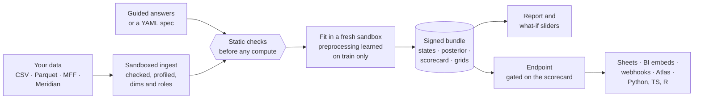

1. **Your data stays labelled.** The upload becomes an `xr.Dataset` with named dims, roles and
   units; nothing downstream is positional.
2. **Mistakes fail early.** A spec that would leak the holdout, a forecast past what the
   model supports, a market the model has never seen: typed errors, before any compute.
3. **Fitting learns, scoring replays.** Every preprocessing step stores what it learned, so a
   forecast or a new market goes through exactly the same transformations, then back into
   your units.
4. **Results are checked twice.** Outputs are verified against the storage's own checksums
   and signed; the scorecard checks convergence, holdout error and plausibility.
5. **Other tools connect to an endpoint, not a file.** Promote a better model and every
   integration uses it; roll back with one call.

## Your first MMM in Guided mode

The whole journey of a geo marketing-mix model, from a spreadsheet of weekly spend and
revenue by region to a budget scenario. The times are what an automated "tester" took on a
laptop, almost all of it the platform working: **135 seconds** from upload to scenario.

<div class="mapi-path" markdown>

1. **Choose "Geo marketing mix"** and drop your CSV on the page. Each column is profiled *in
   your browser*; the platform suggests which column is revenue, which are spend, and why.
   *(5 s)*
2. **Say what you believe**, if anything: an ROI range per channel, a lift test. *Preview
   what this means* shows it in business units before any fitting. *(22 s, optional)*
3. **Fit the model.** Plain-language progress; the model is tested on weeks it has not seen,
   then refitted on everything. *(80 s)*
4. **Read the results**: ROI and share per channel with 90% ranges, and the sanity scorecard,
   each check with what to do next. *(instant)*
5. **Ask "what if"**: move search +20% and see the change in revenue with its range at once;
   *Run exact* confirms it with the full model. *(30 s with the exact run and a forecast)*
6. **Share it**: put the model live as an endpoint, or share a chart by link.

</div>

[:octicons-arrow-right-24: The full tutorial, with screenshots](guides/guided-tutorial.md) ·
[From a spreadsheet to a draft, with curl](guides/guided-data.md)

<div class="mapi-shots" markdown>

<figure markdown>
[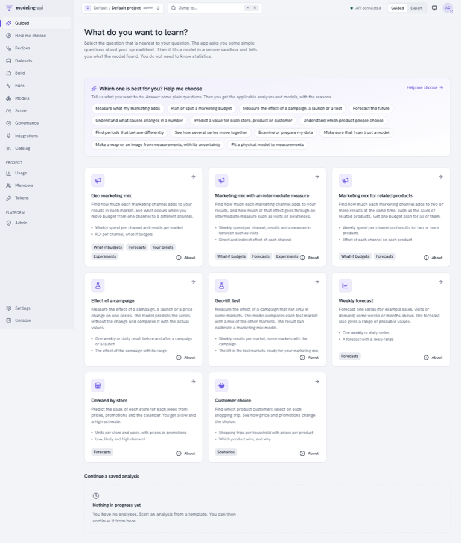{ .mapi-shot loading=lazy }](guides/guided-tutorial.md#1-choose-what-you-want-to-learn)
<figcaption>Templates: start from the question, not the model.</figcaption>
</figure>

<figure markdown>
[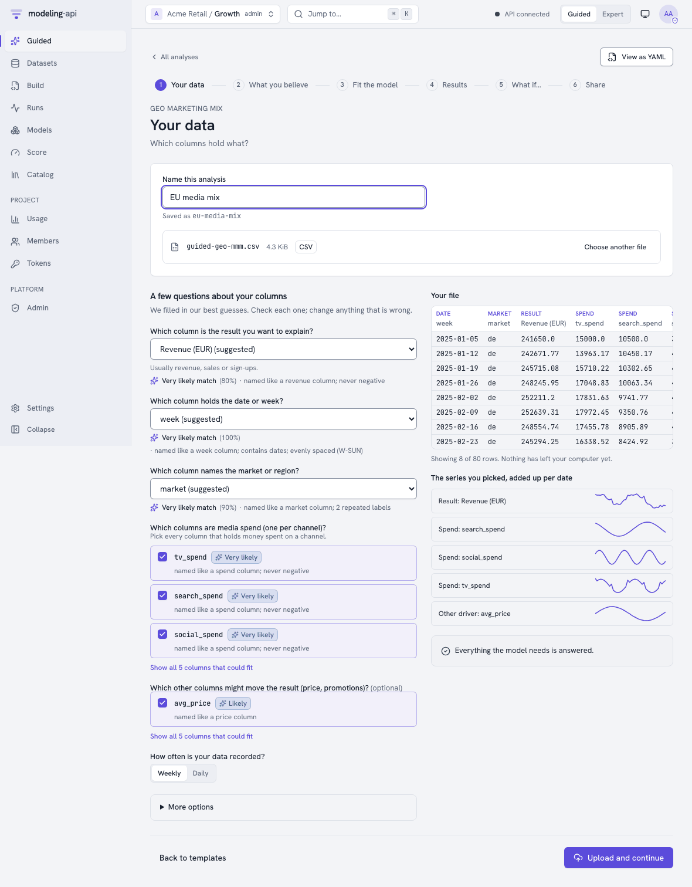{ .mapi-shot loading=lazy }](guides/guided-tutorial.md#2-your-data)
<figcaption>Your data: suggested answers, each with its reason.</figcaption>
</figure>

<figure markdown>
[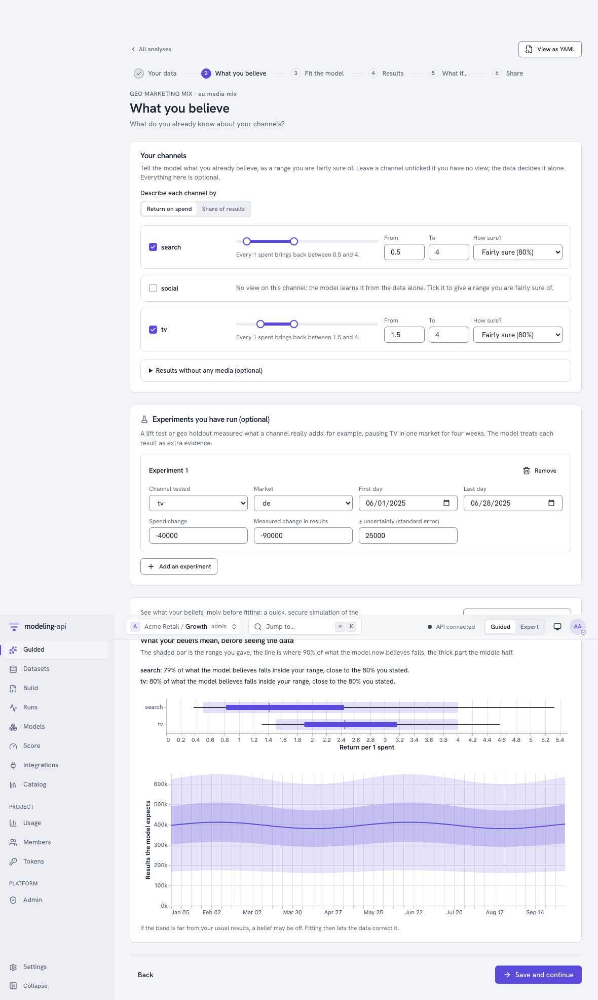{ .mapi-shot loading=lazy }](guides/guided-tutorial.md#3-what-you-believe)
<figcaption>Beliefs: ROI ranges and lift tests, previewed in business units.</figcaption>
</figure>

<figure markdown>
[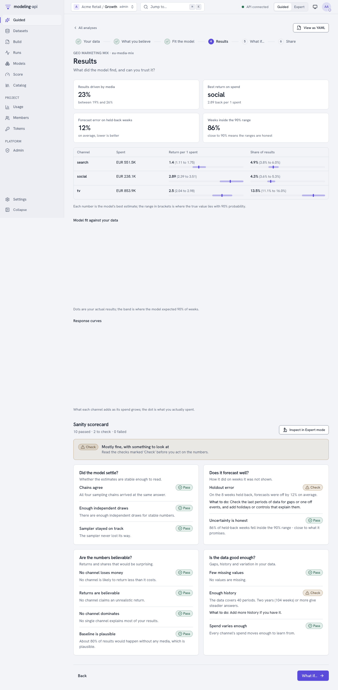{ .mapi-shot loading=lazy }](guides/guided-tutorial.md#5-results-and-the-sanity-scorecard)
<figcaption>Results: every number with the range it could really be in.</figcaption>
</figure>

<figure markdown>
[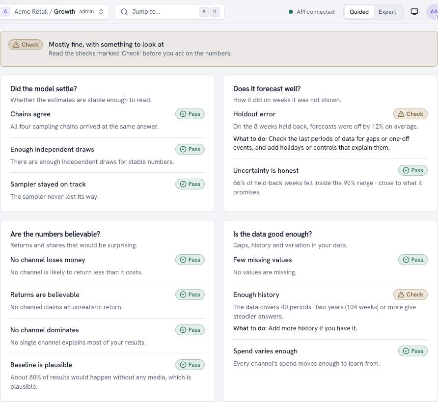{ .mapi-shot loading=lazy }](guides/guided-tutorial.md#5-results-and-the-sanity-scorecard)
<figcaption>Scorecard: can you trust it, and what to do if not.</figcaption>
</figure>

<figure markdown>
[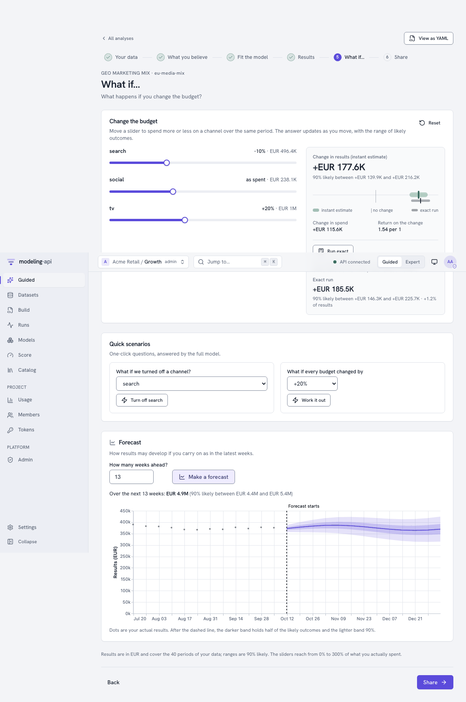{ .mapi-shot loading=lazy }](guides/guided-tutorial.md#6-what-if)
<figcaption>What if: instant answers from per-draw response curves.</figcaption>
</figure>

</div>

## What's new in v0.4

<div class="grid cards" markdown>

-   :material-compass-outline:{ .lg .middle } **Guided mode**

    ---

    Four templates (geo marketing mix, weekly forecast, demand by store, customer choice),
    role detection, MFF and Meridian presets, drafts you can open as YAML, and a lock that
    keeps a project Guided-only.

    [:octicons-arrow-right-24: Tutorial](guides/guided-tutorial.md)

-   :material-scale-balance:{ .lg .middle } **Business priors and lift tests**

    ---

    ROI or contribution-share ranges translated into model priors in a sandbox, with a
    prior-predictive preview; experiments enter the likelihood as calibration.

    [:octicons-arrow-right-24: Guided modelling](guides/guided-modelling.md)

-   :material-clipboard-check-outline:{ .lg .middle } **Sanity scorecard and promotion gate**

    ---

    Convergence, holdout error and coverage, plausibility and data checks, each in plain
    words. Pass goes live, warn needs an admin's audited reason, fail is blocked.

    [:octicons-arrow-right-24: The gate](concepts/integrations.md#promotion-gate)

-   :material-tune-variant:{ .lg .middle } **What-if, forecasts, counterfactuals**

    ---

    Sliders over response curves precomputed per posterior draw, so bands stay joint and
    honest; "Run exact" scores the full model with common random numbers.

    [:octicons-arrow-right-24: What if…](guides/guided-tutorial.md#6-what-if)

-   :material-api:{ .lg .middle } **Endpoints, aliases and snippets**

    ---

    A stable alias per use, history and rollback, a frozen input contract with an example
    call, `score:<alias>` tokens, and generated code in seven flavours.

    [:octicons-arrow-right-24: Integrations hub](guides/integrations-hub.md)

-   :material-webhook:{ .lg .middle } **Signed webhooks**

    ---

    `run.*`, `model.version.ready`, `endpoint.promoted`, `score.completed`: HMAC-signed,
    retried, logged and replayable, through an SSRF guard.

    [:octicons-arrow-right-24: Receive webhooks](guides/webhook-receivers.md)

-   :material-chart-box-plus-outline:{ .lg .middle } **Embeds and static renders**

    ---

    Read-only, expiring chart links for Notion, Slack, Looker Studio or Power BI, and PNG,
    SVG or PDF rendered in the sandbox.

    [:octicons-arrow-right-24: Embed a chart](tutorials/embed-a-chart.md)

-   :material-target:{ .lg .middle } **Atlas and Google Sheets**

    ---

    `RemoteModel` makes an endpoint an Atlas model for budget optimisation; an Apps Script
    writes a forecast into a sheet every morning.

    [:octicons-arrow-right-24: Optimise a budget](guides/atlas.md) ·
    [Connect Sheets](tutorials/google-sheets.md)

-   :material-account-check-outline:{ .lg .middle } **Sign-up and the data lifecycle**

    ---

    Self-service workspaces with e-mail verification and abuse controls, GDPR export, tenant
    deletion that purges every store, and a Cloud Armor policy.

    [:octicons-arrow-right-24: Deleting and exporting data](guides/data-deletion.md)

-   :material-cart-outline:{ .lg .middle } **A customer-choice model**

    ---

    `choice.multinomial_logit`, a conditional logit with household effects, and categorical
    holdout metrics: hit rate against always guessing the favourite, log score, Brier.

    [:octicons-arrow-right-24: Use cases](use-cases.md#customer-choice)

-   :material-console:{ .lg .middle } **Client and CLI for all of it**

    ---

    `api.endpoint("…").score(ds)` returns an `xarray.Dataset`; `mapi endpoints`, `webhooks`,
    `plots`, `guided`, `priors` and `tenant` cover the rest from a terminal.

    [:octicons-arrow-right-24: The Python client](guides/python-client.md)

</div>

## Measured, not promised

Measured on an 8-core laptop against the whole stack, on the data and settings described in
[M3 verification](operations/m3-verification.md).

<div class="mapi-stats" markdown>
<div class="mapi-stat"><strong>135 s</strong><span>upload → report → scenario, clicked through by a script; 79 s of it is the fit</span></div>
<div class="mapi-stat"><strong>0.08 %</strong><span>instant slider vs the exact model for TV at half budget (−454,590 vs −454,241; exact sd 14,003)</span></div>
<div class="mapi-stat"><strong>0.01 %</strong><span>"TV off" from the grid vs an exact counterfactual run (−1,046,519 vs −1,046,414)</span></div>
<div class="mapi-stat"><strong>76–81 %</strong><span>of each translated prior inside the analyst's stated 80% ROI range</span></div>
<div class="mapi-stat"><strong>&lt; 1 %</strong><span>holdout error of the endpoint's model, with every plausibility check passing</span></div>
<div class="mapi-stat"><strong>+0.22 %</strong><span>revenue at the same budget, found by Atlas against the live endpoint (25 candidates, 22 requests)</span></div>
<div class="mapi-stat"><strong>0 objects</strong><span>left in five buckets after a tenant deletion (285 before); only the audit log and cost ledger are kept</span></div>
<div class="mapi-stat"><strong>15 / 15</strong><span>end-to-end API tests of the M3 journey passing against a live stack</span></div>
</div>

The same runs found six usability defects, two of them dead ends, which were fixed before
release. Not yet measured: real testers, a real Google Cloud project, Docker-isolated public
workspaces ([what remains](operations/m3-verification.md#what-remains-unverified)).

## Connect it to everything

<div class="mapi-shots" markdown>

<figure markdown>
[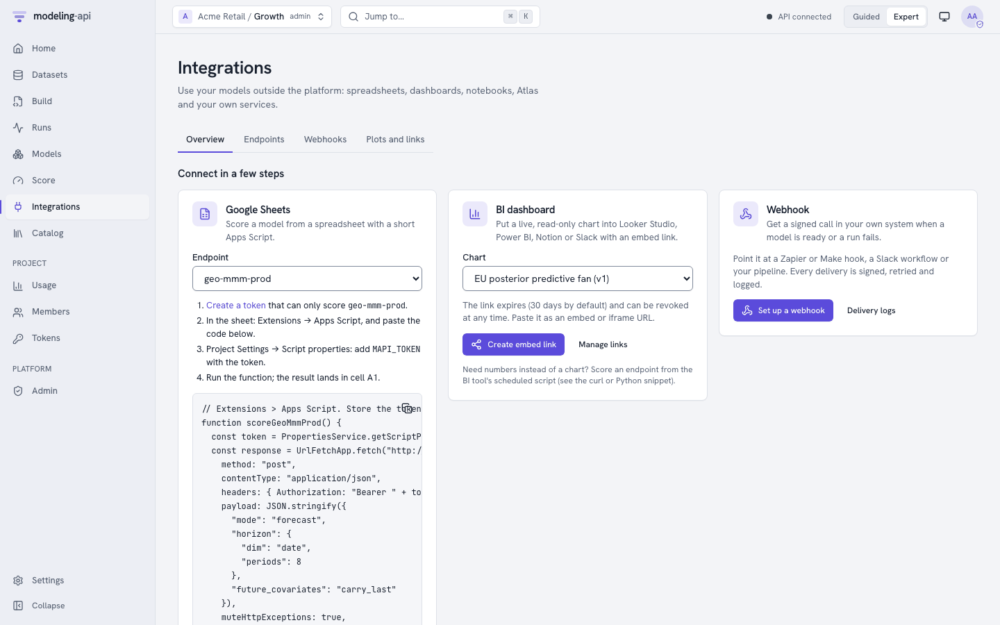{ .mapi-shot loading=lazy }](guides/integrations-hub.md)
<figcaption>Integrations: Sheets, BI and webhooks in a few steps.</figcaption>
</figure>

<figure markdown>
[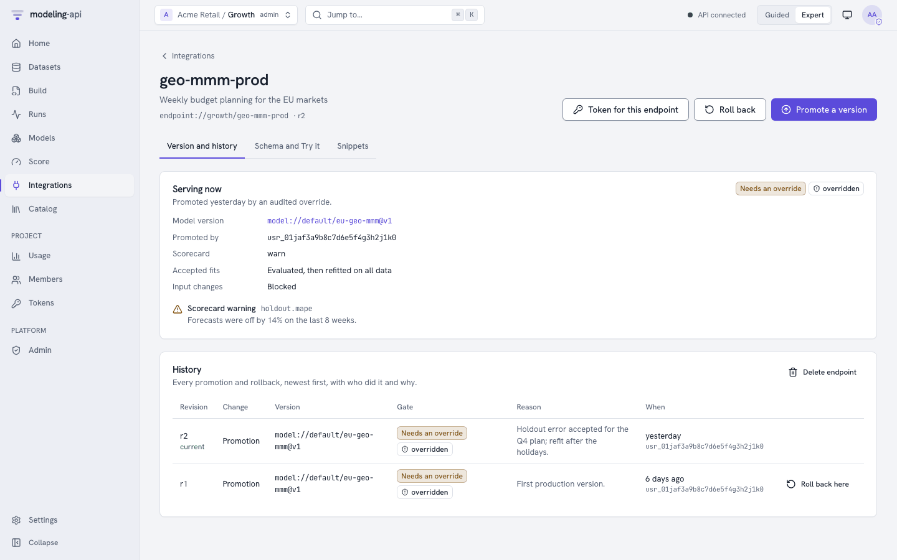{ .mapi-shot loading=lazy }](guides/integrations-hub.md#an-endpoints-page)
<figcaption>Endpoints: one alias, every promotion and rollback with its reason.</figcaption>
</figure>

<figure markdown>
[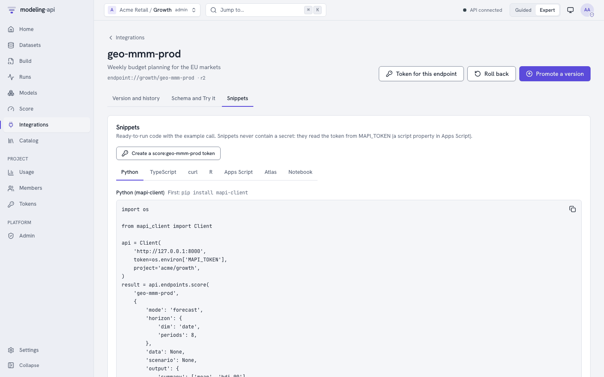{ .mapi-shot loading=lazy }](guides/integrations-hub.md#an-endpoints-page)
<figcaption>Snippets: Python, TypeScript, curl, R, Apps Script, Atlas, notebook.</figcaption>
</figure>

<figure markdown>
[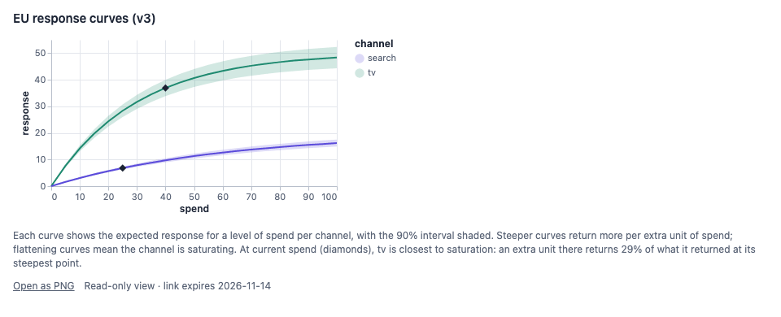{ .mapi-shot loading=lazy }](tutorials/embed-a-chart.md)
<figcaption>Embeds: a read-only chart for a dashboard or a doc, revocable at any time.</figcaption>
</figure>

</div>

```python
--8<-- "client_integrations.py:score"
```

[:octicons-arrow-right-24: Tutorials](tutorials/index.md) ·
[Use cases](use-cases.md) ·
[The Python client](guides/python-client.md)

## The core idea: fit with preprocessing, score with the *same* preprocessing

The same pipeline object runs at fit time and at score time. At fit time each step
**learns** its state from the training data; at score time it **replays** that state. Steps
that look back in time store a small per-group tail, so a forecast sees exactly the history
the model was fitted on.

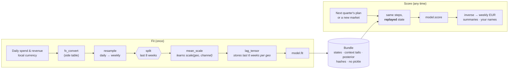

=== "What you write"

    ```yaml
    pipeline:
      - {id: to_eur, use: core.fx_convert@^1, with: {vars: [y, spend], table: fx, ...}}
      - {id: weekly, use: core.resample@^1,   with: {dim: time, freq: W-SUN, how: sum}}
      - {id: scale,  use: core.mean_scale@^1, with: {vars: [spend], over: [time]}}
      - {id: lags,   use: core.lag_tensor@^1, with: {vars: [spend], along: time, within: [geo], l_max: 6}}
    model:
      use: mmm.hierarchical_geo@^1.3
      fit: {mode: evaluate_then_refit}
    ```

=== "What the platform does"

    1. Checks the whole spec **statically**: names, dims, settings, units at every stage, where
       the split happens and whether any step would learn from the holdout (`LEAKAGE_RISK`).
    2. Fits each stateful step on the **training weeks only**, fits the model, then scores the
       holdout **through the same path a forecast uses** and records the metrics.
    3. Refits on all weeks so forecasts start from the latest data, and writes a bundle with
       every state, context tail and hash.

=== "What you get back"

    - Forecasts in **weekly EUR**, not "model units": scaling is inverted, and inversion stops
      at the weekly resample because daily values cannot be recovered from weekly sums.
      The output says so in its `output_space` attribute.
    - A new market drawn from the fitted **hyperprior**, honestly wider than a known one.
    - What-if deltas that share their noise with the baseline (common random numbers), so
      the delta reflects the change, not sampling noise.

The same model in plain Python, without any server; every snippet on this site is executed
by the test suite:

```python
--8<-- "quickstart.py:fit"
```

```python
--8<-- "quickstart.py:errors"
```

## Secure by design

The platform is built to run models and data from people it does not trust. The controls that
matter most are not settings you can forget to turn on: they are how it works.
[The security model](concepts/security.md) says what each one stops, and what is still to be
verified in the cloud.

<div class="grid cards" markdown>

-   :material-cube-scan:{ .lg .middle } **A fresh sandbox per run**

    ---

    Every ingest, fit, score and render runs in its own sandbox (a microVM on Cloud Run
    Jobs), with no secrets and no network but signed URLs to its own objects. Placement by
    trust tier is enforced in code.

-   :material-domain:{ .lg .middle } **Tenants never see each other**

    ---

    PostgreSQL row-level security on every table, pinned per transaction and failing closed;
    roles checked at every request; operators manage the platform without reading tenant
    data.

-   :material-check-decagram-outline:{ .lg .middle } **Outputs are claims**

    ---

    A run's outputs are checked against the store's own hashes and generations, copied where
    runs cannot write, and signed. Download links are minted only after the signature
    verifies.

-   :material-shield-link-variant-outline:{ .lg .middle } **Integrations that cannot be turned against you**

    ---

    Webhooks are HMAC-signed and sent through an SSRF guard that pins the checked address;
    embed links show platform recipes only, carry no credential and can be revoked; snippets
    never contain a secret.

-   :material-cash-lock:{ .lg .middle } **Compute you can see and cap**

    ---

    Quotas in vCPU-seconds per token, tenant and platform, per-token budgets for endpoint
    callers, a cost on every run, a global spend cap and an audited kill switch.

-   :material-file-lock-outline:{ .lg .middle } **No pickle, anywhere**

    ---

    Bundles are single zarr zips plus JSON sidecars; native models are skops (allow-listed
    types) or xgboost JSON. Every file carries CRC32C, MD5 and SHA-256, and reading verifies
    them.

</div>

## Run it for many teams

One deployment serves many organisations. People sign up or sign in with their own identity
provider, work in the projects they have a role in, and see what their compute costs;
operators look after the platform without ever reading a tenant's data.

<div class="mapi-shots" markdown>

<figure markdown>
[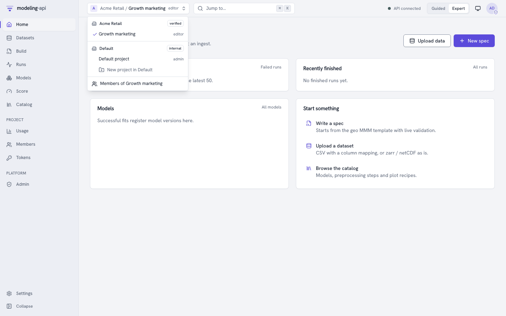{ .mapi-shot loading=lazy }](guides/authentication.md#browser-sign-in)
<figcaption>Tenants and projects: your role in each, and each tenant's trust tier.</figcaption>
</figure>

<figure markdown>
[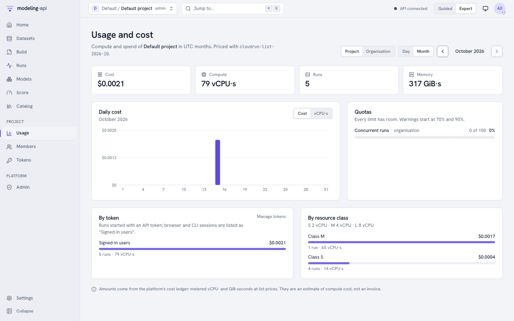{ .mapi-shot loading=lazy }](guides/administration.md#cost-and-usage)
<figcaption>Usage: metered cost per run, by token and resource class, against every quota.</figcaption>
</figure>

<figure markdown>
[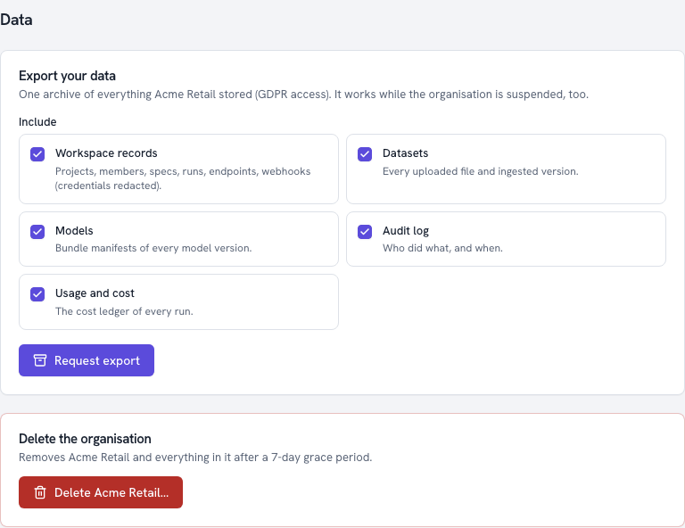{ .mapi-shot loading=lazy }](guides/data-deletion.md)
<figcaption>Your data: a GDPR export, and a deletion that purges every store.</figcaption>
</figure>

</div>

[:octicons-arrow-right-24: Administration](guides/administration.md) ·
[Deploy on your laptop or Google Cloud](operations/index.md) ·
[Roadmap: what comes next](roadmap/index.md)
