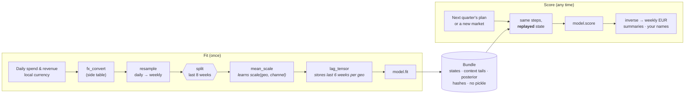

<div class="mapi-hero" markdown>
<div markdown>
<p class="mapi-tagline">Labelled models · replayed preprocessing · typed, honest answers · many teams, one safe platform</p>

# Fit with preprocessing.<br>Score with the *same* preprocessing.

<p>modeling-api is a platform for Bayesian and classical models whose data has <strong>named
dimensions</strong>: geo × channel × week, store × sku × day, household × trip. Describe a model
in a small YAML spec or a few lines of Python. The platform checks your data, learns every
preprocessing step on the training data only, and replays exactly that work whenever you
forecast, add a new market or ask "what if". Many organisations share one deployment, each
in its own tenant, and every run executes in a fresh sandbox whose outputs are verified before
anyone can download them.</p>

[Quickstart: 10 minutes](getting-started/quickstart.md){ .md-button .md-button--primary }
[Get started](getting-started/index.md){ .md-button }
[Run it for your teams](guides/administration.md){ .md-button }

</div>

</div>

!!! info "Where the project is today: v0.3, multi-tenant, with a cloud backend for a private beta"
    `make install && make dev && make seed` starts the whole platform on your laptop, without
    Docker: an HTTP API, a job queue, a sandboxed runner, an object store that behaves like
    Google Cloud Storage, the web app and an isolated plot sandbox, with sign-in through a
    development identity provider. v0.3 adds **tenants, roles, sign-in and API tokens**,
    **quotas and a cost ledger**, an audit log and kill switches, a **Cloud Run Jobs executor**
    with Terraform for every Google Cloud project, and metrics, alerts and runbooks. The cloud
    pieces are tested against fakes; a [short checklist](operations/gcp-deployment.md#before-you-start-the-verify-m0-checklist)
    of cloud behaviours waits for a real project. Guided mode for analysts comes next: see the
    [roadmap](roadmap/index.md).

## See it run

These are screenshots of the [quickstart](getting-started/quickstart.md), taken from a fresh
`make dev` stack: the E33 geo marketing-mix demo, fitted and scored from the browser.

<div class="mapi-shots" markdown>

<figure markdown>
[{ .mapi-shot loading=lazy }](guides/web-ui.md#home)
<figcaption>Home: what is running, what needs attention, recent runs and models.</figcaption>
</figure>

<figure markdown>
[{ .mapi-shot loading=lazy }](guides/web-ui.md#build)
<figcaption>Build: YAML with live validation, and the schema after every pipeline step.</figcaption>
</figure>

<figure markdown>
[{ .mapi-shot loading=lazy }](guides/web-ui.md#run-detail)
<figcaption>Runs: the sampler's own progress, streamed live from the sandbox.</figcaption>
</figure>

<figure markdown>
[{ .mapi-shot loading=lazy }](guides/web-ui.md#overview)
<figcaption>Inspect: a scorecard of convergence and holdout checks, each with a next step.</figcaption>
</figure>

<figure markdown>
[{ .mapi-shot loading=lazy }](guides/web-ui.md#plots)
<figcaption>Plots: rendered in a sandboxed iframe on a separate origin.</figcaption>
</figure>

<figure markdown>
[{ .mapi-shot loading=lazy }](guides/web-ui.md#score)
<figcaption>Score: an 8-week forecast with the fitted preprocessing replayed exactly.</figcaption>
</figure>

</div>

## Run it for many teams

One deployment serves many organisations. People sign in with their own identity provider,
work in the projects they have a role in, and see what their compute costs; operators look
after the platform without ever reading a tenant's data. These screenshots come from a `make
dev` stack with a few tenants.

<div class="mapi-shots" markdown>

<figure markdown>
[{ .mapi-shot loading=lazy }](guides/authentication.md#browser-sign-in)
<figcaption>Sign in with your organisation's identity provider; the app never holds a token.</figcaption>
</figure>

<figure markdown>
[{ .mapi-shot loading=lazy }](guides/authentication.md#browser-sign-in)
<figcaption>Tenants and projects: your role in each, and each tenant's trust tier.</figcaption>
</figure>

<figure markdown>
[{ .mapi-shot loading=lazy }](guides/administration.md#projects-and-members)
<figcaption>Members: viewer, editor, runner, admin. Running sits above editing: compute costs money.</figcaption>
</figure>

<figure markdown>
[{ .mapi-shot loading=lazy }](guides/administration.md#api-tokens)
<figcaption>API tokens: scoped, bound to one project, shown once, revoked at once.</figcaption>
</figure>

<figure markdown>
[{ .mapi-shot loading=lazy }](guides/administration.md#cost-and-usage)
<figcaption>Usage: metered cost per run, by token and resource class, against every quota.</figcaption>
</figure>

<figure markdown>
[{ .mapi-shot loading=lazy }](guides/administration.md#kill-switches)
<figcaption>Operators: tenants, quotas, a global spend cap and a switch that stops uploaded code.</figcaption>
</figure>

</div>

## Why labelled, multi-dimensional models?

Most model-serving stacks see a matrix: rows in, numbers out. Real business models do not
live in a matrix.

<div class="grid" markdown>

!!! failure "What goes wrong with positional data"
    - Column 7 used to be *search spend*; after a schema change it is *social*.
    - The forecast starts in week 53, but the lag features were built from week 1.
    - A market opens. Is it row 12? Does the model even know it is new?
    - Revenue was scaled by the mean, so the prediction came back in "1.37".
    - Someone sums the 90% quantiles of 40 stores and calls it the 90% quantile of the total.

!!! success "What modeling-api does instead"
    - Every array is an **`xr.Dataset` with named dims and coordinates**; nothing is
      positional, so shuffled, subset or reordered data scores the same.
    - Each dim declares what may happen at score time: **`fixed`**, **`extend`** (time) or
      **`new_levels`** (markets, stores, counties) with a declared strategy.
    - Every output says what it is: its **representation** (draws, quantiles, interval, point,
      moments), its **units** and its **output space**.
    - Requests that cannot be answered honestly fail **before any compute**, with a typed
      error code and a JSON pointer.

</div>

## The whole story in one picture

The same pipeline object runs at fit time and at score time. At fit time each step
**learns** its state from the training data; at score time it **replays** that state. Steps that
look back in time store a small per-group tail, so a forecast sees exactly the history the
model was fitted on.



=== "What you write"

    ```yaml
    pipeline:
      - {id: to_eur, use: core.fx_convert@^1, with: {vars: [y, spend], table: fx, ...}}
      - {id: weekly, use: core.resample@^1,   with: {dim: time, freq: W-SUN, how: sum}}
      - {id: scale,  use: core.mean_scale@^1, with: {vars: [spend], over: [time]}}
      - {id: lags,   use: core.lag_tensor@^1, with: {vars: [spend], along: time, within: [geo], l_max: 6}}
    model:
      use: mmm.hierarchical_geo@^1.3
      fit: {mode: evaluate_then_refit}
    ```

=== "What the platform does"

    1. Checks the whole spec **statically**: names, dims, settings, units at every stage, where
       the split happens and whether any step would learn from the holdout (`LEAKAGE_RISK`).
    2. Fits each stateful step on the **training weeks only**, fits the model, then scores the
       holdout **through the same path a forecast uses** and records the metrics.
    3. Refits on all weeks so forecasts start from the latest data, and writes a bundle with
       every state, context tail and hash.

=== "What you get back"

    - Forecasts in **weekly EUR**, not "model units": scaling is inverted, and inversion stops
      at the weekly resample because daily values cannot be recovered from weekly sums.
      The output says so in its `output_space` attribute.
    - A new market drawn from the fitted **hyperprior**, honestly wider than a known one.
    - What-if deltas that share their noise with the baseline (common random numbers), so
      the delta reflects the change, not sampling noise.

## Secure by design

The platform is built to run models and data from people it does not trust. The controls that
matter most are not settings you can forget to turn on: they are how it works.
[The security model](concepts/security.md) says what each one stops, and what is still to be
verified in the cloud.

<div class="grid cards" markdown>

-   :material-cube-scan:{ .lg .middle } **A fresh sandbox per run**

    ---

    Every fit and score runs in its own sandbox (a microVM on Cloud Run Jobs), with no
    secrets, no network but signed URLs to its own objects, and the model code under its own
    user. Placement by trust tier is enforced in code.

-   :material-domain:{ .lg .middle } **Tenants never see each other**

    ---

    PostgreSQL row-level security on every table, pinned per transaction and failing closed;
    roles checked at every request; operators manage the platform without reading tenant
    data.

-   :material-check-decagram-outline:{ .lg .middle } **Outputs are claims**

    ---

    A run's outputs are checked against the store's own hashes and generations, copied where
    runs cannot write, and signed. Download links are minted only after the signature
    verifies.

-   :material-cash-lock:{ .lg .middle } **Compute you can see and cap**

    ---

    Quotas in vCPU-seconds per token, tenant and platform, fair sharing between interactive
    and batch work, a cost on every run, a global spend cap and an audited kill switch.

-   :material-file-lock-outline:{ .lg .middle } **No pickle, anywhere**

    ---

    Bundles are single zarr zips plus JSON sidecars. Native models are stored as skops
    (allow-listed types) or xgboost JSON. Every file carries CRC32C, MD5 and SHA-256, and
    reading verifies them.

-   :material-shield-check-outline:{ .lg .middle } **Contracts are pure JSON**

    ---

    `mapi-spec` never imports numpy or xarray, and the control plane never imports plugin
    code. Specs are validated from **exported static JSON**: settings schemas and schema
    effects. An import-linter contract enforces it.

-   :material-chart-box-outline:{ .lg .middle } **Plots are sanitized**

    ---

    Vega-Lite and Plotly specs are checked against pinned schemas. URL data, links, external
    images, tile maps, prototype keys and unsafe expressions are rejected before anyone sees
    a chart.

-   :material-alert-octagon-outline:{ .lg .middle } **Typed errors, early**

    ---

    `UNSEEN_LEVELS`, `HORIZON_EXCEEDS_FIT`, `MISSING_FUTURE_COVARIATE`,
    `CAPABILITY_UNSUPPORTED`, … Stable codes, HTTP statuses and JSON pointers, raised before
    any compute is spent.

</div>

## Built for two kinds of people

<div class="grid cards" markdown>

-   :material-compass-outline:{ .lg .middle } **Guided: analysts**

    ---

    Marketing and finance analysts pick a template, answer questions in business terms
    ("which column is revenue?"), enter priors as ROI ranges, and get a report with a sanity
    scorecard, plain-language captions on every plot and instant what-if sliders.

    Every plot recipe already ships a `caption_plain` and a `persona`, every model setting an
    `x-ui-level`, and every scorecard item a plain-language message. The Guided UI arrives in
    [v0.4](roadmap/guided-ui.md).

-   :material-code-braces:{ .lg .middle } **Expert: data scientists**

    ---

    Write specs and plugins, inspect posteriors and preprocessing state, and pull any bundle
    into a notebook. The Expert web app, the `mapi` CLI and the Python client work today, and
    so does everything in plain Python.

    [:octicons-arrow-right-24: The Expert web app](guides/web-ui.md)

-   :material-puzzle-outline:{ .lg .middle } **Plugin authors**

    ---

    A PyMC model is one `build()` method; an sklearn model is one `estimator()`. The
    contract kit tells you, before anyone runs your code, whether you followed the rules.

    [:octicons-arrow-right-24: Port a model](guides/port-a-model.md)

-   :material-shield-account-outline:{ .lg .middle } **Administrators and operators**

    ---

    Tenant admins invite people and set their roles, mint and revoke tokens, and read their
    organisation's usage and audit log. Operators run the platform: tenants, quotas, kill
    switches, executors, dashboards and runbooks.

    [:octicons-arrow-right-24: Administration](guides/administration.md)

-   :material-connection:{ .lg .middle } **Integrators**

    ---

    A versioned HTTP API with an OpenAPI 3.1 document, RFC 7807 errors, idempotency keys and
    server-sent events, scoped API tokens with budgets, and a typed Python client. Endpoints,
    webhooks and MCP tools follow in [v0.4](roadmap/guided-ui.md).

    [:octicons-arrow-right-24: HTTP API guide](guides/http-api.md)

</div>

## What you get in v0.3

<div class="grid cards" markdown>

-   :material-account-group-outline: **Tenants, projects and roles** <span class="mapi-badge">new</span>

    Trust tiers, data residency, four roles and one permission matrix, row-level security on
    every table. [:octicons-arrow-right-24: Administration](guides/administration.md)

-   :material-login: **Sign-in and API tokens** <span class="mapi-badge">new</span>

    OpenID Connect through the API, a development IdP, `mapi login`, and scoped, project-bound
    tokens with budgets. [:octicons-arrow-right-24: Authentication](guides/authentication.md)

-   :material-gauge: **Quotas, cost and kill switches** <span class="mapi-badge">new</span>

    vCPU-second quotas, fair share, a cost ledger shown on every run, a spend cap and an audit
    log. [:octicons-arrow-right-24: Quotas and cost](concepts/quotas-and-cost.md)

-   :material-google-cloud: **Cloud Run Jobs and Terraform** <span class="mapi-badge">new</span>

    A sandbox per run in a zero-egress project, Pub/Sub events, KMS signatures, deploy and
    rollback scripts. [:octicons-arrow-right-24: Google Cloud](operations/gcp-deployment.md)

-   :material-chart-line: **Observability** <span class="mapi-badge">new</span>

    Prometheus metrics, traces, dashboards, alerts, runbooks, and a security suite of
    sandbox-escape probes. [:octicons-arrow-right-24: Observability](operations/observability.md)

-   :material-monitor-dashboard: **The Expert web app**

    Datasets, a YAML editor with live validation, live runs, a model inspector and scoring,
    with every plot in a sandboxed iframe. [:octicons-arrow-right-24: Web app guide](guides/web-ui.md)

-   :material-api: **An HTTP API and its clients**

    `/v1` with OpenAPI 3.1, RFC 7807 errors, idempotency and SSE; the `mapi` CLI and a typed
    Python client. [:octicons-arrow-right-24: HTTP API](guides/http-api.md)

-   :material-shield-lock-outline: **Sandboxed, verified runs**

    A supervisor and worker per run, HMAC-signed events, outputs checked against the store's
    own checksums and a signed manifest. [:octicons-arrow-right-24: Security model](concepts/security.md)

-   :material-laptop: **Runs on a laptop**

    `make dev` without Docker (embedded PostgreSQL, a Cloud Storage emulator), or the same
    stack in containers. [:octicons-arrow-right-24: Deployment](operations/index.md)

-   :material-cube-outline: **Labelled data contract**

    `DataSchema`, dim policies, roles, units, ragged layouts and plain-language data checks.
    [:octicons-arrow-right-24: Labelled data](concepts/labelled-data.md)

-   :material-pipe: **Stateful pipelines**

    28 built-in steps with fitted state, stages, splits, context tails and inverse transforms.
    [:octicons-arrow-right-24: Steps catalog](reference/generated/steps-catalog.md)

-   :material-sigma: **PyMC and scikit-learn**

    nutpie, PyMC (segmented and resumable), MAP, ADVI; allow-listed sklearn and xgboost
    estimators with quantile, bootstrap and conformal uncertainty.
    [:octicons-arrow-right-24: Guides](guides/pymc.md)

-   :material-bullhorn-outline: **Marketing-mix models**

    A hierarchical geo MMM with response curves, marginal costs and a budget objective, and
    an adapter for pymc-marketing. [:octicons-arrow-right-24: MMM guide](guides/mmm.md)

-   :material-chart-timeline-variant: **Forecasting**

    HSGP trends with horizon contracts, HMMs with terminal state and filtering.
    [:octicons-arrow-right-24: Time series](guides/time-series.md)

-   :material-check-decagram-outline: **A conformance corpus**

    Six reference problems run end to end on every change: validate, fit, score, evaluate,
    contract kit, plots. [:octicons-arrow-right-24: Corpus](guides/conformance.md)

</div>

## How it compares

MLflow and BentoML are excellent at what they target: packaging a trained model from almost
any framework and serving it behind an API. modeling-api targets a narrower problem, labelled
statistical models whose preprocessing, coordinates and uncertainty must survive the trip to
production, and makes different trade-offs.

<div class="mapi-compare" markdown>

| | Tabular model serving (MLflow / BentoML style) | modeling-api |
|---|---|---|
| Input contract | Column or tensor signatures: names and shapes, no dimensions | `xr.Dataset` with named dims, coordinates, roles, units and per-dim score policies |
| Preprocessing at score time | Up to you: bundle it into the model artifact, or re-implement it in the service | Declared steps with **fitted state**, replayed exactly; stage-aware splits and per-group context tails |
| New groups and horizons | Whatever the model happens to do with an unseen row | Declared per dim (`fixed`, `extend`, `new_levels` + strategy); checked before compute |
| Uncertainty | Point predictions by default; intervals are a custom output | A first-class **representation** that decides which summaries and aggregations are valid |
| Units of the answer | Whatever space the model was trained in | Inverted to original units, with the output space recorded on every variable |
| Serialization | Framework-native; pickle and cloudpickle are common | Zarr zip + JSON, skops or xgboost JSON; **pickle is rejected** on write and on read |
| Validating a request | At call time, inside the model | Statically, from JSON, before a run starts: typed errors with JSON pointers |
| Who it is for | Any model, any framework | Bayesian and classical models of panels, time series and hierarchies; analysts and data scientists |

</div>

## A taste

The same model in plain Python, without any server. The [Python guide](getting-started/first-model.md)
builds it end to end; every snippet on this site is executed by the test suite.

```python
--8<-- "quickstart.py:fit"
```

```python
--8<-- "quickstart.py:errors"
```

<div class="grid cards" markdown>

-   **Next: run the platform and fit your first model**

    [:octicons-arrow-right-24: Quickstart](getting-started/quickstart.md)

-   **Understand the moving parts**

    [:octicons-arrow-right-24: Architecture](concepts/architecture.md) ·
    [Concepts](concepts/index.md)

</div>
