<section class="mono-band mono-band--hero mono-hero--home" markdown>

modeling-api documentation

# Trustworthy models, from spreadsheet to endpoint. { .mono-display }

You bring the data and the question. The platform fits the model, checks it and
**tells you how sure each answer is**.
{ .mono-lead }

[Start the Guided tutorial](guides/guided-tutorial.md){ .md-button .md-button--primary }
[Install modeling-api](getting-started/index.md#install){ .mono-more }

</section>

<section class="mono-band mono-band--alt mono-band--tight tex-contours" markdown>

## Choose your path. { .mono-headline data-reveal }

Four roles use the platform. **Each role has a short path.**
{ .mono-lead data-reveal }

-   { .mono-icon }

    ### Analyst

    Upload a spreadsheet. Get a report, a scorecard and what-if sliders, with no code.

    [Do the Guided tutorial](guides/guided-tutorial.md){ .mono-more }

    [Take the tour of the web app](guides/start-here.md){ .mono-more }

    [Build a client dashboard](guides/client-dashboards.md){ .mono-more }

-   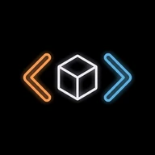{ .mono-icon }

    ### Developer

    Write a spec or some lines of Python. Add your own models, steps and plots.

    [Read the quickstart](getting-started/quickstart.md){ .mono-more }

    [Extend the platform](extend/index.md){ .mono-more }

    [Look up the spec format](reference/spec-format.md){ .mono-more }

-   { .mono-icon }

    ### Operator

    Install the platform, keep it secure and manage the teams that use it.

    [Read the deployment overview](operations/index.md){ .mono-more }

    [Start with Docker Compose](operations/docker.md){ .mono-more }

    [Manage members and quotas](guides/administration.md){ .mono-more }

-   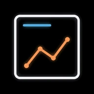{ .mono-icon }

    ### Client

    An analyst made a dashboard for you. Read it and ask questions about it.

    [Read your dashboard](guides/for-clients.md){ .mono-more }

    [Ask about your dashboard](guides/ask-about-your-dashboard.md){ .mono-more }

</section>

<section class="mono-band mono-band--tight" markdown>

Quick links

## Do a task. { .mono-headline .mono-headline--s }

-   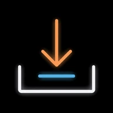{ .mono-icon }

    ### Install

    [Install the packages](getting-started/index.md#install){ .mono-more }

-   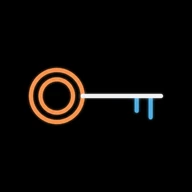{ .mono-icon }

    ### Sign in

    [Sign in with a browser](guides/authentication.md#browser-sign-in){ .mono-more }

-   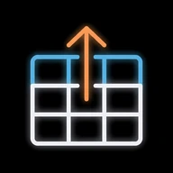{ .mono-icon }

    ### Upload data

    [Upload a spreadsheet](guides/guided-data.md){ .mono-more }

-   { .mono-icon }

    ### Choose a model

    [Get a ranked shortlist](guides/choosing-a-model.md){ .mono-more }

-   { .mono-icon }

    ### Check a model

    [Run the null tests](guides/null-tests.md){ .mono-more }

-   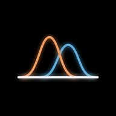{ .mono-icon }

    ### Compare runs

    [Compare runs side by side](guides/run-comparison.md){ .mono-more }

-   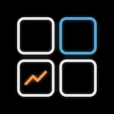{ .mono-icon }

    ### Build a dashboard

    [Make a client dashboard](guides/client-dashboards.md){ .mono-more }

-   { .mono-icon }

    ### Share a link

    [Make a share link](guides/sharing-dashboards-securely.md#make-a-link){ .mono-more }

-   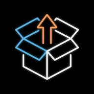{ .mono-icon }

    ### Upload code

    [Upload your own model](extend/upload.md){ .mono-more }

-   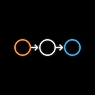{ .mono-icon }

    ### Automate

    [Copy a workflow recipe](guides/workflow-cookbook.md){ .mono-more }

-   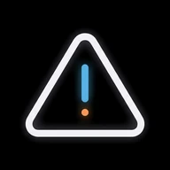{ .mono-icon }

    ### Error codes

    [Find an error code](reference/generated/error-codes.md){ .mono-more }

-   { .mono-icon }

    ### Troubleshoot

    [Fix a problem](operations/troubleshooting.md){ .mono-more }

</section>

<section class="mono-band mono-band--alt mono-band--tight" markdown>

Product tour

## Your first MMM, in four steps. { .mono-headline .mono-headline--s data-reveal }

1.  ### Choose a template and upload your file

    The platform suggests which column is revenue and which columns are spend. It tells you why.

2.  ### Fit the model

    The progress shows in plain language. The platform tests the model on weeks that it did not see.

3.  ### Read the results

    You see the return of each channel with its range. A **sanity scorecard** tells you if you can trust it.

4.  ### Ask "what if"

    Move a slider and see the change in revenue immediately. Then share the result with a link.

[Do the full tutorial](guides/guided-tutorial.md){ .mono-more }

<figure markdown>
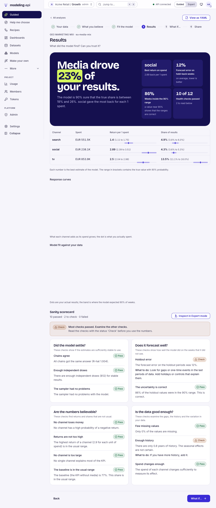{ .mapi-shot loading=lazy }
<figcaption>Step 3: each number has the range that it can be in.</figcaption>
</figure>

<figure markdown>
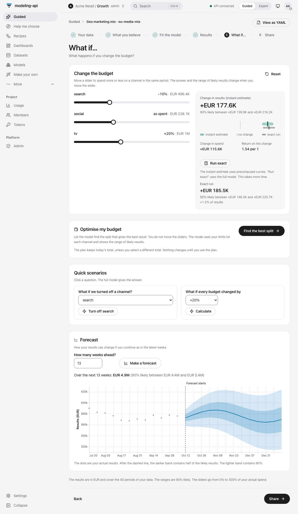{ .mapi-shot loading=lazy }
<figcaption>Step 4: the sliders answer immediately.</figcaption>
</figure>

</section>

<section class="mono-band mono-band--dark mono-band--hero mono-band--left mono-band--tight mono-hero--reference" markdown>

## What is in the box. { .mono-headline data-reveal }

51

Built-in models, in the [models catalog](reference/generated/models-catalog.md).

57

Plot recipes, in the [plot recipes catalog](reference/generated/plots-catalog.md).

57

Workflow nodes, in the [workflow node reference](reference/workflow-nodes.md).

29

Preprocessing steps, in the [steps catalog](reference/generated/steps-catalog.md).

</section>

<section class="mono-band mono-band--tight" markdown>

What's new

## One look, one search. { .mono-headline .mono-headline--s }

Version 0.21 gives the app and the docs one calm look. **Search finds your pages, your work and the docs.**
{ .mono-lead }

[Read what is new in 0.21](whats-new-0.21.md){ .md-button .md-button--primary }
[See the roadmap](roadmap/index.md){ .mono-more }

</section>

<section class="mono-band mono-band--alt mono-band--tight" markdown>

The documentation is CC BY 4.0. The SDK is Apache-2.0. The platform is AGPLv3 or commercial.
Read the [licensing page](project/licensing.md).
{ .mono-lead }

[Why modeling-api?](why.md){ .mono-more }
[See the use cases](use-cases.md){ .mono-more }

</section>
