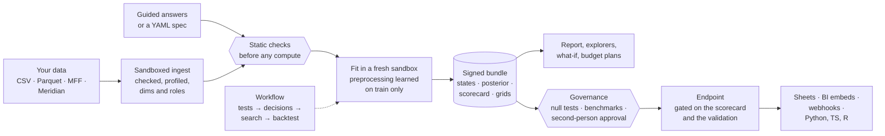
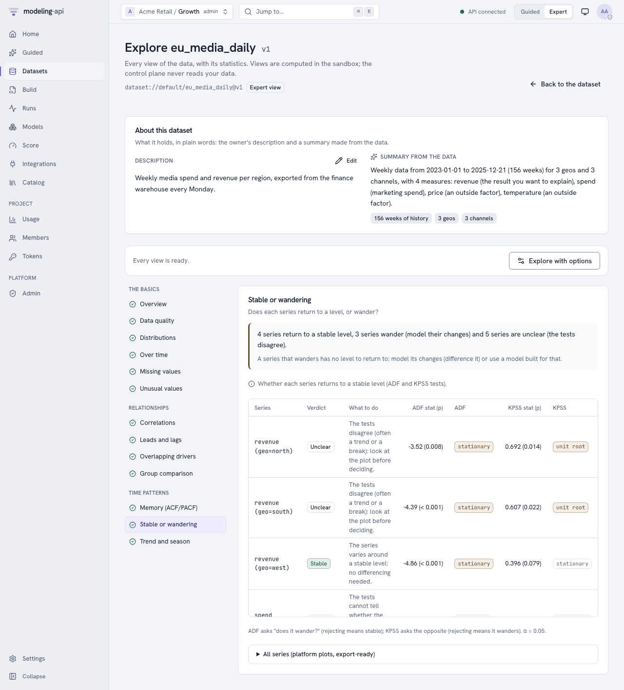
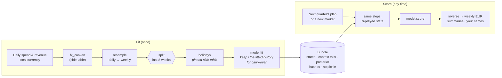

<div class="mapi-hero" markdown>
<div markdown>
<p class="mapi-tagline">Guided for analysts · exact for data scientists · honest uncertainty · one safe platform</p>

# Trustworthy models,<br>from spreadsheet to endpoint.

<p>modeling-api fits Bayesian and classical models of data with <strong>named
dimensions</strong> (market × channel × week, store × product × day, household × trip) and
answers questions with them in the units your business uses. An analyst uploads a spreadsheet
and gets a report, a sanity scorecard and instant what-if sliders. A data scientist writes a
small spec or a few lines of Python and gets the same model behind a versioned endpoint,
with the fitted preprocessing replayed exactly on every call. Whole analyses - tests,
decisions, models, benchmarks - run as versioned **workflows**, and a model only goes live
after it has beaten **shuffled data, fake drivers and a naive forecast**. Every run happens in
a fresh sandbox, and every result says how sure it is.</p>

[Your first MMM in Guided mode](guides/guided-tutorial.md){ .md-button .md-button--primary }
[Quickstart for data scientists](getting-started/quickstart.md){ .md-button }
[What's new in 0.5](whats-new-0.5.md){ .md-button }

</div>

</div>

!!! success "v0.5: workflows, governance, explorers, mmm-framework and statsmodels"
    **Workflows** chain unit-root tests, differencing decisions, AR/MA order searches,
    rolling-origin backtests against naive forecasts, model selection and governance into
    one versioned, schedulable graph. **Governance policies** hold every model to null tests
    - it must beat itself fitted on shuffled results and give fake noise drivers no credit -
    with a second person's approval and an evidence pack. **Data and Model Explorers**,
    **mmm-framework** marketing-mix models with budget optimisation, **twelve statsmodels**
    time-series models, and an **About card on everything** with *Help me choose*.
    [What's new in 0.5](whats-new-0.5.md).

## Two ways in, one model

<div class="mapi-personas" markdown>
<div class="mapi-persona" markdown>

### :material-compass-outline: Analysts

<p class="mapi-promise">Upload → report → scenario in minutes, with honest uncertainty.</p>

- Pick what you want to learn; answer "which column is revenue?" (the platform suggests
  the answer and says why).
- Say what you already believe ("TV returns 1.5 to 4 per euro") or enter a lift test.
- Read a report in plain words, with a **sanity scorecard** that tells you whether to trust it.
- Drag **what-if sliders**: answers in your browser, with a range that stays honest when
  several channels move at once. "Run exact" asks the full model.
- Share a live chart or put the model in a Google Sheet.
- Not sure which model? **Help me choose** asks a few questions and explains its
  recommendations; every option has an *About* card in plain words.

[:octicons-arrow-right-24: Your first analysis in Guided mode](guides/guided-tutorial.md)

</div>
<div class="mapi-persona mapi-persona--expert" markdown>

### :material-code-braces: Data scientists

<p class="mapi-promise">Any PyMC, scikit-learn or forecasting model. Preprocessing replayed exactly. Endpoints in one click.</p>

- A PyMC model is one `build()` method, an sklearn model one `estimator()`; built-in
  marketing-mix, forecasting, demand and choice models are ready to use.
- Steps **learn on the training data only** and are **replayed**, never refitted, at score
  time: forecasts, new markets, counterfactuals.
- Uncertainty is first-class: draws, quantiles or intervals, with the aggregations that are
  valid for each.
- Promote a version to an **endpoint** through the scorecard gate; copy a snippet for
  Python, TypeScript, curl, R, Apps Script or a notebook.
- Automate the statistics: **workflows** of tests, branches, searches, backtests and
  governance checks, run live from `mapi workflows run --watch` or `api.workflows`.

[:octicons-arrow-right-24: Quickstart: zero to first model](getting-started/quickstart.md) ·
[Workflow cookbook](guides/workflow-cookbook.md)

</div>
</div>

Both edit the same `ModelSpec`: every Guided screen has **View as YAML**, and an expert's
changes come back to Guided mode intact. [Who it is for, and who it is not for](why.md).

## How it works



1. **Your data stays labelled.** The upload becomes an `xr.Dataset` with named dims, roles and
   units; nothing downstream is positional.
2. **Mistakes fail early.** A spec that would leak the holdout, a forecast past what the
   model supports, a market the model has never seen: typed errors, before any compute.
3. **Fitting learns, scoring replays.** Every preprocessing step stores what it learned, so a
   forecast or a new market goes through exactly the same transformations, then back into
   your units.
4. **Results are checked twice.** Outputs are verified against the storage's own checksums
   and signed; the scorecard checks convergence, holdout error and plausibility.
5. **Models earn their place.** A governance policy holds each version to null tests and
   benchmarks, records the evidence and, if you ask, waits for a second person; endpoints
   can refuse anything that is not validated.
6. **Other tools connect to an endpoint, not a file.** Promote a better model and every
   integration uses it; roll back with one call.
7. **Whole analyses repeat themselves.** A workflow re-runs the tests, decisions, fits and
   checks every Monday or whenever the data changes, reusing every step whose inputs did not
   change.

## Your first MMM in Guided mode

The whole journey of a geo marketing-mix model, from a spreadsheet of weekly spend and
revenue by region to a budget scenario. The times are what an automated "tester" took on a
laptop, almost all of it the platform working: **135 seconds** from upload to scenario.

<div class="mapi-path" markdown>

1. **Choose "Geo marketing mix"** and drop your CSV on the page. Each column is profiled *in
   your browser*; the platform suggests which column is revenue, which are spend, and why.
   *(5 s)*
2. **Say what you believe**, if anything: an ROI range per channel, a lift test. *Preview
   what this means* shows it in business units before any fitting. *(22 s, optional)*
3. **Fit the model.** Plain-language progress; the model is tested on weeks it has not seen,
   then refitted on everything. *(80 s)*
4. **Read the results**: ROI and share per channel with 90% ranges, and the sanity scorecard,
   each check with what to do next. *(instant)*
5. **Ask "what if"**: move search +20% and see the change in revenue with its range at once;
   *Run exact* confirms it with the full model. *(30 s with the exact run and a forecast)*
6. **Share it**: put the model live as an endpoint, or share a chart by link.

</div>

[:octicons-arrow-right-24: The full tutorial, with screenshots](guides/guided-tutorial.md) ·
[From a spreadsheet to a draft, with curl](guides/guided-data.md)

<div class="mapi-shots" markdown>

<figure markdown>
[{ .mapi-shot loading=lazy }](guides/guided-tutorial.md#1-choose-what-you-want-to-learn)
<figcaption>Templates: start from the question, not the model.</figcaption>
</figure>

<figure markdown>
[{ .mapi-shot loading=lazy }](guides/guided-tutorial.md#2-your-data)
<figcaption>Your data: suggested answers, each with its reason.</figcaption>
</figure>

<figure markdown>
[{ .mapi-shot loading=lazy }](guides/guided-tutorial.md#3-what-you-believe)
<figcaption>Beliefs: ROI ranges and lift tests, previewed in business units.</figcaption>
</figure>

<figure markdown>
[{ .mapi-shot loading=lazy }](guides/guided-tutorial.md#5-results-and-the-sanity-scorecard)
<figcaption>Results: every number with the range it could really be in.</figcaption>
</figure>

<figure markdown>
[{ .mapi-shot loading=lazy }](guides/guided-tutorial.md#5-results-and-the-sanity-scorecard)
<figcaption>Scorecard: can you trust it, and what to do if not.</figcaption>
</figure>

<figure markdown>
[{ .mapi-shot loading=lazy }](guides/guided-tutorial.md#6-what-if)
<figcaption>What if: instant answers from per-draw response curves.</figcaption>
</figure>

</div>

## What's new in v0.5

<div class="grid cards" markdown>

-   :material-graph-outline:{ .lg .middle } **Workflows that think like a statistician**

    ---

    Unit roots → differencing → AR/MA orders → rolling-origin backtest → ARIMAX vs naive →
    select → governance, as one versioned YAML graph with live node status, caching,
    schedules and dataset triggers. Seventeen statistical tests, seven split plans,
    Diebold-Mariano.

    [:octicons-arrow-right-24: Workflow cookbook](guides/workflow-cookbook.md)

-   :material-shield-check-outline:{ .lg .middle } **Models must beat noise**

    ---

    Governance policies: shuffled-target and placebo-regressor null tests, naive benchmarks,
    residual whiteness, stability, signs, prior sensitivity. Second-person approval, evidence
    packs, and endpoints that refuse unvalidated models.

    [:octicons-arrow-right-24: Can you trust this model?](guides/null-tests.md)

-   :material-magnify-scan:{ .lg .middle } **Data and Model Explorers**

    ---

    Stationarity, cross-correlation with the KPI, STL, VIF and quality warnings before you
    model; parameters, residual tests, IRF/FEVD, forecasts, backtests and side-by-side
    comparisons after.

    [:octicons-arrow-right-24: Explore a dataset](guides/data-explorer.md)

-   :material-chart-bell-curve-cumulative:{ .lg .middle } **mmm-framework MMMs and budget plans**

    ---

    `mmm.bayesian` pooled over geos and products, `mmm.frequentist` in seconds, business
    priors, lift tests, and budgets optimised from the posterior with risk objectives.

    [:octicons-arrow-right-24: Marketing-mix models](models/mmm-framework.md)

-   :material-chart-timeline-variant:{ .lg .middle } **Twelve statsmodels models**

    ---

    SARIMAX to VECM and Markov switching, with future drivers, prediction intervals,
    impulse responses and cointegration tests.

    [:octicons-arrow-right-24: statsmodels models](models/statsmodels.md)

-   :material-help-circle-outline:{ .lg .middle } **About cards and Help me choose**

    ---

    Every model, step, node, check and template explains itself in plain words; eight
    questions turn into a ranked shortlist with reasons - in the web app, `mapi choose` or
    `api.catalog.recommend()`.

    [:octicons-arrow-right-24: Choosing a model](guides/choosing-a-model.md)

</div>

### See it at work

<div class="mapi-shots" markdown>

<figure markdown>
[{ .mapi-shot loading=lazy }](guides/workflows.md#the-editor)
<figcaption>Workflows: tests, decisions, searches, backtests and governance as one graph, with typed ports.</figcaption>
</figure>

<figure markdown>
[{ .mapi-shot loading=lazy }](guides/workflows.md#running-and-watching)
<figcaption>Run monitor: every step, decision and verdict live, with the run's cost.</figcaption>
</figure>

<figure markdown>
[{ .mapi-shot loading=lazy }](guides/governance.md#validating-a-model-version)
<figcaption>Governance: checks, evidence and a second person's sign-off.</figcaption>
</figure>

<figure markdown>
[{ .mapi-shot loading=lazy }](guides/null-tests.md)
<figcaption>Null tests: the real model must beat itself fitted on shuffled results.</figcaption>
</figure>

<figure markdown>
[{ .mapi-shot loading=lazy }](guides/data-explorer.md)
<figcaption>Data Explorer: does each series wander, with a plain verdict.</figcaption>
</figure>

<figure markdown>
[{ .mapi-shot loading=lazy }](tutorials/optimise-a-budget.md)
<figcaption>Budget plans: mmm-framework planning from the posterior, with the frontier.</figcaption>
</figure>

</div>

[:octicons-arrow-right-24: Everything that is new in 0.5](whats-new-0.5.md)

## What came in v0.4

<div class="grid cards" markdown>

-   :material-compass-outline:{ .lg .middle } **Guided mode**

    ---

    Four templates (geo marketing mix, weekly forecast, demand by store, customer choice),
    role detection, MFF and Meridian presets, drafts you can open as YAML, and a lock that
    keeps a project Guided-only.

    [:octicons-arrow-right-24: Tutorial](guides/guided-tutorial.md)

-   :material-scale-balance:{ .lg .middle } **Business priors and lift tests**

    ---

    ROI or contribution-share ranges translated into model priors in a sandbox, with a
    prior-predictive preview; experiments enter the likelihood as calibration.

    [:octicons-arrow-right-24: Guided modelling](guides/guided-modelling.md)

-   :material-clipboard-check-outline:{ .lg .middle } **Sanity scorecard and promotion gate**

    ---

    Convergence, holdout error and coverage, plausibility and data checks, each in plain
    words. Pass goes live, warn needs an admin's audited reason, fail is blocked.

    [:octicons-arrow-right-24: The gate](concepts/integrations.md#promotion-gate)

-   :material-tune-variant:{ .lg .middle } **What-if, forecasts, counterfactuals**

    ---

    Sliders over response curves precomputed per posterior draw, so bands stay joint and
    honest; "Run exact" scores the full model with common random numbers.

    [:octicons-arrow-right-24: What if…](guides/guided-tutorial.md#6-what-if)

-   :material-api:{ .lg .middle } **Endpoints, aliases and snippets**

    ---

    A stable alias per use, history and rollback, a frozen input contract with an example
    call, `score:<alias>` tokens, and generated code in seven flavours.

    [:octicons-arrow-right-24: Integrations hub](guides/integrations-hub.md)

-   :material-webhook:{ .lg .middle } **Signed webhooks**

    ---

    `run.*`, `model.version.ready`, `endpoint.promoted`, `score.completed`: HMAC-signed,
    retried, logged and replayable, through an SSRF guard.

    [:octicons-arrow-right-24: Receive webhooks](guides/webhook-receivers.md)

-   :material-chart-box-plus-outline:{ .lg .middle } **Embeds and static renders**

    ---

    Read-only, expiring chart links for Notion, Slack, Looker Studio or Power BI, and PNG,
    SVG or PDF rendered in the sandbox.

    [:octicons-arrow-right-24: Embed a chart](tutorials/embed-a-chart.md)

-   :material-google-spreadsheet:{ .lg .middle } **Google Sheets**

    ---

    A card on every endpoint generates an Apps Script that writes a forecast into a sheet
    every morning, with a token scoped to that one endpoint.

    [:octicons-arrow-right-24: Connect Sheets](tutorials/google-sheets.md)

-   :material-account-check-outline:{ .lg .middle } **Sign-up and the data lifecycle**

    ---

    Self-service workspaces with e-mail verification and abuse controls, GDPR export, tenant
    deletion that purges every store, and a Cloud Armor policy.

    [:octicons-arrow-right-24: Deleting and exporting data](guides/data-deletion.md)

-   :material-cart-outline:{ .lg .middle } **A customer-choice model**

    ---

    `choice.multinomial_logit`, a conditional logit with household effects, and categorical
    holdout metrics: hit rate against always guessing the favourite, log score, Brier.

    [:octicons-arrow-right-24: Use cases](use-cases.md#customer-choice)

-   :material-console:{ .lg .middle } **Client and CLI for all of it**

    ---

    `api.endpoint("…").score(ds)` returns an `xarray.Dataset`; `mapi endpoints`, `webhooks`,
    `plots`, `guided`, `priors` and `tenant` cover the rest from a terminal.

    [:octicons-arrow-right-24: The Python client](guides/python-client.md)

</div>

## Measured, not promised

Measured on an 8-core laptop against the whole stack, with real fits in the sandboxed runner.
The v0.5 journeys, on the data and settings of [M3.5 verification](operations/m35-verification.md):

<div class="mapi-stats" markdown>
<div class="mapi-stat"><strong>37–40 s</strong><span>the canonical workflow, 19 nodes from unit-root tests to governance, through the orchestrator and the sandboxed runner</span></div>
<div class="mapi-stat"><strong>p = 0.7–0.95</strong><span>an ARIMAX fitted on pure noise against 19 shuffled refits: validation fails, promotion answers NOT_VALIDATED</span></div>
<div class="mapi-stat"><strong>0.1 %</strong><span>of the result credited to three fake noise drivers by a model fitted on real signal</span></div>
<div class="mapi-stat"><strong>26 s</strong><span>a validation with the null tests: 19 shuffled refits plus 3 fake drivers</span></div>
<div class="mapi-stat"><strong>10–16 s</strong><span>an mmm-framework budget plan with a 5-point efficient frontier, in the sandbox</span></div>
</div>

Those runs found eight defects that no unit, integration or mocked-browser test could see;
each was fixed with a regression test before release. The v0.4 journey, on the data of
[M3 verification](operations/m3-verification.md):

<div class="mapi-stats" markdown>
<div class="mapi-stat"><strong>135 s</strong><span>upload → report → scenario, clicked through by a script; 79 s of it is the fit</span></div>
<div class="mapi-stat"><strong>0.08 %</strong><span>instant slider vs the exact model for TV at half budget (−454,590 vs −454,241; exact sd 14,003)</span></div>
<div class="mapi-stat"><strong>0.01 %</strong><span>"TV off" from the grid vs an exact counterfactual run (−1,046,519 vs −1,046,414)</span></div>
<div class="mapi-stat"><strong>76–81 %</strong><span>of each translated prior inside the analyst's stated 80% ROI range</span></div>
<div class="mapi-stat"><strong>0 objects</strong><span>left in five buckets after a tenant deletion (285 before); only the audit log and cost ledger are kept</span></div>
</div>

Not yet measured: real testers, a real Google Cloud project, Docker-isolated public
workspaces ([what remains](operations/m3-verification.md#what-remains-unverified)).

## Connect it to everything

<div class="mapi-shots" markdown>

<figure markdown>
[{ .mapi-shot loading=lazy }](guides/integrations-hub.md)
<figcaption>Integrations: Sheets, BI and webhooks in a few steps.</figcaption>
</figure>

<figure markdown>
[{ .mapi-shot loading=lazy }](guides/integrations-hub.md#an-endpoints-page)
<figcaption>Endpoints: one alias, every promotion and rollback with its reason.</figcaption>
</figure>

<figure markdown>
[{ .mapi-shot loading=lazy }](guides/integrations-hub.md#an-endpoints-page)
<figcaption>Snippets: Python, TypeScript, curl, R, Apps Script, notebook.</figcaption>
</figure>

<figure markdown>
[{ .mapi-shot loading=lazy }](tutorials/embed-a-chart.md)
<figcaption>Embeds: a read-only chart for a dashboard or a doc, revocable at any time.</figcaption>
</figure>

</div>

```python
--8<-- "client_integrations.py:score"
```

[:octicons-arrow-right-24: Tutorials](tutorials/index.md) ·
[Use cases](use-cases.md) ·
[The Python client](guides/python-client.md)

## The core idea: fit with preprocessing, score with the *same* preprocessing

The same pipeline object runs at fit time and at score time. At fit time each step
**learns** its state from the training data; at score time it **replays** that state. Steps
that look back in time store a small per-group tail, so a forecast sees exactly the history
the model was fitted on.



=== "What you write"

    ```yaml
    pipeline:
      - {id: to_eur, use: core.fx_convert@^1, with: {vars: [y, spend], table: fx, ...}}
      - {id: weekly, use: core.resample@^1,   with: {dim: time, freq: W-SUN, how: sum}}
      - {id: hols,   use: core.holidays@^1,   with: {table: holidays, along: time}}
    model:
      use: mmm.bayesian@^1                 # mmm-framework: scaling and carry-over inside
      settings: {hierarchy: {pool_over: [geo]}, new_levels: hyperprior}
      fit: {mode: evaluate_then_refit}
    ```

=== "What the platform does"

    1. Checks the whole spec **statically**: names, dims, settings, units at every stage, where
       the split happens and whether any step would learn from the holdout (`LEAKAGE_RISK`).
    2. Fits each stateful step on the **training weeks only**, fits the model, then scores the
       holdout **through the same path a forecast uses** and records the metrics.
    3. Refits on all weeks so forecasts start from the latest data, and writes a bundle with
       every state, context tail and hash.

=== "What you get back"

    - Forecasts in **weekly EUR**, not "model units": the model reports its own units, and
      they stop at the weekly resample because daily values cannot be recovered from weekly sums.
      The output says so in its `output_space` (`model-owned`) and `units` attributes.
    - A new market drawn from the fitted **hyperprior**, honestly wider than a known one.
    - What-if deltas that share their noise with the baseline (common random numbers), so
      the delta reflects the change, not sampling noise.

The same model in plain Python, without any server; every snippet on this site is executed
by the test suite:

```python
--8<-- "quickstart.py:fit"
```

```python
--8<-- "quickstart.py:errors"
```

## Secure by design

The platform is built to run models and data from people it does not trust. The controls that
matter most are not settings you can forget to turn on: they are how it works.
[The security model](concepts/security.md) says what each one stops, and what is still to be
verified in the cloud.

<div class="grid cards" markdown>

-   :material-cube-scan:{ .lg .middle } **A fresh sandbox per run**

    ---

    Every ingest, fit, score and render runs in its own sandbox (a microVM on Cloud Run
    Jobs), with no secrets and no network but signed URLs to its own objects. Placement by
    trust tier is enforced in code.

-   :material-domain:{ .lg .middle } **Tenants never see each other**

    ---

    PostgreSQL row-level security on every table, pinned per transaction and failing closed;
    roles checked at every request; operators manage the platform without reading tenant
    data.

-   :material-check-decagram-outline:{ .lg .middle } **Outputs are claims**

    ---

    A run's outputs are checked against the store's own hashes and generations, copied where
    runs cannot write, and signed. Download links are minted only after the signature
    verifies.

-   :material-shield-link-variant-outline:{ .lg .middle } **Integrations that cannot be turned against you**

    ---

    Webhooks are HMAC-signed and sent through an SSRF guard that pins the checked address;
    embed links show platform recipes only, carry no credential and can be revoked; snippets
    never contain a secret.

-   :material-cash-lock:{ .lg .middle } **Compute you can see and cap**

    ---

    Quotas in vCPU-seconds per token, tenant and platform, per-token budgets for endpoint
    callers, a cost on every run, a global spend cap and an audited kill switch.

-   :material-file-lock-outline:{ .lg .middle } **No pickle, anywhere**

    ---

    Bundles are single zarr zips plus JSON sidecars; native models are skops (allow-listed
    types) or xgboost JSON. Every file carries CRC32C, MD5 and SHA-256, and reading verifies
    them.

</div>

## Run it for many teams

One deployment serves many organisations. People sign up or sign in with their own identity
provider, work in the projects they have a role in, and see what their compute costs;
operators look after the platform without ever reading a tenant's data.

<div class="mapi-shots" markdown>

<figure markdown>
[{ .mapi-shot loading=lazy }](guides/authentication.md#browser-sign-in)
<figcaption>Tenants and projects: your role in each, and each tenant's trust tier.</figcaption>
</figure>

<figure markdown>
[{ .mapi-shot loading=lazy }](guides/administration.md#cost-and-usage)
<figcaption>Usage: metered cost per run, by token and resource class, against every quota.</figcaption>
</figure>

<figure markdown>
[{ .mapi-shot loading=lazy }](guides/data-deletion.md)
<figcaption>Your data: a GDPR export, and a deletion that purges every store.</figcaption>
</figure>

</div>

[:octicons-arrow-right-24: Administration](guides/administration.md) ·
[Deploy on your laptop or Google Cloud](operations/index.md) ·
[Roadmap: what comes next](roadmap/index.md)
