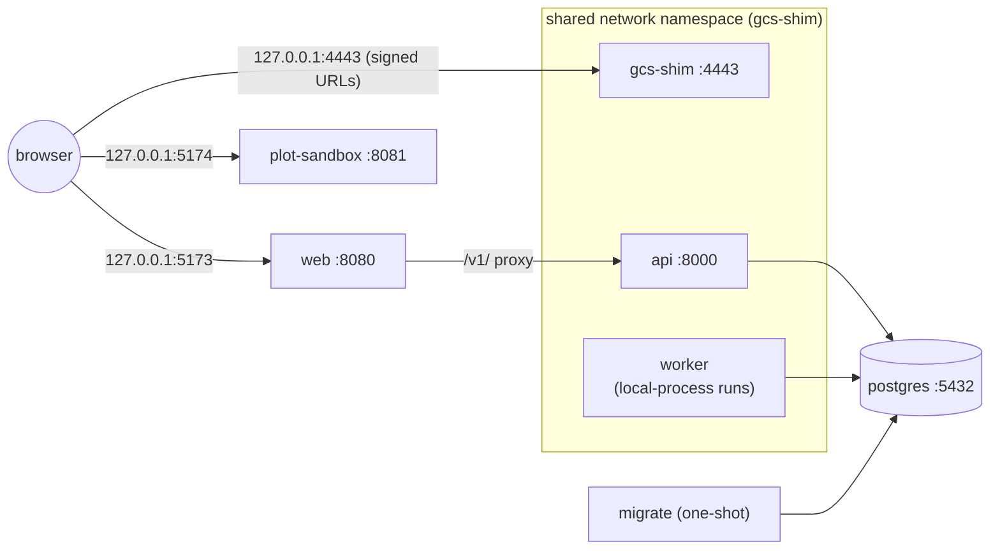

# Docker Compose <span class="mapi-badge">v0.2</span>

`docker-compose.yml` runs the platform's [container images](images.md) as a single-tenant
stack on one machine: the same services as `make dev`, on the same ports, but from the
exact images that production uses. You do not need Docker for development (see
[Local, without Docker](local-development.md)); use compose to check the images end to end or
to run a self-contained demo. What is inside each image, how it is built and the build-time
guards are on [Container images](images.md).

```bash
cp .env.example .env               # set POSTGRES_PASSWORD
make docker-build                  # every image, tagged mapi/<name>:<version>
make compose-up                    # docker compose up -d --wait
make seed                          # load the E33 demo through the API
open http://127.0.0.1:5173
make compose-logs SERVICE=api      # follow one service
make compose-down                  # VOLUMES=1 also deletes the database and objects
```

## The stack



| Service | Image | Published on the host |
|---|---|---|
| `postgres` | `postgres:16` (pinned by digest) | not published; see the override example |
| `gcs-shim` | `mapi/gcs-shim` | `127.0.0.1:4443` and `127.0.0.1:8000` (the API, which shares this namespace) |
| `migrate` | `mapi/server`, `migrate`; compose waits for it to exit with status 0 | — |
| `api` | `mapi/server`, `api` | via `gcs-shim` |
| `worker` | `mapi/worker`, `mapi-server worker`, `MAPI_EXECUTOR=local-process` | — |
| `web` | `mapi/web` with only the app server block | `127.0.0.1:5173` |
| `plot-sandbox` | `mapi/web` with only the sandbox server block | `127.0.0.1:5174` |

**Why `api`, `worker` and `gcs-shim` share one network namespace.** Signed URLs embed the object
store's address, and the bootstrap URL template embeds it for runner processes. If the API
reached the shim as `gcs-shim:4443` while the browser needed `127.0.0.1:4443`, every URL would
need a public form and an internal form. With a shared namespace, `127.0.0.1:4443` and
`127.0.0.1:8000` mean the same thing to the browser, the API, the orchestrator and every runner
subprocess. That is exactly the `make dev` topology, and it matches the `LocalDev` defaults. The
`web` container reaches the API as `api:8000`, which is a network alias of the shim's container.

**Hardening.** Every `mapi/*` service runs as a non-root user, with a read-only root filesystem,
a tmpfs on `/tmp`, all Linux capabilities dropped and `no-new-privileges`. Ports are published on
`127.0.0.1` only. The PostgreSQL password comes from `.env`, and compose refuses to start
without it. The official `postgres` image is the one exception: it starts as root to fix data
directory ownership, then drops to the `postgres` user.

### Executor choice: local-process vs docker

The compose worker runs the **local-process executor inside a runner-capable image**: each run
is a `mapi-runner` subprocess of the worker container. That is the default because it needs
no Docker socket and is daemon-agnostic. Its trade-offs:

| | local-process in `mapi/worker` (default) | docker executor (`compose.override.example.yml`) |
|---|---|---|
| Isolation | Process only: runs share the worker's filesystem, `/tmp` and memory limit | One container per run, from the exact runner image, with its own limits; `--network none` is possible |
| Images | One large image holding every plugin plus the control plane | The control-plane image for the worker, and `mapi/base-*` per run |
| Privileges | None beyond the worker's own | The worker mounts `/var/run/docker.sock`, which is **root-equivalent on the host** |
| Networking | Runs reach `127.0.0.1:4443` directly | Run containers must join the `gcs-shim` network namespace |
| Use it for | Day-to-day development, demos, CI | Checking production images end to end, and self-hosted setups (gVisor `runsc` in v0.3) |

Neither mode is a multi-tenant boundary. Both are single-tenant local stacks, and the
local-process executor is meant to refuse any multi-tenant profile. The worker's `/tmp` is the
scratch space for local-process runs. Size it with `MAPI_WORKER_TMPFS`, `MAPI_WORKER_MEMORY` and
`MAPI_WORKER_CPUS` in `.env`.

## Configuration

Compose reads `.env` in the repository root (copy `.env.example`). `POSTGRES_PASSWORD` is
required; the `MAPI_WORKER_*` sizes, the image version (`MAPI_VERSION`, set by the Makefile)
and the web image's `MAPI_API_UPSTREAM` and `MAPI_WEB_SCRIPT_SRC_EXTRA` are optional. Every
variable is in the [configuration reference](configuration.md#docker-compose).

`compose.override.example.yml` shows the two common changes: publishing PostgreSQL on the
host, and switching the worker to the docker executor. Copy it to `compose.override.yml`
(ignored by version control) to use it.

## Troubleshooting

A missing Docker daemon, `POSTGRES_PASSWORD`, an unhealthy `api` container, a read-only
`/tmp` and ports that are already allocated are covered in
[Troubleshooting](troubleshooting.md#docker-and-compose).
