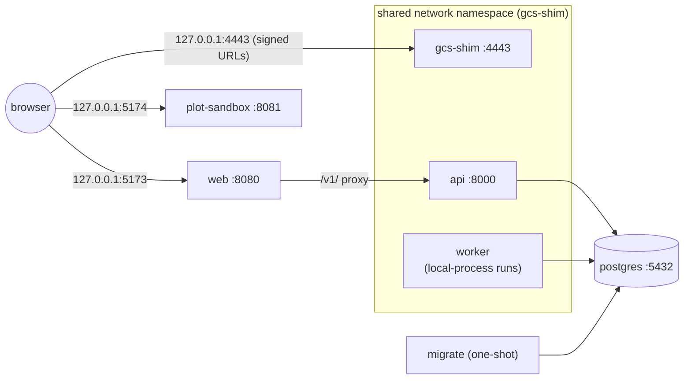

# Docker Compose <span class="mapi-badge">v0.2</span>

`docker-compose.yml` runs the platform's [container images](images.md) as a local stack on
one machine, in the `dev` profile like `make dev` (sign in as `admin@dev.local`; see
[signing in](local-development.md#signing-in)): the same services as `make dev`, on the same ports, but from the
exact images that production uses. You do not need Docker for development (see
[Local, without Docker](local-development.md)); use compose to check the images end to end or
to run a self-contained demo. What is inside each image, how it is built and the build-time
guards are on [Container images](images.md).

```bash
cp .env.example .env               # set POSTGRES_PASSWORD
make docker-build                  # every image, tagged mapi/<name>:<version>
make compose-up                    # docker compose up -d --wait
make seed                          # load the E33 demo through the API
open http://127.0.0.1:5173
make compose-logs SERVICE=api      # follow one service
make compose-down                  # VOLUMES=1 also deletes the database and objects
```

## The stack



| Service | Image | Published on the host |
|---|---|---|
| `postgres` | `postgres:16` (pinned by digest) | not published; see the override example |
| `gcs-shim` | `mapi/gcs-shim` | `127.0.0.1:4443` and `127.0.0.1:8000` (the API, which shares this namespace) |
| `migrate` | `mapi/server`, `migrate`; compose waits for it to exit with status 0 | — |
| `api` | `mapi/server`, `api` | via `gcs-shim` |
| `worker` | `mapi/worker`, `mapi-server worker`, `MAPI_EXECUTOR=local-process` | — |
| `web` | `mapi/web` with only the app server block | `127.0.0.1:5173` |
| `plot-sandbox` | `mapi/web` with only the sandbox server block | `127.0.0.1:5174` |

**Why `api`, `worker` and `gcs-shim` share one network namespace.** Signed URLs embed the object
store's address, and the bootstrap URL template embeds it for runner processes. If the API
reached the shim as `gcs-shim:4443` while the browser needed `127.0.0.1:4443`, every URL would
need a public form and an internal form. With a shared namespace, `127.0.0.1:4443` and
`127.0.0.1:8000` mean the same thing to the browser, the API, the orchestrator and every runner
subprocess. That is exactly the `make dev` topology, and it matches the `LocalDev` defaults. The
`web` container reaches the API as `api:8000`, which is a network alias of the shim's container.

**Durable state.** Three named volumes outlive the containers: `pgdata` (the database),
`gcsdata` (the shim's objects and principal key files) and `keys` (the bundle-signing key).
The worker's finalizer signs every bundle manifest, and the API verifies that signature
before it hands out an artifact link, a `ui/` view or a plot, and before it accepts a score
request. Both must therefore load the *same* key, and the key must survive restarts.
`migrate` creates it once at `/var/lib/mapi/keys/bundle-signing-p256.pem`
(`MAPI_SIGNING_KEY_PATH`). `api` and `worker` mount the volume read-only, with
`MAPI_SIGNING_KEY_CREATE=false`, so a missing key fails start-up loudly instead of a new key
being minted silently. `MAPI_DATA_DIR` (`/tmp/mapi-data`) is per-container scratch.
`make compose-down VOLUMES=1` deletes the key along with the data. A new key cannot verify old
bundles, so delete it only together with the database and the objects.

**Hardening.** Every `mapi/*` service runs as a non-root user, with a read-only root filesystem,
a tmpfs on `/tmp`, all Linux capabilities dropped and `no-new-privileges`. Ports are published on
`127.0.0.1` only. The PostgreSQL password comes from `.env`, and compose refuses to start
without it. The official `postgres` image is the one exception: it starts as root to fix data
directory ownership, then drops to the `postgres` user.

**Host names.** The M1 API has no authentication, and a web page whose host name is
re-pointed at `127.0.0.1` (DNS rebinding) is same-origin to itself, so CORS does not stop it.
The API therefore answers only the `Host` names in `MAPI_ALLOWED_HOSTS` (default `127.0.0.1`,
`localhost`, `api`, plus the host of `MAPI_API_URL`) and returns 400 for anything else. The
app's nginx server answers only `MAPI_WEB_SERVER_NAMES` (default `127.0.0.1 localhost`) and
closes the connection for any other host. The GCS shim does the same, for loopback names and
the hosts of its endpoints (`--allowed-host` adds more). If you reach the stack under another
name, such as a LAN host name, add it to both variables.

### Executor choice: local-process vs docker

The compose worker runs the **local-process executor inside a runner-capable image**: each run
is a `mapi-runner` subprocess of the worker container. That is the default because it needs
no Docker socket and is daemon-agnostic. Its trade-offs:

| | local-process in `mapi/worker` (default) | docker executor (`compose.override.example.yml`) |
|---|---|---|
| Isolation | Process only: runs share the worker's uid, filesystem (including its keys, see below), `/tmp` and memory limit | One container per run, from the exact runner image, with its own limits and a network that reaches only the shim |
| Images | One large image holding every plugin plus the control plane | `mapi/worker` for the orchestrator, and per run the `mapi/base-*` image that ships the run's plugin (`MAPI_DOCKER_IMAGES`) |
| Privileges | None beyond the worker's own | The worker mounts `/var/run/docker.sock`, which is **root-equivalent on the host** |
| Networking | Runs reach `127.0.0.1:4443` directly | Run containers join the `gcs-shim` network namespace (`MAPI_DOCKER_NETWORK=container:mapi-gcs-shim`) |
| Use it for | Day-to-day development, demos, CI | Checking production images end to end, and self-hosted setups (gVisor `runsc` in v0.3) |

**Docker executor settings.** `MAPI_DOCKER_IMAGES` maps a plugin namespace to its runner
image: `mmm.*` and `tabular.*` run in `mapi/base-bayes`, `sklearn.*` in `mapi/base-ml` and
`ts.*` in `mapi/base-forecast`. A workflow node run goes to the image of the model it
runs: its `model` parameter (a backtest or search of `ts.sarimax`), else the plugin of the
model version bound to it (a forecast, evaluation or governance check of a fitted model).
Runs without a model plugin (ingest, describe, statistical tests) use `MAPI_DOCKER_IMAGE`. The defaults are the tags `make docker-build` produces for the current
version. `MAPI_DOCKER_NETWORK` must give the run a way to reach the object store, because
the bootstrap object and every signed URL point at it. In compose that means joining the
shim's network namespace (`container:mapi-gcs-shim`). An internal Docker network that holds
only the shim also works, provided `MAPI_GCS_ENDPOINT` names the shim on that network.
`none` would leave the runner with nothing to fetch its bootstrap object from, so the worker
refuses to start with it.

**docker-gvisor for verified and public tenants.** Shared tiers need an executor with
egress and DNS enforced. Since `none` is not usable, put the run containers on an internal
network that holds nothing but the shim (`docker network create --internal mapi-sandbox`,
the shim attached to it and to nothing that routes out), set
`MAPI_DOCKER_NETWORK=mapi-sandbox` and declare it with `MAPI_DOCKER_NETWORK_ISOLATED=true`
(`host`, `bridge` and `default` are refused). The executor then reports enforced egress and
DNS, but the dispatcher places `verified` and `public` tenants on it only once the security
suite ran against it with the `http_egress`, `dns_egress` and `metadata_token` probes
blocked, and that result and a passing conformance run are recorded
([the shared-tier gate](cloud-run.md#the-shared-tier-gate)).

**Worker isolation in run containers.** A run container starts its supervisor as root, with
every Linux capability dropped except the few the uid split needs, and with
`no-new-privileges`. The supervisor then starts the untrusted worker as uid 10001, which has no
capabilities at all. So the worker cannot signal the supervisor, read its or the init
process's environment, or write to its event pipe. The executor also sets
`MAPI_REQUIRE_ISOLATION=1`, which makes the supervisor fail the run with `SANDBOX_VIOLATION`
rather than run the worker under its own uid.

Neither mode is a multi-tenant boundary. Both are single-tenant local stacks, and the
local-process executor refuses any multi-tenant profile.

**What a local-process run can reach.** Every run is a subprocess of `mapi-server worker` and
runs as the same uid, `10001`. There is no uid split before v0.3. Run code, meaning plugins
and the steps they load, can therefore read everything the orchestrator can read:

- the shim's control key (`/shim/gcs/_shim/keys/control.json`): `storage.admin` on every
  bucket, enough to read or rewrite bundles, datasets and run outputs and to mint signed
  URLs;
- the bundle-signing key (`/var/lib/mapi/keys/`), enough to forge a manifest the API accepts;
- the executions directory under `/tmp/mapi-data`, including the pid files that name the
  nonces of runs in flight.

In this mode, then, bundle signatures and the finalizer's output checks protect against
accidents, not against hostile plugin code. The orchestrator marks itself non-dumpable, so
run code cannot ptrace it or read its `/proc/<pid>/environ` (`DATABASE_URL` with the
password) or its memory. The worker also logs this warning at start-up. Run only trusted
plugin code under local-process. The docker executor does not have this exposure: each
attempt runs in its own container with none of these files mounted. The worker's `/tmp` is the
scratch space for local-process runs. Size it with `MAPI_WORKER_TMPFS`, `MAPI_WORKER_MEMORY` and
`MAPI_WORKER_CPUS` in `.env`.

## Configuration

Compose reads `.env` in the repository root (copy `.env.example`). `POSTGRES_PASSWORD` is
required; the `MAPI_WORKER_*` sizes, the image version (`MAPI_VERSION`, set by the Makefile)
and the web image's `MAPI_API_UPSTREAM` and `MAPI_WEB_SCRIPT_SRC_EXTRA` are optional. Every
variable is in the [configuration reference](configuration.md#docker-compose).

`compose.override.example.yml` shows the two common changes: publishing PostgreSQL on the
host, and switching the worker to the docker executor. Copy it to `compose.override.yml`
(ignored by version control) to use it.

## Troubleshooting

A missing Docker daemon, `POSTGRES_PASSWORD`, an unhealthy `api` container, a read-only
`/tmp` and ports that are already allocated are covered in
[Troubleshooting](troubleshooting.md#docker-and-compose).
