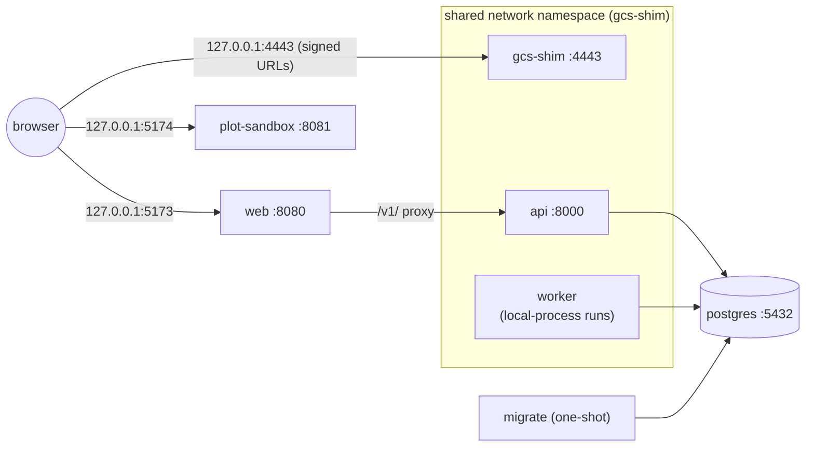

# Docker Compose <span class="mapi-badge">v0.2</span>

`docker-compose.yml` runs the [container images](images.md) of the platform as a local stack
on one machine. It uses the `dev` profile, the same as `make dev` (sign in as
`admin@dev.local`, refer to [signing in](local-development.md#signing-in)). It runs the same
services as `make dev`, on the same ports, but from the exact images that production uses.

You do not need Docker for development (refer to
[Local, without Docker](local-development.md)). Use compose to do a full check of the images,
or to run a self-contained demo. [Container images](images.md) tells what is in each image,
how the build makes it, and the build-time checks.

```bash
cp .env.example .env               # set POSTGRES_PASSWORD
make docker-build                  # every image, tagged mapi/<name>:<version>
make compose-up                    # docker compose up -d --wait
make seed                          # load the E33 demo through the API
open http://127.0.0.1:5173
make compose-logs SERVICE=api      # follow one service
make compose-down                  # VOLUMES=1 also deletes the database and objects
```

## The stack



| Service | Image | Published on the host |
|---|---|---|
| `postgres` | `postgres:16` (pinned by digest) | not published. Refer to the override example |
| `gcs-shim` | `mapi/gcs-shim` | `127.0.0.1:4443` and `127.0.0.1:8000` (the API, which shares this namespace) |
| `migrate` | `mapi/server`, `migrate`. Compose waits until it stops with status 0 | — |
| `api` | `mapi/server`, `api` | through `gcs-shim` |
| `worker` | `mapi/worker`, `mapi-server worker`, `MAPI_EXECUTOR=local-process` | — |
| `web` | `mapi/web` with only the app server block | `127.0.0.1:5173` |
| `plot-sandbox` | `mapi/web` with only the sandbox server block | `127.0.0.1:5174` |

**Why `api`, `worker` and `gcs-shim` share one network namespace.** Signed URLs contain the
address of the object store. The bootstrap URL template also contains it for runner
processes. The API could connect to the shim as `gcs-shim:4443`, while the browser needs
`127.0.0.1:4443`. Then each URL would need a public form and an internal form. With a shared
namespace, `127.0.0.1:4443` and `127.0.0.1:8000` mean the same thing to the browser, the API,
the orchestrator and each runner subprocess. This is exactly the `make dev` topology, and it
agrees with the `LocalDev` defaults. The `web` container connects to the API as `api:8000`,
which is a network alias of the container of the shim.

**Durable state.** Three named volumes stay after the containers stop: `pgdata` (the
database), `gcsdata` (the objects and principal key files of the shim) and `keys` (the
bundle-signing key). The finalizer of the worker signs each bundle manifest. The API verifies
that signature before it gives an artifact link, a `ui/` view or a plot. It also verifies the
signature before it accepts a score request. Thus the two services must load the *same* key,
and the key must stay after restarts.

`migrate` makes the key one time at `/var/lib/mapi/keys/bundle-signing-p256.pem`
(`MAPI_SIGNING_KEY_PATH`). `api` and `worker` mount the volume read-only, with
`MAPI_SIGNING_KEY_CREATE=false`. Thus, if the key is missing, start-up fails with a clear
error, and the services do not mint a new key without a message. `MAPI_DATA_DIR`
(`/tmp/mapi-data`) is the scratch directory of each container.

!!! caution
    Do not delete the key without the database and the objects. A new key cannot verify old
    bundles. `make compose-down VOLUMES=1` deletes the key together with the data.

**Hardening.** Each `mapi/*` service runs as a non-root user, with a read-only root
filesystem, a tmpfs on `/tmp`, all Linux capabilities dropped and `no-new-privileges`.
Compose publishes ports on `127.0.0.1` only. The PostgreSQL password comes from `.env`, and
compose does not start without it. The official `postgres` image is the one exception. It
starts as root to set the owner of the data directory, then it changes to the `postgres`
user.

**Host names.** The M1 API has no authentication. An attacker can point the host name of a
web page at `127.0.0.1` (DNS rebinding). The page is then same-origin to itself, so CORS does
not stop it. Thus the API answers only the `Host` names in `MAPI_ALLOWED_HOSTS` (default
`127.0.0.1`, `localhost`, `api`, and also the host of `MAPI_API_URL`). For all other names,
it returns 400.

The nginx server of the app answers only `MAPI_WEB_SERVER_NAMES` (default
`127.0.0.1 localhost`). It closes the connection for all other hosts. The GCS shim does the
same, for loopback names and the hosts of its endpoints (`--allowed-host` adds more). If you
connect to the stack with a different name, for example a LAN host name, add it to the two
variables.

### Executor choice: local-process vs docker

The compose worker runs the **local-process executor inside a runner-capable image**. Each
run is a `mapi-runner` subprocess of the worker container. This is the default, because it
needs no Docker socket and works with all daemons. The two executors have these differences:

| | local-process in `mapi/worker` (default) | docker executor (`compose.override.example.yml`) |
|---|---|---|
| Isolation | Process only: runs share the uid, filesystem (with its keys, refer to the text below), `/tmp` and memory limit of the worker | One container for each run, from the exact runner image, with its own limits and a network that connects only to the shim |
| Images | One large image with all plugins and the control plane | `mapi/worker` for the orchestrator. For each run, the `mapi/base-*` image that contains the plugin of the run (`MAPI_DOCKER_IMAGES`) |
| Privileges | Only the privileges of the worker | The worker mounts `/var/run/docker.sock`, which is **root-equivalent on the host** |
| Networking | Runs connect to `127.0.0.1:4443` directly | Run containers join the `gcs-shim` network namespace (`MAPI_DOCKER_NETWORK=container:mapi-gcs-shim`) |
| Use it for | Daily development, demos, CI | A full check of the production images, and self-hosted setups (gVisor `runsc` in v0.3) |

**Docker executor settings.** `MAPI_DOCKER_IMAGES` maps a plugin namespace to its runner
image. `mmm.*`, `sci.*` and `tabular.*` run in `mapi/base-bayes`, `sklearn.*` in `mapi/base-ml`, and
`ts.*` and `causal.*` in `mapi/base-forecast`. A workflow node run goes to the image of the model that it
runs. This is its `model` parameter (for example a backtest or search of `ts.sarimax`). If
there is no `model` parameter, it is the plugin of the model version that is bound to the
node. Examples are a forecast, an evaluation or a governance check of a fitted model. Runs without a model
plugin (ingest, describe, statistical tests) use `MAPI_DOCKER_IMAGE`. The defaults are the
tags that `make docker-build` makes for the current version.

`MAPI_DOCKER_NETWORK` must give the run a path to the object store, because the bootstrap
object and each signed URL point at it. In compose, the run joins the network namespace of
the shim (`container:mapi-gcs-shim`). An internal Docker network that holds only the shim
also works, if `MAPI_GCS_ENDPOINT` names the shim on that network. With `none`, the runner
cannot get its bootstrap object. Thus the worker does not start with `none`.

**docker-gvisor for verified and public tenants.** Shared tiers need an executor with egress
and DNS enforced. You cannot use `none`. Thus, do these steps:

1. Make an internal network that holds only the shim
   (`docker network create --internal mapi-sandbox`).
2. Attach the shim to this network, and to no network that routes out.
3. Set `MAPI_DOCKER_NETWORK=mapi-sandbox`.
4. Declare the network with `MAPI_DOCKER_NETWORK_ISOLATED=true`. The executor refuses
   `host`, `bridge` and `default`.

The executor then reports enforced egress and DNS. But the dispatcher puts `verified` and
`public` tenants on it only after these conditions:

- The security suite ran against it, and the executor stopped the `http_egress`,
  `dns_egress` and `metadata_token` probes.
- That result and a passing conformance run are on record
  ([the shared-tier gate](cloud-run.md#the-shared-tier-gate)).

**Worker isolation in run containers.** A run container starts its supervisor as root, with
`no-new-privileges`. All Linux capabilities are dropped, but not the few that the uid split
needs. The supervisor then starts the untrusted worker as uid 10001, which has no
capabilities. Thus the worker cannot signal the supervisor or write to its event pipe. It
also cannot read the environment of the supervisor or of the init process. The executor also
sets `MAPI_REQUIRE_ISOLATION=1`. With this setting, the supervisor fails the run with
`SANDBOX_VIOLATION`, and it does not run the worker under its own uid.

The two modes are not a multi-tenant boundary. They are single-tenant local stacks. The
local-process executor refuses all multi-tenant profiles.

**What a local-process run can reach.** Each run is a subprocess of `mapi-server worker`,
and it runs as the same uid, `10001`. There is no uid split before v0.3. Thus run code (the
plugins and the steps that they load) can read all that the orchestrator can read:

- The control key of the shim (`/shim/gcs/_shim/keys/control.json`). It gives
  `storage.admin` on all buckets. This is sufficient to read or write bundles, datasets and
  run outputs again, and to mint signed URLs.
- The bundle-signing key (`/var/lib/mapi/keys/`). This is sufficient to forge a manifest that
  the API accepts.
- The executions directory under `/tmp/mapi-data`. This includes the pid files that name the
  nonces of the runs that are in progress.

Thus, in this mode, bundle signatures and the output checks of the finalizer protect against
accidents, but not against hostile plugin code. The orchestrator marks itself non-dumpable.
Thus run code cannot ptrace it or read its memory. Run code also cannot read its
`/proc/<pid>/environ` (`DATABASE_URL` with the password). The worker also logs this warning
at start-up.

!!! warning
    Run only trusted plugin code under local-process. Other code can read the keys above.

The docker executor does not have this risk. Each attempt runs in its own container, and
none of these files are mounted. The `/tmp` of the worker is the scratch space for
local-process runs. Set its size with `MAPI_WORKER_TMPFS`, `MAPI_WORKER_MEMORY` and
`MAPI_WORKER_CPUS` in `.env`.

## Configuration

Compose reads `.env` in the repository root (copy `.env.example`). `POSTGRES_PASSWORD` is
necessary. These variables are optional:

- The `MAPI_WORKER_*` sizes.
- The image version (`MAPI_VERSION`, which the Makefile sets).
- `MAPI_API_UPSTREAM` and `MAPI_WEB_SCRIPT_SRC_EXTRA` of the web image.

All the variables are in the [configuration reference](configuration.md#docker-compose).

`compose.override.example.yml` shows the two usual changes: it publishes PostgreSQL on the
host, and it changes the worker to the docker executor. To use it, copy it to
`compose.override.yml`. Version control ignores this file.

## Troubleshooting

[Troubleshooting](troubleshooting.md#docker-and-compose) tells about these problems: a
missing Docker daemon, a missing `POSTGRES_PASSWORD`, an unhealthy `api` container, a
read-only `/tmp` and ports that are already allocated.
