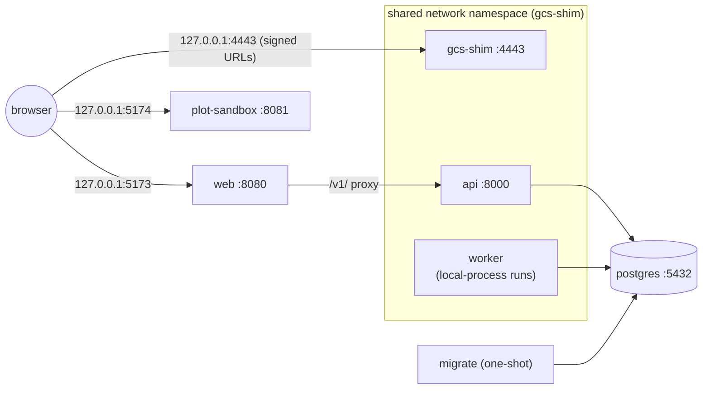

# Containers and docker compose <span class="mapi-badge mapi-badge--soon">v0.2</span>

The platform ships as six images, built from `images/<name>/Dockerfile` with the repository root
as the build context. `docker-compose.yml` runs them as a single-tenant local stack. You do not
need Docker for development (see [Local development](local-development.md)). The images exist
to run the exact production artifacts locally, to back the docker executor, and to become the
Cloud Run Jobs in v0.3.

```bash
cp .env.example .env               # set POSTGRES_PASSWORD
make docker-build                  # every image, tagged mapi/<name>:<version>
make compose-up                    # docker compose up -d --wait
make seed                          # load the E33 demo through the API
open http://127.0.0.1:5173
make compose-logs SERVICE=api      # follow one service
make compose-down                  # VOLUMES=1 also deletes the database and objects
```

## The images

| Image | Contents | Runs as | Entry point |
|---|---|---|---|
| `mapi/base-bayes` | `mapi-runner`, SDK, steps, plot recipes, `mapi-pymc`, the `mmm.*` and `tabular.*` plugins, a C++ compiler for PyTensor | `10001` | `mapi-runner` |
| `mapi/base-ml` | `mapi-runner`, SDK, steps, plot recipes, `mapi-sklearn` (`sklearn.*` plugins). **No PyMC.** | `10001` | `mapi-runner` |
| `mapi/base-forecast` | `mapi-runner`, SDK, steps, plot recipes, `mapi-pymc`, the `ts.*` plugins | `10001` | `mapi-runner` |
| `mapi/worker` | `base-bayes` plus the `ts.*` plugins and `mapi-server` (target `worker` of the base-bayes Dockerfile); for compose only | `10001` | `mapi-server worker` |
| `mapi/server` | The control plane: `mapi-server`, `mapi-spec`, the JSON-only `mapi-plots` core, docker-py. **No science dependencies.** | `10001` | `mapi-server api` (or `worker`, `migrate`) |
| `mapi/gcs-shim` | The local Cloud Storage emulator | `10001` | `mapi-gcs-shim` |
| `mapi/web` | nginx serving `apps/web` (port 8080) and `apps/plot-sandbox` (port 8081) | `101` | nginx |

`make docker-build IMAGES="server web"` builds a subset. `make docker-build` builds them all,
plus `mapi/worker` whenever `base-bayes` is in the set. Every image is labelled with the OCI
`title`, `version`, `revision` (git commit) and `created` keys.

### How the Python images are built

Every Python image uses the same multi-stage pattern:

1. **`manifests`** copies the build context and deletes everything except `pyproject.toml` and
   `uv.lock` files. Its output changes only when dependencies change.
2. **`builder`** installs the third-party dependencies of the image's package set from those
   manifests alone (`uv sync --frozen --no-install-workspace`, once per package, into
   `/opt/mapi/venv`). BuildKit caches this layer, so editing source code does not reinstall
   PyMC. The builder then copies the sources and installs the workspace packages themselves,
   non-editable. Every version comes from `uv.lock`.
3. **`runtime`** starts again from the same `python:3.12-slim` base, adds `tini` (and `g++` for
   the PyMC images), creates user `10001`, and copies in only the virtual environment.

The package set is the `MAPI_PACKAGES` build argument. `images/common/install_packages.py` turns
it into `uv sync` calls. The xgboost dependency `nvidia-nccl-cu13`, a 300 MB wheel used only for
multi-GPU training, is never installed (`MAPI_NO_INSTALL`).

### Build-time guards

An image that is not what it claims to be fails to build:

- **Package assertions.** `images/common/assert_dists.py` checks `MAPI_ASSERT_PRESENT` and
  `MAPI_ASSERT_ABSENT` against the real environment. For example, `base-ml` must not contain
  `pymc`, `pytensor` or `numba`, and `server` must not contain `numpy`, `xarray`, `pandas`,
  `scipy`, `pyarrow`, PyMC, `mapi_sdk`, `mapi_runner` or any plugin.
- **Import contracts in the control-plane image.** The `contracts` stage of
  `images/server/Dockerfile` installs import-linter (hash-pinned from `uv.lock`) into a
  throwaway copy of the environment, and runs the repository's contracts against the packages
  exactly as installed. The runtime stage depends on that stage, so BuildKit cannot skip it.
- **Catalog export.** The runner images load every installed step, model and plot plugin and
  write `/opt/mapi/catalog.json` with its digest (`/opt/mapi/catalog.digest`). If no steps or
  models are registered, the build fails.

The same claims are also proven without Docker: `tests/devops/test_container_invariants.py`
computes each image's dependency closure from `uv.lock` (`scripts/lock_closure.py`) and checks it
against the assertions.

### Compile caches and the read-only root filesystem

PyTensor compiles C at run time, and Numba caches machine code. Both caches are warmed during the
build by compiling a small hierarchical model, then baked read-only into `/opt/mapi/cache`.
PyTensor needs a *writable* compile directory, because it takes a lock and adds new modules. So
at start-up the entry point (`images/common/runner-entrypoint.sh`) builds a symlink farm of the
baked cache under `/tmp/mapi-cache`: real directories, with files that are symlinks to the
baked objects. This costs a few KiB of RAM, which matters on Cloud Run's in-memory filesystem,
and PyTensor accepts the relocated entries without recompiling.

`HOME`, `PYTENSOR_FLAGS`, `NUMBA_CACHE_DIR` and `MPLCONFIGDIR` all point under `/tmp`. The first
three are on the runner's worker-environment allow-list (`mapi_spec.run.WORKER_ENV_ALLOWLIST`),
so plugin code sees them after the supervisor scrubs the environment. The result is that every
image runs with `--read-only` and a tmpfs on `/tmp`.

`docker run mapi/base-bayes` runs the runner. Arguments starting with `-` are passed to the
runner, and any other command replaces it (`docker run mapi/base-bayes python -c ...`).

## The compose stack



| Service | Image | Published on the host |
|---|---|---|
| `postgres` | `postgres:16` (pinned by digest) | not published; see the override example |
| `gcs-shim` | `mapi/gcs-shim` | `127.0.0.1:4443` and `127.0.0.1:8000` (the API, which shares this namespace) |
| `migrate` | `mapi/server`, `migrate`; compose waits for it to exit with status 0 | — |
| `api` | `mapi/server`, `api` | via `gcs-shim` |
| `worker` | `mapi/worker`, `mapi-server worker`, `MAPI_EXECUTOR=local-process` | — |
| `web` | `mapi/web` with only the app server block | `127.0.0.1:5173` |
| `plot-sandbox` | `mapi/web` with only the sandbox server block | `127.0.0.1:5174` |

**Why `api`, `worker` and `gcs-shim` share one network namespace.** Signed URLs embed the object
store's address, and the bootstrap URL template embeds it for runner processes. If the API
reached the shim as `gcs-shim:4443` while the browser needed `127.0.0.1:4443`, every URL would
need a public form and an internal form. With a shared namespace, `127.0.0.1:4443` and
`127.0.0.1:8000` mean the same thing to the browser, the API, the orchestrator and every runner
subprocess. That is exactly the `make dev` topology, and it matches the `LocalDev` defaults. The
`web` container reaches the API as `api:8000`, which is a network alias of the shim's container.

**Hardening.** Every `mapi/*` service runs as a non-root user, with a read-only root filesystem,
a tmpfs on `/tmp`, all Linux capabilities dropped and `no-new-privileges`. Ports are published on
`127.0.0.1` only. The PostgreSQL password comes from `.env`, and compose refuses to start
without it. The official `postgres` image is the one exception: it starts as root to fix data
directory ownership, then drops to the `postgres` user.

**Host names.** The M1 API has no authentication, and a web page whose host name is
re-pointed at `127.0.0.1` (DNS rebinding) is same-origin to itself, so CORS does not stop it.
The API therefore answers only the `Host` names in `MAPI_ALLOWED_HOSTS` (default `127.0.0.1`,
`localhost`, `api`, plus the host of `MAPI_API_URL`) and returns 400 for anything else. The
app's nginx server answers only `MAPI_WEB_SERVER_NAMES` (default `127.0.0.1 localhost`) and
closes the connection for any other host. The GCS shim does the same, for loopback names and
the hosts of its endpoints (`--allowed-host` adds more). If you reach the stack under another
name, such as a LAN host name, add it to both variables.

### Executor choice: local-process vs docker

The compose worker runs the **local-process executor inside a runner-capable image**: each run
is a `mapi-runner` subprocess of the worker container. That is the default because it needs
no Docker socket and is daemon-agnostic. Its trade-offs:

| | local-process in `mapi/worker` (default) | docker executor (`compose.override.example.yml`) |
|---|---|---|
| Isolation | Process only: runs share the worker's filesystem, `/tmp` and memory limit | One container per run, from the exact runner image, with its own limits; `--network none` is possible |
| Images | One large image holding every plugin plus the control plane | `mapi/worker` for the orchestrator, and per run the `mapi/base-*` image that ships the run's plugin (`MAPI_DOCKER_IMAGES`) |
| Privileges | None beyond the worker's own | The worker mounts `/var/run/docker.sock`, which is **root-equivalent on the host** |
| Networking | Runs reach `127.0.0.1:4443` directly | Run containers join the `gcs-shim` network namespace (`MAPI_DOCKER_NETWORK=container:mapi-gcs-shim`) |
| Use it for | Day-to-day development, demos, CI | Checking production images end to end, and self-hosted setups (gVisor `runsc` in v0.3) |

**Docker executor settings.** `MAPI_DOCKER_IMAGES` maps a plugin namespace to its runner
image: `mmm.*` and `tabular.*` run in `mapi/base-bayes`, `sklearn.*` in `mapi/base-ml` and
`ts.*` in `mapi/base-forecast`. Runs without a model plugin (ingest, describe) use
`MAPI_DOCKER_IMAGE`. The defaults are the tags `make docker-build` produces for the current
version. `MAPI_DOCKER_NETWORK` must give the run a way to reach the object store, because
the bootstrap object and every signed URL point at it. In compose that means joining the
shim's network namespace (`container:mapi-gcs-shim`). An internal Docker network that holds
only the shim also works, provided `MAPI_GCS_ENDPOINT` names the shim on that network.
`none` would leave the runner with nothing to fetch its bootstrap object from, so the worker
refuses to start with it.

Neither mode is a multi-tenant boundary. Both are single-tenant local stacks, and the
local-process executor is meant to refuse any multi-tenant profile. The worker's `/tmp` is the
scratch space for local-process runs. Size it with `MAPI_WORKER_TMPFS`, `MAPI_WORKER_MEMORY` and
`MAPI_WORKER_CPUS` in `.env`.

## The web image and the plot sandbox

`mapi/web` builds both Vite apps with pnpm, using `--frozen-lockfile` and `--ignore-scripts`, so no
package lifecycle scripts run. It serves them from one unprivileged nginx with two server
blocks. `NGINX_ENVSUBST_TEMPLATE_DIR` selects which blocks are rendered:
`/etc/nginx/templates/all` (the default), `web` or `plots`. Origins are runtime settings rendered
into the headers at start-up.

| | App (`:8080`, `MAPI_WEB_ORIGIN`) | Plot sandbox (`:8081`, `MAPI_PLOTS_ORIGIN`) |
|---|---|---|
| CSP | `default-src 'self'`; `script-src 'self'` (no `unsafe-eval`, no inline scripts); `frame-src` = the plots origin; `connect-src` = self, `MAPI_API_URL`, `MAPI_GCS_ENDPOINT`; `frame-ancestors 'none'` | `default-src 'none'`; scripts, styles and images from its own origin only; `connect-src` = its own `/topojson/` only; `frame-ancestors` = the app origin |
| Other headers | `X-Frame-Options: DENY`, `nosniff`, `Referrer-Policy: no-referrer`, COOP and CORP `same-origin`, Trusted Types in report-only mode | `nosniff`, `no-referrer`, `Access-Control-Allow-Origin: *` |
| API access | `/v1/` is proxied to `MAPI_API_UPSTREAM`, unbuffered with a one-hour read timeout for SSE | None: no proxy, and the CSP blocks it |

The sandbox documents are framed with `sandbox="allow-scripts"` and no same-origin access, so
they have an **opaque origin**. Their module scripts, styles and topojson are therefore fetched in
CORS mode. That is why the sandbox answers with `Access-Control-Allow-Origin: *`; the assets are
static and public, and no cookies are involved. It is also why its CSP lists the plots origin
explicitly next to `'self'`.

`MAPI_WEB_SCRIPT_SRC_EXTRA` (empty by default) adds sources to the app's `script-src`. Use it
only after a review, for example if a library needs `'wasm-unsafe-eval'`. Trusted Types are in
report-only mode until the SPA ships its policy.

## Base images and pinning

Every base image is a build argument with a readable tag *and* a digest:

```dockerfile
ARG PYTHON_IMAGE=python:3.12-slim-trixie@sha256:a6e3…11b1
```

The Dockerfile frontend (`# syntax=`) and the compose `postgres` image are pinned the same way.
`make docker-pin` re-resolves every tag through the registry API. It needs no Docker daemon, and
you should review the resulting diff like any dependency bump. `make docker-pin-check` (also run
in CI and by `make release-check`) fails if anything is unpinned.

## CI

`.github/workflows/ci.yml` builds every image, plus the `worker` target, on each push and pull
request, using the GitHub Actions layer cache. Images are never pushed. A separate job checks the
digest pins and validates both compose files with `docker compose config`. The web image is
skipped, with a notice, until the pnpm workspace is in the tree.

## Troubleshooting

`error: the Docker daemon is not reachable`
:   `make docker-build` and `make compose-up` check `docker info` first. Start Docker Desktop,
    Colima or `dockerd`, or use `make dev`, which needs no Docker.

`required variable POSTGRES_PASSWORD is missing a value`
:   Copy `.env.example` to `.env` and set `POSTGRES_PASSWORD`. Compose reads `.env` from the
    repository root.

`image check failed: forbidden distribution 'numpy' is installed` (server build)
:   A control-plane dependency started pulling in a science package. Run
    `uv run python scripts/lock_closure.py "mapi-server[docker]" --lacks numpy` to see the
    closure, then find which dependency brings `numpy` in.

`Contracts: 1 broken` in the `contracts` stage
:   Server code imports a forbidden module. `make lint` (`lint-imports`) shows the same failure
    locally, with the import chain.

`PyTensor found no C++ compiler` (base-bayes / base-forecast build)
:   `g++` is missing from `MAPI_APT_PACKAGES`. The PyMC images need it at run time too.

The `api` container is unhealthy
:   `make compose-logs SERVICE=api`. Typical causes are that `migrate` failed (look at its
    logs), or that the `DATABASE_URL` password does not match the database volume, which happens
    after you change `POSTGRES_PASSWORD`. In that case reset with `make compose-down VOLUMES=1`;
    this deletes the data.

`mapi-entrypoint: /tmp/mapi-cache is not writable`
:   The container runs with a read-only root filesystem but without a writable `/tmp`. Add
    `--tmpfs /tmp` (compose already does).

Port already allocated on `docker compose up`
:   A `make dev` stack, or another process, holds 4443, 8000, 5173 or 5174. Stop it with
    `make stop`. Both stacks use the same ports on purpose, so the same URLs work with either.

nginx exits with `host not found` or `invalid number of arguments in "set"`
:   `MAPI_API_UPSTREAM` is empty or malformed. It must be a URL without a path, for example
    `http://api:8000`.
