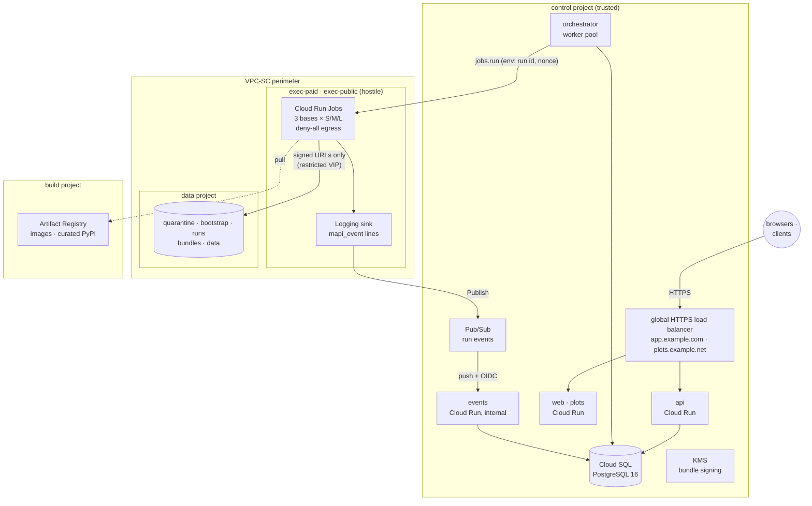

# Deploy to Google Cloud <span class="mapi-badge">v0.3</span>

This page tells how to change empty Google Cloud projects into a multi-tenant platform that
operates. It applies to an environment (`dev`, `staging` or `prod`). At the end, you have
these items:

- The API and the web app on Cloud Run.
- Runs that execute as Cloud Run Jobs in a zero-egress sandbox project.
- Data in private buckets behind a VPC Service Controls perimeter.

All the configuration is in `infra/terraform`. Four scripts in `deploy/gcp` operate it.

!!! warning "Status: written, validated and tested offline; not yet applied"
    The Terraform passes `terraform validate` for each environment. It also passes a
    `terraform test` suite that applies each module against mocked providers (refer to
    [Testing the infrastructure](#testing-the-infrastructure)). We have **not** applied it to
    a real organisation yet. The cloud adapters of the server (Cloud Run Jobs executor, Cloud
    Storage, KMS signing, Pub/Sub push verification) are in the same release. We tested them
    only against fakes. The environment variables that they read are
    [below](#environment-of-the-cloud-run-workloads). Read the next section before you start.

## Before you start: the [verify M0] checklist { #before-you-start-the-verify-m0-checklist }

The design depends on cloud behaviours that the Google Cloud documentation suggests. But
nobody has confirmed them against a real Cloud Run Jobs execution yet. The plan marks each
behaviour **[verify M0]**. These behaviours do not break a `dev` environment. But **do not
admit untrusted tenants until each one has a recorded pass**. The full procedure, with the
probe for each item, is the
[M0 verification checklist](security-hardening.md#m0-verification-checklist). The steps that
remain after the offline M2 verification are in
[M2 verification](m2-verification.md#what-remains-for-real-gcp).

| Assumption | What depends on it | If it is not true |
|---|---|---|
| The Direct VPC egress resolver obeys the **DNS response policy** (`*.` to NXDOMAIN, Google APIs to the restricted VIP) | DNS exfiltration is stopped. You can set `MAPI_CLOUDRUN_DNS_ENFORCED` to `true`. Only this setting lets `verified` and `public` tenants run | Cloud Run Jobs cannot host untrusted code. Keep shared tiers off it. Use GKE Sandbox behind the same executor protocol |
| **Deny-all egress** and **VPC Service Controls** apply to Jobs executions | Runs cannot connect to the internet or to buckets outside the perimeter | The same as above |
| gen2 permits the **supervisor/worker uid split** with `no_new_privs`, seccomp and no `ptrace` | The worker cannot read the credentials of the supervisor | Runs report `DEV_MODE_ISOLATION`. The runner images must start the supervisor as root for the split |
| Execution **overrides are env-only** (no image, resources, service account or network) | `jobs.run` can give only the run id and nonce | The role of the dispatcher must have fewer permissions |
| The limits of the **in-memory filesystem** operate as planned (no ephemeral disk, exit 137 at the limit) | Scratch budgets of 3/6/12 GiB for classes S/M/L. `RESOURCE_EXHAUSTED` with a retry in the next larger class | Fits with large data move to GKE |
| You cannot restore a **deleted bootstrap object** | The nonce in the audit log points at nothing | Terraform already sets the soft-delete window of the bootstrap bucket to 0. If you can still restore a copy, examine the bootstrap design again before launch |
| **Quotas**: 180 `jobs.run` in each minute and 1,000 running executions in each region | The token bucket of the dispatcher (150 a minute by default) and the global limit of 700 concurrent runs | Decrease `MAPI_CLOUDRUN_SUBMITS_PER_MINUTE`. Divide the work across exec projects |
| The **cold start** of a base image of about 2.5 GB keeps the p95 of time-to-`RUNNING` below 90 s | The M2 latency target (met offline, only against the fake backend) | Smaller images, or warm capacity (M6) |
| The path from the **Logging sink to Pub/Sub** carries the labels of the execution in some seconds. Pub/Sub can push to an internal-only service | Run events and progress | Runs still finish (the status of the executor decides if a run is alive), but there is no progress |
| Cloud SQL **managed connection pooling** works in transaction mode with the driver of the server. The migrate role can grant **`BYPASSRLS`** | Row-level security for requests. The platform role for the orchestrator | Give `mapi_orchestrator` its own policy-based access (the explicit policy is already there) |
| `run.jobs.runWithOverrides` works **without `iam.serviceAccounts.actAs`** on the execution account | The least-privilege role of the orchestrator | Grant `actAs` on that one account |
| Cloud Run accepts the **image indexes** that `build-push.sh` pushes (with attestations) | Deploys | Build with `--no-attestations` |

Two more limits of v0.3 are not cloud facts, but they are important on the first day:

- Browser sign-in uses an OpenID provider with an authorization-code endpoint (Google by
  default). The server does not accept the tokens of Identity Platform yet. Refer to
  [Authentication](../guides/authentication.md#identity-platform).
- The nightly security suite has no probe Job in Terraform yet
  ([Security suite](security-suite.md#where-the-probes-run)).

## Topology

One environment has five types of project, one for each trust zone (plan §8.1):



| Module | Project | Creates |
|---|---|---|
| `control` | control | Cloud Run `api`, `events`, `web`, `plots`. Orchestrator worker pool. `migrate` job. Cloud SQL (private IP, managed connection pooling). Secret Manager secrets. Pub/Sub topic, push subscription and dead letters. One Logging sink for each exec project. KMS signing key. Identity Platform. Optional load balancer |
| `exec` | each exec project | VPC without a default route, deny-all egress firewall, restricted-VIP route and DNS zone, DNS response policy, the Job inventory, the execution service account, the dispatcher role |
| `data` | data | The five buckets of plan §8.6 with lifecycle rules, retention, CORS and bucket-level IAM |
| `build` | build | Docker repository (immutable tags), curated PyPI remote, Binary Authorization attestor (stub), GitHub Workload Identity Federation |
| `perimeter` | organisation | The VPC-SC perimeter around the exec and data projects |
| `stack` | all | Connects the modules and enables the APIs |

`envs/<env>/main.tf` holds the **policy** of each environment, where code review sees it.
The policy includes the database size and availability, the deletion protection, the
retention lock and the perimeter mode. `terraform.tfvars` holds only names and ids.

| | dev | staging | prod |
|---|---|---|---|
| Database | Enterprise, 1 vCPU, zonal, no pooler | Enterprise Plus, zonal, pooler | Enterprise Plus, **regional (HA)**, pooler |
| VPC-SC perimeter | dry-run (optional) | enforced, necessary | enforced, necessary |
| Load balancer + domains | optional | optional | **necessary** |
| Deletion protection | off | on | on |
| Bundle retention | 1 day, unlocked | 7 days, unlocked | 30 days, **locked** |
| Signing key | software | software | **HSM** |
| Minimum instances (api) | 0 | 1 | 2 |

## Prerequisites

- **An organisation** with an Access Context Manager policy (`gcloud access-context-manager
  policies list --organization ORG_ID`). Without a policy, you can deploy only `dev`, without
  the perimeter. Each plan then shows a warning.
- **Projects** that the project vending of your organisation makes: `control`, `data`,
  `build`, and one exec project for each pool. The pools are `exec-paid`, and also
  `exec-public` when you have public tenants. Link all projects to billing. Put nothing else
  in the exec projects.
- **Tools**: Terraform ≥ 1.11 (tested with 1.14), `gcloud`, Docker with `buildx`, `python3`
  and `curl`.
- **Permissions** for the first run: project owner (or equivalent) on each project, and
  `roles/accesscontextmanager.policyEditor` on the organisation policy. Later runs use the CI
  identities that Terraform makes.
- **An OAuth client** (web application) for the app origin, for browser sign-in.

## Step by step

### 1. Bootstrap the projects

```bash
deploy/gcp/bootstrap.sh --env staging --region europe-west4 \
  --control-project acme-mapi-stg-control --data-project acme-mapi-stg-data \
  --build-project acme-mapi-stg-build \
  --exec-project paid=acme-mapi-stg-exec-paid --exec-project public=acme-mapi-stg-exec-public \
  --state-project acme-mapi-stg-build --dry-run       # read what it will do, then drop --dry-run
```

The script enables the APIs of each project. It uses the same lists as
`modules/stack/apis.tf`, and a test keeps the lists identical. It makes the state bucket
(uniform access, public access prevention, object versioning). Then it writes
`infra/terraform/envs/staging/backend.hcl`.

### 2. Describe the environment

```bash
cp infra/terraform/envs/staging/terraform.tfvars.example infra/terraform/envs/staging/terraform.tfvars
$EDITOR infra/terraform/envs/staging/terraform.tfvars
```

Type these values:

- The project ids and the region.
- The bucket location. Use the data residency of your tenants.
- The exec pools and the access policy id.
- The domains, the OAuth client id and the GitHub repository.

The file holds no secrets. Do not commit it.

!!! warning "Data residency and the exec region"
    The dispatcher puts a run only on an executor whose region satisfies the data residency
    of its tenant. The default residency is the residency that the region of the dispatch
    pool satisfies: `eu` for `europe-west4`. This default applies to the platform tenant and
    to each tenant that you make without a residency. To change the default, use the
    `default_residency` of the control module.

    The exec region can be unable to satisfy the residency of a tenant. Then the server
    refuses its runs at submission (`403`, "no executor of this platform can run this
    tenant's work"). The
    worker also logs a warning for the tenant at start-up. To change the residency of a
    tenant, use `PATCH /v1/admin/tenants/{id}` (`data_residency`).

### 3. Apply the foundation

```bash
deploy/gcp/deploy.sh --env staging --foundation
```

A foundation apply makes all resources except the Cloud Run workloads and Jobs, which need
images. It makes the registry, networks, DNS policy, database, secrets, buckets, perimeter
and CI identities. `deploy.sh` always shows the plan. Before it applies the plan, it asks you
to type the environment name.

During this apply, ephemeral resources make the database passwords, the token pepper and the
session key. Write-only arguments write them. They are in Secret Manager only. They are not
in the state and not in the plan file.

### 4. Add the OAuth client secret

```bash
export TF_VAR_oidc_client_secret='...'      # from the OAuth client
# in terraform.tfvars: oidc_client_secret_version = 1
```

The secret is an *ephemeral* Terraform variable. Terraform writes it to Secret Manager as a
new version and never keeps it. When you rotate the secret, increase
`oidc_client_secret_version`. Add the identity providers that you want to Identity Platform.
Use the console, or `google_identity_platform_*_idp_config` resources outside this module.

### 5. Build and push the images

```bash
deploy/gcp/build-push.sh --env staging
```

The script builds `server`, `web`, `base-bayes`, `base-ml` and `base-forecast` for
`linux/amd64`. It pushes them as `<version>-<git sha>`. Tags are immutable in the registry.
Thus, if you run the script again for the same commit, it uses the images that are there. The
script writes the **digests** of the images to `deploy/gcp/.out/staging/images.tfvars.json`.
Terraform refuses all images that are not pinned by digest.

### 6. Deploy the release

```bash
deploy/gcp/deploy.sh --env staging
```

The script does these steps:

1. It does a `terraform plan` with `terraform.tfvars` and the images file, and saves the
   plan to a plan file.
2. It asks for confirmation. Type the environment name. In automation, `--yes` skips this
   step.
3. **Migrations first**: it points the `mapi-staging-migrate` job at the new server image and
   executes the job (`deploy/gcp/migrate.sh`). Migrations are expand/contract. Thus the
   release that serves now continues to work on the new schema. On the first release, the job
   is not there yet. Thus the migrations run immediately after the apply.
4. It does a `terraform apply` of exactly the saved plan.
5. It records the images file as a release in
   `gs://<state bucket>/mapi/staging/releases/<UTC timestamp>-<release id>.json`. The release
   id is a hash of the images. Thus, if you retry a deploy of the same images, it is the same
   release.
6. It does a smoke test. The test does a check of the API `/healthz` and `/readyz`, the web
   app (with a Content-Security-Policy) and the plot sandbox. It also makes sure that the
   events service refuses requests from the internet.

### 7. Point DNS at the load balancer

```bash
terraform -chdir=infra/terraform/envs/staging output lb_ip
```

Make `A` records for the two domains. The Google-managed certificate becomes available when
DNS resolves. This often takes 15–60 minutes. Until then, run `deploy.sh --skip-smoke`.
Without `domains`, the services answer on their `run.app` URLs (`terraform output urls`).

### 8. Verify the controls

Before the first production deploy, read the [security hardening](security-hardening.md) page
and do the [M0 verification checklist](security-hardening.md#m0-verification-checklist). When
the DNS item has a recorded pass, tell the orchestrator in the `main.tf` of the environment.
Then deploy again:

```hcl
control = {
  # ...
  extra_env = {
    orchestrator = { MAPI_CLOUDRUN_DNS_ENFORCED = "true" }
  }
}
```

Until then, the executor declares that DNS is not enforced. The dispatcher then does not put
`verified` and `public` tenants on it ([trust tiers](../guides/administration.md#trust-tiers)).

### 9. Name the operators and create the first tenant

Platform operators are the persons whose **verified** e-mail is in `MAPI_OPERATOR_EMAILS`.
Set it on the API. Use only plain values. Never put secrets in `extra_env`:

```hcl
control = {
  # ...
  extra_env = {
    api = { MAPI_OPERATOR_EMAILS = "oncall@acme.example,platform@acme.example" }
  }
}
```

Run `deploy/gcp/deploy.sh --env staging`. Then an operator signs in to the web app, or with
`mapi login --issuer https://accounts.google.com --client-id <the CLI's client id>`. The
operator makes the tenant of each organisation with its first admin. The server sends an
invitation to the admin by e-mail. The admin becomes tenant admin at the first sign-in:

```bash
mapi admin tenants create acme --name "Acme Retail" --tier verified --residency eu \
    --admin-email it@acme.example
```

After this, the tenant admin makes projects and invites persons
([Administration](../guides/administration.md)). Monitor the platform with the
[observability](observability.md) dashboards. Import the alerts before you let users in.

!!! warning "Verified tenants cannot run until DNS enforcement is verified"
    `verified` and `public` tenants need an executor with egress **and** DNS enforced.
    `verified` is the default tier of new tenants (the private beta). A new stack does not
    set `MAPI_CLOUDRUN_DNS_ENFORCED` and has no suite evidence. Thus the server refuses their
    runs at submission (`INFRA_ERROR`, 503). Only `internal` and `self_hosted_trusted`
    tenants run. To open the shared tiers, do these steps:

    1. Pass the DNS red-team gate of the M0 checklist from a Job of this environment.
    2. Set `MAPI_CLOUDRUN_DNS_ENFORCED = "true"` for the orchestrator through
       `control.extra_env` (`{ orchestrator = { MAPI_CLOUDRUN_DNS_ENFORCED = "true" } }`).
       Then deploy.
    3. Run the executor conformance suite and the security suite against the deployed
       executor. Record the two results with `PUT /v1/admin/executors/cloudrun-jobs/evidence`
       ([the shared-tier gate](cloud-run.md#the-shared-tier-gate)). Evidence expires after
       `MAPI_EXECUTOR_EVIDENCE_MAX_AGE_S`, so record the nightly runs.

## Continuous deployment

`.github/workflows/deploy.yml` deploys only on manual dispatch, without service-account keys:

| Job | GitHub environment | Google identity | Does |
|---|---|---|---|
| build | `<env>-build` | `mapi-<env>-ci-push` | `build-push.sh`. Uploads the images file |
| plan | `<env>-plan` | `mapi-<env>-planner` (read-only) | `deploy.sh --plan-only`. The plan goes to the job summary |
| apply | `<env>` | `mapi-<env>-deployer` | `deploy.sh --apply-plan`: migrations, apply of that plan, release record, smoke test |

Do these steps for each environment:

1. Make the three GitHub environments. Put **required reviewers** on `<env>` (the apply).
2. Restrict `<env>` to protected branches.
3. Copy the values of `terraform output github` into environment variables:
   `GCP_WIF_PROVIDER`, `GCP_CI_PUSH_SA`, `GCP_PLANNER_SA`, `GCP_DEPLOYER_SA`.
4. Also add `GCP_IMAGE_REPOSITORY` (`terraform output image_repository`), `TF_STATE_BUCKET`
   and `TERRAFORM_TFVARS` (the contents of the `terraform.tfvars` of the environment).
5. Optionally, add `OIDC_CLIENT_SECRET` as a secret of `<env>-plan` and `<env>`. You must give
   an ephemeral variable to the plan and to the apply.

The workload identity provider accepts tokens only from your repository. Each service
account trusts exactly one GitHub environment. Thus a job can never get more permissions than
its environment permits. A person runs the first apply of an environment, which makes these
identities.

The perimeter is an organisation-level resource. Project-level grants cannot include it. Thus
give these roles on the access policy yourself, or use a scoped access policy for the
projects of the platform:

- `roles/accesscontextmanager.policyEditor` to the deployer.
- `roles/accesscontextmanager.policyReader` to the planner.

When the perimeter is enforced, persons outside it need an access level
(`vpc_sc.access_levels`) to run Terraform or to read the logs of the exec projects. The
deployer has its own ingress rule.

## Limitations

- **Bucket names are global.** The storage contract names buckets `mapi-{env}-{purpose}`
  (`mapi_spec.storage.bucket_name`). Thus `mapi-prod-data` must be free in all of Cloud
  Storage. If a different user has the name, select a more specific environment name as a
  new `envs/` directory. The name must agree with `^[a-z][a-z0-9-]{0,15}$`, for example
  `acme-prod`.
- **KMS key rings are permanent.** If you make a destroyed environment again, you must do a
  `terraform import` of its key rings.
- **`--traffic-only` rollbacks** apply only to the HTTP services. To roll back the
  orchestrator and the Jobs, deploy a release again.

## Metrics

The alert policies in `ops/alerts/cloud-monitoring-alerts.yaml` and the Cloud Monitoring
dashboard read the `mapi_*` series from Managed Service for Prometheus. Nothing outside an
instance can scrape them. The load balancer routes only `/v1`, `/auth/*` and the health
checks, and the orchestrator has no ingress. Thus each server workload (api, events,
orchestrator) runs a **collector sidecar**.

The sidecar is an OpenTelemetry Collector. It scrapes the `/metrics` of the workload over
`127.0.0.1` each 30 s, with the `metrics-token` bearer. It writes the series to Managed
Service for Prometheus. The orchestrator serves its own series on `127.0.0.1:9464`: dispatch
latency, finalize outcomes, integrity failures, running executions and jobs.run 429s. The
runtime identities already have `roles/monitoring.metricWriter`.

Copy the collector image from Google into the registry of the build project. Pin it by
digest, and set it for each environment:

```bash
gcloud artifacts docker images copy \
  us-docker.pkg.dev/cloud-ops-agents-artifacts/google-cloud-opentelemetry-collector/otelcol-google:<version> \
  europe-west4-docker.pkg.dev/<build project>/mirror/otelcol-google:<version>
# terraform.tfvars
metrics_collector_image = "europe-west4-docker.pkg.dev/<build project>/mirror/otelcol-google@sha256:<digest>"
```

Without the image, a release still deploys, but Terraform shows a warning
(`check.metrics_collection`). Then no `mapi_*` series goes to Cloud Monitoring, and the
PromQL alerts (integrity failure, `STALLED` rate, spend caps) can never fire.
`control.metrics_collector` also accepts `scrape_interval`, `cpu` and `memory`. The api and
events services get CPU only while they serve requests. Thus the sidecar scrapes an idle
instance late. This is satisfactory for alerts that use a period of 5 to 15 minutes.

The security-suite series (`mapi_security_probe_unexpected`) comes from the nightly workflow.
The workflow pushes it to the Pushgateway that the `MAPI_PUSHGATEWAY_URL` repository secret
names (`ops/README.md`).

## Day-2 operations

**Rollback.** There are two procedures:

```bash
deploy/gcp/rollback.sh --env prod --list            # recorded releases, newest first
deploy/gcp/rollback.sh --env prod --previous        # redeploy the release before the deployed one
deploy/gcp/rollback.sh --env prod --traffic-only    # seconds: services back to their previous revision
```

A release rollback goes through `deploy.sh` (plan, confirmation, apply, smoke test) with
`--skip-migrate`, because schema changes only move forward. The script records it as
`<UTC timestamp>-<id of the release it redeployed>-rollback.json`. `--previous` reads the
records again. A retried deploy counts one time. After a rollback from a bad release, a
second `--previous` goes one more release back. It does not go back to the bad release.

`--traffic-only` moves traffic with `gcloud` and does not change Terraform. Use it for
incidents. It does not change the orchestrator and the Jobs. The next deploy moves traffic
to the newest revision again.

**Migrations by themselves.** `deploy/gcp/migrate.sh --env prod --image <server@sha256:...>`.

**Rotate secrets.** Increase one of these values in the `main.tf` of the environment:

- `control.database.password_version`. All three database roles and their connection URLs
  change in one apply.
- `control.secret_versions.session_secret`. This signs out all users.
- `token_pepper`. This **makes all API tokens invalid**.

New Cloud Run revisions use the latest secret versions.

**Rotate the bundle-signing key.** Do these steps (refer to
`ops/runbooks/rotating-keys.md`):

1. Make a KMS key version.
2. Set `control.kms_key_version` to it.
3. List the previous version in `control.kms_trusted_key_versions`.
4. Deploy.

If you remove a version from the trusted list, each model that it signed fails with
`INTEGRITY_FAILURE`.

**Add an exec pool.** Add an entry to `exec_pools`. Run `bootstrap.sh` for its project, then
run `deploy.sh`. The perimeter, the Logging sink, the image-pull grant and the
bootstrap-bucket grant change automatically.

**Tear down dev.** You cannot delete KMS keys. You can only schedule their versions for
destruction. Thus the two signing keys have `prevent_destroy`. First, remove them from the
state. Then destroy. Dev has no deletion protection and lets Terraform empty its buckets.
Staging and prod refuse this:

```bash
cd infra/terraform/envs/dev
terraform state list | grep 'google_kms_crypto_key\.' | xargs -n1 terraform state rm
terraform destroy
```

## Environment of the Cloud Run workloads

This is the deployment contract between Terraform (`modules/control/locals.tf`) and
`mapi-server`. Each name is a `mapi-server` setting (refer to the
[configuration reference](configuration.md)). If Terraform sets a variable that the server
does not read, `tests/infra` fails. These are the plain values:

| Variable | Workloads | Value |
|---|---|---|
| `MAPI_ENV` | all | Environment name. Buckets are `mapi-{env}-*` |
| `MAPI_PROFILE` | all | `multi-tenant` (the local-process executor refuses it) |
| `MAPI_OBJECT_STORE` | all | `gcs`: real Cloud Storage, URLs signed without a key file |
| `MAPI_GCP_PROJECT` | all | The project of the Cloud Storage client |
| `MAPI_URL_SIGNER` | all | The service account whose `signBlob` signs URLs (no key file is necessary) |
| `MAPI_URL_UPLOADER` | all | The service account whose `signBlob` signs create-only upload policies (run outputs). It can make objects in `runs` and `quarantine`, but it can never delete them |
| `MAPI_SIGNER`, `MAPI_KMS_KEY_VERSION` | all | `kms` and `…/cryptoKeyVersions/<control.kms_key_version>` of the EC P-256 key that signs bundle manifests |
| `MAPI_DB_APP_ROLE`, `MAPI_DB_SYSTEM_ROLE`, `MAPI_DB_GATEWAY_ROLE` | all | `mapi_app` (row-level security), `mapi_orchestrator` (the platform role, the only RLS bypass) and `mapi_gateway` (the look-ups of the API before it knows the tenant, RLS applies) |
| `MAPI_DEFAULT_RESIDENCY` | all | The residency of the platform tenant and of tenants that you make without a residency. It is the `default_residency` of the control module. If not set, it is the residency that the region of the dispatch pool satisfies (`eu` for `europe-west4`) |
| `MAPI_TRUSTED_PROXIES` | all | `169.254.0.0/16` (the Cloud Run front end), `35.191.0.0/16` and `130.211.0.0/22` (Google load balancer front ends) and the address of the load balancer. The API skips these hops when it reads the address of the caller from `X-Forwarded-For`. After the first deployment, make sure that the audit fingerprint of a sign-up is different between two networks. If your topology has more hops, add them through `extra_env` |
| `MAPI_API_URL`, `MAPI_WEB_ORIGIN`, `MAPI_PLOTS_ORIGIN` | all, web | Public origins (the API shares the app origin behind the load balancer) |
| `MAPI_DATA_DIR` | all | `/tmp/mapi` (in-memory scratch) |
| `MAPI_ALLOWED_HOSTS` | api, events | The host names that the service answers |
| `MAPI_OIDC_ISSUER`, `MAPI_OIDC_CLIENT_ID` | api | Browser sign-in |
| `MAPI_PUBSUB_PUSH_AUDIENCE`, `MAPI_PUBSUB_PUSH_SERVICE_ACCOUNT`, `MAPI_PUBSUB_PUSH_SUBSCRIPTIONS` | events | The values that a valid Pub/Sub push token must contain, and the one subscription that can push |
| `MAPI_EXECUTOR` | orchestrator | `cloudrun-jobs` |
| `MAPI_WORKER_METRICS_PORT`, `MAPI_WORKER_METRICS_HOST` | orchestrator | `9464` on `127.0.0.1`: the `/metrics` of the orchestrator (dispatch, reconcile, finalize series), for the collector sidecar |
| `MAPI_CLOUDRUN_PROJECT`, `MAPI_CLOUDRUN_REGION` | orchestrator | The exec pool that it dispatches to (`control.dispatch_pool`, default the first pool that is not public). Its Jobs use the default `mapi-{env}-{base}-{class}` names |
| `MAPI_BOOTSTRAP_URL` | Jobs | `gs://mapi-{env}-bootstrap/{nonce}` (set on each Job, read by the runner) |

These values come from Secret Manager (references that resolve when a revision starts):

| Variable | Workloads | Secret |
|---|---|---|
| `MAPI_DATABASE_URL` | api, events | `db-url-app-direct`: `mapi_app`, direct (the LISTEN that feeds SSE) |
| `MAPI_DATABASE_APP_URL` | api, events, orchestrator | `db-url-app`: `mapi_app` through the pooler (transaction mode). Tenant sessions |
| `MAPI_DATABASE_GATEWAY_URL` | api, events | `db-url-gateway`: `mapi_gateway` through the pooler. Sign-in look-ups, operator routes, the routing of pushed events (no RLS bypass) |
| `MAPI_DATABASE_SYSTEM_URL` | orchestrator | `db-url-orchestrator`: `mapi_orchestrator`, direct. The loops of the orchestrator. Only the service account of the orchestrator can read this secret (plan §9) |
| `MAPI_DATABASE_URL` | orchestrator | `db-url-orchestrator` (procrastinate needs LISTEN) |
| `MAPI_DATABASE_URL` | migrate | `db-url-migrate`: role `mapi_migrate` (schema owner), direct |
| `MAPI_SERVER_SECRET` | all | The root of the API-token pepper and the audit fingerprint key. If you rotate it (`control.secret_versions.server_secret`), all API tokens become invalid |
| `MAPI_METRICS_TOKEN` | api, events, orchestrator, collector sidecars | The bearer that a scraper sends on `GET /metrics` (the multi-tenant profile refuses scrapes without it) |
| `MAPI_OIDC_CLIENT_SECRET` | api | Only when a client secret version is available |

One orchestrator serves one exec pool, and an environment deploys **one** orchestrator. Runs
go only to `control.dispatch_pool`. Until tier placement across pools (M5), keep all tenants
on that pool. A second pool, for example a separate exec project for `public` tenants, needs
a second orchestrator outside this module.

**The two** orchestrators must then set `MAPI_DISPATCH_TIERS` with no common tiers. For
example, set `internal,self-hosted-trusted,verified` through `control.extra_env.orchestrator`
here, and `public` on the other orchestrator. If not, leases do not look at pools. Each
orchestrator then takes the queued runs of all tenants, and public-tier code can go into the
paid pool. Terraform `exec_pools[*].public` selects only the default `dispatch_pool`. The
server does not read it.

Each workload can get more plain variables through `control.extra_env` in the `main.tf` of
the environment. Never put secrets there.

## Testing the infrastructure

```bash
uv run pytest tests/infra -q                     # everything below
TF_PLUGIN_CACHE_DIR=~/.terraform.d/plugin-cache uv run pytest tests/infra -q   # reuse providers
```

- **Static invariants** (they always run): deny-all egress with exactly two exceptions, no
  public buckets or principals, `max_retries = 0` and gen2 on each Job, the VPC-SC perimeter
  and DNS policy, write-only secrets, and digest-pinned images. They also make sure that the
  infrastructure agrees with the `mapi_spec` contracts (bucket names, resource class sizes,
  runner environment, the push endpoint).
- **`terraform fmt`, `terraform validate`** for each environment (with `-backend=false`).
- **`terraform test`** for each module. The test applies each module against mocked Google
  providers. Thus it evaluates each expression and connection, and it asserts the security
  properties on the result values. It uses no credentials and makes no cloud calls.
- **Deploy scripts**: `--help`, argument checks, the confirmation guard and full dry runs.
  These tests use stub `terraform`/`gcloud`/`docker`/`curl` binaries that prove that nothing
  executes. They run under `/bin/bash` 3.2 and under the `bash` on `PATH`. If `shellcheck` is
  installed, it also runs.

If `terraform` is not installed, the Terraform tests are skipped. The first run downloads the
Google providers (about 250 MB). It puts them into a temporary cache, but not if
`TF_PLUGIN_CACHE_DIR` is set.
