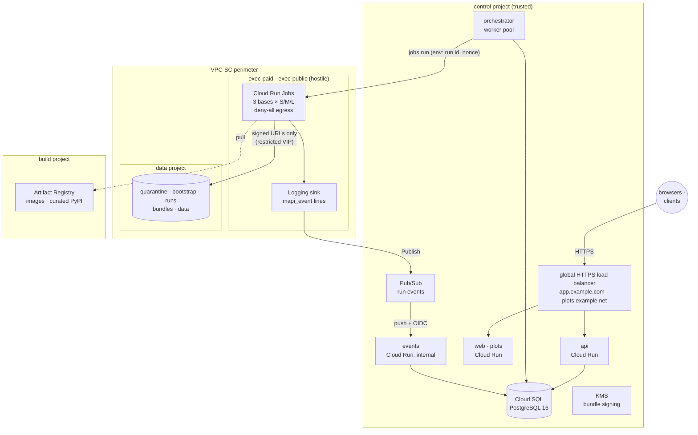

# Deploy to Google Cloud <span class="mapi-badge mapi-badge--soon">v0.3</span>

This page takes an environment (`dev`, `staging` or `prod`) from empty Google Cloud projects to
a running, multi-tenant platform: the API and web app on Cloud Run, runs executing as Cloud Run
Jobs in a zero-egress sandbox project, and data in private buckets behind a VPC Service Controls
perimeter. Everything is in `infra/terraform` and driven by four scripts in `deploy/gcp`.

!!! warning "Status: written, validated and tested offline; not yet applied"
    The Terraform passes `terraform validate` for every environment and a `terraform test` suite
    that applies every module against mocked providers (see
    [Testing the infrastructure](#testing-the-infrastructure)). It has **not** been applied to a
    real organisation yet, and several cloud behaviours it relies on are marked **[verify M0]**:
    check them with the [M0 verification checklist](security-hardening.md#m0-verification-checklist)
    before the first production deploy. The server's cloud adapters (Cloud Run Jobs executor,
    Cloud Storage, KMS signing, Pub/Sub push verification) ship in the same release; the
    environment variables they read are listed [below](#environment-of-the-cloud-run-workloads).

## Topology

One environment spans five kinds of project, one per trust zone (plan §8.1):



| Module | Project | Creates |
|---|---|---|
| `control` | control | Cloud Run `api`, `events`, `web`, `plots`; orchestrator worker pool; `migrate` job; Cloud SQL (private IP, managed connection pooling); Secret Manager secrets; Pub/Sub topic, push subscription and dead letters; one Logging sink per exec project; KMS signing key; Identity Platform; optional load balancer |
| `exec` | each exec project | VPC without a default route, deny-all egress firewall, restricted-VIP route and DNS zone, DNS response policy, the Job inventory, the execution service account, the dispatcher role |
| `data` | data | The five buckets of plan §8.6 with lifecycle rules, retention, CORS and bucket-level IAM |
| `build` | build | Docker repository (immutable tags), curated PyPI remote, Binary Authorization attestor (stub), GitHub Workload Identity Federation |
| `perimeter` | organisation | The VPC-SC perimeter around the exec and data projects |
| `stack` | all | Wires the modules together and enables the APIs |

`envs/<env>/main.tf` holds each environment's **policy** (database size and availability,
deletion protection, retention lock, perimeter mode) where code review sees it;
`terraform.tfvars` holds only names and ids.

| | dev | staging | prod |
|---|---|---|---|
| Database | Enterprise, 1 vCPU, zonal, no pooler | Enterprise Plus, zonal, pooler | Enterprise Plus, **regional (HA)**, pooler |
| VPC-SC perimeter | dry-run (optional) | enforced, required | enforced, required |
| Load balancer + domains | optional | optional | **required** |
| Deletion protection | off | on | on |
| Bundle retention | 1 day, unlocked | 7 days, unlocked | 30 days, **locked** |
| Signing key | software | software | **HSM** |
| Minimum instances (api) | 0 | 1 | 2 |

## Prerequisites

- **An organisation** with an Access Context Manager policy (`gcloud access-context-manager
  policies list --organization ORG_ID`). Without one, only `dev` can be deployed, without the
  perimeter (every plan then warns).
- **Projects**, created by your organisation's project vending: `control`, `data`, `build`,
  and one exec project per pool (`exec-paid`, plus `exec-public` once public tenants exist),
  all linked to billing. Keep the exec projects free of anything else.
- **Tools**: Terraform ≥ 1.11 (tested with 1.14), `gcloud`, Docker with `buildx`, `python3`
  and `curl`.
- **Permissions** for the first run: project owner (or equivalent) on every project, and
  `roles/accesscontextmanager.policyEditor` on the organisation policy. Later runs use the
  CI identities Terraform creates.
- **An OAuth client** (web application) for the app origin, for browser sign-in.

## Step by step

### 1. Bootstrap the projects

```bash
deploy/gcp/bootstrap.sh --env staging --region europe-west4 \
  --control-project acme-mapi-stg-control --data-project acme-mapi-stg-data \
  --build-project acme-mapi-stg-build \
  --exec-project paid=acme-mapi-stg-exec-paid --exec-project public=acme-mapi-stg-exec-public \
  --state-project acme-mapi-stg-build --dry-run       # read what it will do, then drop --dry-run
```

It enables each project's APIs (the same lists as `modules/stack/apis.tf`; a test keeps them
identical), creates the state bucket (uniform access, public access prevention, object
versioning) and writes `infra/terraform/envs/staging/backend.hcl`.

### 2. Describe the environment

```bash
cp infra/terraform/envs/staging/terraform.tfvars.example infra/terraform/envs/staging/terraform.tfvars
$EDITOR infra/terraform/envs/staging/terraform.tfvars
```

Fill in the project ids, region, bucket location (follow your tenants' data residency), the
exec pools, the access policy id, the domains, the OAuth client id and the GitHub repository.
The file holds no secrets and is not committed.

### 3. Apply the foundation

```bash
deploy/gcp/deploy.sh --env staging --foundation
```

A foundation apply creates everything except the Cloud Run workloads and Jobs, which need
images: the registry, networks, DNS policy, database, secrets, buckets, perimeter and CI
identities. `deploy.sh` always shows the plan and asks you to type the environment name
before applying it.

Database passwords, the token pepper and the session key are generated during this apply by
ephemeral resources and written with write-only arguments: they are in Secret Manager and
nowhere else (not in the state, not in the plan file).

### 4. Add the OAuth client secret

```bash
export TF_VAR_oidc_client_secret='...'      # from the OAuth client
# in terraform.tfvars: oidc_client_secret_version = 1
```

The secret is an *ephemeral* Terraform variable: it is written to Secret Manager as a new
version and never stored. Raise `oidc_client_secret_version` whenever you rotate it. Add the
identity providers you want to Identity Platform (console, or
`google_identity_platform_*_idp_config` resources outside this module).

### 5. Build and push the images

```bash
deploy/gcp/build-push.sh --env staging
```

It builds `server`, `web`, `base-bayes`, `base-ml` and `base-forecast` for `linux/amd64`,
pushes them as `<version>-<git sha>` (tags are immutable in the registry, so re-running for the
same commit reuses what is there) and writes their **digests** to
`deploy/gcp/.out/staging/images.tfvars.json`. Terraform refuses any image that is not pinned by
digest.

### 6. Deploy the release

```bash
deploy/gcp/deploy.sh --env staging
```

1. `terraform plan` with `terraform.tfvars` and the images file, saved to a plan file.
2. Confirmation (type the environment name; `--yes` skips it in automation).
3. **Migrations first**: the `mapi-staging-migrate` job is pointed at the new server image and
   executed (`deploy/gcp/migrate.sh`). Migrations are expand/contract, so the release still
   serving keeps working on the new schema. On the very first release the job does not exist
   yet, so they run right after the apply instead.
4. `terraform apply` of exactly the saved plan.
5. The images file is recorded as a release in
   `gs://<state bucket>/mapi/staging/releases/<UTC timestamp>-<sha>.json`.
6. Smoke test: API `/healthz` and `/readyz`, the web app (with a Content-Security-Policy), the
   plot sandbox, and a check that the events service refuses requests from the internet.

### 7. Point DNS at the load balancer

```bash
terraform -chdir=infra/terraform/envs/staging output lb_ip
```

Create `A` records for both domains. The Google-managed certificate provisions once DNS
resolves (often 15–60 minutes); until then run `deploy.sh --skip-smoke`. Without `domains`,
the services answer on their `run.app` URLs (`terraform output urls`).

### 8. Verify the controls

Work through the [security hardening](security-hardening.md) page, and the
[M0 verification checklist](security-hardening.md#m0-verification-checklist) before the first
production deploy.

## Continuous deployment

`.github/workflows/deploy.yml` deploys on manual dispatch only, without service-account keys:

| Job | GitHub environment | Google identity | Does |
|---|---|---|---|
| build | `<env>-build` | `mapi-<env>-ci-push` | `build-push.sh`; uploads the images file |
| plan | `<env>-plan` | `mapi-<env>-planner` (read-only) | `deploy.sh --plan-only`; the plan goes to the job summary |
| apply | `<env>` | `mapi-<env>-deployer` | `deploy.sh --apply-plan`: migrations, apply of that plan, release record, smoke test |

Set up, per environment:

1. Create the three GitHub environments and put **required reviewers** on `<env>` (the apply).
   Restrict `<env>` to protected branches.
2. Copy the values of `terraform output github` into environment variables:
   `GCP_WIF_PROVIDER`, `GCP_CI_PUSH_SA`, `GCP_PLANNER_SA`, `GCP_DEPLOYER_SA`; also
   `GCP_IMAGE_REPOSITORY` (`terraform output image_repository`), `TF_STATE_BUCKET` and
   `TERRAFORM_TFVARS` (the contents of the environment's `terraform.tfvars`).
3. Optionally add `OIDC_CLIENT_SECRET` as a secret of `<env>-plan` and `<env>` (an ephemeral
   variable must be given to both the plan and the apply).

The workload identity provider accepts tokens from your repository only, and each service
account trusts exactly one GitHub environment, so a job can never assume more than its
environment allows. The very first apply of an environment (which creates these identities)
is run by a person.

## Day-2 operations

**Rollback.** Two ways:

```bash
deploy/gcp/rollback.sh --env prod --list            # recorded releases, newest first
deploy/gcp/rollback.sh --env prod --previous        # redeploy the release before the newest
deploy/gcp/rollback.sh --env prod --traffic-only    # seconds: services back to their previous revision
```

A release rollback goes through `deploy.sh` (plan, confirmation, apply, smoke test) with
`--skip-migrate`: schema changes only move forward. `--traffic-only` shifts traffic with
`gcloud` without touching Terraform, for incidents; it leaves the orchestrator and the Jobs as
they are, and the next deploy moves traffic to the newest revision again.

**Migrations by themselves.** `deploy/gcp/migrate.sh --env prod --image <server@sha256:...>`.

**Rotate secrets.** Raise `control.database.password_version` in the environment's `main.tf`
(all three database roles and their connection URLs change in one apply), or
`control.secret_versions.session_secret` (signs everyone out) or `token_pepper` (**invalidates
every API token**). New Cloud Run revisions pick up the latest secret versions.

**Add an exec pool.** Add an entry to `exec_pools`, run `bootstrap.sh` for its project, then
`deploy.sh`. The perimeter, the Logging sink, the image-pull grant and the bootstrap-bucket grant
follow automatically.

**Tear down dev.** KMS keys cannot be deleted (only their versions can be scheduled for
destruction), so the two signing keys carry `prevent_destroy`. Release them from the state
first, then destroy; dev has no deletion protection and lets Terraform empty its buckets,
while staging and prod refuse:

```bash
cd infra/terraform/envs/dev
terraform state list | grep 'google_kms_crypto_key\.' | xargs -n1 terraform state rm
terraform destroy
```

## Environment of the Cloud Run workloads

This is the deployment contract between Terraform (`modules/control/locals.tf`) and
`mapi-server`. Plain values:

| Variable | Workloads | Value |
|---|---|---|
| `MAPI_ENV` | all | Environment name; buckets are `mapi-{env}-*` |
| `MAPI_PROFILE` | all | `multi-tenant` (the local-process executor refuses it) |
| `MAPI_OBJECT_STORE` | all | `gcs` |
| `MAPI_GCP_PROJECT`, `MAPI_GCP_REGION` | all | Control project and region |
| `MAPI_API_URL`, `MAPI_WEB_ORIGIN`, `MAPI_PLOTS_ORIGIN` | all, web | Public origins (the API shares the app origin behind the load balancer) |
| `MAPI_KMS_KEY` | all | KMS key that signs bundle manifests (EC P-256) |
| `MAPI_URL_SIGNER` | all | Service account whose `signBlob` signs URLs (no key file exists) |
| `MAPI_DATA_DIR` | all | `/tmp/mapi` (in-memory scratch) |
| `MAPI_ALLOWED_HOSTS` | api, events | Host names the service answers |
| `MAPI_OIDC_ISSUER`, `MAPI_OIDC_CLIENT_ID` | api | Browser sign-in |
| `MAPI_PUSH_AUDIENCE`, `MAPI_PUSH_SERVICE_ACCOUNT`, `MAPI_PUSH_SUBSCRIPTION` | events | What a valid Pub/Sub push token must say |
| `MAPI_EXECUTOR` | orchestrator | `cloudrun-jobs` |
| `MAPI_BOOTSTRAP_URL` | orchestrator, Jobs | `gs://mapi-{env}-bootstrap/{nonce}` |
| `MAPI_CLOUDRUN_POOLS` | orchestrator | JSON: per pool, its project, region, classes, whether it hosts public tenants, and the Job name per base and class |

From Secret Manager (references, resolved when a revision starts):

| Variable | Workloads | Secret |
|---|---|---|
| `MAPI_DATABASE_URL` | api, events | `db-url-app`: role `mapi_app` through the pooler (transaction mode) |
| `MAPI_DATABASE_LISTEN_URL` | api | `db-url-app-direct`: direct connection for the LISTEN that feeds SSE |
| `MAPI_DATABASE_URL` | orchestrator | `db-url-orchestrator`: role `mapi_orchestrator`, direct (procrastinate needs LISTEN) |
| `MAPI_DATABASE_URL` | migrate | `db-url-migrate`: role `mapi_migrate` (schema owner), direct |
| `MAPI_TOKEN_PEPPER` | api | HMAC pepper of API token hashes |
| `MAPI_SESSION_SECRET` | api | Session cookie key |
| `MAPI_OIDC_CLIENT_SECRET` | api | Only once a client secret version exists |

Each workload can get extra plain variables through `control.extra_env` in the environment's
`main.tf`; secrets never go there.

## Testing the infrastructure

```bash
uv run pytest tests/infra -q                     # everything below
TF_PLUGIN_CACHE_DIR=~/.terraform.d/plugin-cache uv run pytest tests/infra -q   # reuse providers
```

- **Static invariants** (always run): deny-all egress with exactly two exceptions, no public
  buckets or principals, `max_retries = 0` and gen2 on every Job, the VPC-SC perimeter and DNS
  policy, write-only secrets, digest-pinned images, and agreement with the `mapi_spec`
  contracts (bucket names, resource class sizes, runner environment, the push endpoint).
- **`terraform fmt`, `terraform validate`** for every environment (with `-backend=false`).
- **`terraform test`** for every module: each is applied against mocked Google providers, so
  every expression and wiring is evaluated, and the security properties are asserted on the
  resulting values (no credentials, no cloud calls).
- **Deploy scripts**: `--help`, argument checks, the confirmation guard and full dry runs, with
  stub `terraform`/`gcloud`/`docker`/`curl` binaries that prove nothing executes; under
  `/bin/bash` 3.2 and the `bash` on `PATH`. `shellcheck` runs when installed.

The Terraform tests are skipped when `terraform` is not installed; the first run downloads the
Google providers (about 250 MB, into a temporary cache unless `TF_PLUGIN_CACHE_DIR` is set).
