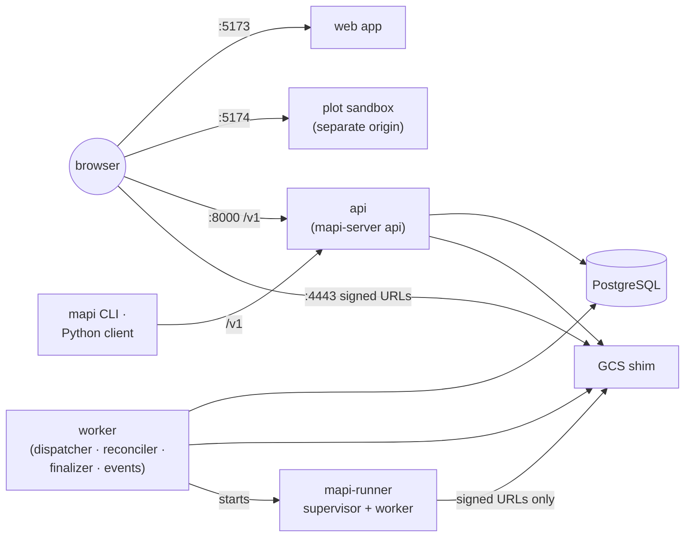

# Deployment v0.3

You can run the whole platform on one machine in two ways. The two ways start the same
services on the same ports. Because of this, the URLs, the CLI, the Python client and the
tests work with the two ways. v0.3 adds Google Cloud, with Terraform for each project and
scripts that deploy, migrate and roll back. All three ways run the same multi-tenant code.
Only the executor, the store and the identity provider change.

| | [Local, without Docker](local-development.md) | [Docker Compose](docker.md) | [Google Cloud](gcp-deployment.md) (v0.3) |
|---|---|---|---|
| Command | `make dev` | `make docker-build && make compose-up` | `deploy/gcp/deploy.sh --env ENV` |
| PostgreSQL | embedded (`pgserver`) or your `DATABASE_URL` | the official `postgres:16` image | Cloud SQL |
| Object storage | the GCS shim, in `.local/gcs` | the GCS shim image, in a volume | Cloud Storage |
| Runs execute as | `mapi-runner` subprocesses of the worker | subprocesses of the worker container, or one container for each run | Cloud Run Jobs, one new sandbox for each run |
| Code | your working tree, with hot reload | the [container images](images.md) | the same images |
| Sign-in | the development IdP | the development IdP | Google or another OpenID provider |
| Use it for | development, demos, the end-to-end tests | a full check of the production images | a multi-tenant private beta: start with the [[verify M0] checklist](gcp-deployment.md#before-you-start-the-verify-m0-checklist) |

These items apply to the two local ways:

- **Sign-in is for development only.** The two local ways run the servers in the `dev`
  profile. Each person who can get access to the API can sign in as one of the seeded
  accounts, through the built-in identity provider. `MAPI_STACK_PROFILE=single-tenant` turns
  sign-in off. The API listens on `127.0.0.1`, and compose publishes each port on `127.0.0.1`
  only. Do not connect a local stack to networks that you do not trust. Refer to the
  [security model](../concepts/security.md#local-development-vs-production).
- **State is the database and the object store.** Make a backup of the two. Locally, they are
  in `.local/pg` and `.local/gcs`. Under compose, they are the `pgdata` and `gcsdata` volumes.
  Also make a backup of the bundle signing key (`.local/keys/`) if you want to download the
  model versions that you have now.
- **Migrations run first.** `make dev` and compose both run `mapi-server migrate` before the
  API and the worker start. If the migration fails, they stop.

## In this section

- [Local, without Docker](local-development.md): what `make dev` starts, the usual commands,
  how to work on one component, and the location of the state.
- [Docker Compose](docker.md): the compose stack, its network layout and how to select the
  executor.
- [Container images](images.md): the six images, how the build makes them, and the checks
  that keep them correct.
- [Deploying to Google Cloud](gcp-deployment.md): the [verify M0] checklist, then the Terraform and
  deploy scripts, step by step, until you have the first tenant.
- [Security hardening on Google Cloud](security-hardening.md): what each control does, and the
  M0 verification checklist.
- [Authentication and isolation](authentication.md): sign-in, API tokens, operators,
  row-level security and Pub/Sub push.
- [Cloud Run Jobs executor](cloud-run.md): the v0.3 execution backend.
- [Observability](observability.md): metrics, logs, traces, and the dashboards, alerts and
  runbooks in `ops/`.
- [Security suite](security-suite.md): the sandbox-escape probes and the actions that each
  isolation level must stop.
- [M2 verification](m2-verification.md): the M2 exit criteria that we verified without a
  cloud project, the measured numbers, and the steps that a real project still needs.
- [M3 verification](m3-verification.md): the Guided journey and the integrations through the
  live stack, the times and fixes from testers without help, and the protocol for the five
  testers.
- [M3.5 verification](m35-verification.md): workflows, governance, the explorers,
  mmm-framework and Help me choose through the live stack, the defects that we found and
  repaired, and how to run the journeys again.
- [Configuration reference](configuration.md): all the environment variables.
- [Troubleshooting](troubleshooting.md): port conflicts and all other problems.
