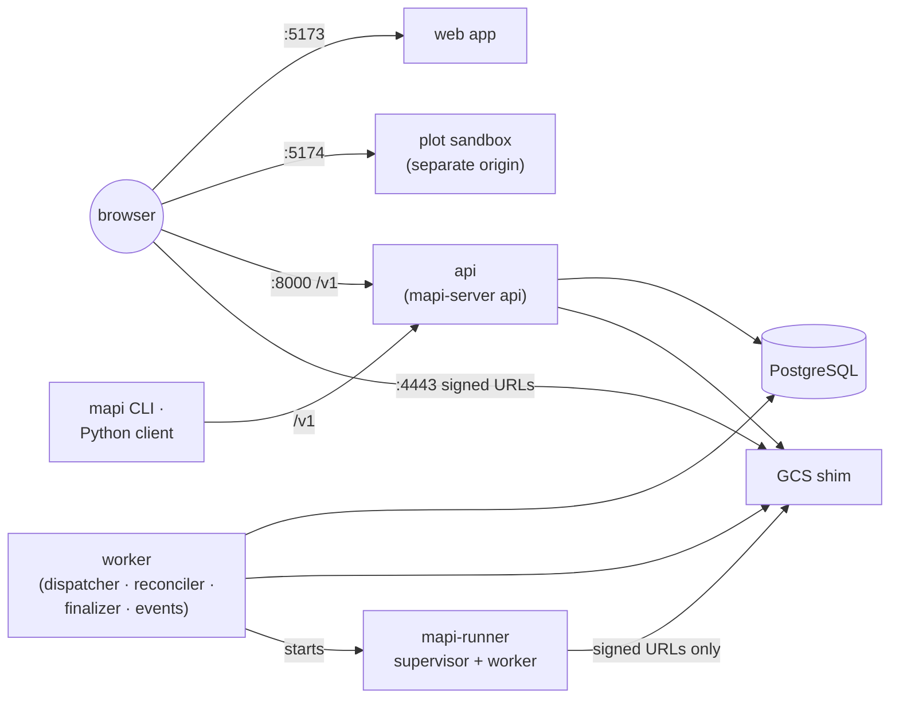

# Deployment v0.2

v0.2 runs the whole platform on one machine, single-tenant. The two supported ways start the
same services on the same ports, so URLs, the CLI, the Python client and the tests work with
either.

| | [Local, without Docker](local-development.md) | [Docker Compose](docker.md) | [Google Cloud](gcp-deployment.md) (v0.3) |
|---|---|---|---|
| Command | `make dev` | `make docker-build && make compose-up` | `deploy/gcp/deploy.sh --env ENV` |
| PostgreSQL | embedded (`pgserver`) or your `DATABASE_URL` | the official `postgres:16` image | Cloud SQL |
| Object storage | the GCS shim, in `.local/gcs` | the GCS shim image, in a volume | Cloud Storage |
| Runs execute as | `mapi-runner` subprocesses of the worker | subprocesses of the worker container, or one container per run | Cloud Run Jobs, one fresh sandbox per run |
| Code | your working tree, with hot reload | the [container images](images.md) | the same images |
| Use it for | development, demos, the end-to-end tests | checking the production images end to end | multi-tenant [v0.3](../roadmap/cloud.md): Terraform in `infra/terraform` |

Whichever you choose:

- **It is single-tenant and has no authentication.** The API listens on `127.0.0.1`, and
  compose publishes every port on `127.0.0.1` only. Do not expose a v0.2 stack to untrusted
  networks; see the [security model](../concepts/security.md#local-development-vs-production).
- **State is the database plus the object store.** Back up both (`.local/pg` and
  `.local/gcs` locally; the `pgdata` and `gcsdata` volumes under compose), and the bundle
  signing key (`.local/keys/`) if you want existing model versions to stay downloadable.
- **Migrations run first.** `make dev` and compose both run `mapi-server migrate` before the
  API and the worker start, and stop if it fails.

## In this section

- [Local, without Docker](local-development.md): what `make dev` starts, everyday commands,
  working on one component, where state lives.
- [Docker Compose](docker.md): the compose stack, its network layout and the executor choice.
- [Container images](images.md): the six images, how they are built and the guards that keep
  them honest.
- [Google Cloud](gcp-deployment.md): the Terraform and deploy scripts of v0.3, step by step.
- [Security hardening on Google Cloud](security-hardening.md): what each control does, and the
  M0 verification checklist.
- [Authentication and isolation](authentication.md): sign-in, API tokens, operators,
  row-level security and Pub/Sub push.
- [Cloud Run Jobs executor](cloud-run.md): the v0.3 execution backend.
- [Observability](observability.md): metrics, logs, traces, and the dashboards, alerts and
  runbooks in `ops/`.
- [Security suite](security-suite.md): the sandbox-escape probes and what each isolation level
  must block.
- [Configuration reference](configuration.md): every environment variable.
- [Troubleshooting](troubleshooting.md): port conflicts and everything else.
