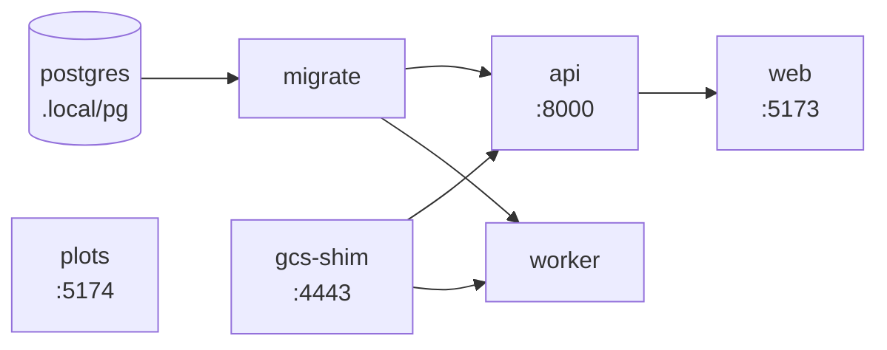

# Local, without Docker <span class="mapi-badge">v0.2</span>

`make dev` runs the whole platform on your machine **without Docker**. PostgreSQL comes from the
`pgserver` wheel and object storage from the GCS shim, so the only requirements are the uv
workspace and, for the web app, Node.js with pnpm.

```bash
make install          # uv sync --all-packages (+ pnpm install once apps/ exist)
make dev              # start everything; Ctrl-C stops everything
make seed             # in another shell: load the E33 demo data and spec
open http://127.0.0.1:5173
```

The [quickstart](../getting-started/quickstart.md) walks through fitting, inspecting and
scoring the demo model from the browser. This page explains what `make dev` runs, how to
work on one component, and where local state lives.

## Signing in <span class="mapi-badge">v0.3</span> { #signing-in }

`make dev` runs the servers in the `dev` profile: multi-tenant, with a development identity
provider built into the API. The browser shows a sign-in screen. Choose one of the seeded
accounts on the provider's page:

| Account | Role |
|---|---|
| `admin@dev.local` | Admin of the `default` tenant and a platform operator (the admin console) |
| `analyst@dev.local` | `runner` in the `default` project |
| `viewer@dev.local` | `viewer` in the `default` project |

`make seed` and `make e2e` sign in by themselves as `admin@dev.local` (change it with
`MAPI_DEV_ACCOUNT`). The CLI signs in with
`mapi login --issuer https://dev-idp.mapi.localhost --discovery-url http://127.0.0.1:8000/dev/idp`.
Anyone who can reach the API can sign in as any of these accounts, which is why the profile
exists only for local development. `MAPI_STACK_PROFILE=single-tenant make dev` gives back the
credential-less v0.2 API. See [Authentication and isolation](authentication.md) for the
details.

### Signing up <span class="mapi-badge">v0.4</span> { #signing-up }

Self-service sign-up (`POST /auth/signup`) is on in the `dev` profile. Its e-mails are not
sent: the dev mailer writes each one to an outbox under `MAPI_DATA_DIR/outbox`, and
`make outbox` prints the newest ones with their verification links (`TO=<address>` keeps one
recipient's). The API serves the same at `GET /dev/outbox?to=<address>`. A verified sign-up
creates a `public`-tier workspace; to sign in to it, sign up with one of the seeded addresses
above, because the development identity provider only knows those. A `public` workspace runs
built-in models and declarative specs only, and only on an executor with enforced egress and
DNS, so the `local-process` executor of `make dev` refuses its runs (cut line A; see
[Sign-up and abuse controls](signup-and-abuse.md)).

## What `make dev` starts

`scripts/dev.py` is a small process supervisor. It starts each service in dependency order and
waits until the service is ready before starting the ones that need it. All output goes to one
terminal, with each line prefixed by its service name (coloured when the output is a terminal).



| Service | Command | Ready when |
|---|---|---|
| `postgres` | Embedded PostgreSQL 16 (`pgserver`), data in `.local/pg`, unix socket only. Skipped when `DATABASE_URL` is set. | `pg_ctl` reports it running and the `mapi` database exists |
| `gcs-shim` | `mapi-gcs-shim serve --host 127.0.0.1 --port 4443 --cors-origin <web origin> --root .local/gcs` | The port accepts connections |
| `migrate` | `mapi-server migrate` (runs once) | It exits with status 0 |
| `api` | `mapi-server api --host 127.0.0.1 --port 8000` | `GET /healthz` returns 2xx |
| `worker` | `mapi-server worker` with `MAPI_EXECUTOR=local-process`: dispatcher, reconciler, event ingestion and the finalizer queue. Every run is a `mapi-runner` supervisor process that starts its own worker process. | Started |
| `web` | `pnpm --filter @mapi/web dev --host 127.0.0.1 --port 5173 --strictPort` | The port accepts connections |
| `plots` | `pnpm --filter @mapi/plot-sandbox dev --host 127.0.0.1 --port 5174 --strictPort` | The port accepts connections |

Every service receives the same resolved environment: `MAPI_ENV`, `DATABASE_URL`,
`MAPI_GCS_ENDPOINT`, `MAPI_API_URL`, `MAPI_WEB_ORIGIN`, `MAPI_PLOTS_ORIGIN` and `MAPI_DATA_DIR`.
The values come from `mapi_spec.localdev.LocalDev`, the same contract the services themselves
read, so they cannot disagree about ports. The
[configuration reference](configuration.md) lists every variable.

!!! note "The plot sandbox is a separate origin"
    Plots render in an `<iframe sandbox="allow-scripts">` served from `MAPI_PLOTS_ORIGIN`
    (port 5174), never from the app origin (port 5173). `LocalDev` refuses a configuration that
    puts both on the same origin.

### Shutting down

++ctrl+c++ (or `make stop` from another shell) stops the services in reverse start order. Each
service runs in its own process group. The supervisor sends that group `SIGTERM`, and sends
`SIGKILL` if it is still running after the grace period (10 s, `--grace` to change). Child
processes such as Vite's esbuild are stopped with their parent. A second ++ctrl+c++ kills
everything at once. The embedded PostgreSQL is stopped last, unless you ran
`scripts/dev.py up --keep-db`.

If any long-running service exits on its own, the supervisor stops the whole stack and exits
with a non-zero status. It never restarts anything silently: the log above the shutdown shows
the reason.

### The first start

On its first start against a new environment the worker logs `no catalog for sha256:…:
queued describe run`. The catalog (the steps, models and plot recipes installed in the
runner, with their settings schemas and schema effects) is produced by a sandboxed
`describe` run of the real runner and cached per `uv.lock` digest, so it is rebuilt only when
the locked dependencies change. Until it is ready, spec validation reports the catalog as
unavailable; it takes a few seconds.

Runs use the same isolation as in production, minus what a laptop cannot do: the run event
`DEV_MODE_ISOLATION` notes that the worker process runs as your user, without a uid split or
`no_new_privs`.

!!! warning "Plugin code runs as you, next to the platform's keys"
    Without a uid split, run code (plugins and the steps they load) can read every file your
    user can. That includes the shim's control key (`.local/gcs/_shim/keys/control.json`,
    full access to every bucket), the bundle-signing key (`.local/keys/`) and the
    executions directory. So a hostile plugin could forge a signed bundle or rewrite outputs
    after the finalizer checked them. The orchestrator makes itself non-dumpable on Linux,
    so run code cannot read its environment (`DATABASE_URL`) or its memory. The worker logs
    the same warning when it starts. Only run plugin code you trust in `make dev`.

## Everyday commands

| Command | What it does |
|---|---|
| `make dev` (or `make run`) | Start the stack in the foreground |
| `make dev ONLY=api` | Start `api` and what it depends on (`gcs-shim`, `migrate`) |
| `make dev WITHOUT=web,plots` | Everything except the two Vite servers (for example while the web app is not built yet) |
| `make stop` | Stop a stack running in another shell, then its embedded PostgreSQL |
| `make status` | Which services are up, and whether PostgreSQL is running |
| `make migrate` | Apply database migrations once. It starts the embedded PostgreSQL if needed and stops it again afterwards. |
| `make db-shell` | `psql` on the dev database (the embedded server or `DATABASE_URL`) |
| `make seed` | Load the E33 demo datasets and the `eu-geo-mmm` spec through the HTTP API (`make seed SIZE=full` for the large variant) |
| `make e2e` | The end-to-end suites against the running stack: `pytest -m e2e` (`tests/e2e`, through the Python client), then the Playwright `@e2e` suite (`apps/web/e2e`, through the browser) |
| `make outbox` | The dev mailer's newest e-mails and their links (sign-up verification); `TO=<address>` filters |
| `make clean-local` | Delete `MAPI_DATA_DIR` (database, objects, supervisor state). It refuses while anything is running; `YES=1` skips the prompt. |
| `uv run python scripts/dev.py env` | Print the resolved environment as `export` lines, for running a component by hand |

`make seed` uses only the public API. It creates the datasets `eu_media_daily`, `fx_daily` and
`holidays_eu`, uploads each table to the signed URL the API returns, waits for the sandboxed
ingest runs, then creates the spec pointing at the new dataset versions. Running it again adds
new dataset versions and a new spec revision. The datasets themselves are reused. `SIZE` is
only read from the make command line: some toolchains (conda's compilers) export a `SIZE`
variable of their own.

`uv run python scripts/seed.py --export demo/` writes the same tables, the E33 score payloads
and the spec as files instead, for uploading through the web app.

## End-to-end tests

`make e2e` drives the M1 flow through the running stack: upload the E33 data, validate and
fit the spec, follow the run over SSE, check the signed manifest and the bundle, score an
8-week forecast, a new market, a weekly EUR plan and counterfactuals, and probe the security
boundaries that are visible from outside (the bootstrap object is gone, forged events are
refused, the plot iframe is an opaque origin). Start `make dev` first; both suites read the
same `MAPI_*` variables, so export them in the shell that runs `make e2e` when you moved a
port. The browser suite writes screenshots to `apps/web/e2e/screenshots/` (git-ignored).

```bash
export MAPI_API_URL=http://127.0.0.1:8010   # only if you moved the API
make dev                                     # shell 1
make e2e                                     # shell 2: about 5 minutes
```

The mocked Playwright smoke suite (`pnpm --filter @mapi/web test`) serves its own build on
port 5173, so run it while `make dev` is stopped.

## Working on one component

To run a component yourself, for example with a debugger or auto-reload, either exclude it and
start it by hand with the same environment:

```bash
make dev WITHOUT=api,web           # web depends on api, so exclude it too
eval "$(uv run python scripts/dev.py env)"
mapi-server api --host 127.0.0.1 --port 8000
```

or replace its command with `MAPI_DEV_<NAME>_CMD`. The command is shell-quoted; `<NAME>` is
`GCS_SHIM`, `MIGRATE`, `API`, `WORKER`, `WEB` or `PLOTS`:

```bash
MAPI_DEV_API_CMD="uvicorn mapi_server.app:app --reload --host 127.0.0.1 --port 8000" make dev
```

The readiness probe still applies, so a replacement `api` must answer `GET /healthz`.

## Configuration

`make dev` reads **your shell environment**. It does not read `.env`, which is only for docker
compose. With nothing set, everything uses the defaults above. To change something, export the
variable first:

```bash
export MAPI_API_URL=http://127.0.0.1:9000          # move the API (and its probe) to port 9000
export DATABASE_URL=postgresql://me@localhost/mapi  # use your own PostgreSQL instead of pgserver
make dev
```

Export the same `MAPI_*` URLs in every shell that talks to the stack (`make seed`, `make e2e`,
the CLI, the Python client). The [configuration reference](configuration.md) lists every
variable, including those that only compose or the images use.

## Where state lives

All local state lives under `MAPI_DATA_DIR`, which defaults to `.local/` in the repository root
and is ignored by git.

```text
.local/
├─ pg/                    PostgreSQL data directory (pgserver); log in pg/log
├─ gcs/                   GCS shim objects (buckets mapi-local-*)
│  └─ _shim/keys/         the shim's principals: control.json (control plane), exec.json (runs)
├─ keys/                  bundle-signing-p256.pem: signs bundle manifests (stands in for KMS)
├─ outbox/                the dev mailer's e-mails (make outbox, GET /dev/outbox)
├─ executions/            per-run scratch of the local executor (removed when a run ends)
└─ dev/supervisor.json    pid of the running supervisor and its services (make stop/status)
```

Deleting `keys/` makes every registered model version unusable: their manifests no longer
verify, so the API refuses to mint download links for them (`INTEGRITY_FAILURE`).

## Troubleshooting

Port conflicts, a stale supervisor, PostgreSQL that will not start, failed migrations, an API
that never becomes ready and blank plots are covered in
[Troubleshooting](troubleshooting.md).
