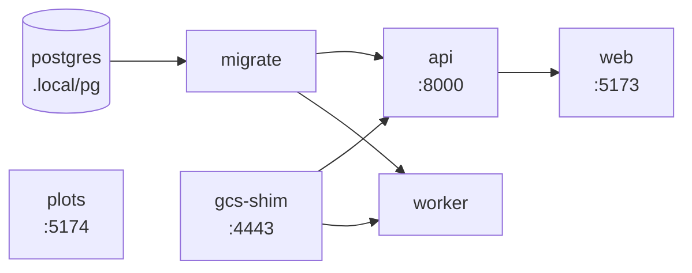

# Local, without Docker <span class="mapi-badge">v0.2</span>

`make dev` runs the whole platform on your machine **without Docker**. PostgreSQL comes from
the `pgserver` wheel, and object storage comes from the GCS shim. Thus you need only the uv
workspace and, for the web app, Node.js with pnpm.

```bash
make install          # uv sync --all-packages (+ pnpm install once apps/ exist)
make dev              # start everything; Ctrl-C stops everything
make seed             # in another shell: load the E33 demo data and spec
open http://127.0.0.1:5173
```

The [quickstart](../getting-started/quickstart.md) tells how to fit, examine and score the
demo model from the browser. This page tells what `make dev` runs, how to work on one
component, and where the local state is.

## Signing in <span class="mapi-badge">v0.3</span> { #signing-in }

`make dev` runs the servers in the `dev` profile. This profile is multi-tenant, with a
development identity provider in the API. The browser shows a sign-in screen. Select one of
the seeded accounts on the page of the provider:

| Account | Role |
|---|---|
| `admin@dev.local` | Admin of the `default` tenant and a platform operator (the admin console) |
| `analyst@dev.local` | `runner` in the `default` project |
| `viewer@dev.local` | `viewer` in the `default` project |

`make seed` and `make e2e` sign in automatically as `admin@dev.local`. To change the
account, set `MAPI_DEV_ACCOUNT`. The CLI signs in with
`mapi login --issuer https://dev-idp.mapi.localhost --discovery-url http://127.0.0.1:8000/dev/idp`.
Each person who can get access to the API can sign in as each of these accounts. For this
reason, the profile is only for local development. `MAPI_STACK_PROFILE=single-tenant make dev`
gives the v0.2 API without credentials. For more data, refer to
[Authentication and isolation](authentication.md).

### Signing up <span class="mapi-badge">v0.4</span> { #signing-up }

Self-service sign-up (`POST /auth/signup`) is on in the `dev` profile. The server does not
send its e-mails. The dev mailer writes each e-mail to an outbox under
`MAPI_DATA_DIR/outbox`. `make outbox` prints the newest e-mails with their verification
links. `TO=<address>` shows only the e-mails of one recipient. The API serves the same data
at `GET /dev/outbox?to=<address>`.

A verified sign-up makes a `public`-tier workspace. To sign in to it, sign up with one of
the seeded addresses above, because the development identity provider knows only those
addresses. A `public` workspace runs only built-in models and declarative specs. It runs only
on an executor with enforced egress and DNS. Thus the `local-process` executor of `make dev`
refuses its runs (cut line A, refer to [Sign-up and abuse controls](signup-and-abuse.md)).

## What `make dev` starts

`scripts/dev.py` is a small process supervisor. It starts each service in the sequence of
its dependencies. It waits until a service is ready before it starts the services that need
it. All output goes to one terminal. Each line starts with the name of its service (in
colour when the output is a terminal).



| Service | Command | Ready when |
|---|---|---|
| `postgres` | Embedded PostgreSQL 16 (`pgserver`), data in `.local/pg`, unix socket only. Skipped when `DATABASE_URL` is set. | `pg_ctl` reports that it runs, and the `mapi` database is there |
| `gcs-shim` | `mapi-gcs-shim serve --host 127.0.0.1 --port 4443 --cors-origin <web origin> --root .local/gcs` | The port accepts connections |
| `migrate` | `mapi-server migrate` (runs one time) | It stops with status 0 |
| `api` | `mapi-server api --host 127.0.0.1 --port 8000` | `GET /healthz` returns 2xx |
| `worker` | `mapi-server worker` with `MAPI_EXECUTOR=local-process`: dispatcher, reconciler, event ingestion and the finalizer queue. Each run is a `mapi-runner` supervisor process that starts its own worker process. | Started |
| `web` | `pnpm --filter @mapi/web dev --host 127.0.0.1 --port 5173 --strictPort` | The port accepts connections |
| `plots` | `pnpm --filter @mapi/plot-sandbox dev --host 127.0.0.1 --port 5174 --strictPort` | The port accepts connections |

Each service gets the same resolved environment: `MAPI_ENV`, `DATABASE_URL`,
`MAPI_GCS_ENDPOINT`, `MAPI_API_URL`, `MAPI_WEB_ORIGIN`, `MAPI_PLOTS_ORIGIN` and
`MAPI_DATA_DIR`. The values come from `mapi_spec.localdev.LocalDev`. The services read the
same contract, so they always agree about ports. The
[configuration reference](configuration.md) lists all the variables.

!!! note "The plot sandbox is a separate origin"
    Plots show in an `<iframe sandbox="allow-scripts">` that comes from `MAPI_PLOTS_ORIGIN`
    (port 5174), never from the app origin (port 5173). `LocalDev` refuses a configuration
    that puts the two on the same origin.

### Shutting down

++ctrl+c++ (or `make stop` from a different shell) stops the services in the opposite
sequence of the start. Each service runs in its own process group. The supervisor sends
`SIGTERM` to that group. If the group still runs after the grace period, the supervisor
sends `SIGKILL`. The grace period is 10 s (change it with `--grace`). Child processes, for
example the esbuild of Vite, stop with their parent. A second ++ctrl+c++ stops all processes
immediately. The embedded PostgreSQL stops last, but not if you ran
`scripts/dev.py up --keep-db`.

If a long-running service stops without a command, the supervisor stops the whole stack. The
supervisor then stops with a status that is not zero. It never starts a service again
without a message. The log above the shutdown shows the reason.

### The first start

At its first start against a new environment, the worker logs `no catalog for sha256:…:
queued describe run`. The catalog contains the steps, models and plot recipes in the runner,
with their settings schemas and schema effects. A sandboxed `describe` run of the real runner
makes the catalog. The server keeps it in a cache for each digest of the environment: the hash
of `uv.lock` and of the workspace sources (`packages/*/src`, `plugins/*/src`). Thus the
server builds it again after you change the locked dependencies or the code, when you
restart `make dev`. Until the catalog is ready, spec validation reports that the catalog is
not available. This takes some seconds.

Runs use the same isolation as in production, but not the parts that a laptop cannot do. The
run event `DEV_MODE_ISOLATION` tells that the worker process runs as your user, without a uid
split or `no_new_privs`.

!!! warning "Plugin code runs as you, next to the platform's keys"
    Run only plugin code that you trust in `make dev`. Without a uid split, run code
    (plugins and the steps that they load) can read all the files that your user can read.
    These include the control key of the shim (`.local/gcs/_shim/keys/control.json`, full
    access to all buckets), the bundle-signing key (`.local/keys/`) and the executions
    directory. Thus a hostile plugin could forge a signed bundle, or change outputs after the
    finalizer did a check of them. On Linux, the orchestrator makes itself non-dumpable.
    Thus run code cannot read its environment (`DATABASE_URL`) or its memory. The worker logs
    the same warning when it starts.

## Everyday commands

| Command | What it does |
|---|---|
| `make dev` (or `make run`) | Starts the stack in the foreground |
| `make dev ONLY=api` | Starts `api` and its dependencies (`gcs-shim`, `migrate`) |
| `make dev WITHOUT=web,plots` | Starts all services, but not the two Vite servers (for example, while the web app is not built yet) |
| `make stop` | Stops a stack that runs in a different shell, then its embedded PostgreSQL |
| `make status` | Shows which services operate, and if PostgreSQL runs |
| `make migrate` | Applies database migrations one time. If necessary, it starts the embedded PostgreSQL, and then it stops it again. |
| `make db-shell` | `psql` on the dev database (the embedded server or `DATABASE_URL`) |
| `make seed` | Loads the E33 demo datasets and the `eu-geo-mmm` spec through the HTTP API (`make seed SIZE=full` for the large variant) |
| `make e2e` | Runs the end-to-end suites against the stack: `pytest -m e2e` (`tests/e2e`, through the Python client), then the Playwright `@e2e` suite (`apps/web/e2e`, through the browser) |
| `make outbox` | Shows the newest e-mails of the dev mailer and their links (sign-up verification). `TO=<address>` filters |
| `make clean-local` | Deletes `MAPI_DATA_DIR` (database, objects, supervisor state). It refuses while a service runs. `YES=1` skips the prompt. |
| `uv run python scripts/dev.py env` | Prints the resolved environment as `export` lines, so that you can run a component manually |

`make seed` uses only the public API. It does these steps:

1. It makes the datasets `eu_media_daily`, `fx_daily` and `holidays_eu`.
2. It uploads each table to the signed URL that the API returns.
3. It waits for the sandboxed ingest runs.
4. It makes the spec that points at the new dataset versions.

If you run it again, it adds new dataset versions and a new spec revision. It uses the same
datasets again. `make` reads `SIZE` only from the make command line, because some toolchains
(the compilers of conda) export their own `SIZE` variable.

`uv run python scripts/seed.py --export demo/` writes the same tables, the E33 score payloads
and the spec as files. You can then upload these files through the web app.

## End-to-end tests

`make e2e` does the M1 flow through the stack:

- It uploads the E33 data, validates and fits the spec, and follows the run over SSE.
- It does a check of the signed manifest and the bundle.
- It scores an 8-week forecast, a new market, a weekly EUR plan and counterfactuals.
- It probes the security boundaries that are visible from outside. The bootstrap object is
  gone, the server refuses forged events, and the plot iframe is an opaque origin.

Start `make dev` first. The two suites read the same `MAPI_*` variables. Thus, if you moved a
port, export the variables in the shell that runs `make e2e`. The browser suite writes
screenshots to `apps/web/e2e/screenshots/` (git ignores them).

```bash
export MAPI_API_URL=http://127.0.0.1:8010   # only if you moved the API
make dev                                     # shell 1
make e2e                                     # shell 2: about 25 minutes
```

`make e2e` also runs the M2 tenancy suite and the M3 suites. The M3 suites are the trust
lifecycle and the whole Guided journey to an endpoint, webhooks, embeds, budget
optimisation, export and deletion (refer to [M3 verification](m3-verification.md)). Two
settings make the deletion checks complete:

- Start the stack with `MAPI_TENANT_DELETION_GRACE_S=0` (no grace period).
- On a new `MAPI_DATA_DIR`, set `MAPI_BUNDLE_RETENTION_DAYS=0` (no retention lock on model
  bundles).

If not, those checks stop where the platform waits, and the suite skips them. Each run signs
up two workspaces. The default sign-up limits are 5 for each address in each hour, and 25 for
each `dev.local` in each day. These limits permit two runs in each hour. Thus, on a stack that
you test many times, increase `MAPI_SIGNUP_PER_IP_PER_HOUR` and
`MAPI_SIGNUP_PER_DOMAIN_PER_DAY`.

Webhooks can get to receivers on your machine. In the `dev` profile, `make dev` writes a
temporary CA and a certificate for `127.0.0.1` and `localhost` to
`$MAPI_DATA_DIR/dev/webhook-tls/`. The servers trust the CA and permit the two hosts. Serve
HTTPS with `cert.pem` and `key.pem` from there. Then register
`https://127.0.0.1:<port>/...`.

The mocked Playwright smoke suite (`pnpm --filter @mapi/web test`) serves its own build on
port 5173. Thus run it only while `make dev` is stopped.

## Working on one component

You can run a component yourself, for example with a debugger or auto-reload. There are two
procedures. In the first procedure, exclude the component and start it manually with the
same environment:

```bash
make dev WITHOUT=api,web           # web depends on api, so exclude it too
eval "$(uv run python scripts/dev.py env)"
mapi-server api --host 127.0.0.1 --port 8000
```

In the second procedure, replace its command with `MAPI_DEV_<NAME>_CMD`. The command is
shell-quoted. `<NAME>` is `GCS_SHIM`, `MIGRATE`, `API`, `WORKER`, `WEB` or `PLOTS`:

```bash
MAPI_DEV_API_CMD="uvicorn mapi_server.app:app --reload --host 127.0.0.1 --port 8000" make dev
```

The readiness probe still applies. Thus a replacement `api` must answer `GET /healthz`.

## Configuration

`make dev` reads **your shell environment**. It does not read `.env`, which is only for
docker compose. If you set nothing, all services use the defaults above. To change a value,
export the variable first:

```bash
export MAPI_API_URL=http://127.0.0.1:9000          # move the API (and its probe) to port 9000
export DATABASE_URL=postgresql://me@localhost/mapi  # use your own PostgreSQL instead of pgserver
make dev
```

Export the same `MAPI_*` URLs in each shell that connects to the stack (`make seed`,
`make e2e`, the CLI, the Python client). The [configuration reference](configuration.md)
lists all the variables. This includes the variables that only compose or the images use.

## Where state lives

All local state is under `MAPI_DATA_DIR`. The default is `.local/` in the repository root,
and git ignores it.

```text
.local/
├─ pg/                    PostgreSQL data directory (pgserver); log in pg/log
├─ gcs/                   GCS shim objects (buckets mapi-local-*)
│  └─ _shim/keys/         the shim's principals: control.json (control plane), exec.json (runs)
├─ keys/                  bundle-signing-p256.pem: signs bundle manifests (stands in for KMS)
├─ outbox/                the dev mailer's e-mails (make outbox, GET /dev/outbox)
├─ executions/            per-run scratch of the local executor (removed when a run ends)
└─ dev/supervisor.json    pid of the running supervisor and its services (make stop/status)
```

!!! caution
    Do not delete `keys/`. If you delete it, you cannot use the registered model versions.
    Their manifests do not verify, and the API does not mint download links for them
    (`INTEGRITY_FAILURE`).

## Troubleshooting

[Troubleshooting](troubleshooting.md) tells about these problems: port conflicts, an old
supervisor, PostgreSQL that does not start, failed migrations, an API that never becomes
ready, and blank plots.
