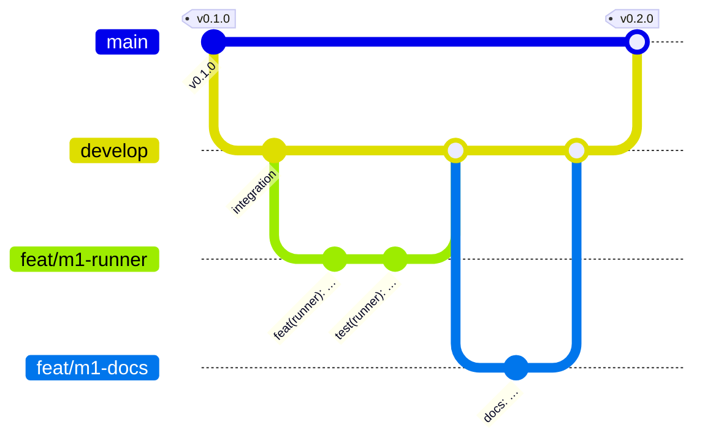

# Contributing

Thank you for your help. All contributions are under the Contributor Licence Agreement
(`CONTRIBUTOR-LICENSE.md` in the repository root).

## Set up

```bash
make install          # uv sync --all-packages (+ pnpm install once apps/ exist)
make help             # every developer entry point
```

| Command | What it does |
|---|---|
| `make test` | Runs the default test suite (all tests, but not the Docker, cloud and end-to-end tests) |
| `make test-fast` | Runs only the unit tests. It does not run the slow MCMC tests |
| `make lint` | Runs ruff, the ruff format check and the import-linter contracts |
| `make typecheck` | Runs mypy on each package that has type checks |
| `make conformance` | Runs the conformance corpus at size `tiny` (`FIXTURE=e33` for one fixture) |
| `make docs-serve` | Shows this site and loads it again when a page changes |
| `make docs-build` | Makes the generated reference pages again and builds the site in strict mode |
| `make docs-test` | Runs all the documentation snippets and the checks of the docs |
| `make dev` | Runs the whole stack locally without Docker ([Local, without Docker](../operations/local-development.md)) |
| `make docker-build` / `make compose-up` | Builds the images / runs the compose stack ([Docker Compose](../operations/docker.md)) |
| `make release-check` | Does a check of version consistency, the changelog entry, plan files (there must be none), pinned images and current third-party notices |
| `make notices` | Makes `THIRD-PARTY-NOTICES.md` again after a change to `uv.lock` or `pnpm-lock.yaml` ([Licensing](licensing.md#third-party-libraries)) |

## Branching model

We use git flow with two permanent branches, `main` and `develop`.



| Branch | Purpose |
|---|---|
| `main` | Releases only. We merge each milestone from `develop` and tag it `vX.Y.Z`. Nobody commits to `main` directly. |
| `develop` | Integration. We merge feature branches here with `--no-ff`. |
| `feat/<milestone>-<topic>` | One unit of work. Make the branch from the latest `develop`. |

```bash
git checkout -B feat/m1-my-change develop
# ... small, logical commits ...
make fmt lint typecheck test
```

Do not rebase or rewrite `develop` or `main`. Keep changes to shared files small, and only add
to them. The shared files are the root `pyproject.toml`, the `Makefile`, `uv.lock` and CI.
Tell about these changes in your pull request.

## Writing style

Write all text for users in ASD-STE100 Simplified Technical English. This includes the
documentation, the text in the web app, and the messages that the server sends for the app
to show. The rules are in [Writing style](writing-style.md).

## Commit messages

Use [Conventional commits](https://www.conventionalcommits.org/), with the package as the
scope:

```text
feat(sdk): replay context tails at each step's input stage
fix(server): reject score requests whose horizon exceeds the fit
docs: add the porting guide
test(conformance): add the e24 filter fixture
chore: bump ruff
```

## Code style

- Use Python 3.12 and ruff (line length 100). Use type hints in all code. Use mypy strict for
  the core packages.
- Tests are in `tests/` in each package. PyMC fits in tests use very small settings
  (`tune: 50–150`, `draws: 50–150`, `chains: 2`). If a test takes more than about ten
  seconds, mark it `slow`.
- Write short docstrings (Google style). The contract tests are the executable documentation.
- `mapi_spec` must not import numpy, xarray or pandas. The server must not import plugin code
  or array code. `make lint` makes sure of the two rules.

## Documentation

The site uses MkDocs Material. `mkdocs.yml` is at the repository root, and the pages are in
`docs/`.

- **The tests run all Python examples.** The examples are in `docs/snippets/*.py`. Pages
  include them with `--8<-- "file.py:section"`. `conformance/tests/test_docs_snippets.py`
  runs each file. To add a section, use `# --8<-- [start:name]` / `# --8<-- [end:name]`.
- **Platform examples run against a live stack.** `make e2e` runs the client, HTTP and
  remote-CLI walkthroughs (`docs/snippets/client_tour.py`, `http_tour.sh`, `cli_remote.sh`).
  The default suite runs the local CLI walkthrough (`cli_local.sh`) in
  `conformance/tests/test_docs_platform.py`. Shell snippets use the same section markers.
- **Scripts make the reference pages.** `scripts/gen_docs_catalog.py` writes the pages for the
  steps, models, plot recipes, spec schema and error codes. `scripts/gen_docs_reference.py`
  writes the CLI reference, the server settings and a copy of `apps/web/openapi.json`. The
  two scripts write into `docs/reference/generated/`, which git ignores. An MkDocs hook runs
  the two scripts before each build.
- **New `MAPI_*` variables go into the configuration reference**
  (`docs/operations/configuration.md`). A test looks for these variables in the source tree.
- **Screenshots** are in `docs/assets/screenshots/`. Each screenshot must be 300 KB or less,
  and a page must use it. `make docs-screenshots` captures them again from a stack that runs and has
  seed data.
- `make docs-build` must pass (`mkdocs build --strict`, with anchor validation).
- Write for two types of readers. An analyst wants to know what a feature does for them. A
  data scientist wants to know exactly how it works.
