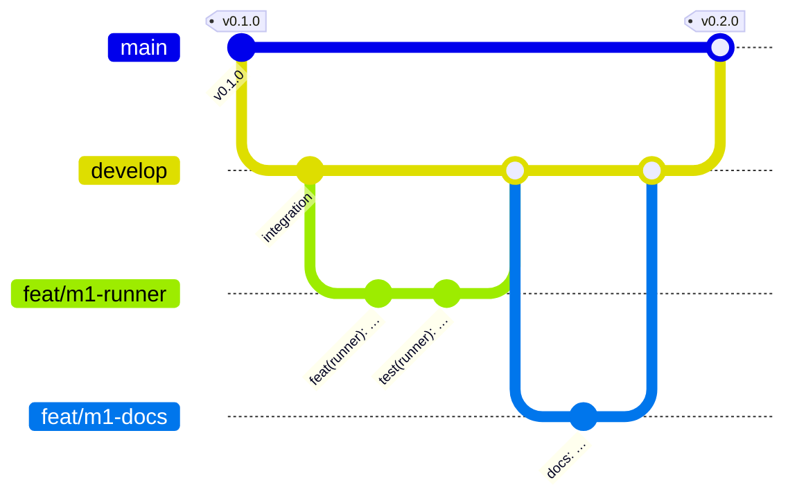

# Contributing

Thank you for helping. All contributions are made under the Contributor Licence Agreement
(`CONTRIBUTOR-LICENSE.md` in the repository root).

## Set up

```bash
make install          # uv sync --all-packages (+ pnpm install once apps/ exist)
make help             # every developer entry point
```

| Command | What it does |
|---|---|
| `make test` | The default test suite (everything except Docker, cloud and end-to-end tests) |
| `make test-fast` | Unit tests only, skipping slow MCMC tests |
| `make lint` | ruff, ruff format check and the import-linter contracts |
| `make typecheck` | mypy over every type-checked package |
| `make conformance` | The conformance corpus at size `tiny` (`FIXTURE=e33` for one) |
| `make docs-serve` | This site with live reload |
| `make docs-build` | Regenerate the generated reference pages and build the site strictly |
| `make docs-test` | Run every documentation snippet and the docs checks |
| `make dev` | The whole stack locally without Docker ([Local, without Docker](../operations/local-development.md)) |
| `make docker-build` / `make compose-up` | Build the images / run the compose stack ([Docker Compose](../operations/docker.md)) |
| `make release-check` | Version consistency, changelog entry, no plan files, pinned images, current third-party notices |
| `make notices` | Regenerate `THIRD-PARTY-NOTICES.md` after a change to `uv.lock` or `pnpm-lock.yaml` ([Licensing](licensing.md#third-party-libraries)) |

## Branching model

We use git flow with two long-lived branches, `main` and `develop`.



| Branch | Purpose |
|---|---|
| `main` | Releases only. Each milestone is merged from `develop` and tagged `vX.Y.Z`. Nobody commits to `main` directly. |
| `develop` | Integration. Feature branches are merged here with `--no-ff`. |
| `feat/<milestone>-<topic>` | One unit of work, branched from the latest `develop`. |

```bash
git checkout -B feat/m1-my-change develop
# ... small, logical commits ...
make fmt lint typecheck test
```

Never rebase or rewrite `develop` or `main`. Keep changes to shared files (the root
`pyproject.toml`, the `Makefile`, `uv.lock`, CI) minimal and additive, and mention them in
your pull request.

## Writing style

Write all text for users in ASD-STE100 Simplified Technical English: documentation, text in
the web app, and the messages that the server sends for the app to show. The rules are in
[Writing style](writing-style.md).

## Commit messages

[Conventional commits](https://www.conventionalcommits.org/), scoped by package:

```text
feat(sdk): replay context tails at each step's input stage
fix(server): reject score requests whose horizon exceeds the fit
docs: add the porting guide
test(conformance): add the e24 filter fixture
chore: bump ruff
```

## Code style

- Python 3.12, ruff (line length 100), type hints everywhere; mypy strict for the core
  packages.
- Tests live next to each package in `tests/`. PyMC fits in tests use tiny settings
  (`tune: 50–150`, `draws: 50–150`, `chains: 2`) and are marked `slow` when they take more than
  about ten seconds.
- Docstrings are concise (Google style). The contract tests are the executable documentation.
- `mapi_spec` must not import numpy, xarray or pandas; the server must not import plugin or
  array code. `make lint` enforces both.

## Documentation

The site is MkDocs Material (`mkdocs.yml` at the repository root, pages in `docs/`).

- **Every Python example is executed.** Examples live in `docs/snippets/*.py`, are included in
  pages with `--8<-- "file.py:section"`, and `conformance/tests/test_docs_snippets.py` runs each
  file. Add a section with `# --8<-- [start:name]` / `# --8<-- [end:name]`.
- **Platform examples run against a live stack.** The client, HTTP and remote-CLI walkthroughs
  (`docs/snippets/client_tour.py`, `http_tour.sh`, `cli_remote.sh`) run under `make e2e`; the
  local CLI walkthrough (`cli_local.sh`) runs in the default suite
  (`conformance/tests/test_docs_platform.py`). Shell snippets use the same section markers.
- **Reference pages are generated.** `scripts/gen_docs_catalog.py` writes the steps, models,
  plot recipes, spec schema and error-code pages, and `scripts/gen_docs_reference.py` the CLI
  reference, the server settings and a copy of `apps/web/openapi.json`, into
  `docs/reference/generated/` (git-ignored); an MkDocs hook runs both before every build.
- **New `MAPI_*` variables go into the configuration reference**
  (`docs/operations/configuration.md`); a test scans the source tree for them.
- **Screenshots** live in `docs/assets/screenshots/` (at most 300 KB each, each used by a page).
  `make docs-screenshots` recaptures them from a running, seeded stack.
- `make docs-build` must pass (`mkdocs build --strict`, with anchor validation).
- Write for two readers: an analyst who wants to know what a feature does for them, and a data
  scientist who wants to know exactly how it works.
