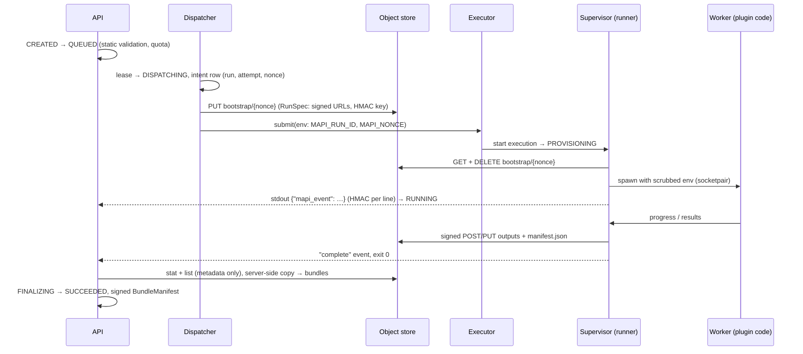

# Run protocol <span class="mapi-badge mapi-badge--soon">v0.2</span>

This page specifies how a run moves from the API to a sandbox and back. It covers:

- the run state machine;
- the bootstrap object and the environment an execution receives;
- the event stream the runner writes;
- the output manifest, its verification at finalisation, and the signed bundle manifest;
- the storage layout;
- the ports and environment variables of a local install.

Every shape on this page is a Pydantic model or a constant in `mapi_spec.run`,
`mapi_spec.storage` or `mapi_spec.localdev`. The API server, the executors, the runner and
the tests all import them from there.



## Run states

`RunState` values are lower-case on the wire. This page writes them in upper case.

| State | Meaning |
|---|---|
| `CREATED` | Accepted by the API; static validation and quota not yet decided |
| `REJECTED` | Static validation or quota refused the run (terminal) |
| `QUEUED` | Waiting for the dispatcher |
| `DISPATCHING` | Leased; intent row written; executor call in progress |
| `PROVISIONING` | The executor accepted the execution; no event seen yet |
| `RUNNING` | At least one verified event arrived |
| `STALLED` | No event for K × the progress interval. This is a warning, not a failure: the executor's status API is the liveness source of truth. |
| `FINALIZING` | Execution finished. Outputs are being verified and copied. |
| `SUCCEEDED` | A verified bundle exists (terminal) |
| `PARTIAL` | A verified *partial* bundle exists, written from checkpoints after a SIGTERM or deadline. Terminal, but can be resumed. |
| `FAILED` | Terminal, with a failure class: `user`, `resource_exhausted`, `infra`, `integrity`, `timeout` or `sandbox` |
| `CANCELLING` | The user asked to cancel; waiting for the executor to confirm |
| `CANCELLED` | Terminal |

### Transitions

`mapi_spec.run.transition(state, trigger, actor=...)` is a pure function. It returns the
matching rule, or raises `IllegalTransition`, which maps to 409 `CONFLICT`. Callers persist
`rule.target` with a compare-and-set on the old state. When `rule.new_attempt` is set they
also increment `attempt` and generate a fresh nonce. A test checks the table below against
the code exhaustively, all 13 × 19 state and trigger pairs.

| From | Trigger | To | Owner | Failure class | New attempt |
|---|---|---|---|---|---|
| `CREATED` | `accept` | `QUEUED` | api | | |
| `CREATED` | `reject` | `REJECTED` | api | | |
| `QUEUED` | `lease` | `DISPATCHING` | dispatcher | | |
| `DISPATCHING` | `submitted` | `PROVISIONING` | dispatcher, reconciler (orphan adoption) | | |
| `DISPATCHING` | `infra_retry` | `QUEUED` | dispatcher, reconciler | | yes |
| `DISPATCHING` | `fail_infra` | `FAILED` | dispatcher, reconciler | infra | |
| `PROVISIONING`, `RUNNING`, `STALLED` | `event` | `RUNNING` | events | | |
| `PROVISIONING`, `RUNNING`, `STALLED` | `complete` | `FINALIZING` | reconciler | | |
| `PROVISIONING`, `RUNNING`, `STALLED` | `infra_retry` | `QUEUED` | reconciler | | yes |
| `PROVISIONING`, `RUNNING`, `STALLED` | `fail_user` / `fail_resource_exhausted` / `fail_infra` / `fail_timeout` / `fail_sandbox` | `FAILED` | reconciler | user / resource_exhausted / infra / timeout / sandbox | |
| `RUNNING` | `silence` | `STALLED` | reconciler | | |
| `STALLED` | `silence` | `STALLED` (no-op) | reconciler | | |
| `FINALIZING` | `event` | `FINALIZING` (no-op) | events | | |
| `FINALIZING` | `verified` | `SUCCEEDED` | finalizer | | |
| `FINALIZING` | `verified_partial` | `PARTIAL` | finalizer | | |
| `FINALIZING` | `fail_integrity` | `FAILED` | finalizer | integrity | |
| `FINALIZING` | `fail_infra` | `FAILED` | finalizer | infra | |
| every non-terminal state except `CANCELLING` | `cancel` | `CANCELLING` | api | | |
| `CANCELLING` | `cancel` / `event` | `CANCELLING` (no-op) | api / events | | |
| `CANCELLING` | `cancel_confirmed` | `CANCELLED` | reconciler | | |
| `PARTIAL` | `resume` | `QUEUED` | api | | yes |

Rules that every component follows:

- **Events only move a run to `RUNNING`.** All other execution-time transitions come from the
  reconciler. The reconciler is level-triggered and reads the executor's status.
- **`complete`** fires when the executor reports exit code `0` or `16` and the `complete`
  event has been received. The finalizer then reads `OutputManifest.status` and fires
  `verified` or `verified_partial`.
- **`infra_retry`** is applied only after the old execution is confirmed gone. Automatic
  retries are capped by cost, and there is no automatic retry once a run has spent more than
  30 minutes without user consent.
- **Late events.** The events service drops verified events for runs that are already
  terminal. Every terminal state rejects `event`.
- **Cancelling a `FINALIZING` run is a no-op at the API.** The table allows the edge, but
  `POST /v1/runs/{id}:cancel` returns the run unchanged: the execution has already finished,
  and the finalizer may already have reserved a version number and copied write-once bundle
  objects.

## Bootstrap

The executor passes no credentials, URLs or keys through argv or the environment. The only
per-execution values are `MAPI_RUN_ID` and `MAPI_NONCE`.

1. The dispatcher writes an intent row `(run, attempt, nonce)`. The nonce is 256 random bits
   written as 64 lowercase hex characters (`new_nonce()`).
2. The dispatcher writes a **`RunSpec`** to `gs://mapi-{env}-bootstrap/{nonce}`
   (`mapi_spec.run.RunSpec`, schema `runspec.json`).
3. The dispatcher calls `Executor.submit(RunSubmit, nonce)`. For every out-of-process
   executor, `RunSubmit.payload` stays empty: the executor sees only the run id, attempt,
   kind, resource class, timeout and labels. Everything secret travels in the `RunSpec`.
4. The supervisor resolves `MAPI_BOOTSTRAP_URL`, GETs the object, and **deletes it
   immediately**. It then validates the object as a `RunSpec` and starts the worker with
   `worker_environ()`, an allow-listed environment in which every `MAPI_*` variable is
   removed. If the object is missing or invalid, the supervisor exits with code
   `2 CONFIG_ERROR`.

| `RunSpec` field | Meaning |
|---|---|
| `schema_version` | `mapi.runspec/v1` |
| `run_id`, `attempt`, `nonce`, `kind` | Run identity. Parent kinds (`sweep`, `backtest`, `sbc`, `campaign`) never execute. |
| `tenant_id`, `project_id` | Always present (`default` in M1) |
| `spec`, `spec_hash`, `catalog_digest` | The *resolved* spec JSON (`use:` ranges pinned), its canonical hash, and the catalog snapshot it was resolved against |
| `inputs` | `name → SignedGet{url, expires_at, generation, size, crc32c, md5_hash?}`. Well-known names are `dataset` and `bundle`. URLs are pinned to a generation and support HTTP `Range`. The runner checks size and CRC32C after download and exits `13 INTEGRITY_ERROR` on a mismatch. |
| `outputs` | `name → SignedPut \| PostPolicy`. `manifest` is a required write-once **signed PUT** for `{prefix}manifest.json`. `artifacts` is a **V4 POST policy** on the attempt prefix with a `content_length_range`. `checkpoints` is a POST policy on `checkpoint_prefix`, present only for checkpointable runs. |
| `resume` | Checkpoint objects from the previous attempt, as `SignedGet`s |
| `checkpoint_prefix` | `{attempt prefix}checkpoints/`, or `null` |
| `hmac_key` | Base64 encoding of at least 32 random bytes; the per-run event HMAC key (`new_hmac_key()`). Never logged: `RunSpec.redacted()` blanks it, together with every URL. |
| `limits` | `RunLimits`: `log_line_bytes` (4096), `log_total_bytes` (20 MiB), `max_event_bytes` (64 KiB), `progress_interval_s` (2 s), `max_output_bytes` and `scratch_bytes` (from the resource class), `max_output_objects` (10 000) |
| `resource_class`, `deadline`, `created_at`, `labels` | The class (S/M/L/XL), a hard UTC deadline, and metadata |

### Environment

| Variable | Set by | Value |
|---|---|---|
| `MAPI_RUN_ID` | executor, per execution | The run id |
| `MAPI_NONCE` | executor, per execution | 64 hex characters |
| `MAPI_BOOTSTRAP_URL` | executor, static per Job or backend | A template with exactly one `{nonce}`. Cloud: `gs://mapi-prod-bootstrap/{nonce}`, read with the execution service account, which may get and delete but not list. Local: `http://127.0.0.1:4443/storage/v1/b/mapi-local-bootstrap/o/{nonce}`. |
| `MAPI_EXEC_TOKEN` | local executor only | Bearer token of the GCS shim's *exec* principal, which may get and delete in the bootstrap bucket. **Never set in the cloud.** |

`RunnerEnv.from_environ()` parses these and names any missing variable.
`RunnerEnv.resolved_bootstrap_url()` substitutes the nonce into the template.

## Events

The worker cannot write the real stdout. It reports to the supervisor over a socketpair. The
supervisor captures the worker's stdout and stderr, strips ANSI and control sequences, and
writes **one JSON object per line** to its own stdout:

```json
{"mapi_event":{"attempt":1,"hmac":"5f0c…","payload":{"chains":[],"fraction":0.4,"phase":"sample"},"run_id":"run_01jaf3q2x8m9v7k5h4g3f2e1d0","seq":12,"ts":"2026-10-15T09:31:00.123456Z","type":"progress"}}
```

Cloud Logging stores each line as the `jsonPayload` of a log entry. The sink filter is
`jsonPayload.mapi_event:*`, and the run identity is cross-checked against the execution
label. The local executor reads the same lines from the supervisor's stdout pipe.
`encode_event_line()` and `decode_event_line()` implement the wire format:

- lines that are not JSON, or JSON without `mapi_event`, are not events and are ignored;
- an invalid `mapi_event` object, or a line over 64 KiB, raises `InvalidEvent`, which is a
  `SANDBOX_VIOLATION`.

Each event has these fields:

| Field | Rule |
|---|---|
| `run_id`, `attempt` | Must match the run and its current attempt |
| `seq` | Starts at 0 per attempt and increases by 1 per line. The receiver deduplicates on `(run_id, attempt, seq)`. Gaps are tolerated, because logging can drop entries. |
| `ts` | Timezone-aware and normalised to UTC |
| `type` | `state`, `progress`, `log`, `diagnostic`, `warning`, `checkpoint`, `metric`, `complete` or `error` |
| `payload` | Validated against the payload model for `type`; see below |
| `hmac` | Lower-case hex HMAC-SHA256 under the run's `hmac_key` |

**What the HMAC covers:**

```text
"mapi.run-event.v1" 0x00 ‖ canonical JSON of the event without "hmac"
```

Canonical JSON (`canonical_bytes()`) is defined as follows:

- the model is dumped in JSON mode **with defaults included**;
- keys are sorted;
- there is no whitespace;
- the text is UTF-8 with no ASCII escaping;
- integral floats are written as integers;
- NaN and Infinity are rejected.

Verification uses a constant-time comparison (`verify_event()`). An event that fails
verification is dropped and counted as a sandbox violation for that run. It never changes the
run's state. Output manifests use the context tag `mapi.output-manifest.v1` and bundle
manifests use `mapi.bundle-manifest.v1`, so a signature from one domain is never valid in
another.

| `type` | Payload model | Notes |
|---|---|---|
| `state` | `StatePayload{phase, message?}` | Runner phases: `bootstrap`, `load_inputs`, `validate`, `preprocess`, `fit`, `sample`, `score`, `evaluate`, `derive`, `plots`, `upload`, `done` |
| `progress` | `ProgressPayload{phase, fraction?, message?, eta_seconds?, chains[]}` | Coalesced to at most one every `limits.progress_interval_s`; upserted into one `run_progress` row |
| `log` | `LogPayload{stream, line, truncated}` | One line, at most `log_line_bytes`. Beyond `log_total_bytes` the run fails with `SANDBOX_VIOLATION` (log flood). |
| `diagnostic` | `Diagnostic` (`mapi_spec`) | Rolls up into the scorecard |
| `warning` | `WarningPayload{code, message, untrusted_text?}` | |
| `checkpoint` | `CheckpointPayload{name, size, crc32c, segment, draws_done?}` | `name` is relative to `checkpoint_prefix` |
| `metric` | `MetricPayload{name, value, step?, labels}` | |
| `complete` | `CompletePayload{status, manifest_name, manifest_crc32c, objects, total_bytes}` | The last event of a successful (`complete`) or checkpointed (`partial`) attempt |
| `error` | `ErrorPayload{code, failure_class, message, untrusted_text?}` | `code` must equal `failure_class.error_code` |

`make_event(run_id, attempt, seq, payload, key=...)` infers `type` from the payload model
and signs the event.

## Exit codes

The supervisor exits with `0` only after it has uploaded the manifest and emitted the
`complete` event. `failure_class_for_exit()` classifies the code. Any other non-zero code,
for example `1` from a crashed supervisor, is `infra`.

| Code | Name | Failure class |
|---|---|---|
| 0 | `OK` | — (success) |
| 2 | `CONFIG_ERROR` | infra: bad environment, bootstrap missing or invalid |
| 10 | `USER_ERROR` | user: plugin or user code raised, or produced invalid output |
| 11 | `RESOURCE_EXHAUSTED` | resource_exhausted: `MemoryError` or scratch budget exceeded |
| 12 | `INFRA_ERROR` | infra: uploads or downloads failed after retries |
| 13 | `INTEGRITY_ERROR` | integrity: an input did not match its size or CRC32C |
| 14 | `TIMEOUT` | timeout: deadline reached with no checkpoint to flush |
| 15 | `SANDBOX_VIOLATION` | sandbox: log flood, output caps exceeded, forged or oversized events |
| 16 | `PARTIAL` | — (SIGTERM or deadline; checkpoint flushed and a `partial` manifest uploaded) |
| 137 | `KILLED` | resource_exhausted: SIGKILL, usually the OOM killer. The user is offered "retry at class + 1". |
| 143 | `TERMINATED` | timeout: SIGTERM not handled in time |

When the user cancels a run, the run is already in `CANCELLING`, so the exit code does not
decide the outcome.

## Outputs and finalisation

The runner uploads every output under its attempt prefix
`t/{tenant}/runs/{run}/a{attempt}/` in the runs bucket, using the `artifacts` POST policy.
It streams each object and computes CRC32C and MD5 as it goes. Last, it PUTs
**`manifest.json`**, an `OutputManifest` signed with the run HMAC key:

```json
{
  "schema_version": "mapi.output-manifest/v1",
  "tenant_id": "default", "project_id": "default",
  "run_id": "run_01jaf3q2x8m9v7k5h4g3f2e1d0", "attempt": 1, "kind": "fit",
  "status": "complete",
  "prefix": "t/default/runs/run_01jaf3q2x8m9v7k5h4g3f2e1d0/a1/",
  "spec_hash": "sha256:…", "catalog_digest": "sha256:…",
  "inputs": {"dataset": {"generation": 3, "size": 1048576, "crc32c": "4waSgw=="}},
  "objects": {
    "bundle.zarr.zip": {"key": "t/default/runs/run_01jaf3q2x8m9v7k5h4g3f2e1d0/a1/bundle.zarr.zip",
                        "size": 2097152, "crc32c": "AAAAAA==", "md5": "1B2M2Y8AsgTpgAmY7PhCfg=="}
  },
  "runner_version": "0.2.0", "created_at": "2026-10-15T10:20:00Z", "hmac": "…"
}
```

Each object's `key` must equal `prefix + name`. Names must not contain empty, `.` or `..`
segments, and the manifest must not list itself.

Hashes follow GCS conventions:

- **CRC32C** is the base64 encoding of the 4-byte big-endian value (`crc32c_to_base64()`);
- **MD5** is the base64 encoding of the 16-byte digest.

**The manifest is a claim.** The control plane verifies it in the `FINALIZING` state without
reading any object content:

1. **Metadata only.** List the attempt prefix and `stat` objects. This yields the
   server-computed `size`, `crc32c`, `md5Hash` and `generation`.
2. **Compare.** `verify_output_objects(manifest, listing, expected_prefix=…)` requires the
   following:
    - every claimed object exists with identical size, CRC32C and MD5;
    - no unexpected object exists under the prefix, except `manifest.json` and
      `checkpoints/…`.

    Any discrepancy is an `INTEGRITY_FAILURE` issue. The run moves to `FAILED(integrity)` and
    a security alert is raised.
3. **Validate sidecars.** JSON sidecars (`diagnostics.json`, `plots.json`, `metrics.json`,
    `coords.json`; `schema.json` and `summary.json` for ingest; `catalog.json` for describe)
    are read with size caps, validated with Pydantic, and plots are sanitized.
4. **Server-side copy.** Each verified object is copied into the bundles bucket under
    `t/{tenant}/models/{model}/{version}/`. The copy pins `source_generation` to the verified
    generation and uses `if_generation_match=0`, so bundle objects are write-once. The
    execution service account has no access to this bucket.
5. **Sign.** The platform writes a **`BundleManifest`** that binds the tenant, run, base
    image, overlay hash, spec hash, data hash, catalog digest and every *destination*
    generation, and signs it:
    - **M1 (local):** `KMS-EC-P256-SHA256` with a local P-256 key the server keeps under
      `MAPI_DATA_DIR/keys/` (an emulation of the KMS signer, so a real KMS key can be swapped
      in without changing the signing bytes). Bundles signed `HS256` are refused when URLs
      are minted;
    - **v0.3 (M2):** a Cloud KMS asymmetric signature over the same bytes.

    URLs to the bundle are minted only after `verify_bundle_manifest()` succeeds.

## Job payloads and object names

`mapi_spec.jobs` is the contract between the dispatcher, which writes `RunSpec.spec` and
names the inputs, and the runner, which reads them and names the outputs. Both sides import
it, so a renamed input or a changed payload fails type checks and tests on both sides.

| Kind | `RunSpec.spec` | Inputs | Outputs the control plane reads |
|---|---|---|---|
| `ingest` | `IngestJob` (a mapping or the MFF preset; `dataset` and `source` are informational) | `upload` | `data.zarr.zip`, `schema.json` (`DataSchema`), `summary.json` (`DataSummary`), `profile.json`, `preview.json` |
| `describe` | `DescribeJob` (`image_digest`) | none | `catalog.json` (`Catalog`) |
| `validate` | the resolved `ModelSpec` | `dataset`, `side.<name>` | `validation.json` |
| `fit` | the resolved `ModelSpec` (`use:` and dataset refs pinned) | `dataset`, `side.<name>` | `bundle.zarr.zip`, `diagnostics.json`, `metrics.json` (`MetricsSidecar`), `plots.json`, `coords.json` (`ScoreMetadata.fit_coords`), `ui/…` |
| `score` | the `ScoreRequest` | `bundle`, `bundle.manifest`, `dataset` (the request's `data`), `scenario`, `side.<name>` | `score.zarr.zip`, `result.json`, `plots.json`, `ui/summary.arrow` |
| `evaluate` / `derive` / `render` | `EvaluateJob` / `DeriveJob` / `RenderJob` from the run's `params` | `bundle`, `dataset` (default: the fit dataset), `side.<name>`; `plots` for render | as listed in the [runner reference](runner.md#what-runspecspec-holds-per-kind) |

`side_table_input(name)` builds `side.<name>`; `SCORE_INPUTS` maps a `ScoreRequest`'s `data`
and `scenario` fields to their input names. A `*.zarr.zip` dataset may carry its raw
`DataSchema` as JSON in the root attribute `DATASET_SCHEMA_ATTR` (`mapi_schema`); ingest writes
it, and an upload that carries it keeps its dim policies, roles and units instead of an
inferred schema.

### UI views

Small JSON views go next to datasets and bundles for the browser (the control plane never
decodes them; the web app fetches them through signed URLs). `mapi_spec.views` defines them
and each carries a `format` tag:

| Object | `format` | Model |
|---|---|---|
| `preview.json` | `mapi.preview/v1` | `PreviewView`: dim columns then variable columns, the first rows, `total_rows` |
| `profile.json` | `mapi.profile/v1` | `ProfileView`: per-variable statistics and a missingness grid along the time-like dim (at most 1,000 binned columns) |
| `ui/tree_index.json` | `mapi.tree-index/v1` | `TreeIndexView`: every DataTree node's dims, coordinates (values for small ones), variables and scalar attributes; no arrays |

## Storage layout

`mapi_spec.storage` builds every key on the server from validated ids (`check_segment`). User
input never becomes a path.

| Bucket (`Buckets(env)`) | Keys | Access |
|---|---|---|
| `mapi-{env}-quarantine` | `t/{tenant}/uploads/{upload_id}` | Signed PUT from the browser; 7-day lifecycle |
| `mapi-{env}-bootstrap` | `{nonce}` | The execution identity may get and delete, but not list; 1-day lifecycle |
| `mapi-{env}-runs` | `t/{tenant}/runs/{run}/a{n}/[tasks/{i}/]`, with `checkpoints/` inside | Written only through signed URLs |
| `mapi-{env}-bundles` | `t/{tenant}/models/{model}/{version}/`: `bundle.zarr.zip`, `manifest.json`, `manifest.sig`, `diagnostics.json`, `plots.json`, `metrics.json`, `ui/…` | Control plane only; write-once |
| `mapi-{env}-data` | `t/{tenant}/datasets/{sha256}/`: `data.zarr.zip`, `schema.json`, `summary.json`, `profile.json`, `preview.json` | Content-addressed |

The control plane accesses storage only through the async `ObjectStore` protocol:

- reads and writes: `put`, `get` (with byte ranges and a `max_bytes` cap), `stat` (metadata
  only), `list`, `delete` and `copy`;
- signing: `sign_get` (pinned to a generation), `sign_put` (write-once by default) and
  `post_policy`.

`if_generation_match=0` means "only if the object does not exist yet". Failures raise
`NotFound`, `PreconditionFailed` or `AccessDenied`.

## Local development

| Component | Address | Override |
|---|---|---|
| API (FastAPI) | `http://127.0.0.1:8000` | `MAPI_API_URL` |
| GCS shim (local Cloud Storage emulator) | `http://127.0.0.1:4443` | `MAPI_GCS_ENDPOINT` |
| Web app (Vite dev server) | `http://127.0.0.1:5173` | `MAPI_WEB_ORIGIN` |
| Plot sandbox | `http://127.0.0.1:5174` | `MAPI_PLOTS_ORIGIN` |
| Postgres 16 | Embedded `pgserver`, with its data under `MAPI_DATA_DIR` (default `.local/`) | `DATABASE_URL` (any `postgresql://` URL) |

The plot sandbox **must** be a different origin from the web app, because plots render in a
`sandbox="allow-scripts"` iframe with no same-origin access. `LocalDev` refuses a
configuration that puts both on the same origin.

Other environment variables:

- `MAPI_ENV` (default `local`) selects the bucket names, for example `mapi-local-runs`.
- `LocalDev.from_environ(os.environ)` resolves the full configuration.
- `LocalDev.bootstrap_url_template()` gives the `MAPI_BOOTSTRAP_URL` value for the local
  executor.

No Docker daemon is needed. Postgres comes from `pgserver` and storage from the GCS shim.
