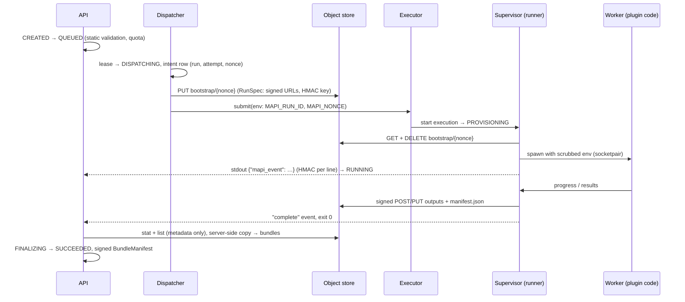

# Run protocol <span class="mapi-badge">v0.2</span>

This page tells how a run moves from the API to a sandbox and back. It gives:

- the state machine of the run
- the bootstrap object and the environment that an execution gets
- the event stream that the runner writes
- the output manifest, the checks on it at finalisation, and the signed bundle manifest
- the storage layout
- the ports and the environment variables of a local installation.

Each shape on this page is a Pydantic model or a constant in `mapi_spec.run`,
`mapi_spec.storage` or `mapi_spec.localdev`. The API server, the executors, the runner and
the tests all import them from these modules.



## Run states

`RunState` values are in lower case on the wire. This page writes them in upper case.

| State | Meaning |
|---|---|
| `CREATED` | The API accepted the run. The static validation and the quota check are not complete yet. |
| `REJECTED` | Terminal. This state is for submissions that the static validation or the quota refuses. The current server does not make such runs. Refer to the note below the transition table. |
| `QUEUED` | The run waits for the dispatcher. |
| `DISPATCHING` | The dispatcher has the lease and wrote the intent row. The call to the executor is in progress. |
| `PROVISIONING` | The executor accepted the execution. No event came yet. |
| `RUNNING` | Minimum one verified event came. |
| `STALLED` | No event came for K × the progress interval. This is a warning, not a failure. The status API of the executor is the source of truth about the execution. |
| `FINALIZING` | The execution is complete. The control plane does a check of the outputs and copies them. |
| `SUCCEEDED` | Terminal. A verified bundle exists. |
| `PARTIAL` | Terminal, but you can resume the run. A verified *partial* bundle exists. The runner wrote it from checkpoints after a SIGTERM or at the deadline. |
| `FAILED` | Terminal, with one of these failure classes: `user`, `resource_exhausted`, `infra`, `integrity`, `timeout` or `sandbox` |
| `CANCELLING` | The user asked to cancel the run. The run waits for the executor to confirm. |
| `CANCELLED` | Terminal |

### Transitions

`mapi_spec.run.transition(state, trigger, actor=...)` is a pure function. It returns the rule
that matches, or it raises `IllegalTransition`. `IllegalTransition` maps to 409 `CONFLICT`.
Callers save `rule.target` with a compare-and-set on the old state. If `rule.new_attempt` is
set, callers also increase `attempt` and make a new nonce. A test compares the table below with
the code for all 13 × 19 pairs of state and trigger.

| From | Trigger | To | Owner | Failure class | New attempt |
|---|---|---|---|---|---|
| `CREATED` | `accept` | `QUEUED` | api | | |
| `CREATED` | `reject` | `REJECTED` | api | | |
| `QUEUED` | `lease` | `DISPATCHING` | dispatcher | | |
| `DISPATCHING` | `submitted` | `PROVISIONING` | dispatcher, reconciler (orphan adoption) | | |
| `DISPATCHING` | `infra_retry` | `QUEUED` | dispatcher, reconciler | | yes |
| `DISPATCHING` | `fail_infra` | `FAILED` | dispatcher, reconciler | infra | |
| `PROVISIONING`, `RUNNING`, `STALLED` | `event` | `RUNNING` | events | | |
| `PROVISIONING`, `RUNNING`, `STALLED` | `complete` | `FINALIZING` | reconciler | | |
| `PROVISIONING`, `RUNNING`, `STALLED` | `infra_retry` | `QUEUED` | reconciler | | yes |
| `PROVISIONING`, `RUNNING`, `STALLED` | `fail_user` / `fail_resource_exhausted` / `fail_infra` / `fail_timeout` / `fail_sandbox` | `FAILED` | reconciler | user / resource_exhausted / infra / timeout / sandbox | |
| `RUNNING` | `silence` | `STALLED` | reconciler | | |
| `STALLED` | `silence` | `STALLED` (no-op) | reconciler | | |
| `FINALIZING` | `event` | `FINALIZING` (no-op) | events | | |
| `FINALIZING` | `verified` | `SUCCEEDED` | finalizer | | |
| `FINALIZING` | `verified_partial` | `PARTIAL` | finalizer | | |
| `FINALIZING` | `fail_integrity` | `FAILED` | finalizer | integrity | |
| `FINALIZING` | `fail_infra` | `FAILED` | finalizer | infra | |
| every non-terminal state except `CANCELLING` | `cancel` | `CANCELLING` | api | | |
| `CANCELLING` | `cancel` / `event` | `CANCELLING` (no-op) | api / events | | |
| `CANCELLING` | `cancel_confirmed` | `CANCELLED` | reconciler | | |
| `CANCELLING` | `complete` | `FINALIZING` | reconciler | | |
| `PARTIAL` | `resume` | `QUEUED` | api | | yes |

**A submission that is not valid makes no run.** `POST /v1/runs` and the model `:score`
action do the static validation *before* a run row exists. If the validation finds an error,
the server refuses the request with a 4xx problem. The `code` of the problem is the code of the
first error. The `errors` list gives each issue with its JSON pointer. The server keeps
nothing, thus there is no `REJECTED` run and no run history for the request.

`CREATED → reject → REJECTED` stays in the table for a later server that records refused
submissions.

All components obey these rules:

- **Events only move a run to `RUNNING`.** All other transitions during the execution come
  from the reconciler. The reconciler is level-triggered and reads the status of the executor.
- **`complete`** occurs when the executor reports exit code `0` or `16` and the `complete`
  event came. Then the finalizer reads `OutputManifest.status` and starts `verified` or
  `verified_partial`.
- **`infra_retry`** occurs only after the control plane confirms that the old execution
  stopped. The cost limits the automatic retries (`MAPI_AUTO_RETRY_COST_FACTOR` times the
  estimate). A count also limits them (`MAPI_MAX_INFRA_RETRIES`). If a run used more than
  30 minutes, there is no automatic retry without the consent of the user.
- **Late events.** The events service ignores verified events for runs that are already
  terminal. All terminal states reject `event`.
- **A cancel of a `FINALIZING` run has no effect at the API.** The table permits the
  transition, but `POST /v1/runs/{id}:cancel` returns the run with no change. The execution is
  already complete. The finalizer can possibly have a version number already. It can also have
  copied write-once bundle objects.

## Bootstrap

The executor does not send credentials, URLs or keys through argv or the environment. The only
values for each execution are `MAPI_RUN_ID` and `MAPI_NONCE`.

1. The dispatcher writes an intent row `(run, attempt, nonce)`. The nonce is 256 random bits,
   written as 64 lowercase hex characters (`new_nonce()`).
2. The dispatcher writes a **`RunSpec`** to `gs://mapi-{env}-bootstrap/{nonce}`
   (`mapi_spec.run.RunSpec`, schema `runspec.json`).
3. The dispatcher calls `Executor.submit(RunSubmit, nonce)`. For all out-of-process
   executors, `RunSubmit.payload` stays empty. The executor sees only the run id, the attempt,
   the kind, the resource class, the timeout and the labels. All secret values go in the
   `RunSpec`.
4. The supervisor resolves `MAPI_BOOTSTRAP_URL`, GETs the object, and **deletes it
   immediately**. Then it validates the object as a `RunSpec`. It starts the worker with
   `worker_environ()`, an allow-listed environment that has no `MAPI_*` variable. If the
   object is missing or not valid, the supervisor exits with code `2 CONFIG_ERROR`.

| `RunSpec` field | Meaning |
|---|---|
| `schema_version` | `mapi.runspec/v1` |
| `run_id`, `attempt`, `nonce`, `kind` | The identity of the run. Parent kinds (`sweep`, `backtest`, `sbc`, `campaign`) never execute. |
| `tenant_id`, `project_id` | Always present (`default` in M1) |
| `spec`, `spec_hash`, `catalog_digest` | The *resolved* spec JSON (with pinned `use:` ranges), its canonical hash, and the catalog snapshot that the server used to resolve it |
| `inputs` | `name → SignedGet{url, expires_at, generation, size, crc32c, md5_hash?}`. The well-known names are `dataset` and `bundle`. Each URL is pinned to a generation and supports HTTP `Range`. The runner does a check of the size and the CRC32C after the download. If they do not agree, it exits with `13 INTEGRITY_ERROR`. |
| `outputs` | `name → SignedPut \| PostPolicy`. `manifest` is a necessary write-once **signed PUT** for `{prefix}manifest.json`. `artifacts` is a **create-only V4 POST policy** on the attempt prefix with a `content_length_range`. It cannot replace an object that exists. Thus it cannot overwrite the manifest or replace an output after the runner wrote it. `checkpoints` is a POST policy on `checkpoint_prefix`. It is present only for runs that can write checkpoints. |
| `resume` | The checkpoint objects of the newest earlier attempt that wrote checkpoints, as `SignedGet`s. The server ignores an attempt that stopped before its first checkpoint. |
| `checkpoint_prefix` | `{attempt prefix}checkpoints/`, or `null` |
| `hmac_key` | The event HMAC key of the run (`new_hmac_key()`), in base64. It has a minimum of 32 random bytes. The logs never show it: `RunSpec.redacted()` removes it and all URLs. |
| `limits` | `RunLimits`: `log_line_bytes` (4096), `log_total_bytes` (20 MiB), `max_event_bytes` (64 KiB), `progress_interval_s` (2 s), `max_output_bytes` and `scratch_bytes` (from the resource class), `max_output_objects` (10 000) |
| `resource_class`, `deadline`, `created_at`, `labels` | The class (S/M/L/XL), a hard UTC deadline, and metadata |

### Environment

| Variable | Set by | Value |
|---|---|---|
| `MAPI_RUN_ID` | executor, for each execution | The run id |
| `MAPI_NONCE` | executor, for each execution | 64 hex characters |
| `MAPI_BOOTSTRAP_URL` | executor, static for each Job or backend | A template with exactly one `{nonce}`. Cloud: `gs://mapi-prod-bootstrap/{nonce}`. The execution service account reads it. This account can get and delete, but it cannot list. Local: `http://127.0.0.1:4443/storage/v1/b/mapi-local-bootstrap/o/{nonce}`. |
| `MAPI_EXEC_TOKEN` | local executor only | The bearer token of the *exec* principal of the GCS shim. This principal can get and delete in the bootstrap bucket. **Never set in the cloud.** |

`RunnerEnv.from_environ()` parses these variables and gives the name of each missing variable.
`RunnerEnv.resolved_bootstrap_url()` puts the nonce into the template.

## Events

The worker cannot write to the real stdout. It sends reports to the supervisor through a
socketpair. The supervisor captures the stdout and the stderr of the worker. It removes ANSI
and control sequences. Then it writes **one JSON object on each line** to its own stdout:

```json
{"mapi_event":{"attempt":1,"hmac":"5f0c…","payload":{"chains":[],"fraction":0.4,"phase":"sample"},"run_id":"run_01jaf3q2x8m9v7k5h4g3f2e1d0","seq":12,"ts":"2026-10-15T09:31:00.123456Z","type":"progress"}}
```

Cloud Logging keeps each line as the `jsonPayload` of a log entry. The sink filter is
`jsonPayload.mapi_event:*`. The platform compares the identity of the run with the label of
the execution. The local executor reads the same lines from the stdout pipe of the supervisor.
`encode_event_line()` and `decode_event_line()` implement the wire format:

- A line that is not JSON, or JSON without `mapi_event`, is not an event. The platform ignores
  it.
- A `mapi_event` object that is not valid, or a line of more than 64 KiB, raises
  `InvalidEvent`. This is a `SANDBOX_VIOLATION`.

Each event has these fields:

| Field | Rule |
|---|---|
| `run_id`, `attempt` | Must agree with the run and its current attempt |
| `seq` | Starts at 0 for each attempt and increases by 1 for each line. The receiver removes duplicates on `(run_id, attempt, seq)`. Gaps are permitted, because the logs can lose entries. |
| `ts` | Has a timezone and is normalised to UTC |
| `type` | `state`, `progress`, `log`, `diagnostic`, `warning`, `checkpoint`, `metric`, `complete` or `error` |
| `payload` | Validated against the payload model for `type`. Refer to the table below. |
| `hmac` | Lower-case hex HMAC-SHA256 with the `hmac_key` of the run |

**The data that the HMAC signs:**

```text
"mapi.run-event.v1" 0x00 ‖ canonical JSON of the event without "hmac"
```

Canonical JSON (`canonical_bytes()`) has these rules:

- The model is dumped in JSON mode **with the defaults**.
- The keys are sorted.
- There is no whitespace.
- The text is UTF-8 with no ASCII escapes.
- Floats with integral values are written as integers.
- NaN and Infinity are not permitted.

The verification uses a constant-time comparison (`verify_event()`). If an event fails the
verification, the platform ignores it and counts a sandbox violation for that run. Such an
event never changes the state of the run. Output manifests use the context tag
`mapi.output-manifest.v1`. Bundle manifests use `mapi.bundle-manifest.v1`. Thus a signature
from one domain is never valid in a different domain.

| `type` | Payload model | Notes |
|---|---|---|
| `state` | `StatePayload{phase, message?}` | The runner phases: `bootstrap`, `load_inputs`, `validate`, `preprocess`, `fit`, `sample`, `score`, `evaluate`, `derive`, `plots`, `upload`, `done` |
| `progress` | `ProgressPayload{phase, fraction?, message?, eta_seconds?, chains[]}` | Maximum one in each `limits.progress_interval_s`. The platform writes it into one `run_progress` row (upsert). |
| `log` | `LogPayload{stream, line, truncated}` | One line, maximum `log_line_bytes`. After `log_total_bytes`, the run fails with `SANDBOX_VIOLATION` (log flood). |
| `diagnostic` | `Diagnostic` (`mapi_spec`) | Goes into the scorecard |
| `warning` | `WarningPayload{code, message, untrusted_text?}` | |
| `checkpoint` | `CheckpointPayload{name, size, crc32c, segment, draws_done?}` | `name` is relative to `checkpoint_prefix` |
| `metric` | `MetricPayload{name, value, step?, labels}` | |
| `complete` | `CompletePayload{status, manifest_name, manifest_crc32c, objects, total_bytes}` | The last event of a successful attempt (`complete`) or of an attempt with checkpoints (`partial`) |
| `error` | `ErrorPayload{code, failure_class, message, untrusted_text?}` | `code` must be equal to `failure_class.error_code` |

`make_event(run_id, attempt, seq, payload, key=...)` gets `type` from the payload model and
signs the event.

## Exit codes

The supervisor exits with `0` only after it uploads the manifest and sends the `complete`
event. `failure_class_for_exit()` gives the failure class of the code. All other non-zero
codes are `infra`, for example `1` from a supervisor that crashed.

| Code | Name | Failure class |
|---|---|---|
| 0 | `OK` | — (success) |
| 2 | `CONFIG_ERROR` | infra: the environment is bad, or the bootstrap is missing or not valid |
| 10 | `USER_ERROR` | user: plugin code or user code raised an exception, or made output that is not valid |
| 11 | `RESOURCE_EXHAUSTED` | resource_exhausted: `MemoryError`, or the run used more than the scratch budget |
| 12 | `INFRA_ERROR` | infra: the uploads or downloads of the supervisor failed after retries. (An `INFRA_ERROR` that the worker reports exits with `10`.) |
| 13 | `INTEGRITY_ERROR` | integrity: the size or the CRC32C of an input was not correct |
| 14 | `TIMEOUT` | timeout: the run got to the deadline with no checkpoint to flush |
| 15 | `SANDBOX_VIOLATION` | sandbox: log flood, output caps exceeded, or forged or oversized events |
| 16 | `PARTIAL` | — (SIGTERM or deadline. The runner flushed a checkpoint and uploaded a `partial` manifest.) |
| 137 | `KILLED` | resource_exhausted: SIGKILL, usually from the OOM killer. The platform offers "retry at class + 1" to the user. |
| 143 | `TERMINATED` | timeout: the runner did not stop in the permitted time after SIGTERM |

When the user cancels a run, the run is already in `CANCELLING`. Thus the exit code does not
set the result, with one exception. A fit that writes checkpoints can get the SIGTERM. Then it
flushes its last checkpoint, uploads a `partial` manifest, sends a `partial` `complete` event
and exits with `16`. The reconciler then starts `complete` from `CANCELLING`, and the
finalizer verifies the partial bundle. Thus the run ends in `PARTIAL`, and you can resume it.
All other exits end in `CANCELLED`.

## Outputs and finalisation

The runner uploads all outputs below its attempt prefix
`t/{tenant}/runs/{run}/a{attempt}/` in the runs bucket. It uses the `artifacts` POST policy.
It streams each object and calculates CRC32C and MD5 during the stream. Last, it PUTs
**`manifest.json`**, an `OutputManifest` that it signs with the HMAC key of the run:

```json
{
  "schema_version": "mapi.output-manifest/v1",
  "tenant_id": "default", "project_id": "default",
  "run_id": "run_01jaf3q2x8m9v7k5h4g3f2e1d0", "attempt": 1, "kind": "fit",
  "status": "complete",
  "prefix": "t/default/runs/run_01jaf3q2x8m9v7k5h4g3f2e1d0/a1/",
  "spec_hash": "sha256:…", "catalog_digest": "sha256:…",
  "inputs": {"dataset": {"generation": 3, "size": 1048576, "crc32c": "4waSgw=="}},
  "objects": {
    "bundle.zarr.zip": {"key": "t/default/runs/run_01jaf3q2x8m9v7k5h4g3f2e1d0/a1/bundle.zarr.zip",
                        "size": 2097152, "crc32c": "AAAAAA==", "md5": "1B2M2Y8AsgTpgAmY7PhCfg=="}
  },
  "runner_version": "0.2.0", "created_at": "2026-10-15T10:20:00Z", "hmac": "…"
}
```

The `key` of each object must be equal to `prefix + name`. Names must not have empty, `.` or
`..` segments. The manifest must not list itself.

The hashes use the GCS conventions:

- **CRC32C** is the base64 encoding of the 4-byte big-endian value (`crc32c_to_base64()`).
- **MD5** is the base64 encoding of the 16-byte digest.

**The manifest is a claim.** The control plane verifies it in the `FINALIZING` state. It does
not read the content of the objects:

1. **Metadata only.** The control plane lists the attempt prefix and does a `stat` of the
   objects. This gives the `size`, `crc32c`, `md5Hash` and `generation` that the server
   calculated.
2. **Compare.** `verify_output_objects(manifest, listing, expected_prefix=…)` needs these
   conditions:
    - Each object in the manifest exists with the same size, CRC32C and MD5.
    - No unexpected object exists below the prefix. `manifest.json` and `checkpoints/…` are
      permitted.

    Each difference is an `INTEGRITY_FAILURE` issue. The run moves to `FAILED(integrity)`, and
    the platform raises a security alert.
3. **Validate sidecars.** The control plane reads the JSON sidecars with size caps and
    validates them with Pydantic. The sidecars are `diagnostics.json`, `plots.json`,
    `metrics.json` and `coords.json`, `schema.json` and `summary.json` for ingest, and
    `catalog.json` for describe. It also sanitizes the plots.
4. **Server-side copy.** The control plane copies each verified object into the bundles
    bucket below `t/{tenant}/models/{model}/{version}/`. The copy pins `source_generation` to
    the verified generation and uses `if_generation_match=0`. Thus bundle objects are
    write-once. The execution service account has no access to this bucket.
5. **Sign.** The platform writes a **`BundleManifest`** and signs it. The manifest binds the
    tenant, the run, the base image, the overlay hash, the spec hash, the data hash, the
    catalog digest and each *destination* generation. The signature is:
    - **M1 (local):** `KMS-EC-P256-SHA256` with a local P-256 key. The server keeps the key
      below `MAPI_DATA_DIR/keys/`. This is an emulation of the KMS signer. Thus you can
      replace it with a real KMS key, and the signed bytes do not change. The server refuses
      bundles with the `HS256` signature when it makes URLs.
    - **v0.3 (M2):** a Cloud KMS asymmetric signature on the same bytes.

    The control plane makes URLs to the bundle only after `verify_bundle_manifest()` is
    successful.

## Job payloads and object names

`mapi_spec.jobs` is the contract between the dispatcher and the runner. The dispatcher writes
`RunSpec.spec` and gives the names of the inputs. The runner reads them and gives the names
of the outputs. The two sides import the module. Thus, if you change the name of an input or
change a payload, the type checks and the tests fail on the two sides.

| Kind | `RunSpec.spec` | Inputs | Outputs that the control plane reads |
|---|---|---|---|
| `ingest` | `IngestJob` (a mapping or the MFF preset. `dataset` and `source` are only for information.) | `upload` | `data.zarr.zip`, `schema.json` (`DataSchema`), `summary.json` (`DataSummary`), `profile.json`, `preview.json` |
| `describe` | `DescribeJob` (`image_digest`) | none | `catalog.json` (`Catalog`) |
| `validate` | the resolved `ModelSpec` | `dataset`, `side.<name>` | `validation.json` |
| `fit` | the resolved `ModelSpec` (with pinned `use:` and dataset references) | `dataset`, `side.<name>` | `bundle.zarr.zip`, `diagnostics.json`, `metrics.json` (`MetricsSidecar`), `plots.json`, `coords.json` (`ScoreMetadata.fit_coords`), `ui/…` |
| `score` | the `ScoreRequest` | `bundle`, `bundle.manifest`, `dataset` (the `data` of the request), `scenario`, `side.<name>`, `history` (v0.4: the fit dataset, for forecasts with `future_covariates` set to `carry_last` or `seasonal_naive`), `inline.data` / `inline.scenario` (v0.4: the inline XrJSON of an endpoint call, for use when `dataset` / `scenario` is not present) | `score.zarr.zip`, `result.json`, `summary.json` (`ScoreSummary`, which the API puts in `ScoreCallResult.summary`), `plots.json`, `ui/summary.arrow`. Also `ui/guided/forecast.json` or `ui/guided/counterfactual.json` (v0.4). |
| `evaluate` / `derive` / `render` | `EvaluateJob` / `DeriveJob` / `RenderJob` from the `params` of the run | `bundle`, `dataset` (default: the fit dataset), `side.<name>`. `plots` for render. | as the [runner reference](runner.md#what-runspecspec-holds-per-kind) shows |

`side_table_input(name)` makes `side.<name>`. `SCORE_INPUTS` maps the `data` and `scenario`
fields of a `ScoreRequest` to their input names. A `*.zarr.zip` dataset can contain its raw
`DataSchema` as JSON in the root attribute `DATASET_SCHEMA_ATTR` (`mapi_schema`). Ingest
writes this attribute. If an upload has this attribute, the upload keeps its dim policies,
roles and units. The platform does not infer a schema for it.

`inline.data` and `inline.scenario` (`mapi_spec.endpoints.INPUT_INLINE_DATA` and
`INPUT_INLINE_SCENARIO`) contain the `XrJsonDataset` JSON of an endpoint score call. The API
keeps them in the quarantine bucket. The worker decodes them with the caps of the wire format:
strict JSON, no `NaN` or `Infinity`, and a maximum of 5 MB. The worker gives each dim
coordinate the type from the raw schema of the bundle:

- dates from ISO strings
- whole numbers for `integer` and `index` dims
- text for categorical dims.

If the worker cannot read a value, the run fails with `SCHEMA_INVALID`.

### UI views

Small JSON views for the browser go next to datasets and bundles. The control plane never
decodes them. The web app gets them through signed URLs. `mapi_spec.views` defines them, and
each view has a `format` tag:

| Object | `format` | Model |
|---|---|---|
| `preview.json` | `mapi.preview/v1` | `PreviewView`: the dim columns, then the variable columns, the first rows, and `total_rows` |
| `profile.json` | `mapi.profile/v1` | `ProfileView`: the statistics for each variable, and a grid of missing values along the time-like dim (maximum 1,000 binned columns) |
| `ui/tree_index.json` | `mapi.tree-index/v1` | `TreeIndexView`: the dims, coordinates (with values for small coordinates), variables and scalar attributes of each DataTree node. It has no arrays. |
| `ui/summary.arrow`, `ui/grids/*.arrow` | Arrow IPC | Tidy tables (`mapi_sdk.wire.to_arrow_table`): one column for each dim, then one column for each variable. The schema metadata `mapi.attrs` holds the attrs as JSON. From v0.9, the schema metadata `mapi.dims` holds the names of the dim columns as a JSON list |
| `ui/preprocess.json` | `mapi.preprocess/v1` | `PreprocessView`: each pipeline step in sequence (`id`, resolved `use`, `kind`, `stateful`). For each step, it gives the learned JSON (maximum 16 KB, `learned_truncated`). It also gives the numeric state arrays with their labels, if they have a maximum of two dims and 10,000 cells. `omitted` gives the names of larger arrays. |

## Storage layout

`mapi_spec.storage` makes each key on the server from validated ids (`check_segment`). User
input never becomes a path.

| Bucket (`Buckets(env)`) | Keys | Access |
|---|---|---|
| `mapi-{env}-quarantine` | `t/{tenant}/uploads/{upload_id}` | Signed PUT from the browser. 7-day lifecycle. |
| `mapi-{env}-bootstrap` | `{nonce}` | The execution identity can get and delete, but it cannot list. 1-day lifecycle. |
| `mapi-{env}-runs` | `t/{tenant}/runs/{run}/a{n}/[tasks/{i}/]`, with `checkpoints/` in it | Written only through signed URLs |
| `mapi-{env}-bundles` | `t/{tenant}/models/{model}/{version}/`: `bundle.zarr.zip`, `manifest.json`, `manifest.sig`, `diagnostics.json`, `plots.json`, `metrics.json`, `ui/…` | Control plane only. Write-once. |
| `mapi-{env}-data` | `t/{tenant}/datasets/{sha256}/`: `data.zarr.zip`, `schema.json`, `summary.json`, `profile.json`, `preview.json` | Content-addressed |

The control plane gets access to storage only through the async `ObjectStore` protocol:

- read and write: `put`, `get` (with byte ranges and a `max_bytes` cap), `stat` (metadata
  only), `list`, `delete` and `copy`
- sign: `sign_get` (pinned to a generation), `sign_put` (write-once by default) and
  `post_policy`.

`if_generation_match=0` means "only if the object does not exist yet". Failures raise
`NotFound`, `PreconditionFailed` or `AccessDenied`.

## Local development

| Component | Address | Override |
|---|---|---|
| API (FastAPI) | `http://127.0.0.1:8000` | `MAPI_API_URL` |
| GCS shim (local Cloud Storage emulator) | `http://127.0.0.1:4443` | `MAPI_GCS_ENDPOINT` |
| Web app (Vite dev server) | `http://127.0.0.1:5173` | `MAPI_WEB_ORIGIN` |
| Plot sandbox | `http://127.0.0.1:5174` | `MAPI_PLOTS_ORIGIN` |
| Postgres 16 | Embedded `pgserver`, with its data in `MAPI_DATA_DIR` (default `.local/`) | `DATABASE_URL` (any `postgresql://` URL) |

The plot sandbox **must** have an origin that is different from the web app. The reason is
that plots render in a `sandbox="allow-scripts"` iframe with no same-origin access. `LocalDev`
refuses a configuration that puts the two on the same origin.

Other environment variables and helpers:

- `MAPI_ENV` (default `local`) selects the bucket names, for example `mapi-local-runs`.
- `LocalDev.from_environ(os.environ)` resolves the full configuration.
- `LocalDev.bootstrap_url_template()` gives the `MAPI_BOOTSTRAP_URL` value for the local
  executor.

You do not need a Docker daemon. Postgres comes from `pgserver`, and storage comes from the
GCS shim.
