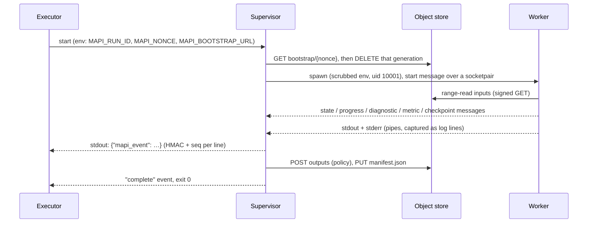

# Runner <span class="mapi-badge">v0.2</span>

`mapi-runner` executes one run in a sandbox. It implements the side of the execution in the
[run protocol](run-protocol.md). Two processes are part of a run:

- The **supervisor** is trusted. It has the HMAC key of the run and the signed URLs. It is
  the only process that writes to the stdout of the execution.
- The **worker** is not trusted. It runs the platform harness (`mapi_sdk`) together with
  plugin code. It does not get the key or a URL that can write.



## Start a run

```bash
MAPI_RUN_ID=run_01… MAPI_NONCE=<64 hex> \
MAPI_BOOTSTRAP_URL='http://127.0.0.1:4443/storage/v1/b/mapi-local-bootstrap/o/{nonce}' \
MAPI_EXEC_TOKEN=<local shim exec token> \
mapi-runner
```

All the configuration of the run comes from the environment. The command-line options tell
only about the image. They never contain secrets:

| Option | Default | Meaning |
|---|---|---|
| `--worker-python PATH` | this interpreter, or `MAPI_WORKER_PYTHON` | The interpreter of the worker environment (the site-packages of the base image and all overlays) |
| `--worker-registry MODULE:CALLABLE` | entry points | The factory of the plugin registry for the worker |
| `--scratch-dir DIR` | `$TMPDIR` | The parent directory of the scratch space of the run |
| `--keep-scratch` | off | Keep the scratch directory after the run, for debug |
| `--term-grace SECONDS` | 5 | The time that the worker gets to stop after SIGTERM. After this time, the supervisor kills the worker. |
| `--deadline-reserve SECONDS` | 15 | The time before the deadline for the checkpoint flush and a partial manifest |
| `--base-image NAME` | `MAPI_BASE_IMAGE` | Recorded in the output manifest |

## What the supervisor guarantees

- **The supervisor deletes the bootstrap object before code that is not trusted runs.** The
  supervisor reads the object. Then it deletes exactly the generation that it read. If the
  delete fails, the run stops with exit code `2`.
- **Only signed events go to stdout.** The supervisor keeps a private copy of the stdout
  descriptor for its event writer. It points fd 1 at stderr. All text that the worker prints
  goes into the `line` of a `log` event. This is also true for text that looks like an event.
  Each line has `seq` and an HMAC with the key of the run.
- **The worker gets a scrubbed environment.** Only `WORKER_ENV_ALLOWLIST` goes through. Thus
  no `MAPI_*` variable gets to the worker. The worker starts with `python -I -u` in a new
  session, with `TMPDIR` set to its scratch directory. If the supervisor runs as root (Cloud
  Run, docker), these rules also apply:
    - The worker runs as uid/gid `10001` with no supplementary groups.
    - The worker has `no_new_privs` and no core dumps.
    - The supervisor marks itself non-dumpable.

    In all other conditions (macOS, a non-root shell), the run continues in **dev mode**. The
    supervisor reports a `DEV_MODE_ISOLATION` warning event. Dev mode is not a security
    boundary. An executor that promises the split sets `MAPI_REQUIRE_ISOLATION=1` (the docker
    executor does this). Then the supervisor does not go into dev mode. It fails the run with
    `SANDBOX_VIOLATION`.
- **The supervisor validates worker messages.** Each message is a JSON frame with a length
  prefix and a maximum size of 256 KiB. It must agree with its Pydantic model. These are a
  `SANDBOX_VIOLATION`: a malformed frame, an unknown type, or a message after the final
  result.
- **Logs have caps.** The supervisor removes ANSI escapes, control characters and bidi
  overrides. It cuts lines at `limits.log_line_bytes` (4 KB) and flags them `truncated`. More
  than `limits.log_total_bytes` (20 MB) of worker output is `SANDBOX_VIOLATION (log_flood)`.
- **The supervisor cleans worker text.** It removes the same characters from all other
  strings that the worker sends. These strings are state and progress messages, warnings,
  diagnostics, metric labels, and error and issue messages. Line breaks become spaces, except
  in `untrusted_text`.
- **The supervisor coalesces progress.** It sends a maximum of one `progress` event in each
  `limits.progress_interval_s` (2 s). The newest value wins.
- **The supervisor uploads outputs only from regular files.** It opens each file with
  `O_NOFOLLOW`, relative to directories that it opened before. A symlink, FIFO or device in
  the outputs tree is a violation. The reserved names `manifest.json` and `checkpoints/` are
  also violations. The object caps and byte caps from `limits` apply. The supervisor selects
  the content type of each object from its extension.
- **The manifest tells exactly which bytes the supervisor sent.** The supervisor calculates
  CRC32C and MD5 while it streams each file through the POST policy. It signs the
  `OutputManifest` with the key of the run and PUTs it last. The `complete` event comes after
  the manifest.
- **The supervisor enforces the scratch budget.** It measures the scratch directory each 2 s.
  The worker refuses all inputs that are larger than the remaining space. If the run uses
  more than `limits.scratch_bytes`, the result is `RESOURCE_EXHAUSTED`.

## SIGTERM, the deadline and checkpoints

The supervisor does these steps on SIGTERM, or when the time gets to the deadline minus the
reserve:

1. It sends a `RUN_TERMINATING` warning event and sends SIGTERM to the session of the worker.
2. It waits for the worker to stop. The worker cooperates when it cancels. Samplers do a
   check for cancellation after some draws. The segmented sampler of PyMC writes a final
   checkpoint before it stops. After `--term-grace`, the supervisor kills the worker.
3. It waits for the checkpoint uploads that did not finish.
4. If checkpoints exist, it uploads a manifest with `status: partial` that lists the
   checkpoint objects. Then it exits with `16 PARTIAL`. If no checkpoints exist, it exits
   with `143` (SIGTERM) or `14` (deadline).

The worker writes checkpoints to `{scratch}/checkpoints/` as two flat files for each fit
key: `ckpt-<key>.draws.zarr.zip` and `ckpt-<key>.meta.json`. The supervisor uploads the two
files with the `checkpoints` POST policy. It sends a `checkpoint` event for each file. A
resumed attempt gets the same names in `RunSpec.resume`: **the resume names are equal to the
object names relative to the checkpoint prefix**. The runner downloads them before the fit
starts, and the engine continues from them.

## Exit codes

| Exit | When |
|---|---|
| `0` | The supervisor uploaded the outputs and the manifest, and sent the `complete` event |
| `2` | The environment is bad, the bootstrap is missing or not valid, or the supervisor cannot use `outputs`. (There are no events if the supervisor could not read the RunSpec.) |
| `10` | The worker reported a user, spec or data error, crashed, or exited without a result |
| `11` | Out of memory (`MemoryError`, or SIGKILL killed the worker), or the run used more than the scratch budget |
| `12` | The uploads or downloads of the supervisor failed after retries |
| `13` | The size, CRC32C or MD5 of an input was not correct, or a bundle did not agree with its manifest |
| `14` | The run got to the deadline without a checkpoint |
| `15` | Sandbox violation: log flood, malformed messages, unsafe outputs, oversized events or output caps |
| `16` | Partial: the worker flushed a checkpoint after SIGTERM or at the deadline |
| `143` | SIGTERM with no checkpoint to flush |

The supervisor always reports a failure in an `error` event. The supervisor writes the
`message` of this event. Text from the worker or from a plugin goes in `untrusted_text`. The
supervisor also sends typed issues from the worker as `diagnostic` events, for example
`MISSING_FUTURE_COVARIATE`.

The supervisor accepts only three failure classes from the worker: `resource_exhausted`,
`integrity` and `sandbox`. If the worker reports `INFRA_ERROR`, the run fails as `user`. An
example is a failed input download. The reason is that the `infra` exit makes the platform
retry the full run automatically. Thus only failures that the supervisor sees itself can use
`infra`. All other failures that the worker reports become `user`.

## What `RunSpec.spec` holds, per kind

The dispatcher writes these documents, and the runner reads them. The two sides import the
models and the names of the inputs and outputs from `mapi_spec.jobs`. Refer to the
[run protocol](run-protocol.md#job-payloads-and-object-names). The runner reads inputs with
HTTP range requests. Each dataset is one object: `*.zarr.zip`, or `data.tree.zip` for a
[tree dataset](../guides/tree-data.md) (v0.8). A tree input can come with a `tree_schema`
input (the `tree_schema.json` of its version). The runner selects the nodes of
`data.nodes` and merges them into the flat input of the pipeline. A tree-input model also
gets the whole tree. The raw schema of a plain dataset comes from one of these sources, in
this sequence:

1. the `schema` input, if there is one
2. the zarr root attribute `mapi_schema` (`mapi_spec.jobs.DATASET_SCHEMA_ATTR`). Ingest writes
   this attribute, and uploads can contain it.
3. a schema that the runner infers.

| Kind | `spec` | Inputs | Outputs (relative to the attempt prefix) |
|---|---|---|---|
| `ingest` | `IngestMapping`, or `IngestJob` (`{"mapping": …}`, `{"preset": "mff", "mff": {…}}` or, from v0.8, `{"assembly": …}`, and also `dataset` and `source`, which are only for information) | `upload`, or `upload.0`, `upload.1`, … (one for each source of an assembly) | `data.zarr.zip`, `schema.json`, `summary.json` (`DataSummary`), `profile.json` (`mapi.profile/v1`, with the `sha256` and `size_bytes` of the data), `preview.json` (`mapi.preview/v1`). A tree version (v0.8) writes `data.tree.zip` and `tree_schema.json` (`TreeSchema`) in place of `data.zarr.zip`. Its `schema.json` is the schema of the root node, `summary.json` adds a summary for each node under `nodes`, and the explorer views of each node are under `ui/explore/nodes/<slug>/` with an index |
| `inspect` | `InspectJob` (v0.8: `format`, and caps for arrays, HDF5 objects, dims and attributes) | `upload` | `inspection.json` (`UploadInspection`). The run reads only metadata, after the HDF5 guard |
| `describe` | `DescribeJob` (`{"image_digest": …?}`) | none | `catalog.json` (`Catalog`), `describe.json` (`catalog_digest`, versions) |
| `validate` | a `ModelSpec` | `dataset`, optional `schema`, `side.<name>` | `validation.json` (`ValidateResponse` with the stages that a dry run resolved) |
| `fit` | a `ModelSpec` | `dataset`, optional `schema`, `side.<name>` | `bundle.zarr.zip`, `bundle.manifest.json`, `diagnostics.json`, `plots.json`, `metrics.json` (`MetricsReport`. v0.9: `elpd` has the `elpd_loo`/`elpd_waic` estimates with their pointwise values), `coords.json` (`{stage: {dim: CoordSummary}}`), `scorecard.json` (`Scorecard`, v0.4), `evaluation/…`, `ui/thin.zarr.zip`, `ui/summaries.json`, `ui/tree_index.json` (`mapi.tree-index/v1`), `ui/preprocess.json` (`mapi.preprocess/v1`), `ui/grids/*.arrow`, `ui/grids/response_curves.json` (`mapi.response-grid/v1`, v0.4), `ui/plotdata/*.arrow` |
| `score` | a `ScoreRequest`, or `{"request": …, "plots": […], "max_draws": n}` | `bundle`, optional `bundle.manifest`, `dataset` (payload), `scenario`, `side.<name>`, `history` (v0.4) | `score.zarr.zip`, `result.json`, `summary.json` (`ScoreSummary`: the summary as tables, at most 100 000 cells. v0.9: a circular output has `period`), `ui/summary.arrow`, `plots.json`. Forecasts add `ui/guided/forecast.json` (`mapi.forecast/v1`). Counterfactuals add `ui/guided/counterfactual.json` (`mapi.counterfactual/v1`) (v0.4). |
| `evaluate` | `{"request": …?, "metrics": […]?}` | `bundle`, `dataset`, `side.<name>` | the score outputs and also `metrics.json` |
| `derive` | `{"names": […], "draws": n?, "data": "dataset://…"?}` | `bundle`, `dataset`, `side.<name>` | `derived.zarr.zip`, `ui/grids/<name>.arrow`, `result.json` |
| `render` | `{"plots": […]?, "format": "png" \| "svg", "scale": 2}` | `plots` (a `plots.json`) | `renders/<plot id>.<format>` |
| `translate_priors` | `PriorTranslationJob` (`{"spec": …, "business_priors": …, "lift_tests": […], "draws": n, "seed": s}`, v0.4) | `dataset`, optional `schema`, `side.<name>` | `priors.json` (`PriorTranslationResult`), `plots.json` (`mmm.prior_beliefs`, `core.prior_predictive`) |

At the top level of the attempt prefix, `manifest.json` is the `OutputManifest` of the
runner. Thus the runner uploads the manifest of the SDK bundle as `bundle.manifest.json`. The
evaluation sub-bundle keeps the SDK layout (`evaluation/manifest.json`).

In `plots.json`, the runner moves inline Arrow datasets that are larger than 64 KiB to
`ui/plotdata/<plot>.<dataset>.arrow`. The plot refers to them as `data_ref`, with their size
and CRC32C.

The Arrow views (`ui/summary.arrow`, `ui/grids/*.arrow`) are tidy tables from
`mapi_sdk.wire.to_arrow_table`. From v0.9, the schema metadata `mapi.dims` gives the names of
the dim columns as a JSON list. Thus the web app keeps a numeric dim, for example a grid
position in cm, as a key column and not as a value.

`scorecard.json` does the data checks on the raw dataset. The check `data.missing` (v0.9)
does not count these variables:

- the variables with the role `constant`, `index` or `mask` in the raw schema or in the
  schema of the model stage
- the canonical variables that the model lists in `CustomModel.structural_missing`. The
  runner gets them from the plugin registry. If it cannot find the plugin, the list is empty.

The message of the check names the variables that it does not count.

A `workflow_node` run gets a tree dataset input as its root node, and keeps the full tree
(v0.9). Thus the `nodes` parameter of a model node can select other nodes of the tree.

### MFF preset

The preset reads a long table with the columns `Period`, `VariableName` and `VariableValue`.
`Period` becomes the time dim (`date`, policy `extend`, inferred frequency). Each key column
(`Geography`, `Product`, `Campaign`, `Outlet`, `Creative`) becomes a categorical dim only if
it has more than one distinct value. Each `VariableName` becomes a variable. You can override
roles, units and column names in `mff`.

## Not implemented yet

- `optimize` runs. They fail with `CAPABILITY_UNSUPPORTED`. The runner reports this as exit
  `10`.
- `render` needs `vl-convert-python` (Vega-Lite) or `kaleido` (Plotly) in the image. If the
  image does not have them, the run fails with a clear message. The runner does not render
  plots with `data_ref` datasets.

## HDF5 and NetCDF-4 <span class="mapi-badge">v0.8</span>

`h5py` and `h5netcdf` are explicit dependencies of `mapi-runner`. Thus each runner image can
read NetCDF-4 and HDF5 uploads. The runner reads NetCDF-3 files with SciPy.

Before xarray or h5py opens an HDF5 file, the HDF5 guard (`mapi_runner.worker.hdf5_guard`)
walks the file with the low-level API of h5py and refuses unsafe files with
`INGEST_UNSAFE_FILE`. The supervisor sets `HDF5_PLUGIN_PATH` to an empty directory and
`HDF5_USE_FILE_LOCKING=FALSE` in the environment of the worker. Thus libhdf5 cannot load a
filter plugin. Refer to [the HDF5 guard](../guides/tree-data.md#security-the-hdf5-guard).
