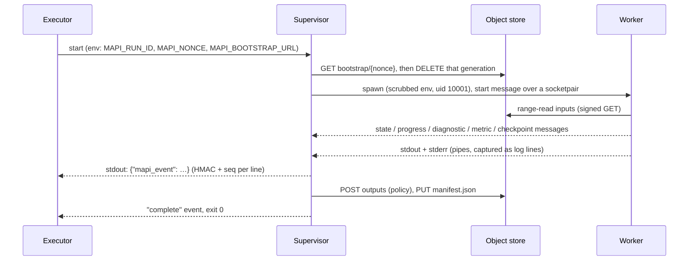

# Runner <span class="mapi-badge mapi-badge--soon">v0.2</span>

`mapi-runner` executes one run inside a sandbox. It implements the
[run protocol](run-protocol.md) from the execution's side. Two processes take part:

- the **supervisor** is trusted. It holds the run's HMAC key and the signed URLs, and it is
  the only process that writes to the execution's stdout;
- the **worker** is untrusted. It runs the platform harness (`mapi_sdk`) together with plugin
  code, and receives neither the key nor any write URL.



## Starting a run

```bash
MAPI_RUN_ID=run_01… MAPI_NONCE=<64 hex> \
MAPI_BOOTSTRAP_URL='http://127.0.0.1:4443/storage/v1/b/mapi-local-bootstrap/o/{nonce}' \
MAPI_EXEC_TOKEN=<local shim exec token> \
mapi-runner
```

All run configuration comes from the environment. The command-line options describe the
image only and never carry secrets:

| Option | Default | Meaning |
|---|---|---|
| `--worker-python PATH` | this interpreter, or `MAPI_WORKER_PYTHON` | Interpreter of the worker environment (the base image's site-packages plus any overlay) |
| `--worker-registry MODULE:CALLABLE` | entry points | Plugin registry factory for the worker |
| `--scratch-dir DIR` | `$TMPDIR` | Parent directory of the run's scratch space |
| `--keep-scratch` | off | Keep the scratch directory after the run, for debugging |
| `--term-grace SECONDS` | 5 | How long the worker gets to stop after SIGTERM before it is killed |
| `--deadline-reserve SECONDS` | 15 | Time kept before the deadline for the checkpoint flush and a partial manifest |
| `--base-image NAME` | `MAPI_BASE_IMAGE` | Recorded in the output manifest |

## What the supervisor guarantees

- **The bootstrap object is deleted before any untrusted code runs.** The supervisor reads the
  object, then deletes exactly the generation it read. If the delete fails, the run stops
  with exit code `2`.
- **Only signed events reach stdout.** The supervisor keeps a private copy of the stdout
  descriptor for its event writer and points fd 1 at stderr. Anything the worker prints,
  including text that looks like an event, ends up in the `line` of a `log` event. Every line
  carries `seq` and an HMAC under the run key.
- **The worker gets a scrubbed environment.** Only `WORKER_ENV_ALLOWLIST` passes through, so
  no `MAPI_*` variable reaches it. It starts with `python -I -u` in a new session, with
  `TMPDIR` set to its scratch directory. When the supervisor runs as root (Cloud Run, docker)
  the worker also runs as uid/gid `10001` with no supplementary groups, `no_new_privs` and
  no core dumps, and the supervisor marks itself non-dumpable. Anywhere else (macOS, a
  non-root shell) the run continues in **dev mode**: the supervisor reports a
  `DEV_MODE_ISOLATION` warning event. Dev mode is not a security boundary.
- **Worker messages are validated.** Each message is a length-prefixed JSON frame of at most
  256 KiB and must match its Pydantic model. A malformed frame, an unknown type or anything
  sent after the final result is a `SANDBOX_VIOLATION`.
- **Logs are capped.** ANSI escapes, control characters and bidi overrides are stripped.
  Lines are cut at `limits.log_line_bytes` (4 KB) and flagged `truncated`. More than
  `limits.log_total_bytes` (20 MB) of worker output is `SANDBOX_VIOLATION (log_flood)`.
- **Progress is coalesced.** At most one `progress` event is sent per
  `limits.progress_interval_s` (2 s), and the newest value wins.
- **Outputs are uploaded only from regular files.** The supervisor opens each file with
  `O_NOFOLLOW`, relative to directories it has already opened. A symlink, FIFO or device in
  the outputs tree is a violation, and so are the reserved names `manifest.json` and
  `checkpoints/`. The object and byte caps from `limits` apply, and the supervisor picks each
  object's content type from its extension.
- **The manifest describes exactly the bytes that were sent.** CRC32C and MD5 are computed
  while each file streams through the POST policy. The `OutputManifest` is signed with the
  run key and PUT last, and the `complete` event follows it.
- **The scratch budget is enforced.** The supervisor measures the scratch directory every 2 s,
  and the worker refuses any input larger than the space left. Exceeding
  `limits.scratch_bytes` is `RESOURCE_EXHAUSTED`.

## SIGTERM, the deadline and checkpoints

On SIGTERM, or when the deadline minus the reserve is reached, the supervisor:

1. sends a `RUN_TERMINATING` warning event and forwards SIGTERM to the worker's session;
2. waits for the worker to stop. The worker cancels cooperatively: samplers check for
   cancellation every few draws, and PyMC's segmented sampler writes a final checkpoint
   before it stops. After `--term-grace` the worker is killed;
3. waits for checkpoint uploads that are still running;
4. if checkpoints exist, uploads a manifest with `status: partial` that lists the checkpoint
   objects, and exits with `16 PARTIAL`. Otherwise it exits with `143` (SIGTERM) or `14`
   (deadline).

Checkpoints are written to `{scratch}/checkpoints/` as two flat files per fit key:
`ckpt-<key>.draws.zarr.zip` and `ckpt-<key>.meta.json`. The supervisor uploads both with the
`checkpoints` POST policy and emits a `checkpoint` event for each. A resumed attempt receives
the same names in `RunSpec.resume`: **resume names equal object names relative to the
checkpoint prefix**. They are downloaded before the fit starts, and the engine continues
from them.

## Exit codes

| Exit | When |
|---|---|
| `0` | Outputs and the manifest were uploaded and the `complete` event was emitted |
| `2` | Bad environment, missing or invalid bootstrap, or unusable `outputs` (no events when the RunSpec could not be read) |
| `10` | The worker reported a user, spec or data error, crashed, or exited without a result |
| `11` | Out of memory (`MemoryError`, or the worker was killed by SIGKILL) or the scratch budget was exceeded |
| `12` | Uploads failed after retries, or the worker reported an infrastructure error |
| `13` | An input did not match its size, CRC32C or MD5, or a bundle did not match its manifest |
| `14` | The deadline was reached without a checkpoint |
| `15` | Sandbox violation: log flood, malformed messages, unsafe outputs, oversized events or output caps |
| `16` | Partial: a checkpoint was flushed after SIGTERM or at the deadline |
| `143` | SIGTERM with no checkpoint to flush |

A failure is always reported in an `error` event whose `message` is written by the
supervisor. Text that comes from the worker or a plugin goes in `untrusted_text`. Typed
issues reported by the worker, such as `MISSING_FUTURE_COVARIATE`, are also emitted as
`diagnostic` events. The supervisor accepts only four failure classes from the worker:
`resource_exhausted`, `integrity`, `infra` and `sandbox`. Any other failure the worker
reports becomes `user`.

## What `RunSpec.spec` holds, per kind

The dispatcher writes these documents, and they are defined in `mapi_runner.jobs`. Inputs
are read with HTTP range requests. Every dataset is a single-object `*.zarr.zip`. A dataset's
raw schema comes from the `schema` input if there is one, otherwise from the zarr root
attribute `mapi_schema` (which ingest writes), and otherwise it is inferred.

| Kind | `spec` | Inputs | Outputs (relative to the attempt prefix) |
|---|---|---|---|
| `ingest` | `IngestMapping`, or `{"mapping": …}`, or `{"preset": "mff", "mff": {…}}` | `upload` | `data.zarr.zip`, `schema.json`, `profile.json` (holds `sha256` and `size_bytes` of the data), `preview.json` |
| `describe` | `{}` | none | `catalog.json` (`Catalog`), `describe.json` (`catalog_digest`, versions) |
| `validate` | a `ModelSpec` | `dataset`, optional `schema`, `side.<name>` | `validation.json` (`ValidateResponse` with the stages resolved by a dry run) |
| `fit` | a `ModelSpec` | `dataset`, optional `schema`, `side.<name>` | `bundle.zarr.zip`, `bundle.manifest.json`, `diagnostics.json`, `plots.json`, `metrics.json`, `evaluation/…`, `ui/thin.zarr.zip`, `ui/summaries.json`, `ui/tree_index.json`, `ui/grids/*.arrow`, `ui/plotdata/*.arrow` |
| `score` | a `ScoreRequest`, or `{"request": …, "plots": […], "max_draws": n}` | `bundle`, optional `bundle.manifest`, `dataset` (payload), `scenario`, `side.<name>` | `score.zarr.zip`, `result.json`, `ui/summary.arrow`, `plots.json` |
| `evaluate` | `{"request": …?, "metrics": […]?}` | `bundle`, `dataset`, `side.<name>` | the score outputs plus `metrics.json` |
| `derive` | `{"names": […], "draws": n?}` | `bundle`, `dataset`, `side.<name>` | `derived.zarr.zip`, `ui/grids/<name>.arrow`, `result.json` |
| `render` | `{"plots": […]?, "format": "png" \| "svg", "scale": 2}` | `plots` (a `plots.json`) | `renders/<plot id>.<format>` |

At the top level of the attempt prefix, `manifest.json` is the runner's `OutputManifest`.
For that reason the SDK bundle's own manifest is uploaded as `bundle.manifest.json`. The
evaluation sub-bundle keeps the SDK layout (`evaluation/manifest.json`).

In `plots.json`, inline Arrow datasets larger than 64 KiB are moved to
`ui/plotdata/<plot>.<dataset>.arrow` and referenced as `data_ref`, with their size and
CRC32C.

### MFF preset

The preset reads a long table with `Period`, `VariableName` and `VariableValue` columns.
`Period` becomes the time dim (`date`, policy `extend`, frequency inferred). Each key column
(`Geography`, `Product`, `Campaign`, `Outlet`, `Creative`) becomes a categorical dim only if
it holds more than one distinct value. Each `VariableName` becomes a variable. Roles, units
and column names can be overridden in `mff`.

## Not implemented yet

- `optimize` runs. They fail with `CAPABILITY_UNSUPPORTED`, which is reported as exit `10`.
- `render` needs `vl-convert-python` (Vega-Lite) or `kaleido` (Plotly) in the image.
  Without them the run fails with a clear message. Plots whose datasets are `data_ref` are
  not rendered.
- netCDF-4 (HDF5) uploads need `h5netcdf` in the image. netCDF-3 files are read with SciPy.
