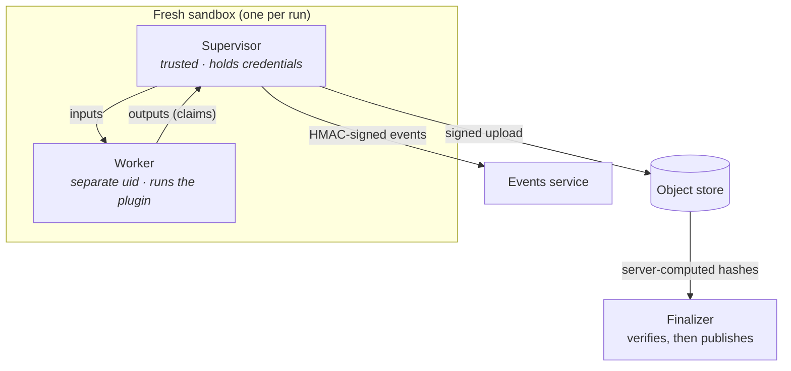

# Cloud and multi-tenant core v0.3

!!! success "Status: available in v0.3 (milestone M2), a private beta"
    v0.3 makes the platform multi-tenant. It also gives the platform a cloud execution
    backend: each run gets one new sandbox on Cloud Run Jobs. The run protocol (bootstrap
    object, signed events, verified outputs, signed bundle manifests) did not change from
    [v0.2](platform-api.md). v0.3 adds the cloud versions of the local parts. All
    multi-tenant functions also run on a laptop (`make dev`). We tested the cloud parts
    against fakes. A [short checklist](../operations/gcp-deployment.md#before-you-start-the-verify-m0-checklist)
    of cloud behaviours waits for a real project. For instructions, read [Administration](../guides/administration.md),
    [Authentication](../guides/authentication.md) and [Deploy to Google Cloud](../operations/gcp-deployment.md).

## One sandbox per run

- **Isolation.** Each run gets a new micro-VM sandbox (Cloud Run Jobs, gen2). A trusted
  **supervisor** holds the short-lived credentials of the run. An untrusted **worker** runs
  the harness and the plugin under a different user. The worker has no credentials and no
  network.
- **No egress.** Sandboxes cannot connect to the internet, and they cannot use DNS. Data
  comes in and results go out only through signed URLs for one object.
- **Outputs are claims.** The finalizer checks each artifact against the hashes and the
  object generation that the store calculated. Then it copies the artifact to a location
  where the sandbox cannot write. If a manifest does not agree, the finalizer rejects it as
  `INTEGRITY_FAILURE`.
- **Progress you can trust.** Only the supervisor writes events. Each line has an HMAC
  signature and a sequence number. The status from the executor tells if a run is alive.
- **Long fits can resume.** Segmented PyMC sampling writes checkpoints to the prefix of the
  run. Thus a preempted fit resumes where it stopped. (Checkpoints, `partial` runs and
  resume already work locally in v0.2.)

| Local (`make dev`, Compose) | On Google Cloud in v0.3 |
|---|---|
| `local-process` / `docker` executor | Cloud Run Jobs, a fixed inventory of base image × resource class |
| Worker as your user (`DEV_MODE_ISOLATION`) | Worker under its own uid, `no_new_privs`, in a microVM |
| GCS shim with emulated principals | Cloud Storage with IAM, VPC Service Controls |
| Events from the supervisor's stdout pipe | Cloud Logging → Pub/Sub push → `POST /internal/events` |
| EC P-256 key in `.local/keys/` | Cloud KMS asymmetric signatures, same bytes |
| The development IdP, `127.0.0.1` only | OIDC for people, scoped tokens for programs |

## Multi-tenant core

- Tenants and projects with role-based access. Postgres applies row-level security on each
  table. (In v0.2, each row and storage key already has `tenant_id` and `project_id`.)
- Scoped API tokens with their own budgets, and quotas for each tenant in vCPU-seconds.
  Interactive and batch priority classes stop one big sweep from blocking the scoring of all
  other users.
- A cost ledger for each run, which shows in the UI.
- We already published the contracts for all of these functions. See
  [Tenancy and authentication](../concepts/tenancy-and-auth.md),
  [Quotas and cost](../concepts/quotas-and-cost.md) and the
  [multi-tenant HTTP API](../reference/http-api.md#multi-tenant-api).
- Other backends connect through the same `Executor` protocol. Each backend must pass an
  executor conformance suite.
- The infrastructure is code. Terraform sets up the control, exec, data and build projects
  and the VPC Service Controls perimeter. There are also deploy scripts and a GitHub Actions
  workflow. See [Deploy to Google Cloud](../operations/gcp-deployment.md) and
  [Security hardening on Google Cloud](../operations/security-hardening.md).

[Cloud Run Jobs executor](../operations/cloud-run.md) describes the Cloud Run executor, the
authenticated Pub/Sub event path, KMS manifest signing and the hardened Cloud Storage driver.
We tested these parts against fakes. They did not run on a live cloud yet.

## What it means for plugins

You do not change your code. The contract kit already checks the properties that the cloud
needs: no pickle, deterministic bundles, typed errors, and the evaluate path is the same as
the score path. If a plugin passes `check_model` now, it is ready for sandboxed execution.
