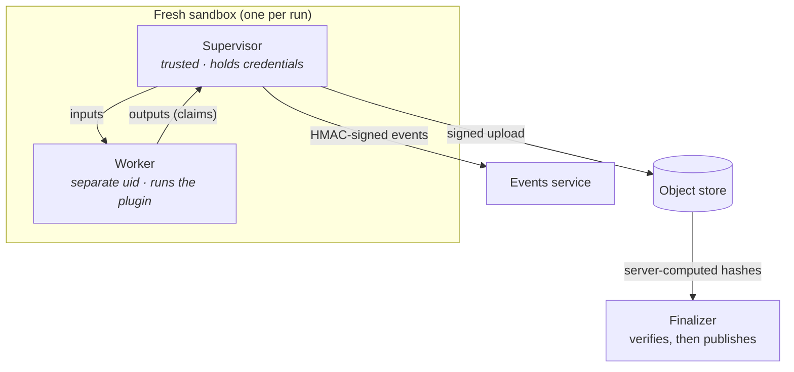

# Cloud and multi-tenant core v0.3

!!! abstract "Status: this release (milestone M2), a private beta"
    v0.3 makes the platform multi-tenant and gives it a cloud execution backend: one fresh
    sandbox per run on Cloud Run Jobs. The run protocol (bootstrap object, signed events,
    verified outputs, signed bundle manifests) is the one that already ran locally in
    [v0.2](platform-api.md); v0.3 adds the cloud counterparts of the local pieces.
    Everything multi-tenant runs on a laptop too (`make dev`). The cloud pieces are tested
    against fakes, and a [short checklist](../operations/gcp-deployment.md#before-you-start-the-verify-m0-checklist)
    of cloud behaviours waits for a real project. To use it: [Administration](../guides/administration.md),
    [Authentication](../guides/authentication.md), [Deploy to Google Cloud](../operations/gcp-deployment.md).

## One sandbox per run

- **Isolation.** Each run gets a fresh micro-VM sandbox (Cloud Run Jobs, gen2). A trusted
  **supervisor** holds the run's short-lived credentials; an untrusted **worker** runs the
  harness and the plugin under a different user, with no credentials and no network.
- **No egress.** Sandboxes cannot reach the internet, including DNS. Data comes in and results
  go out only through object-scoped signed URLs.
- **Outputs are claims.** The finalizer checks every artifact against the hashes and object
  generation the store computed itself, then copies it somewhere the sandbox cannot write. A
  manifest that does not match is rejected as `INTEGRITY_FAILURE`.
- **Progress you can trust.** Only the supervisor writes events, each line HMAC-signed and
  sequence-numbered; the executor's own status decides whether a run is alive.
- **Resumable long fits.** Segmented PyMC sampling checkpoints to the run's prefix, so a
  preempted fit resumes where it stopped. (Checkpoints, `partial` runs and resume already work
  locally in v0.2.)

| Local (`make dev`, Compose) | On Google Cloud in v0.3 |
|---|---|
| `local-process` / `docker` executor | Cloud Run Jobs, a fixed inventory of base image × resource class |
| Worker as your user (`DEV_MODE_ISOLATION`) | Worker under its own uid, `no_new_privs`, in a microVM |
| GCS shim with emulated principals | Cloud Storage with IAM, VPC Service Controls |
| Events from the supervisor's stdout pipe | Cloud Logging → Pub/Sub push → `POST /internal/events` |
| EC P-256 key in `.local/keys/` | Cloud KMS asymmetric signatures, same bytes |
| The development IdP, `127.0.0.1` only | OIDC for people, scoped tokens for programs |

## Multi-tenant core

- Tenants and projects with role-based access; row-level security in Postgres on every table
  (every row and storage key already carries `tenant_id` and `project_id` in v0.2).
- Scoped API tokens with their own budgets; per-tenant quotas in vCPU-seconds; interactive and
  batch priority classes so one big sweep cannot starve everyone's scoring.
- A per-run cost ledger shown in the UI.
- The contracts for all of this are already published: see
  [Tenancy and authentication](../concepts/tenancy-and-auth.md),
  [Quotas and cost](../concepts/quotas-and-cost.md) and the
  [multi-tenant HTTP API](../reference/http-api.md#multi-tenant-api).
- Other backends plug in through the same `Executor` protocol, each gated by an executor
  conformance suite.
- The infrastructure is code: Terraform for the control, exec, data and build projects and the
  VPC Service Controls perimeter, with deploy scripts and a GitHub Actions workflow. See
  [Deploy to Google Cloud](../operations/gcp-deployment.md) and
  [Security hardening on Google Cloud](../operations/security-hardening.md).

The Cloud Run executor, the authenticated Pub/Sub event path, KMS manifest signing and the
hardened Cloud Storage driver are described in [Cloud Run Jobs executor](../operations/cloud-run.md)
(tested against fakes; no live cloud yet).

## What it means for plugins

Nothing changes in your code. The contract kit already checks the properties the cloud relies
on: no pickle, deterministic bundles, typed errors, evaluate path equals score path. A plugin
that passes `check_model` today is ready for sandboxed execution.
