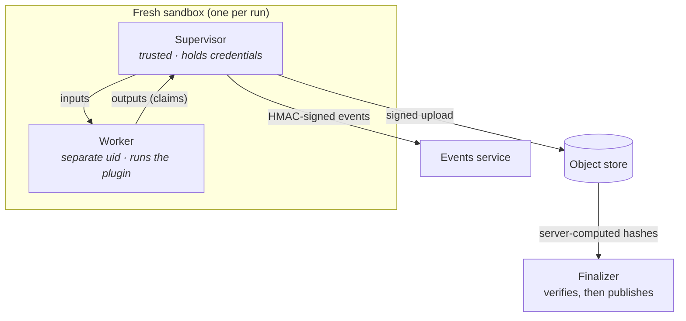

# Cloud execution coming in v0.3

!!! abstract "Status"
    Planned. v0.3 runs fits and scores in the cloud, one fresh sandbox per run, and makes the
    platform multi-tenant for a private beta.

## One sandbox per run

- **Isolation.** Each run gets a fresh micro-VM sandbox (Cloud Run Jobs, gen2). A trusted
  **supervisor** holds the run's short-lived credentials; an untrusted **worker** runs the
  harness and the plugin under a different user, with no credentials and no network.
- **No egress.** Sandboxes cannot reach the internet, including DNS. Data comes in and results
  go out only through object-scoped signed URLs.
- **Outputs are claims.** The finalizer checks every artifact against the hashes and object
  generation the store computed itself, then copies it somewhere the sandbox cannot write. A
  manifest that does not match is rejected as `INTEGRITY_FAILURE`.
- **Progress you can trust.** Only the supervisor writes events, each line HMAC-signed and
  sequence-numbered; the executor's own status decides whether a run is alive.
- **Resumable long fits.** Segmented PyMC sampling (available today) checkpoints to the run's
  prefix, so a preempted fit resumes where it stopped.

## Multi-tenant core

- Tenants and projects with role-based access; row-level security in Postgres on every table.
- Scoped API tokens with their own budgets; per-tenant quotas in vCPU-seconds; interactive and
  batch priority classes so one big sweep cannot starve everyone's scoring.
- A per-run cost ledger shown in the UI.
- Other backends plug in through the same `Executor` protocol, each gated by an executor
  conformance suite.

## What it means for plugins

Nothing changes in your code. The contract kit already checks the properties the cloud relies
on: no pickle, deterministic bundles, typed errors, evaluate path equals score path. A plugin
that passes `check_model` today is ready for sandboxed execution.
