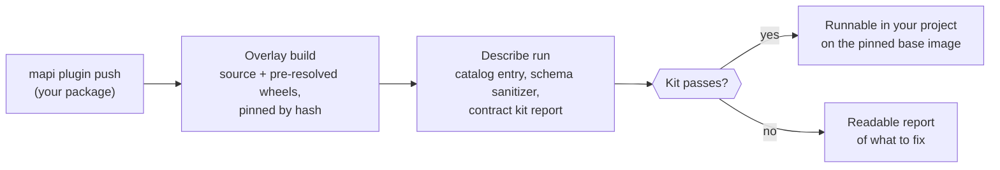

# Plugin upload, dashboard chat and MCP planned

!!! abstract "Status: v0.18 delivered the first tiers; upload is planned for v0.19"
    v0.18 made the platform yours in tiers ([what's new](../whats-new-0.18.md)):

    1. **No code, for every analyst** (delivered): model recipes, prep presets, chart
       templates and team workflow templates in [Make your own](../extend/index.md). They are
       data that trusted code compiles, so they need no sandbox for tenant code.
    2. **Python plugins on a stack you run** (delivered): scaffolds and contract kits for
       models, steps, plot recipes, workflow nodes and workflow templates, and three ways to
       [run them on your stack](../extend/develop/run-on-your-stack.md).
    3. **Upload to a shared deployment** (v0.19): tenant admins and verified users
       upload a plugin; it is built and checked in the sandbox; a second person approves it
       before the whole tenant can use it. The public tier stays blocked.
       [Upload your own code](../extend/upload.md).

    The dashboard chat and the MCP server, planned for v0.18 before, are in v0.20.

## Delivered in v0.20: dashboard chat and MCP { #planned-for-v020 }

v0.16 shipped client dashboards with a read-only tool surface
(`mapi_spec.dashboard_tools.DASHBOARD_TOOLS`). v0.17 made dashboards work for any model type
and added six tools (`list_panels`, `get_panel`, `get_accuracy`, `list_inputs`,
`get_prediction` and `get_batch_summary`), 14 in all. The member, client and share routes
already call these tools. v0.20 adds ([what's new](../whats-new-0.20.md)):

- **A chat explainer on a dashboard.** A Gemini flash-class model answers questions about a
  dashboard in plain words. The control plane is the proxy. The API keys stay on the server,
  and the CSP `connect-src` of the web app does not change.
- **Answers as React elements.** The chat renders its answers as React elements, never as
  HTML. The Trusted Types policy of the app forbids `createHTML`.
- **An MCP server on the same tools.** Each MCP tool maps 1:1 onto a `DASHBOARD_TOOLS` entry.
  The tools stay read-only.
- **Spend caps for each dashboard.** The chat has its own limits, as the exact results of
  v0.16 have.

See [Ask about your dashboard](../guides/ask-about-your-dashboard.md),
[Connect a chat tool with MCP](../guides/connect-a-chat-tool-with-mcp.md) and
[Client dashboards: the tool surface](../concepts/client-dashboards.md#tools).

## Plugin upload (v0.19)

Since v0.18, a developer runs their own plugin only on a deployment that they control
([three ways](../extend/develop/run-on-your-stack.md)). This work makes upload a product
feature of a shared deployment, for tenant admins and verified users, with a second person who
approves:

- **Overlays, not images.** The platform builds a plugin into a hash-pinned overlay on top
  of one base-image version. The overlay has the source and the wheels that were resolved
  before, from a curated mirror. The first version takes pure Python packages only. Runs
  never install software.
- **The contract kit runs on upload.** The kit does the same checks as `mapi plugin test`
  on your computer. These checks decide if a version becomes runnable. The platform keeps
  the report with the version, next to its SBOM.
- **Schema sanitizer.** The platform sanitizes the settings schemas of a plugin before the
  web app makes forms from them.
- **Dev overlays** for fast iteration. The target is less than five minutes from `push` to
  a runnable version.
- **A vetted tier.** We will port the sibling marketing-mix and HMM models as plugins. They
  will show that real models agree with the contract.

## An MCP server for agents

The MCP server gives a curated set of tools to AI assistants and agents. For example, the
tools list and describe models, score an endpoint, read a run and get a plot. The server
returns each string from a user or a plugin as clearly delimited untrusted text. Thus a model
name cannot put hidden instructions into an agent. Tokens and scopes work the same as for
other clients.

## Sweeps, SBC and what is already delivered

- **`optimize` runs** (delivered in v0.5). The sandbox optimises budgets *next to the
  model* with the planning module of mmm-framework. It uses the response curves of the
  posterior ([Optimise a budget](../tutorials/optimise-a-budget.md)).
- **Backtests** (delivered in v0.5) run as workflow nodes on rolling-origin and
  expanding-window plans ([cookbook](../guides/workflow-cookbook.md)).
- **Sweeps** (delivered). The `search.grid` workflow node runs each point of a grid and logs
  the scores of each point as metrics. v0.14 retired the `Sweep` document: the server does
  not accept new ones. To compare sweeps, use the
  [compare page](../guides/run-comparison.md).
- **`SBC`** as one parent run that fans out and aggregates the results, for example the
  simulation-based calibration of a new plugin. (The governance of v0.5 has a
  parametric-bootstrap version, `recovery.simulated`.)
- **Bayesian checks in a workflow** (delivered in v0.9). The recipe `bayes_workflow_audit`
  does a convergence gate, a posterior predictive check, a prior sensitivity check and a
  recovery check in one workflow run. Since v0.9, `recovery.simulated` simulates each dataset
  of a Bayesian model with predictive draws from its posterior predictive. `sci_spatial_ladder` fits its best model
  again with wider and narrower priors
  ([Bayesian models in a workflow](../concepts/workflows.md#bayesian-models-in-a-workflow)).
  These checks run as nodes of the workflow, not as one parent run.

## Exit criteria

- Three sibling models are packaged as plugins and pass the contract kit.
- A dev overlay is pushed and becomes runnable in less than five minutes.
- An SBC of a new plugin runs as a single parent.

We cut a release when it passes its exit criteria. Read the
[changelog](../project/changelog.md).
