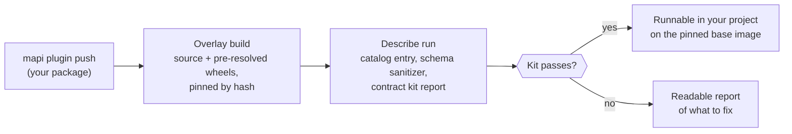

# Expert plugins and MCP planned

!!! abstract "Status: planned, no release number yet"
    v0.4 opened the hosted platform to declarative specs and built-in models. v0.5 added
    workflows, governance, the explorers and budget optimisation in the sandbox
    ([what's new](../whats-new-0.5.md)). The plan before v0.5 put this work in v0.6 (M4).
    The releases v0.6 to v0.15 gave other features: the spec builder, scientific models, tree
    datasets (M4), the science gallery (M5), run tracking, the MMM pack, causal models, run
    comparison, image data and deep learning. Thus the items on this page are not done yet. With them, **allow-listed experts can upload their own model plugins**. AI
    assistants and agents also get a curated **MCP server**. Simulation-based calibration
    becomes a single parent run. Sweeps are workflows with a `search.grid` node (v0.14
    retired the `Sweep` document). Public code upload for all users comes after these
    items, with its own controls (see the [roadmap](index.md#after-v06)).

## Plugin upload for allow-listed experts

Now, a data scientist can run their own `PyMCModel` or `SklearnModel` only on a deployment
that they control. They install it into the environment of the runner. This work makes it a
product feature of a shared deployment. It is available to tenants that an operator put on
the allow list:

- **Overlays, not images.** The platform builds a plugin into a hash-pinned overlay on top
  of one base-image version. The overlay has the source and wheels that were resolved
  before, including native wheels from a curated mirror. Runs never install software.
- **The contract kit runs on upload.** The kit does the same checks as `mapi plugin test`
  on your computer. These checks decide if a version becomes runnable. The platform keeps
  the report with the version, next to its SBOM.
- **Schema sanitizer.** The platform sanitizes the settings schemas of a plugin before the
  web app makes forms from them.
- **Dev overlays** for fast iteration. The target is less than five minutes from `push` to
  a runnable version.
- **A vetted tier.** We will port the sibling marketing-mix and HMM models as plugins. They
  will show that real models agree with the contract.

## An MCP server for agents

The MCP server gives a curated set of tools to AI assistants and agents. For example, the
tools list and describe models, score an endpoint, read a run and get a plot. The server
returns each string from a user or a plugin as clearly delimited untrusted text. Thus a model
name cannot put hidden instructions into an agent. Tokens and scopes work the same as for
other clients.

## Sweeps, SBC and what is already delivered

- **`optimize` runs** (delivered in v0.5). The sandbox optimises budgets *next to the
  model* with the planning module of mmm-framework. It uses the response curves of the
  posterior ([Optimise a budget](../tutorials/optimise-a-budget.md)).
- **Backtests** (delivered in v0.5) run as workflow nodes on rolling-origin and
  expanding-window plans ([cookbook](../guides/workflow-cookbook.md)).
- **Sweeps** (delivered). The `search.grid` workflow node runs each point of a grid and logs
  the scores of each point as metrics. v0.14 retired the `Sweep` document: the server does
  not accept new ones. To compare sweeps, use the
  [compare page](../guides/run-comparison.md).
- **`SBC`** as one parent run that fans out and aggregates the results, for example the
  simulation-based calibration of a new plugin. (The governance of v0.5 has a
  parametric-bootstrap version, `recovery.simulated`.)
- **Bayesian checks in a workflow** (delivered in v0.9). The recipe `bayes_workflow_audit`
  does a convergence gate, a posterior predictive check, a prior sensitivity check and a
  recovery check in one workflow run. Since v0.9, `recovery.simulated` simulates each dataset
  of a Bayesian model with predictive draws from its posterior predictive. `sci_spatial_ladder` fits its best model
  again with wider and narrower priors
  ([Bayesian models in a workflow](../concepts/workflows.md#bayesian-models-in-a-workflow)).
  These checks run as nodes of the workflow, not as one parent run.

## Exit criteria

- Three sibling models are packaged as plugins and pass the contract kit.
- A dev overlay is pushed and becomes runnable in less than five minutes.
- An SBC of a new plugin runs as a single parent.

We cut a release when it passes its exit criteria. Read the
[changelog](../project/changelog.md).
