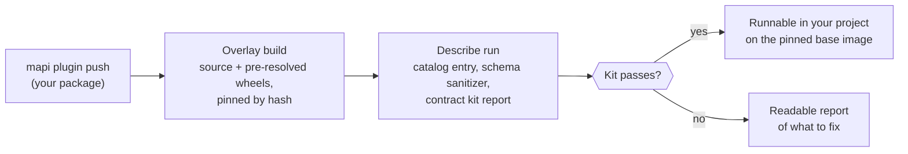

# Expert plugins and MCP next: v0.6

!!! abstract "Status: next (milestone M4)"
    v0.4 opened the hosted platform to declarative specs and built-in models; v0.5 added
    workflows, governance, the explorers and in-sandbox budget optimisation
    ([what's new](../whats-new-0.5.md)). v0.6 lets **allow-listed experts upload their own
    model plugins** and gives AI assistants and agents a curated **MCP server**; sweeps and
    simulation-based calibration become single parent runs. Public code upload for everyone
    comes after it, behind its own controls (see the [roadmap](index.md#after-v06)).

## Plugin upload for allow-listed experts

Today a data scientist's own `PyMCModel` or `SklearnModel` runs on a deployment they control,
installed into the runner's environment. v0.6 makes it a product feature of a shared
deployment, for tenants an operator has allow-listed:

- **Overlays, not images.** A plugin is built into a hash-pinned overlay (its source plus
  wheels resolved in advance, including native wheels from a curated mirror) on top of one
  base-image version. Runs never install anything.
- **The contract kit runs on upload.** The same checks you run locally with
  `mapi plugin test` decide whether a version becomes runnable, and its report is kept with
  the version, next to its SBOM.
- **Schema sanitizer.** A plugin's settings schemas are sanitized before the web app renders
  forms from them.
- **Dev overlays** for fast iteration: the target is under five minutes from `push` to a
  runnable version.
- **A vetted tier**: the sibling marketing-mix and HMM models ported as plugins, as the proof
  that real models fit the contract.

## An MCP server for agents

A curated set of tools, such as listing and describing models, scoring an endpoint, reading a
run and fetching a plot, for AI assistants and agents. Every string that came from a user or
a plugin is returned as clearly delimited untrusted text, so a model name cannot smuggle
instructions into an agent. Tokens and scopes work as for any other client.

## Sweeps as jobs, and what v0.5 already delivered

- **`optimize` runs** (delivered in v0.5). Budgets are optimised *next to the model* in the
  sandbox with mmm-framework's planning module, from the posterior's response curves
  ([Optimise a budget](../tutorials/optimise-a-budget.md)).
- **Backtests** (delivered in v0.5) run as workflow nodes on rolling-origin and
  expanding-window plans ([cookbook](../guides/workflow-cookbook.md)).
- **`Sweep` and `SBC`** as one parent run that fans out and aggregates: a sensitivity sweep
  over a prior, simulation-based calibration of a new plugin (v0.5's governance has a
  parametric-bootstrap version, `recovery.simulated`).

## Exit criteria

- Three sibling models packaged as plugins and passing the contract kit.
- A dev overlay pushed and runnable in under five minutes.
- An as-of backtest and a sensitivity sweep each run as a single parent.

Releases are cut when their exit criteria pass; follow the
[changelog](../project/changelog.md).
