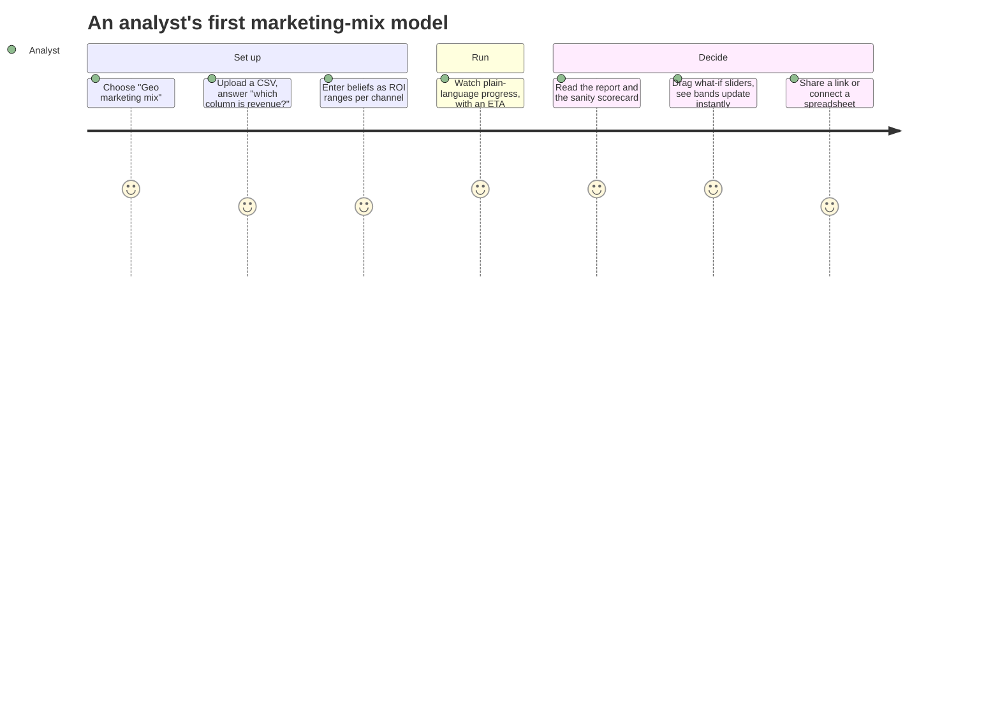

# Guided mode and integrations v0.4

!!! success "Status: this release (milestone M3), the first public launch"
    With the multi-tenant core in place ([v0.3](cloud.md)), v0.4 lets analysts go from a
    spreadsheet to a trustworthy report and a what-if scenario without writing YAML, and lets
    other applications call fitted models through stable endpoints. It is the first public
    launch, **cut line A**: anyone may sign up and run declarative specs and the built-in
    models on their own data; uploaded code stays with trusted tiers.
    To use it: [the Guided tutorial](../guides/guided-tutorial.md),
    [the Integrations hub](../guides/integrations-hub.md), [Tutorials](../tutorials/index.md).

## Guided mode: organised around tasks

One app, two modes over the **same** `ModelSpec`. A header toggle switches between Guided and
Expert; every Guided screen has "View as YAML", and Expert edits round-trip back.

| Shipped | Where to read about it |
|---|---|
| Four templates (geo marketing mix, weekly forecast, demand by store, customer choice) and a question flow with role detection | [Your first analysis in Guided mode](../guides/guided-tutorial.md) |
| Sandboxed ingest of CSV, Parquet, MFF and Meridian-shaped tables; the BayesInsight import and the `mmm.bayesinsight` model | [From a spreadsheet to a Guided draft](../guides/guided-data.md), [Import a BayesInsight model](../tutorials/bayesinsight-import.md) |
| Business priors (ROI or share ranges) translated in a sandbox, lift tests as calibration | [Guided modelling](../guides/guided-modelling.md) |
| The sanity scorecard and the promotion gate | [Guided mode](../concepts/guided-mode.md#scorecard), [Integrations](../concepts/integrations.md#promotion-gate) |
| What-if sliders over per-draw response grids, "Run exact", forecast and counterfactual views | [What if…](../guides/guided-tutorial.md#6-what-if) |
| The persona lock: projects that stay Guided-only | [The persona lock](../concepts/guided-mode.md#the-persona-lock) |

## Integrations

| Shipped | Where to read about it |
|---|---|
| Endpoints and aliases with history, rollback and a frozen input contract; `score:<alias>` tokens | [Endpoints and webhooks](../guides/endpoints-and-webhooks.md) |
| Generated snippets: Python, TypeScript, curl, R, Apps Script, Atlas, a notebook cell | [The Integrations hub](../guides/integrations-hub.md#an-endpoints-page), [Connect Google Sheets](../tutorials/google-sheets.md) |
| Signed webhooks with an outbox, retries, a delivery log, replays and an SSRF guard | [Receive webhooks](../guides/webhook-receivers.md) |
| Saved plots, PNG/SVG/PDF renders in the sandbox and expiring embed links | [Embed a chart](../tutorials/embed-a-chart.md), [Sharing plots](../guides/sharing-plots.md) |
| The Python client's endpoints and the Atlas `RemoteModel`; the CLI's `endpoints`, `webhooks`, `plots`, `guided`, `priors` and `tenant` commands | [Optimise a budget with Atlas](../guides/atlas.md), [The Python client](../guides/python-client.md) |

## Trust and the data lifecycle

| Shipped | Where to read about it |
|---|---|
| Self-service sign-up with e-mail verification, disposable-domain blocking, rate limits and Sybil flags for operators to review | [Sign-up and abuse controls](../operations/signup-and-abuse.md) |
| Identity verification and cut line A at run admission | [Sign-up and abuse controls](../operations/signup-and-abuse.md) |
| Tenant deletion that purges every store, and the GDPR export | [Deleting and exporting data](../guides/data-deletion.md) |
| A Cloud Armor policy on every load-balancer backend | [Security hardening](../operations/security-hardening.md) |

## The exit criteria

| Criterion | Where it stands |
|---|---|
| Five non-technical testers go from upload to report to scenario unaided in under 30 minutes | Prepared: an automated run takes 135 s of system time, six usability defects it found are fixed, and the [protocol for the testers](../operations/m3-verification.md#protocol-for-the-five-non-technical-testers) is written. The sessions themselves are still to run |
| Atlas optimises against an endpoint | Met on a laptop: +0.22 % revenue at the same budget against the live endpoint ([details](../operations/m3-verification.md#atlas-against-the-live-endpoint)) |
| Cut line A: public launch of declarative specs and built-ins | Met for admission: sign-up workspaces are `public`, uploaded code is refused; public runs need an executor that enforces egress and DNS (`docker-gvisor` or Cloud Run Jobs), which this laptop could not run |

Everything was verified locally; see [M3 verification](../operations/m3-verification.md) for
the numbers and for what still needs real people, Docker or Google Cloud.
