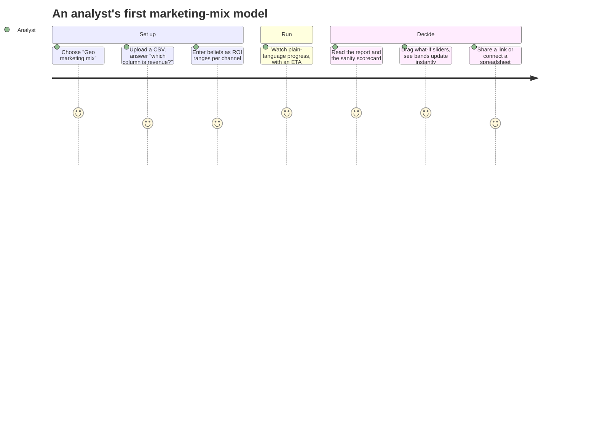

# Guided mode and integrations v0.4

!!! success "Status: available in v0.4 (milestone M3), the first public launch"
    v0.4 builds on the multi-tenant core of [v0.3](cloud.md). With v0.4, analysts go from a
    spreadsheet to a trustworthy report and a what-if scenario. They do not write YAML. Other
    applications can call fitted models through stable endpoints. v0.4 is the first public
    launch, **cut line A**. All persons can sign up and run declarative specs and the
    built-in models on their own data. Only trusted tiers can upload code.
    For instructions, read [the Guided tutorial](../guides/guided-tutorial.md),
    [the Integrations hub](../guides/integrations-hub.md) and [Tutorials](../tutorials/index.md).

## Guided mode: organised around tasks

The app has two modes over the **same** `ModelSpec`. A toggle in the header changes between
Guided and Expert. Each Guided screen has "View as YAML". Edits in Expert mode go back to
Guided mode.

| Shipped | Where to read about it |
|---|---|
| Four templates (geo marketing mix, weekly forecast, demand by store, customer choice) and a question flow with role detection | [Your first analysis in Guided mode](../guides/guided-tutorial.md) |
| Sandboxed ingest of CSV, Parquet, MFF and Meridian-shaped tables | [From a spreadsheet to a Guided draft](../guides/guided-data.md) |
| Business priors (ROI or share ranges) translated in a sandbox, lift tests as calibration | [Guided modelling](../guides/guided-modelling.md) |
| The sanity scorecard and the promotion gate | [Guided mode](../concepts/guided-mode.md#scorecard), [Integrations](../concepts/integrations.md#promotion-gate) |
| What-if sliders over per-draw response grids, "Run exact", forecast and counterfactual views | [What if…](../guides/guided-tutorial.md#6-what-if) |
| The persona lock: projects that stay Guided-only | [The persona lock](../concepts/guided-mode.md#the-persona-lock) |

## Integrations

| Shipped | Where to read about it |
|---|---|
| Endpoints and aliases with history, rollback and a frozen input contract; `score:<alias>` tokens | [Endpoints and webhooks](../guides/endpoints-and-webhooks.md) |
| Generated snippets: Python, TypeScript, curl, R, Apps Script, a notebook cell | [The Integrations hub](../guides/integrations-hub.md#an-endpoints-page), [Connect Google Sheets](../tutorials/google-sheets.md) |
| Signed webhooks with an outbox, retries, a delivery log, replays and an SSRF guard | [Receive webhooks](../guides/webhook-receivers.md) |
| Saved plots, PNG/SVG/PDF renders in the sandbox and expiring embed links | [Embed a chart](../tutorials/embed-a-chart.md), [Sharing plots](../guides/sharing-plots.md) |
| The Python client's endpoints; the CLI's `endpoints`, `webhooks`, `plots`, `guided`, `priors` and `tenant` commands | [Optimise a budget](../tutorials/optimise-a-budget.md), [The Python client](../guides/python-client.md) |

## Trust and the data lifecycle

| Shipped | Where to read about it |
|---|---|
| Self-service sign-up with e-mail verification, disposable-domain blocking, rate limits and Sybil flags for operators to review | [Sign-up and abuse controls](../operations/signup-and-abuse.md) |
| Identity verification and cut line A at run admission | [Sign-up and abuse controls](../operations/signup-and-abuse.md) |
| Tenant deletion that purges every store, and the GDPR export | [Deleting and exporting data](../guides/data-deletion.md) |
| A Cloud Armor policy on every load-balancer backend | [Security hardening](../operations/security-hardening.md) |

## The exit criteria

| Criterion | Where it stands |
|---|---|
| Five non-technical testers go from upload to report to scenario without help in less than 30 minutes | Prepared. An automated run takes 135 s of system time. We repaired the six usability defects that it found. We wrote the [protocol for the testers](../operations/m3-verification.md#protocol-for-the-five-non-technical-testers). The sessions are not done yet. |
| An external optimiser works against an endpoint | Met on a laptop: +0.22 % revenue at the same budget against the live endpoint ([details](../operations/m3-verification.md#an-external-optimiser-against-the-live-endpoint)). From v0.5, the platform optimises budgets next to the model, in a sandboxed `optimize` run on mmm-framework planning ([Optimise a budget](../tutorials/optimise-a-budget.md)). We removed the external-optimiser adapter. |
| Cut line A: public launch of declarative specs and built-ins | Met for admission. Sign-up workspaces are `public`, and the platform refuses uploaded code. Public runs need an executor that enforces egress and DNS (`docker-gvisor` or Cloud Run Jobs). This laptop could not run these executors. |

We verified all items locally. [M3 verification](../operations/m3-verification.md) gives the
numbers. It also tells which items still need real persons, Docker or Google Cloud.
