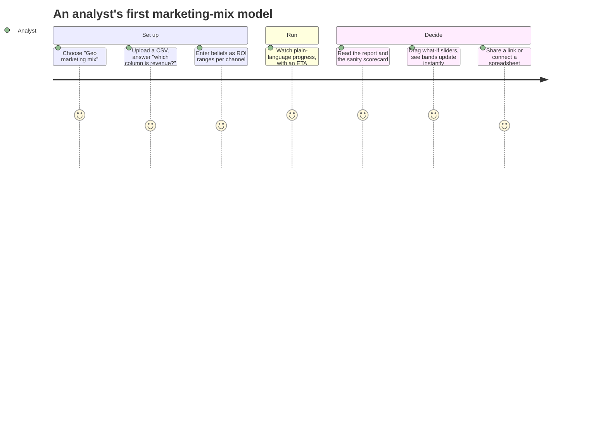

# Guided UI and integrations coming in v0.4

!!! abstract "Status"
    Planned. v0.4 lets analysts go from a CSV to a trustworthy report and a what-if scenario
    without writing YAML, and lets other applications call fitted models through stable
    endpoints. It is the first public launch: declarative specs and built-in models.

## Guided mode: organised around tasks

One app, two modes over the **same** `ModelSpec`. A header toggle switches between Guided and
Expert; every Guided screen has "View as YAML", and Expert edits round-trip back.

1. **Templates.** "What do you want to learn?": geo marketing mix, weekly forecast, demand by
   store, customer choice.
2. **A question flow instead of a column mapper.** Answers fill in dims, roles and the binding.
3. **Business priors.** Beliefs entered as ROI ranges or contribution shares, converted to model
   priors, with a prior-predictive preview in business units. Lift-test results can be entered
   as calibration data.
4. **A report with a sanity scorecard.** Convergence, holdout error and plausibility checks,
   each with a plain-language message and a suggested action.
5. **Instant what-if sliders.** Sliders interpolate response curves precomputed **per posterior
   draw** at fit time, so the uncertainty bands stay joint and honest. "Run exact" submits a
   real score run.

### Already in place

The pieces Guided mode is built on ship in v0.1:

| Guided feature | Built on (available now) |
|---|---|
| Forms that show only the basics | `x-ui-level` (`basic` or `advanced`) on every model setting |
| Plain-language plot captions | `caption_plain` and `persona` on every plot recipe |
| Scorecard items | `Diagnostic` with expert and plain messages and a suggested action |
| Data problems in words | `validate_dataset` ("2 markets are missing 2 days of revenue in March 2026") |
| What-if sliders | `response_curves` derived quantity of `mmm.hierarchical_geo`, per thinned draw |
| Role-based plot templates | `tmpl.*` templates bound to roles and dims, not variable names |

## Integrations

- **Endpoints and aliases** (`endpoint://growth/eu-geo-mmm-prod`) with promotion gated on the
  scorecard.
- A **Python client** (and a TypeScript one) generated from the OpenAPI document, plus
  ready-to-paste snippets prefilled from an endpoint's schema.
- **Webhooks** with signed, timestamped payloads and a delivery log.
- **Static plot rendering** (PNG, SVG, PDF) and read-only embed links for BI tools and docs.
- An **MCP server** with a curated set of tools (`list_models`, `describe_model`, `score`,
  `get_run`, `get_plot`), where every string that came from a user or plugin is returned as
  clearly delimited untrusted text.
