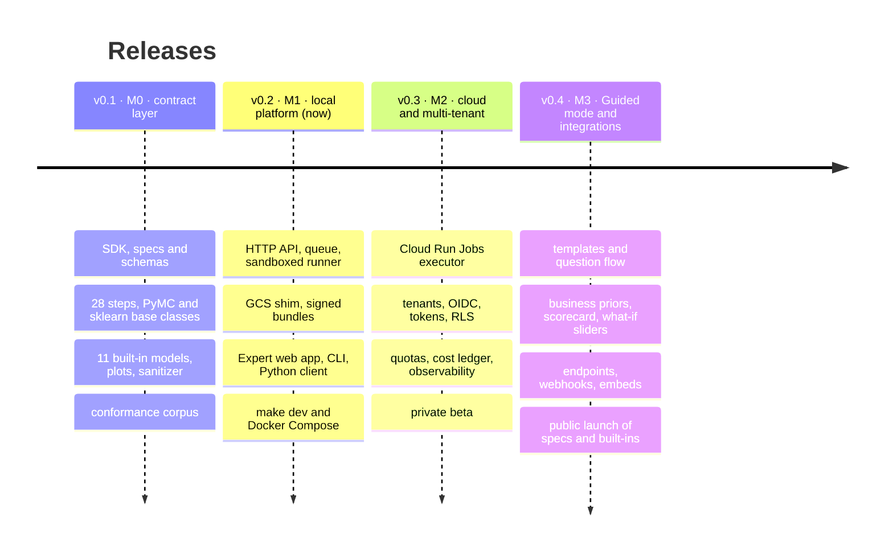

# Roadmap

modeling-api ships as three products, in this order: a typed modelling runtime, a job platform
around it, and a hosted multi-user platform. The rules that make the last one safe (no pickle,
JSON-only contracts, static validation, sanitized plots, sandboxed runs whose outputs are
verified) are in the code from the first release.

| Release | Milestone | Theme | Status |
|---|---|---|---|
| **v0.1** | M0 | The contract layer: specs, the xarray runtime, steps, models, plots, the conformance corpus, all in your own Python process | available |
| **v0.2** | M1 | [The local platform](platform-api.md): the same work as API calls and sandboxed runs, with the Expert web app, on a laptop or one Docker host | this release |
| **v0.3** | M2 | [Cloud and multi-tenant core](cloud.md): one fresh sandbox per run on Cloud Run, tenants, tokens, quotas; a private beta | next |
| **v0.4** | M3 | [Guided mode and integrations](guided-ui.md): analysts from CSV to report and scenario; endpoints for other apps; first public launch | planned |

## What v0.2 contains

- [x] The `/v1` HTTP API: datasets, specs with synchronous static validation, runs, model
      versions, scoring with `Prefer: wait`, plots; OpenAPI 3.1, RFC 7807 errors,
      idempotency keys, cursor pagination, server-sent events with `Last-Event-ID` resume
- [x] An orchestrator on PostgreSQL: dispatcher with intent rows, a level-triggered
      reconciler (executor status is the liveness truth, orphan adoption, `stalled` as a
      warning), a metadata-only finalizer with server-side copy and signed bundle manifests
- [x] `local-process`, `docker` and `docker-gvisor` executors
- [x] `mapi-runner`: a trusted supervisor and an untrusted worker per run, a one-time bootstrap
      object, HMAC-signed events, capped logs and outputs, checkpoints and `partial` runs;
      `ingest`, `describe`, `validate`, `fit`, `score`, `evaluate`, `derive`, `render`
- [x] `mapi-gcs-shim`: a local Cloud Storage with generations, server-computed CRC32C and MD5,
      signed URLs and POST policies, per-principal permissions and write-once buckets
- [x] The Expert web app and an origin-isolated plot sandbox
- [x] The `mapi` CLI and the typed Python client
- [x] `make dev` without Docker, six container images and a Docker Compose stack
- [x] End-to-end suites: the E33 geo MMM fitted, inspected and scored through the API and
      through the browser

## v0.3 · M2: cloud and multi-tenant core

Runs move to **Cloud Run Jobs**, one fresh microVM per run, in an execution project with
deny-all egress (DNS included) and VPC Service Controls; a fixed inventory of about a dozen
Jobs (base image × resource class) with tenant code arriving later as hash-pinned overlays.
The control plane gains **tenants and projects** with PostgreSQL row-level security, OIDC
sign-in, scoped API tokens with budgets, **quotas** in vCPU-seconds, interactive and batch
priority classes, a per-run **cost ledger** shown in the UI, Cloud KMS signatures, checkpoint
and resume across infrastructure failures, Terraform for every project, and an observability
stack. Exit criteria include 100 concurrent fits without loss, chaos and executor-conformance
suites, a nightly security suite and a p95 time-to-running under 90 seconds.
[More](cloud.md).

## v0.4 · M3: Guided mode and integrations

Analysts get **Guided mode**: templates, a question flow instead of a column mapper,
sandboxed CSV, Parquet and MFF ingest, business priors and lift-test input, the sanity
scorecard and **what-if sliders** over response curves precomputed per posterior draw, and
forecast and counterfactual screens. Other applications get **endpoints and aliases**
promoted on the scorecard, the Python client's Atlas `RemoteModel`, generated snippets,
signed **webhooks**, static plot rendering and embed links. The exit criterion: five
non-technical testers go from upload to report to scenario unaided in under 30 minutes. It is
the first public launch: declarative specs and built-in models (untrusted data, trusted code).
[More](guided-ui.md).

## After v0.4

Further out, in the order they are planned: uploading **your own plugins** to the hosted
platform (first for allow-listed teams, built into hash-pinned overlays and checked by the
contract kit on upload), then **public code upload** behind a stricter sandbox and abuse
controls, then scale features (warm scorers, GPU executors, other clouds, model composition)
when real usage asks for them.

!!! note "Dates"
    Releases are cut when their exit criteria pass, not on a calendar. Follow the
    [changelog](../project/changelog.md) for what has landed.
