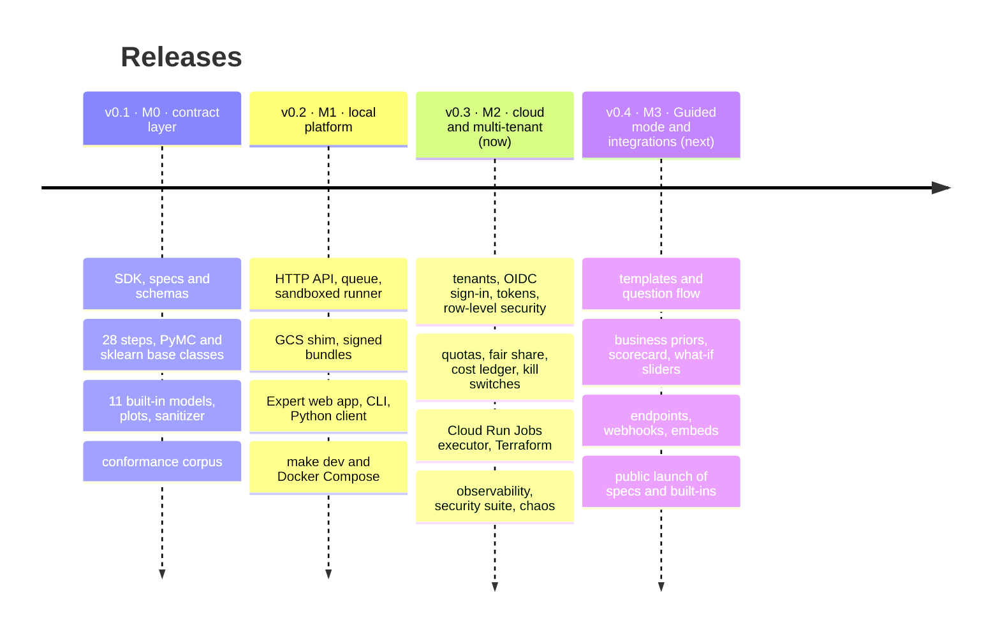

# Roadmap

modeling-api ships as three products, in this order: a typed modelling runtime, a job platform
around it, and a hosted multi-user platform. The rules that make the last one safe (no pickle,
JSON-only contracts, static validation, sanitized plots, sandboxed runs whose outputs are
verified) are in the code from the first release.

| Release | Milestone | Theme | Status |
|---|---|---|---|
| **v0.1** | M0 | The contract layer: specs, the xarray runtime, steps, models, plots, the conformance corpus, all in your own Python process | available |
| **v0.2** | M1 | [The local platform](platform-api.md): the same work as API calls and sandboxed runs, with the Expert web app, on a laptop or one Docker host | available |
| **v0.3** | M2 | [Cloud and multi-tenant core](cloud.md): tenants, sign-in, tokens, quotas and cost; one fresh sandbox per run on Cloud Run; a private beta | this release |
| **v0.4** | M3 | [Guided mode and integrations](guided-ui.md): analysts from CSV to report and scenario; endpoints for other apps; first public launch | next |

## What v0.3 contains

- [x] **Tenants and projects** with trust tiers, data residency and suspension; four roles
      checked at every request against one permission matrix; PostgreSQL row-level security on
      every table, pinned per transaction and failing closed
      ([Administration](../guides/administration.md))
- [x] **Sign-in**: OpenID Connect for the browser through the API (no token in the browser), a
      development identity provider for offline work, `mapi login` for the terminal, and scoped,
      project-bound API tokens with expiry, rate limits and budgets
      ([Authentication](../guides/authentication.md))
- [x] **Quotas in vCPU-seconds** per token, tenant and platform; interactive work ahead of
      batch with weighted fair sharing; a per-run **cost ledger** shown in the app and the CLI;
      a global spend cap and a switch that stops all uploaded code
- [x] An append-only **audit log**, readable by tenant admins (their tenant) and operators
- [x] The **Cloud Run Jobs executor** (a fixed Job inventory, intent rows, orphan adoption,
      `taskCount` fan-out, `jobs.run` rate limiting with back-off), **authenticated Pub/Sub
      push** events, **Cloud KMS** manifest signatures and a hardened Cloud Storage driver,
      tested against fakes
- [x] **Terraform** for the control, exec, data and build projects and the VPC Service Controls
      perimeter, deploy and rollback scripts, and a GitHub Actions workflow without service
      account keys ([Deploy to Google Cloud](../operations/gcp-deployment.md))
- [x] **Observability**: Prometheus metrics, JSON logs with trace ids, OpenTelemetry traces,
      dashboards, alerts and runbooks ([Observability](../operations/observability.md))
- [x] The **security suite** of sandbox-escape probes, chaos tests and a 100-fit load test
      ([M2 verification](../operations/m2-verification.md))
- [x] The web app's **Members, Tokens, Usage and Admin** screens and a project switcher; the CLI's
      `login`, `use`, `tokens`, `usage` and `admin` commands

Still to do against a real Google Cloud project: the
[[verify M0] checklist](../operations/gcp-deployment.md#before-you-start-the-verify-m0-checklist)
(above all, that the DNS response policy applies to Cloud Run Jobs), cold-start and
time-to-`RUNNING` measurements, and the security suite run inside an execution. Until the DNS
check passes, `verified` and `public` tenants are not placed on Cloud Run.

## Next: v0.4 · M3, Guided mode and integrations

Analysts get **Guided mode**: templates, a question flow instead of a column mapper,
sandboxed CSV, Parquet and MFF ingest, business priors and lift-test input, the sanity
scorecard and **what-if sliders** over response curves precomputed per posterior draw, and
forecast and counterfactual screens. Other applications get **endpoints and aliases**
promoted on the scorecard, the Python client's Atlas `RemoteModel`, generated snippets,
signed **webhooks**, static plot rendering and embed links. The platform adds Cloud Armor,
sign-up verification and tenant deletion. The exit criterion: five non-technical testers go
from upload to report to scenario unaided in under 30 minutes. It is the first public launch:
declarative specs and built-in models (untrusted data, trusted code).
[More](guided-ui.md).

## After v0.4

Further out, in the order they are planned: uploading **your own plugins** to the hosted
platform (first for allow-listed teams, built into hash-pinned overlays and checked by the
contract kit on upload), then **public code upload** behind a separate execution project,
signed base images, abuse controls and an external penetration test, then scale features
(warm scorers, GPU executors, other clouds, model composition) when real usage asks for them.

!!! note "Dates"
    Releases are cut when their exit criteria pass, not on a calendar. Follow the
    [changelog](../project/changelog.md) for what has landed.
