# Roadmap

modeling-api ships as three products, in this sequence:

1. A typed modelling runtime.
2. A job platform around the runtime.
3. A hosted platform for many users.

Some rules make the hosted platform safe. These rules are in the code from the first
release: no pickle, contracts in JSON only, static validation, sanitized plots, and
sandboxed runs with verified outputs.

```mermaid
timeline
    title Releases
    v0.1 · M0 · contract layer : SDK, specs and schemas : 28 steps, PyMC and sklearn base classes : 11 built-in models, plots, sanitizer : conformance corpus
    v0.2 · M1 · local platform : HTTP API, queue, sandboxed runner : GCS shim, signed bundles : Expert web app, CLI, Python client : make dev and Docker Compose
    v0.3 · M2 · cloud and multi-tenant : tenants, OIDC sign-in, tokens, row-level security : quotas, fair share, cost ledger, kill switches : Cloud Run Jobs executor, Terraform : observability, security suite, chaos
    v0.4 · M3 · Guided mode and integrations : templates, question flow, business priors : scorecard, what-if, forecasts : endpoints, snippets, webhooks, embeds : sign-up, deletion, GDPR export
    v0.5 · M3.5 · workflows and governance : workflows of tests, transforms and models : governance policies and null tests : Data and Model Explorers : mmm-framework and statsmodels : About cards, Help me choose
    v0.5.1 · forecasts with actuals : forecasts from the last actual : no refit
    v0.6 · spec builder : completions from the catalog : Insert panel : Visual view
    v0.7 · scientific models : four sci models : outputs on a grid : Fields in the Model Explorer
    v0.8 · M4 · tree datasets : NetCDF-4 and HDF5 groups : versions from several files : data.nodes and tree-input models
    v0.9 · M5 · science gallery : 15 sci models in all : 14 plot recipes : Bayesian workflow nodes and six recipes : tutorials for the case studies
    v0.10 · chart wiring : score plots by output shape : classifier plots and metrics : Data Explorer for scientific data
    v0.11 · run tracking : metrics, params, tags and notes : live chains : run search
    v0.12 · MMM pack : nested and multivariate MMMs : time-varying effects, counts and shares : ten plot recipes
    v0.13 · causal and BSTS : causal impact, synthetic control, DiD : ts.bsts : geo-lift to MMM
    v0.14 · run comparison : compare page, experiments, saved views : run media : image data and classification
    v0.15 · deep learning : mapi-jax networks : image collections : GPU resource class
    planned · v1.0 : MLflow export : system metrics : retention and hardening
    planned · expert plugins and MCP : plugin upload for allow-listed experts : curated MCP server : SBC as parent runs
```

| Release | Milestone | Theme | Status |
|---|---|---|---|
| **v0.1** | M0 | The contract layer: specs, the xarray runtime, steps, models, plots and the conformance corpus. All of it runs in your own Python process. | available |
| **v0.2** | M1 | [The local platform](platform-api.md): the same work as API calls and sandboxed runs, with the Expert web app. It runs on a laptop or on one Docker host. | available |
| **v0.3** | M2 | [Cloud and multi-tenant core](cloud.md): tenants, sign-in, tokens, quotas and cost. Each run gets one new sandbox on Cloud Run. This release is a private beta. | available |
| **v0.4** | M3 | [Guided mode and integrations](guided-ui.md): analysts go from a spreadsheet to a report and a scenario. Other apps get endpoints, webhooks and embeds. This release is the first public launch. | available |
| **v0.5** | M3.5 | [Workflows, governance, explorers, mmm-framework and statsmodels](workflows-governance.md): automated, versioned analyses. Models must pass null tests and get the approval of a second person. Also budget plans, About cards and Help me choose. | available |
| **v0.5.1** | | [Forecasts with actuals](../concepts/forecasting-with-actuals.md): a forecast starts from the actuals that came after the fit. The model does not fit again. | available |
| **v0.6** | | The spec builder in the web app: completions and hover text from the catalog of the tenant, an **Insert** panel and a **Visual** view. | available |
| **v0.7** | | [Scientific models](../reference/models.md#scientific-models-mapi-plugin-science): four `sci.*` plugins with data on a map, an image or a grid. Outputs on a grid show in the **Fields** section of the Model Explorer. | available |
| **v0.8** | M4 | [Tree datasets](../guides/tree-data.md): NetCDF-4 and HDF5 files with groups, raw HDF5 files, and versions made from several files. A spec selects the nodes that it reads. | available |
| **v0.9** | M5 | [Science gallery](../tutorials/pymc-challenges/index.md): 15 `sci.*` models in all, 14 plot recipes, workflow nodes for Bayesian checks and plots, six workflow recipes and a tutorial for each case study. | available |
| **v0.10** | | Chart wiring: score plots that follow the shape of each output, standard plots and metrics for classifiers, state models and ADVI fits, and the [Data Explorer for scientific data](../guides/data-explorer.md#scientific-data). | available |
| **v0.11** | | [Run tracking](../guides/tracking.md): metrics, params, tags, notes and structured log lines for each run, live chains and run search. | available |
| **v0.12** | | [The MMM pack](../models/mmm-framework.md): `mmm.nested`, `mmm.multivariate`, effects that change over time, counts and shares, and ten plot recipes. | available |
| **v0.13** | | [Causal models and BSTS](../models/causal.md): `causal.impact`, `causal.synthetic_control`, `causal.did` and `ts.bsts`. A geo-lift test calibrates the MMM. | available |
| **v0.14** | | [Run comparison](../guides/run-comparison.md), experiments and saved views, run media, [image data](../guides/image-data.md) and a classification pack. | available |
| **v0.15** | | [Deep learning](../guides/deep-learning.md) on JAX, image collections of up to 1 000 000 images, and the resource class `GPU`. | available |
| **v1.0** | | Planned: an MLflow export of runs and experiments, system metrics for each run, retention for the tracking data, and hardening. | planned |
| Not set | | [Expert plugins and MCP](expert-plugins.md): plugin upload for allow-listed experts, a curated MCP server for AI agents, and SBC as parent runs. | planned |

!!! note "Milestone names"
    The plan before v0.5 gave the names M4 and M5 to plugin upload and to public code upload.
    The releases used these names for tree datasets (M4) and the science gallery (M5). Plugin
    upload, the MCP server and public code upload are not done. They have no release number
    yet.

## What v0.10 to v0.15 contain

[What's new in 0.10 to 0.15](../whats-new-0.15.md) tells about each release.

- [x] **v0.10, chart wiring.** Score plots follow the shape of each output: a map for a grid,
      a fan for a time series. Four new core recipes (`core.roc_pr`, `core.confusion`,
      `core.loss_curve`, `core.loo_pit`). The metrics `auc` and `mase` are calculated. The
      Data Explorer shows images, profiles, maps, networks, trees, directions and points.
- [x] **v0.11, run tracking.** Model code, workflow nodes and API users log metrics, params,
      tags, notes and structured log lines. The run page shows live curves and a lane for
      each chain. `GET /v1/runs` searches by metric, param and tag
      ([Track metrics, params and tags](../guides/tracking.md)).
- [x] **v0.12, the MMM pack.** `mmm.nested`, `mmm.multivariate`, time-varying channel
      effects, count and share likelihoods, and ten plot recipes
      ([Marketing-mix models](../models/mmm-framework.md)).
- [x] **v0.13, causal models and BSTS.** `causal.impact`, `causal.synthetic_control`,
      `causal.did` and `ts.bsts`. The node `model.lift_test` and the recipe `geo_lift_mmm`
      calibrate the MMM with a geo-lift test ([Measure the effect of a change](../guides/causal.md)).
- [x] **v0.14, run comparison and images.** The compare page, experiments, saved views, and
      images, figures and tables in a run ([Compare runs](../guides/run-comparison.md)).
      The upload format `image_folder`, the image gallery, and a classification pack
      ([Image data](../guides/image-data.md)).
- [x] **v0.15, deep learning.** `mapi-jax` with `dl.mlp`, `dl.cnn_classifier`,
      `dl.finetune_classifier` and `dl.embed`. Image collections, resumable uploads,
      pretrained weights as datasets, and the resource class `GPU`
      ([Deep learning](../guides/deep-learning.md)).

We did the web journeys of these releases in a browser on a local dev stack. These items are
not done yet:

- The GPU path is not tested on a GPU or on Google Cloud. A GPU run on a laptop uses the CPU.
- One GPU for each run, and no training on more than one machine.
- The platform keeps media and image packs until you delete the tenant.
- Collections take no pipeline steps and no time splits. Workflows and side tables do not
  take collections.
- `mmm.nested` and `mmm.multivariate` use national data only.

## Planned: v1.0

The v1.0 release is planned to complete run tracking. These items are not available:

- An **MLflow export**: a sandboxed job writes the experiments, runs, params, metrics and
  media in the MLflow layout, for download.
- A read-only subset of the **MLflow REST API**, with platform tokens.
- **System metrics**: the CPU, the memory and the GPU of each run, as metrics.
- **Retention and partitions** for run events and metric points, and quotas for the volume of
  metrics and media.
- **Hardening**: the full test suites and an end-to-end test of the journeys of each release
  on a live stack.

## What v0.9 contains

- [x] **Eleven new science models** from the pymc-challenges case studies, 15 `sci.*` models
      in all. They are for images, fields, maps, graphs, trees of species and angles
      ([models reference](../reference/models.md#scientific-models-mapi-plugin-science)).
- [x] **14 plot recipes**: maps, networks (`net.graph`), trees, polar charts, image checks,
      colour swatches and posterior views (`core.pair`, `core.ridge`, `core.rank_matrix`,
      `core.calibration`, `core.state_sequence`) ([plot reference](../reference/plots.md)).
- [x] **Workflow nodes for Bayesian models**: `model.summary`, `evaluate.ppc`,
      `compare.stacking`, `model.score` and `plot.render`. Plots also go into reports
      ([Bayesian models in a workflow](../concepts/workflows.md#bayesian-models-in-a-workflow)).
- [x] **Tree datasets in workflows**: `model.fit` and `model.backtest` take `nodes` and
      `join` ([Tree datasets in a workflow](../concepts/workflows.md#tree-datasets-in-a-workflow)).
- [x] **Six workflow recipes**: model ladders (`sci_spatial_ladder`, `sci_network_ladder`,
      `sci_phylo_signal`), `sci_calibrate_then_design`, `bayes_workflow_audit` and
      `sci_image_model_check` ([workflow cookbook](../guides/workflow-cookbook.md)).
- [x] **Circular outputs** (`OutputDecl.circular`): the holdout metrics and the score
      summaries of an angle are on the circle
      ([Circular outputs](../concepts/representations.md#circular-outputs)).
- [x] **Tutorials** for the 15 case studies, and the
      [complex workflows tutorial](../tutorials/complex-workflows.md). The command
      `python -m mapi_plugin_science.export` makes datasets that you can upload from the data
      of pymc-challenges.

We did the steps of the E18, E51 and E21 tutorials on a live dev stack, in a browser. Only
`sci_spatial_ladder` ran end to end on a live dev stack. The six recipes run through the
server orchestrator in a slow test, with small fits. The same as for v0.5, no part of v0.9 ran
on real Google Cloud or in Docker. These items are not done yet:

- `governance.check` with `sensitivity.prior` cannot find the prior widths of
  `sci.areal_bym2`, so the check is skipped.
- The graph check of the network ladder does not mark the statistics of the observed network.
- `core.prior_predictive` cannot draw the prior draws of `sci.heat_plate`. Some science
  models keep no prior draws.
- A backtest of a tree dataset gives the full tree to each fold. `search.grid` has no `nodes`
  parameter.
- The HTML report does not show plot sections.
- Some fits mix slowly: `sci.turing_pattern` at the size of the notebook, and the
  latent-space fit of `sci.network_latent_space` with covariates.

Read the [changelog](../project/changelog.md) for the full list. Some of the case studies of
pymc-challenges are not ported yet.

## What v0.5.1 to v0.8 contain

- [x] **v0.5.1, forecasts with actuals.** All twelve statsmodels models can forecast from
      actuals with their fitted parameters. Other models refuse with `ACTUALS_NOT_SUPPORTED`
      ([Forecasts with actuals](../concepts/forecasting-with-actuals.md)).
- [x] **v0.6, the spec builder.** Completions, hover text and settings checks in the YAML
      editor come from the catalog of the tenant. The **Insert** panel and the **Visual** view
      edit the same document. This release changed only the web app.
- [x] **v0.7, scientific models.** `sci.lgcp_grid`, `sci.fisher_kpp`, `sci.traction_force`
      and `sci.strong_lens`. `OutputDecl.grid` declares an output on a grid
      ([Capabilities](../concepts/capabilities.md#outputs-on-a-grid-or-a-circle)). The Score
      page guides each request in steps.
- [x] **v0.8 (M4), tree datasets.** A dataset version can hold an `xr.DataTree`. A guard does
      a check of each HDF5 file in the sandbox before it opens the file. A model can declare
      `input: tree` to get the full tree
      ([Tree datasets](../guides/tree-data.md)). The catalog shows each plot recipe as a card
      with an example picture.

The web flows for trees ran against the mock API only. The real server and runner path ran
in the end-to-end test. The v0.6 spec builder ran in the unit and Playwright smoke tests
against the mock API.

## What v0.5 contains

- [x] **Workflows**: versioned DAGs of statistical tests, transforms, branches, split plans,
      order searches, model fits, evaluations, comparisons, governance and reports. Also
      live events, a cache, schedules and dataset triggers
      ([cookbook](../guides/workflow-cookbook.md)).
- [x] **Governance**: versioned project and tenant policies and twelve checks. The checks
      include null tests against shuffled targets and placebo regressors. Also
      second-person approval, evidence packs and promotion that needs validation
      ([null tests explained](../guides/null-tests.md)).
- [x] **Data and Model Explorers**, with side-by-side comparisons and Diebold-Mariano tests
- [x] **mmm-framework** as the marketing-mix engine, with **budget optimisation** in the sandbox
- [x] **Twelve statsmodels** time-series models
- [x] **About cards** on each item that you can select, and **Help me choose**
      ([choosing a model](../guides/choosing-a-model.md))
- [x] The Python client and the CLI for all of these items
- [x] The screens of the web app for all of these items:
      the visual workflow builder, the run monitor, Guided recipes, the policy editor, the
      review queue, the explorers, About cards and the chooser, and budget plans

We verified these items end to end on a live local stack
([M3.5 verification](../operations/m35-verification.md)):

- the canonical workflow
- governance with a second person
- mmm-framework with a budget plan
- the explorers and the chooser
- the CLI.

Some work is not done yet, the same as for v0.4. It includes a real Google Cloud project,
Docker-isolated executors, and the sessions with five non-technical testers.

## What v0.4 contains

- [x] **Guided mode**: four templates (geo marketing mix, weekly forecast, demand by store,
      customer choice). Also a question flow with role detection, drafts with "View as YAML",
      and the persona lock ([tutorial](../guides/guided-tutorial.md)).
- [x] **Sandboxed ingest** of CSV, Parquet, MFF and Meridian-shaped tables. Refusals are in
      plain language.
- [x] **Business priors** as ROI or share ranges. A sandbox translates them and shows a
      prior-predictive preview. Also **lift tests** as calibration
      ([Guided modelling](../guides/guided-modelling.md)).
- [x] The **sanity scorecard** that each fit writes, and the **promotion gate** that uses it
- [x] **What-if sliders** over response grids for each draw, "Run exact", and forecast and
      counterfactual views
- [x] **Endpoints and aliases**, `score:<alias>` tokens, **snippets** in seven languages, and
      a **Google Sheets** card ([Connect Google Sheets](../tutorials/google-sheets.md))
- [x] **Signed webhooks** with an outbox, retries, a delivery log, replays and an SSRF guard
      ([Receive webhooks](../guides/webhook-receivers.md))
- [x] **Saved plots, static renders and embed links** ([Embed a chart](../tutorials/embed-a-chart.md))
- [x] The endpoints of the Python client, and new CLI commands
- [x] **Sign-up** with e-mail verification and abuse controls, **tenant deletion**, the
      **GDPR export**, and a **Cloud Armor** policy
- [x] The Integrations hub, trust pages and admin additions in the web app

We verified these items end to end on a laptop
([M3 verification](../operations/m3-verification.md)). The exit of M3 also needs the
sessions with five non-technical testers. These sessions are not done yet. Some work against
a real Google Cloud project is not done yet, the same as for v0.3:

- the [[verify M0] checklist](../operations/gcp-deployment.md#before-you-start-the-verify-m0-checklist)
- cold-start measurements
- public workspaces on an executor that enforces egress and DNS.

## Planned: expert plugins and MCP

**Plugin upload for allow-listed experts.** Experts upload their own model plugins. The
platform builds them into hash-pinned overlays, with native wheels from a curated mirror. The
contract kit checks each plugin on upload. Also fast dev overlays and a vetted tier of ported
sibling models.

An **MCP server** gives AI assistants and agents a small, curated set of tools that are safe
from injection. The tools list and describe models, score an endpoint, read a run and get a
plot.

Budget optimisations already run as **in-sandbox `optimize` jobs**, and backtests run as
workflow nodes (v0.5). Sweeps are workflows with a `search.grid` node (v0.14 retired the
`Sweep` document). **`SBC`** runs as one parent. [More](expert-plugins.md).

## After expert plugins { #after-v06 }

This is the planned sequence:

1. **Public code upload**: uploaded plugins for all tenants. This release needs these
   controls:
    - a separate execution project
    - signed base images
    - verification before code runs
    - Sybil controls
    - a takedown process
    - a rehearsed kill-switch drill
    - an external penetration test.

    The security suite must first be green for two weeks.
2. **Scale and depth**. Each item comes when real usage needs it:
    - warm scorers for exact answers in less than one second
    - executors with more than one GPU, and for large data
    - other clouds
    - recursive forecasting
    - chained models (full-funnel and KPI graphs)
    - a plugin marketplace with a consent model.

!!! note "Dates"
    We cut a release when it passes its exit criteria, not on a calendar date. Read the
    [changelog](../project/changelog.md) to see the changes that we released.
