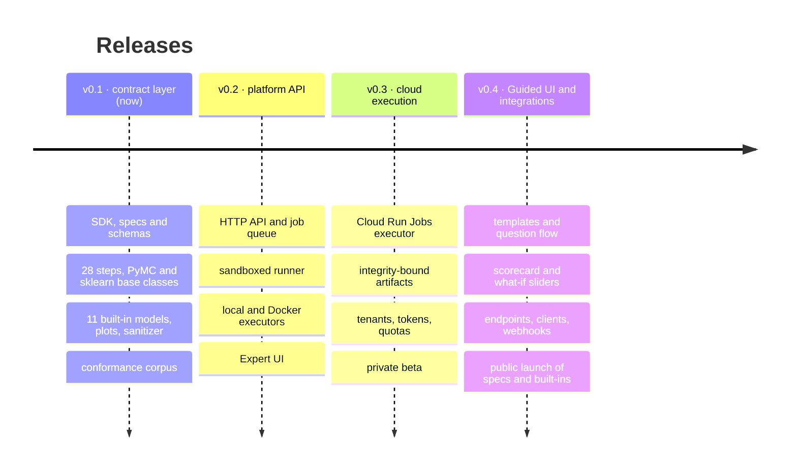

# Roadmap

modeling-api ships as three products, in this order: a typed modelling runtime, a job platform
around it, and a hosted multi-user platform. The rules that make the last one safe (no pickle,
JSON-only contracts, static validation, sanitized plots) are in the code from the first
release.

| Release | Theme | Status |
|---|---|---|
| **v0.1** | The contract layer: everything in this documentation that runs in your Python process | available |
| **v0.2** | [Platform API](platform-api.md): the same work as API calls and sandboxed runs, with an Expert UI | coming in v0.2 |
| **v0.3** | [Cloud execution](cloud.md): one fresh sandbox per run, integrity-bound artifacts, multiple tenants | coming in v0.3 |
| **v0.4** | [Guided UI and integrations](guided-ui.md): analysts end to end, endpoints for other apps | coming in v0.4 |

## What v0.1 contains

- [x] `DataSchema`, `ModelSpec`, `ScoreRequest` and their JSON Schemas; a strict YAML loader;
      spec hashes
- [x] Static validation: schema propagation, split stage, `LEAKAGE_RISK`, dim policies,
      recursion, CoordPlan checks from metadata
- [x] The xarray runtime: steps with fitted state, stages, context tails, inverse transforms,
      coordinate canonicalisation, representation-aware summaries
- [x] Bundles with integrity sidecars and no pickle; the in-process executor
- [x] `PyMCModel` (nutpie, PyMC with resumable segments, MAP, ADVI), `SklearnModel` (point,
      quantile, bootstrap, conformal, classifier)
- [x] 28 built-in steps and five split kinds
- [x] Built-in models: hierarchical geo MMM, pymc-marketing adapter, HSGP trend, Gaussian HMM,
      hierarchical GLM, quantile regressor, five `sklearn.tabular_*` plugins
- [x] Plot recipes (core, MMM, ML packs), Altair and Plotly converters, the sanitizer
- [x] The contract kit and a six-fixture conformance corpus

## After v0.4

Further out, in the order they are planned: uploading **your own plugins** to the hosted
platform (first for allow-listed teams, built into hash-pinned overlays and checked by the
contract kit on upload), then **public code upload** behind a stricter sandbox and abuse
controls, then scale features (warm scorers, GPU executors, other clouds, model composition)
when real usage asks for them.

!!! note "Dates"
    Releases are cut when their exit criteria pass, not on a calendar. Follow the
    [changelog](../project/changelog.md) for what has landed.
