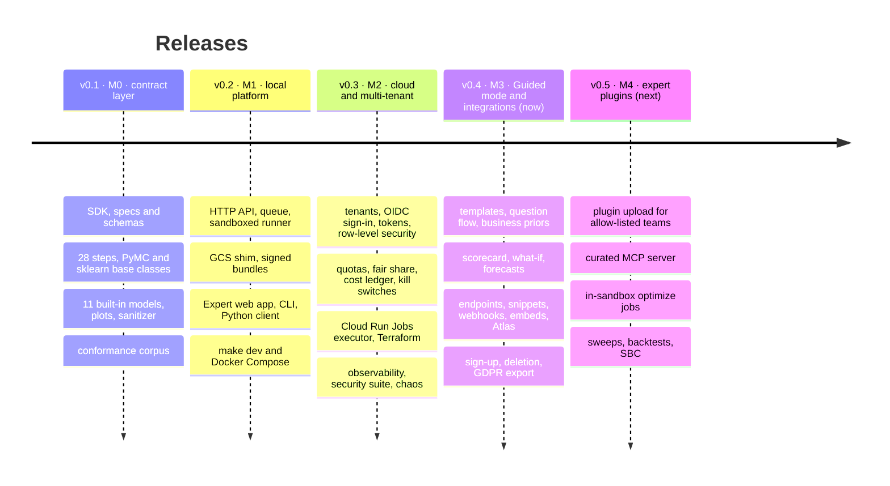

# Roadmap

modeling-api ships as three products, in this order: a typed modelling runtime, a job platform
around it, and a hosted multi-user platform. The rules that make the last one safe (no pickle,
JSON-only contracts, static validation, sanitized plots, sandboxed runs whose outputs are
verified) are in the code from the first release.

| Release | Milestone | Theme | Status |
|---|---|---|---|
| **v0.1** | M0 | The contract layer: specs, the xarray runtime, steps, models, plots, the conformance corpus, all in your own Python process | available |
| **v0.2** | M1 | [The local platform](platform-api.md): the same work as API calls and sandboxed runs, with the Expert web app, on a laptop or one Docker host | available |
| **v0.3** | M2 | [Cloud and multi-tenant core](cloud.md): tenants, sign-in, tokens, quotas and cost; one fresh sandbox per run on Cloud Run; a private beta | available |
| **v0.4** | M3 | [Guided mode and integrations](guided-ui.md): analysts from spreadsheet to report and scenario; endpoints, webhooks and embeds for other apps; the first public launch | this release |
| **v0.5** | M4 | [Expert plugins, MCP and optimisation jobs](expert-plugins.md): plugin upload for allow-listed teams, a curated MCP server, in-sandbox `optimize`, sweeps and backtests | next |

## What v0.4 contains

- [x] **Guided mode**: four templates (geo marketing mix, weekly forecast, demand by store,
      customer choice), a question flow with role detection, drafts with "View as YAML", the
      persona lock ([tutorial](../guides/guided-tutorial.md))
- [x] **Sandboxed ingest** of CSV, Parquet, MFF and Meridian-shaped tables with plain-language
      refusals; the **BayesInsight** import and the `mmm.bayesinsight` model (removed in
      v0.5: mmm-framework is the only MMM engine)
- [x] **Business priors** as ROI or share ranges, translated in a sandbox with a
      prior-predictive preview, and **lift tests** as calibration
      ([Guided modelling](../guides/guided-modelling.md))
- [x] The **sanity scorecard** written by every fit, and the **promotion gate** that uses it
- [x] **What-if sliders** over per-draw response grids, "Run exact", forecast and
      counterfactual views
- [x] **Endpoints and aliases**, `score:<alias>` tokens, **snippets** in seven languages, a
      **Google Sheets** card ([Connect Google Sheets](../tutorials/google-sheets.md))
- [x] **Signed webhooks** with an outbox, retries, a delivery log, replays and an SSRF guard
      ([Receive webhooks](../guides/webhook-receivers.md))
- [x] **Saved plots, static renders and embed links** ([Embed a chart](../tutorials/embed-a-chart.md))
- [x] The Python client's endpoints and **Atlas `RemoteModel`**
      ([Optimise a budget](../guides/atlas.md)); new CLI commands
- [x] **Sign-up** with e-mail verification and abuse controls, **tenant deletion**, the
      **GDPR export**, and a **Cloud Armor** policy
- [x] The Integrations hub, trust pages and admin additions in the web app

Verified end to end on a laptop ([M3 verification](../operations/m3-verification.md)). Still
to come for M3's exit: the sessions with five non-technical testers. Still to do against a
real Google Cloud project, as for v0.3: the
[[verify M0] checklist](../operations/gcp-deployment.md#before-you-start-the-verify-m0-checklist),
cold-start measurements, and public workspaces running on an executor that enforces egress
and DNS.

## Next: v0.5 · M4, expert plugins, MCP and optimisation jobs

**Allow-listed teams upload their own model plugins**: built into hash-pinned overlays (with
native wheels from a curated mirror), checked by the contract kit on upload, with fast dev
overlays and a vetted tier of ported sibling models. A **curated MCP server** gives agents a
small, injection-safe set of tools. Atlas optimisations run as **in-sandbox `optimize`
jobs**, and **`Sweep`, `Backtest` and `SBC`** run as one parent each.
[More](expert-plugins.md).

## After v0.5

In the order they are planned:

1. **Public code upload** (M5): uploaded plugins for every tenant, behind a separate
   execution project, signed base images, verification before any code runs, Sybil controls,
   a takedown process, a rehearsed kill-switch drill and an external penetration test, with
   the security suite green for two weeks first.
2. **Scale and depth** (M6), each when real usage asks for it: warm scorers for sub-second
   exact answers, GPU and large-data executors, other clouds, recursive forecasting, chained
   models (full-funnel and KPI graphs), and a plugin marketplace with a consent model.

!!! note "Dates"
    Releases are cut when their exit criteria pass, not on a calendar. Follow the
    [changelog](../project/changelog.md) for what has landed.
