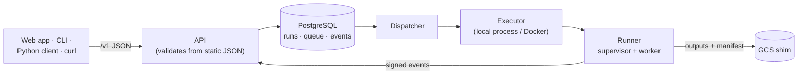

# The local platform v0.2

!!! success "Status: available in v0.2 (milestone M1)"
    v0.1 defined the documents that the platform accepts (`ModelSpec`, `ScoreRequest`). It
    also defined the error codes that the platform returns and the executor protocol that it
    controls. v0.2 puts an HTTP API, a job queue, a sandboxed runner, a local object store and
    the Expert web app around them. All of it runs on one machine. Start with the
    [quickstart](../getting-started/quickstart.md).

## What changed for you

Each thing that you do in a notebook is also an API call. The work runs in a sandbox, not in
your process:

| In your process (v0.1) | On the platform (v0.2) |
|---|---|
| `validate_spec(spec, catalog, schema)` | `POST /v1/specs:validate`, all problems at one time with JSON pointers, and the live squiggles in the editor |
| `fit_spec(spec, data, ...)` | `POST /v1/runs` with `kind: fit`. Progress comes as server-sent events. |
| `score_bundle(bundle, request, data)` | `POST /v1/models/{id}/versions/{v}:score` with `Prefer: wait` |
| A bundle directory | A model version in a registry, with lineage, metrics, a scorecard, plots and a signed manifest |
| `InprocExecutor` | `local-process` and `docker` executors behind the same protocol |

## Design commitments, kept

- **The API never imports plugin code and never decodes your arrays.** It validates specs and
  score requests from the exported catalog JSON and stored metadata. An import-linter contract
  keeps numpy, xarray and all plugins out of the server. The build of the server image checks
  this contract against the installed packages.
- **Runs are idempotent and observable.** Submissions have idempotency keys. The status from
  the executor is the source of truth. Events control progress bars. They never decide if a
  run is alive.
- **Errors are RFC 7807 problems** with the same stable codes that you see in Python.
- **OpenAPI 3.1** describes each endpoint. CI checks the generated clients for drift.
- **Outputs are verified.** The platform checks the outputs of a run against the checksums
  and generations of the object store. Then it copies the outputs to a location where runs
  cannot write, and signs them.

## Where to go next

- [The Expert web app](../guides/web-ui.md), [the CLI](../guides/cli.md),
  [the Python client](../guides/python-client.md) and [the HTTP API](../guides/http-api.md)
- [Architecture overview](../concepts/architecture.md) and the
  [security model](../concepts/security.md)
- [Deployment](../operations/index.md): `make dev` and Docker Compose
