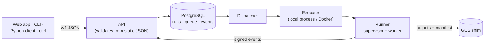

# The local platform v0.2

!!! success "Status: available in v0.2 (milestone M1)"
    The documents the platform accepts (`ModelSpec`, `ScoreRequest`), the error codes it returns
    and the executor protocol it drives were defined in v0.1. v0.2 puts an HTTP API, a job
    queue, a sandboxed runner, a local object store and the Expert web app around them, and
    runs it all on one machine. Start with the [quickstart](../getting-started/quickstart.md).

## What changed for you

Everything you do in a notebook is also an API call, and the work runs in a sandbox instead
of your process:

| In your process (v0.1) | On the platform (v0.2) |
|---|---|
| `validate_spec(spec, catalog, schema)` | `POST /v1/specs:validate`, every problem at once with JSON pointers, and the editor's live squiggles |
| `fit_spec(spec, data, ...)` | `POST /v1/runs` with `kind: fit`; progress streamed as server-sent events |
| `score_bundle(bundle, request, data)` | `POST /v1/models/{id}/versions/{v}:score` with `Prefer: wait` |
| A bundle directory | A model version in a registry, with lineage, metrics, a scorecard, plots and a signed manifest |
| `InprocExecutor` | `local-process` and `docker` executors behind the same protocol |

## Design commitments, kept

- **The API never imports plugin code and never decodes your arrays.** It validates specs and
  score requests from the exported catalog JSON and stored metadata. An import-linter contract
  keeps numpy, xarray and every plugin out of the server, and the server image build checks
  it against the installed packages.
- **Runs are idempotent and observable.** Submissions carry idempotency keys; the executor's
  status is the source of truth; events drive progress bars, never liveness decisions.
- **Errors are RFC 7807 problems** with the same stable codes you see in Python.
- **OpenAPI 3.1** describes every endpoint, and the generated clients are checked for drift in
  CI.
- **Outputs are verified.** A run's outputs are checked against the object store's own
  checksums and generations, copied where runs cannot write, and signed.

## Where to go next

- [The Expert web app](../guides/web-ui.md), [the CLI](../guides/cli.md),
  [the Python client](../guides/python-client.md) and [the HTTP API](../guides/http-api.md)
- [Architecture overview](../concepts/architecture.md) and the
  [security model](../concepts/security.md)
- [Deployment](../operations/index.md): `make dev` and Docker Compose
