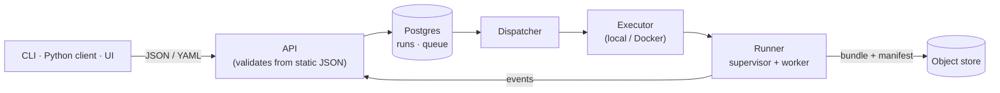

# Platform API coming in v0.2

!!! abstract "Status"
    Planned. The documents it accepts (`ModelSpec`, `ScoreRequest`), the error codes it returns
    and the executor protocol it drives already exist and are documented on this site; v0.2
    puts an HTTP API, a job queue and a sandboxed runner around them.

## What changes for you

Everything you do in a notebook today becomes an API call, and the work runs in a sandbox
instead of your process:

| Today (v0.1) | With the platform API (v0.2) |
|---|---|
| `validate_spec(spec, catalog, schema)` | `POST /v1/specs:validate`, every problem at once with JSON pointers |
| `fit_spec(spec, data, ...)` | `POST /v1/runs` with `kind: fit`; progress streamed as server-sent events |
| `score_bundle(bundle, request, data)` | `POST /v1/runs` with `kind: score`, or score a named endpoint |
| A bundle directory | A model version in a registry, with lineage, metrics and plots |
| `InprocExecutor` | Local-process and Docker executors behind the same protocol |

## Design commitments

- **The API never imports plugin code and never decodes your arrays.** It validates specs and
  score requests from the exported catalog JSON and stored metadata, exactly as
  `validate_spec` and `validate_score_request` do today. An import-linter contract keeps
  numpy, xarray and every plugin out of the server.
- **Runs are idempotent and observable.** Submissions carry idempotency keys; the executor's
  status is the source of truth; events drive progress bars, never liveness decisions.
- **Errors are RFC 7807 problems** with the same stable codes you see in Python.
- **OpenAPI 3.1** describes every endpoint, and generated clients are checked for drift in CI.

## The Expert UI

v0.2 also brings the first web UI, for data scientists:

- a YAML spec editor with live validation at JSON pointers and the schema at every pipeline
  stage;
- run views with per-chain progress, logs and cancel;
- an inspector for posteriors, diagnostics and preprocessing state;
- plots rendered in an isolated iframe on a separate origin, after the server-side sanitizer.

## A local object store

Bundles and datasets live in an object store. For local development the platform ships an
emulator of the Google Cloud Storage features it relies on (object generations,
server-computed CRC32C and MD5, signed URLs with range reads), so the integrity checks you see
in [Bundles](../concepts/bundles.md) work the same way on a laptop as in the cloud.
