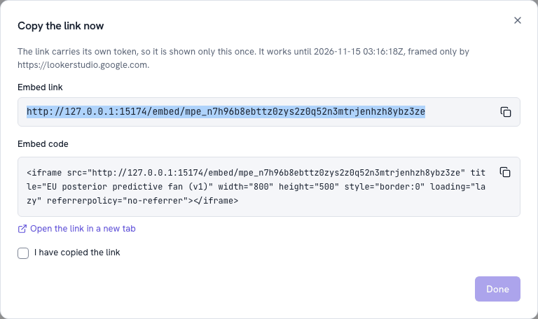

# Embed a chart in Notion, Slack or BI <span class="mapi-badge">v0.4</span>

A chart from a fitted model belongs where decisions are made: the planning page in Notion,
the weekly thread in Slack, the dashboard in Looker Studio or Power BI. An **embed link**
shows one chart, read-only, to anyone who has the link, until it expires or you revoke it.
Nobody needs an account, and the link can read nothing else.

This is what the link opens: the chart, its plain-language caption, a PNG fallback and the
expiry date.

{ .mapi-shot }

## What can be shared

Only charts the platform drew with one of **its own recipes** (`core.*`, `mmm.*`, `ml.*`,
`ts.*`, `choice.*`): response curves, decompositions, forecast fans, scorecard charts and the
like. A chart written by a plugin or by hand is refused (`EMBED_NOT_ALLOWED`), because a
shared link runs the chart's specification in a stranger's browser, and only specifications
the platform wrote are allowed to do that. Share those inside the project, or as a PNG.

A link points at one **model version**, so it never changes under your readers when the model
is refitted: share the new version's chart when you want them to see it.

## 1. Create the link

=== "In Guided mode"

    On the last step, **Share**, choose **Share a chart**, pick the chart and create the link.

=== "In the Integrations hub"

    **Integrations → Plots and links → Save a model plot** (or **Share** in a model version's
    plot gallery): pick the model, the version and the chart. Then **Create link** on the
    saved plot. Optionally give it a label, an expiry (7 to 365 days, 30 by default) and
    the sites that may frame it.

    { .mapi-shot }

=== "Python"

    ```python
    --8<-- "embed_chart.py:save"
    ```

    ```python
    --8<-- "embed_chart.py:link"
    ```

=== "CLI"

    ```bash
    mapi plots embed plt_01jaf3n1p2q3r4s5t6v7w8x9y0 \
      --label "Weekly marketing review" --expires-in-days 90 \
      --allow-origin https://lookerstudio.google.com
    ```

The link and its `<iframe>` code are shown **once**: the platform keeps only a keyed hash of
the token, like a password. Copy it now.

## 2. Put it where people look

| Tool | How | Notes |
|---|---|---|
| **Notion** | Type `/embed`, paste the link | Leave *sites that may frame it* empty unless you have checked which origin frames the embed (see below) |
| **Slack** | Paste the link in a message or a canvas | Slack shows links, not live frames: readers click through to the chart. For an image in the thread, post the PNG (step 4) |
| **Looker Studio** | **Insert → URL embed**, paste the link | Allow `https://lookerstudio.google.com` if you restrict sites |
| **Power BI** | On a dashboard, **Add a tile → Web content**, paste the `<iframe>` code | Reports have no built-in web frame: use a custom visual that renders HTML, or the PNG |
| **Confluence, internal portals, any web page** | Paste the `<iframe>` code (in Confluence, through an iframe or HTML macro) | Set `width` and `height` to fit the page |
| **Slides, PDFs, e-mail** | Use the PNG (step 4) | These cannot show live content |

**Sites that may frame it.** With a list of `https://` origins, the embed page draws the
chart only when the page that directly frames it is one of them, and shows *This plot can
only be shown on the sites it was shared with* elsewhere. Opened directly, the link always
works. Some tools frame embeds through an embedding service of their own; the origin the
check sees is then that service's, so if the notice appears, add the origin your browser's
developer tools show as the frame's parent, or create the link without a restriction.

## 3. Check it

Open the link in a private window: no sign-in, one chart. From Python, the same public view
that the embed page reads, and the list of the plot's links with their view counts:

```python
--8<-- "embed_chart.py:check"
```

```text
EU response curves (v3) | expires 2026-11-14 | mmm.response_curves@1.0.0
mpe_7k2m9q… Weekly marketing review active 0 views
```

The list never shows a token again, only its first characters (`display`).

## 4. A PNG, SVG or PDF instead

For slides, a PDF report or a Slack thread, render the chart to a file. Rendering is a small
sandboxed run (the `runner` role), and the file is checked against its checksum when you
download it:

```python
--8<-- "embed_chart.py:png"
```

In the hub, the **Download** buttons of a saved plot do the same; on the command line,
`mapi plots render --saved plt_… -f pdf -o chart.pdf`. When you create a link with the `runner` role, a PNG is rendered too, and
the embed page offers it as **Open as PNG** for tools that cannot show interactive content.

## 5. Revoke it

When the meeting is over, or the link went somewhere it should not:

```python
--8<-- "embed_chart.py:revoke"
```

In the hub: **Revoke** in the plot's list of links; on the command line,
`mapi plots revoke <plot_id> <embed_id>`. Every dashboard showing the link stops on its next
load and says *This link has expired or was revoked*. Deleting the saved plot revokes all of
its links; deleting the organisation revokes every link at once.

## What a viewer's browser can and cannot do

The embed page is served from the **plot sandbox's origin**, not the app's. It sends no
cookie or credential, its Content-Security-Policy lets it fetch the one public embed view and
nothing else, the view is validated again in the browser, and every text is written as text.
The view carries the chart's data inline (up to 1.5 MB), so the page never touches storage.
Per-link and per-address rate limits stop a link from being scraped
([Sharing plots](../guides/sharing-plots.md#the-embed-page)).

## Next

- [Connect Google Sheets](google-sheets.md) for the numbers behind the chart.
- [Sharing plots](../guides/sharing-plots.md): every option of saving, rendering and embedding,
  with `curl`.
