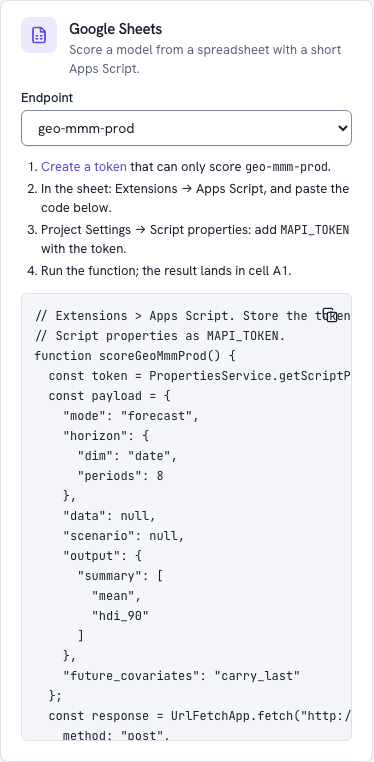

# Connect Google Sheets <span class="mapi-badge">v0.4</span>

By the end of this tutorial a Google Sheet holds your model's forecast, week by week, with
the actual results it was fitted on and the range the future could fall in, and refreshes
itself every morning. Nobody needs to open the platform, and the sheet never holds anything
but a token that can score one endpoint.

| You need | Where to get it |
|---|---|
| An **endpoint** serving a model that forecasts (a geo marketing mix or a weekly forecast) | The Guided [*Share* step](../guides/guided-tutorial.md#7-share), or **Promote a model** in the [Integrations hub](../guides/integrations-hub.md#promoting-through-the-gate) |
| A platform the internet can reach | Apps Script runs on Google's servers, so it cannot call a stack on `127.0.0.1`. Use your team's deployment |
| A Google account that may use Apps Script | Any Google Workspace or personal account |

## 1. Create a token that can only score this endpoint

In the web app, open **Integrations**: the **Google Sheets** card lists your endpoints. Pick
yours and click **Create a token**: the Tokens page opens prefilled for a `score:<alias>`
token, which can read and score that endpoint and nothing else.

{ .mapi-shot style="max-width: 420px" }

Or from a terminal, with a rate limit and a monthly compute budget:

```bash
mapi tokens create sheets-forecast -s score:geo-mmm-prod --rate-limit 60 --budget 600
```

The secret is shown **once**. A sheet's script properties are visible to everyone who can
edit the script, which is why the token should be able to do nothing but score this
endpoint; revoke it at any time on the Tokens page (`mapi tokens revoke`).

## 2. Paste the generated script

In the sheet: **Extensions → Apps Script**. Replace the empty function with the code from
the card (it is the endpoint's **Apps Script** snippet, also on its Snippets tab and from
`mapi endpoints snippets geo-mmm-prod -l apps_script`). For an endpoint `geo-mmm-prod` it
looks like this:

```javascript
--8<-- "sheets_endpoint.gs"
```

Then **Project Settings → Script properties → Add script property**: name `MAPI_TOKEN`,
value the token from step 1. Back in the editor, choose the function and press **Run**.
The first run asks you to authorise the script to connect to an external service and to edit
your spreadsheets.

A sheet called **Result** now holds the answer: the platform ran the endpoint's example call
(here an 8-week forecast) in a sandbox and returned the requested summary inline, one table
per output variable. Each table has a header row (`variable`, the coordinate columns such as
`geo` and `time`, then `mean`, `hdi_90_lower` and `hdi_90_upper`) and one row per
coordinate. The payload is the endpoint's own example, generated from its input contract, so
it is valid as it stands. If the run takes longer than the minute the script waits, **Result**
says *Still running*; run the function again to collect it.

To send your own data instead of the example's, add a sheet called **Input** in long format:
a header row naming the endpoint's dims and input variables, then one row per coordinate.
The script reads it into the call when the example sends inline data; an endpoint whose
example call sends none (a plain forecast) refuses an **Input** sheet.

The summary is per coordinate, per market and week here. The next step writes a different
table: the history the model was fitted on next to the forecast's range, summed over markets.

## 3. Write the forecast into a table

A forecast run also writes a small JSON table for Guided mode, `ui/guided/forecast.json`:
the history the model was fitted on, then the forecast's quantiles per period. This script
fetches it and writes it into a sheet called **Forecast**. Replace the code with it, and set
`MAPI_URL`, `MAPI_PROJECT`, `ENDPOINT` and `CALL` (the `payload` of the generated script):

```javascript
--8<-- "sheets_forecast.gs"
```

Run `refreshForecast`. The **Forecast** sheet then looks like this (the numbers depend on
your model):

| time | Actual revenue | 5% | 25% | Median | 75% | 95% |
|---|---|---|---|---|---|---|
| 2026-09-27 | 101.5 | | | | | |
| 2026-10-04 | 98.2 | | | | | |
| 2026-10-11 | 104.9 | | | | | |
| 2026-10-18 | | 88.0 | 96.3 | 101.2 | 106.4 | 114.9 |
| 2026-10-25 | | 85.1 | 94.0 | 99.8 | 105.2 | 115.3 |
| | | | | | | |
| Forecast from 2026-10-18 | expected revenue (kEUR) | | | | | |

How to read it: in 90% of plausible futures the week of 18 October lands between the 5% and
95% columns; half of them land between 25% and 75%. The KPI is summed over the model's other
dims (markets, stores) *per posterior draw* before the quantiles are taken, which is why
these ranges are honest totals and not sums of per-market ranges. Chart the table with
**Insert → Chart** (a line for the median and the actuals, an area between 5% and 95%).

What the script does, and why:

- **One run per day.** It sends an `Idempotency-Key` made of the endpoint and the date. The
  platform remembers a key for 24 hours, so running the script again the same day returns
  the same run instead of starting (and paying for) another one. Change `CALL` and you get a
  `409 IDEMPOTENCY_CONFLICT` until the next day; rename the key to start over.
- **Still running?** `Prefer: wait=30` waits up to 30 seconds. A cold start in the cloud can
  take longer; the sheet then says *Still running*, and the next run of the script collects
  the result.
- **Short-lived links.** The result's links are signed URLs that expire after 15 minutes.
  The script fetches the table at once and never stores the link; the link needs no token.

## 4. Refresh it every morning

In the Apps Script editor: **Triggers** (the clock icon) → **Add Trigger** →
function `refreshForecast`, event source **Time-driven**, **Day timer**, a time of day. Each
morning the sheet is cleared and refilled with a fresh forecast from whatever version the
endpoint serves that day, so promoting a better model updates the sheet without touching it.

## When something goes wrong

| What the sheet or the editor shows | Why | What to do |
|---|---|---|
| `401: …` | No token, or a revoked or expired one | Check the `MAPI_TOKEN` script property; create a new token |
| `403: …` | The token's scope is not `score:<this alias>` (or the project header is wrong) | Create the token from the Sheets card, check `MAPI_PROJECT` |
| `404: …` | The endpoint was deleted or renamed | Pick the endpoint again in the Sheets card |
| `409: …` with `IDEMPOTENCY_CONFLICT` | `CALL` changed since the day's first run, under the same key | Wait for tomorrow, or change the key's prefix |
| `422: …` with `MISSING_FUTURE_COVARIATE`, or `409: …` with `HORIZON_EXCEEDS_FIT` | The call asks for something the model cannot answer: future values it does not have, or more periods than it may forecast | Copy the payload from the endpoint's snippet again; shorten the horizon |
| `429: …` with `RATE_LIMITED` or `QUOTA_EXCEEDED` | The token's rate limit, its budget or a project quota | Raise the limit or budget on the Tokens page, or refresh less often |
| *This endpoint's model wrote no forecast table.* | The call is not a forecast, or the model's outputs have no KPI to tabulate | Use a forecast call; for other outputs, read the result with the Python client |

## Next

- [Embed a chart](embed-a-chart.md) in a doc or a dashboard next to the sheet.
- [Receive webhooks](../guides/webhook-receivers.md) to refresh the sheet as soon as a better
  model goes live, instead of on a timer.
- The [Integrations hub](../guides/integrations-hub.md) for every snippet and token option.
