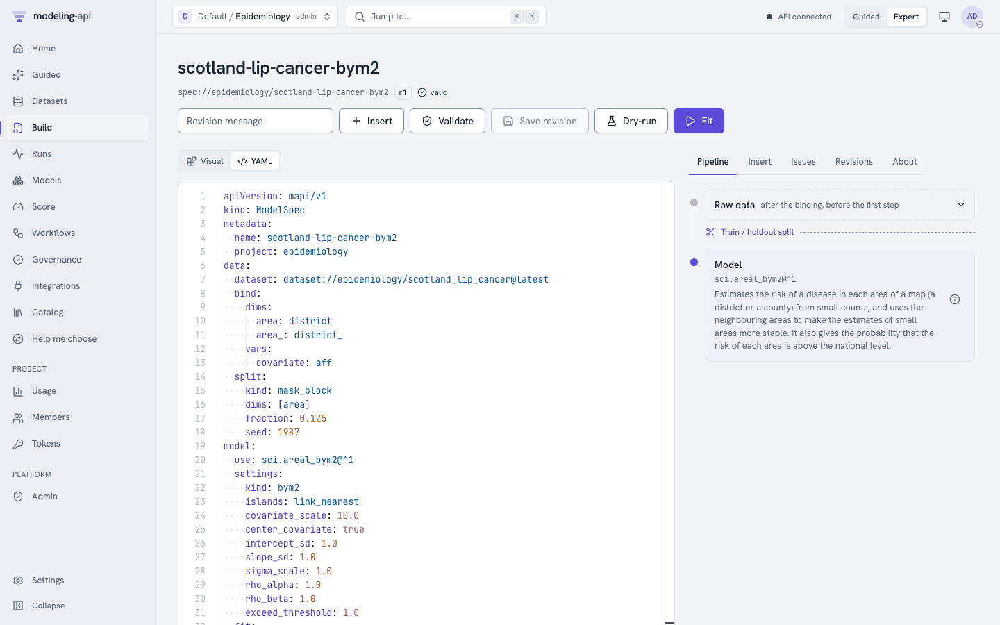
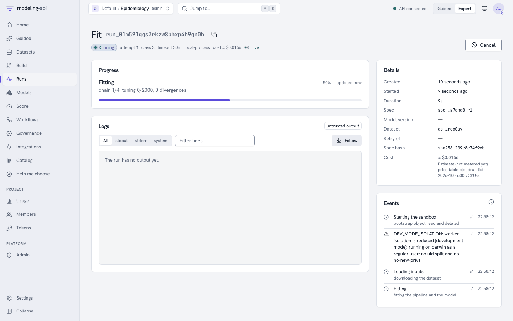
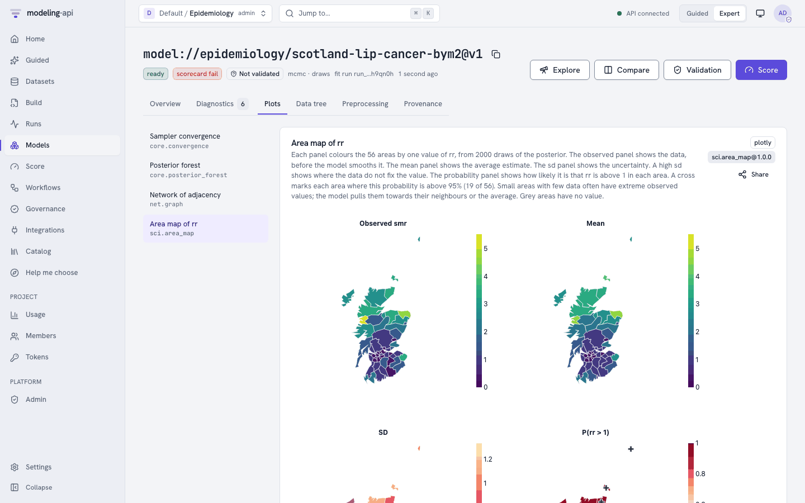
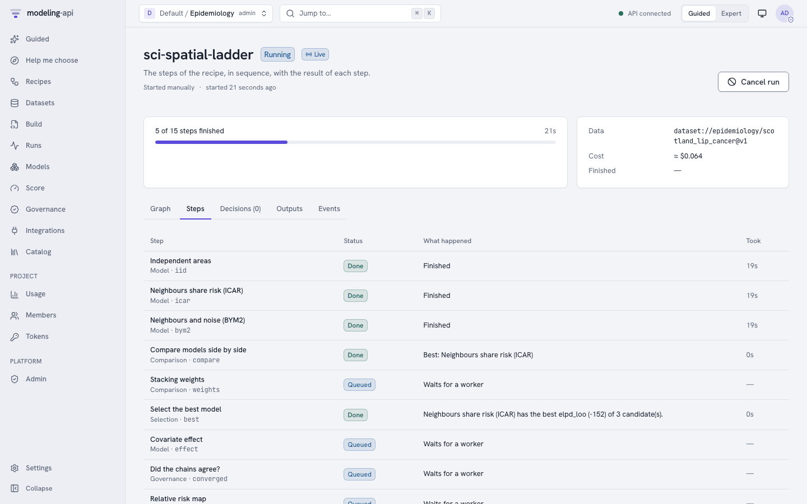
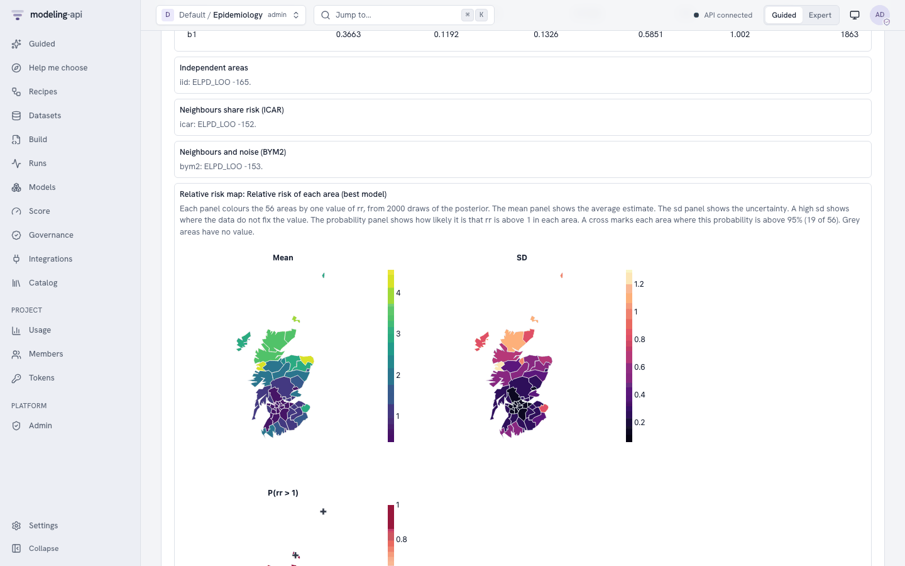

# E18 Scottish lip cancer disease map (ICAR/BYM2)

This tutorial does the main analysis of the pymc-challenges notebook
`E18_areal_models_icar_bym2.py` in the web app. You use the model `sci.areal_bym2@1`. You do
not write PyMC code.

**You need:**

- The platform (start it with `make dev`) and a project that you can upload datasets to. This
  tutorial uses the project `epidemiology`. If your project has a different name, change the
  project part of each `dataset://` and `model://` reference.
- A local copy of pymc-challenges. The export command reads the file
  `data/scotland_lip.geojson`.
- About 15 minutes. One fit takes less than one minute of sandbox time.

## 1. The question

Between 1975 and 1980, 536 men in Scotland got lip cancer. For each of the 56 districts, you
know the observed count and an expected count. The expected count is the count of the district
if each age group had the national rate. The ratio of the two is the standardised morbidity
ratio (SMR). The SMR is a raw estimate of the relative risk of the district.

The notebook asks two questions:

1. **Where** is the risk really high, when you include the noise of small counts?
2. **Does outdoor work explain the risk?** `AFF` is the percentage of the workers in
   agriculture, fishing and forestry. Lip cancer has a relation to sunlight.

Small districts have few cases, so their SMRs have much noise. The notebook lets each district
share its risk with its neighbours on the map. It puts graph priors on the district effects:
the intrinsic CAR (ICAR), the proper CAR and BYM2. BYM2 is a scaled ICAR plus independent
effects. Its parameter `rho` is the share of the variation that follows the map.

The decision at the end of the notebook is this:

- **Do not publish the raw SMR map.** Publish the BYM2 smoothed relative risk and the
  probability that the relative risk is more than 1. In 19 districts this probability is more
  than 0.95. These are the districts where the risk is "high and certain".
- **Use BYM2 as the default model.** The graph models predict equally well, and all three
  predict better than independent districts. BYM2 has a `rho` that you can read, and its
  priors mean the same thing on each map.
- **Report the AFF effect as an association.** Its 90% interval excludes 0 in each model. But
  its size changes from a relative risk of 1.96 for each 10 points (independent districts) to
  1.50 (BYM2). The size depends on what you assume about risk factors that you did not
  measure. This is spatial confounding.

**What you will get**, and the notebook section that each item replaces:

| In the web app | Notebook |
|---|---|
| The graph of the districts, with the island links (**Plots**, `net.graph`) | Section 2 (the queen graph) and section 3 (the island links) |
| The posterior of `b0`, `b1`, `sigma` and `rho` (**Parameters**) | Section 4, the BYM2 row of the diagnostics table, and section 6 |
| The smoothed relative risk `rr` and `p_exceed`, the probability that `rr` is more than 1 (**Plots**, `sci.area_map`) | Section 7, the three maps |
| `elpd_loo` and the Pareto k warning (**Diagnostics**) | Section 8, the LOO table |
| The error on 7 districts that the fit did not see (**Diagnostics**) | Section 8, a smaller version of the 8-fold cross-validation |
| The ladder of `kind` values, compared by `elpd_loo` (the recipe `sci_spatial_ladder`) | Section 4 (the five models) and section 9 (`b1` in each model) |
| New maps of risk and counts (**Score**, **Simulate**) | Section 3, the prior predictive draws "by hand" |

Some parts of the notebook are not in the port, for example the unscaled BYM and the Moran's I
checks of the residual effects. See [Differences from the notebook](#10-differences-from-the-notebook).

## 2. Get the data

The export command reads the GeoJSON file of pymc-challenges and writes a NetCDF file that
the platform can read. Run it from the root of the modeling-api repository:

```bash
uv run python -m mapi_plugin_science.export e18 \
    --challenges <path to pymc-challenges>/data \
    --out scotland_lip.nc --spec scotland_lip.yaml
```

The command writes:

```text
wrote scotland_lip.nc (variables cases, expected, aff, adjacency, ring_x, ring_y on district=56, district_=56, vertex=51)
upload it as dataset epidemiology/scotland_lip_cancer and fit sci.areal_bym2
wrote the suggested spec to scotland_lip.yaml
```

The file holds one dataset:

| Name | Dims | Type | Meaning |
|---|---|---|---|
| `district` | 56 | categorical, `fixed` | The district names, as in the GeoJSON file (Orkney has the name `Okney`) |
| `district_` | 56 | categorical, `fixed` | The same districts again: the second axis of `adjacency` |
| `vertex` | 51 | integer, `fixed` | The points of the outline of each district |
| `cases` | `district` | float64, target | The observed cases, 1975 to 1980 (`CANCER`) |
| `expected` | `district` | float64, exposure | The expected cases (`CEXP`), from 1.07 to 88.66 |
| `aff` | `district` | float64, covariate | The percentage of workers in agriculture, fishing and forestry (`AFF`) |
| `adjacency` | `district, district_` | int64, constant | 1 when two districts touch (queen contiguity), else 0 |
| `ring_x`, `ring_y` | `district, vertex` | float64, constant | The outline of each district in British National Grid metres. NaN fills the unused points |

The export makes the graph as the notebook does. Two districts are neighbours when their
outlines share at least one point. The graph has 117 edges. Orkney, Shetland and the Western
Isles have no neighbours. The model links them when it fits (step 6.1).

The attribute `mapi_schema` gives each variable its role, so you do not map columns.

!!! tip "Simulated data"
    `--synthetic` writes a map of 43 square districts (one of them is an island) with counts
    from the model itself. The true values are `b0 = 0.1`, `b1 = 0.4`, `sigma = 0.5` and
    `rho = 0.8`. You do not need pymc-challenges for it.

    ```bash
    uv run python -m mapi_plugin_science.export e18 --synthetic --out disease_map_synthetic.nc
    ```

## 3. Upload the dataset

1. Open **Datasets** in the sidebar.
2. Click **New dataset**.
3. Type `scotland_lip_cancer` in **Name**. Type a description, for example "Male lip cancer
   in 56 districts of Scotland, 1975 to 1980, with district outlines".
4. Click **Create dataset**. The upload panel opens.
5. Click **Choose files** and select `scotland_lip.nc`.
6. Click **Preview structure**. The panel shows **Structure of the file**. Make sure that it
   shows `cases`, `expected` and `aff` on `district`, and `adjacency` on `district` and
   `district_`.
7. Optional: type a message in **Version message (optional)**.
8. Click **Upload and ingest**.

The ingest run reads the file in the sandbox. When it is done, the version page shows the tabs
Schema, Coordinates, Missingness, Preview and About. On **Schema**, `cases` has the role
`target`, `expected` has the role `exposure` and `aff` has the role `covariate`.
**Missingness** shows missing values only in `ring_x` and `ring_y`. These are the unused
points of the shorter outlines.

The file is one plain dataset. You do not need the tree fields ("Put this file in a node of a
tree (optional)") or the HDF5 path.

### 3.1 Explore the data

Look at the data before you build the spec.

1. On the version page, click **Explore this version**. The Data Explorer opens. The
   sections under *Pictures of the data* come first.
2. Click **Map**.

- The map shows the 56 districts. Select `cases`, `expected`, `aff` or the ratio `cases` /
  `expected` (the standardised morbidity ratio) to set the colours. The lines join the
  neighbour districts.
- The list of areas with no neighbour shows Orkney, Shetland and the Western Isles. The model
  links them when it fits (step 6.1).
- The table of Moran's I tells if neighbour districts have similar values. A positive value
  with a small p-value is a reason for a spatial model.
- `ring_x`, `ring_y` and `adjacency` are geometry. They are not in **Distributions**,
  **Unusual values** or **Data quality**.
- The time sections are in **Not for this data**. The data has no time dim.

Refer to [Scientific data](../../guides/data-explorer.md#scientific-data).

## 4. Build the spec

1. Open **Build** and click **New spec**. The editor opens with the geo MMM template.
2. Set the **Editor view** to **YAML**.
3. Open the **Insert** panel on the right.
4. Open the **Datasets** section and select `scotland_lip_cancer`. The toast "Dataset set" shows.
5. Type `areal` in the search field. Under **Models**, select **Disease risk on a map of
   areas** (`sci.areal_bym2@^1`). The toast "Model set" shows.
6. Select all the text in the editor and paste the full spec below. The template has other
   blocks (a pipeline, a split and the MMM plots), so the spec must replace all of it.
7. Click **Validate**. The status shows `valid`.
8. Click **Save spec**. The spec gets its name `scotland-lip-cancer-bym2` from `metadata.name`.

{ .mapi-shot }

This is the full spec:

```yaml
apiVersion: mapi/v1
kind: ModelSpec
metadata:
  name: scotland-lip-cancer-bym2
  project: epidemiology
data:
  dataset: dataset://epidemiology/scotland_lip_cancer@latest
  bind:
    dims:
      area: district
      area_: district_
    vars:
      covariate: aff
  split:
    kind: mask_block
    dims: [area]
    fraction: 0.125
    seed: 1987
model:
  use: sci.areal_bym2@^1
  settings:
    kind: bym2
    islands: link_nearest
    covariate_scale: 10.0
    center_covariate: true
    intercept_sd: 1.0
    slope_sd: 1.0
    sigma_scale: 1.0
    rho_alpha: 1.0
    rho_beta: 1.0
    exceed_threshold: 1.0
  fit:
    mode: evaluate_then_refit
    seed: 1987
    tune: 1000
    draws: 1000
    chains: 4
    target_accept: 0.9
    engine: nutpie
evaluate:
  metrics: [rmse, mae, coverage_90, elpd_loo]
outputs:
  plots:
    - core.convergence
    - core.posterior_forest
    - sci.area_map
    - net.graph
```

The settings are the defaults of the model. They are also the choices of the notebook. The
`--spec` file of the export has the short form of the same spec. This table tells what each
setting means for the question:

| Setting | Value | Meaning for this question |
|---|---|---|
| `kind` | `bym2` | The prior of the district effects. `bym2` is the model that the notebook recommends. Use `poisson`, `iid`, `icar` or `car` to fit the other models of the notebook (step 6.5) |
| `islands` | `link_nearest` | Orkney, Shetland and the Western Isles have no neighbours. The model links each one to the district with the closest outline, as the notebook does. Without a link, the BYM2 scaling factor is not defined |
| `covariate_scale` | 10 | `b1` is the effect of 10 percentage points of AFF on the log relative risk, as in the notebook |
| `center_covariate` | true | The model subtracts the mean AFF (8.66%). Thus `b0` is the log relative risk of a district with a mean AFF |
| `intercept_sd`, `slope_sd` | 1, 1 | The priors `b0 ~ Normal(0, 1)` and `b1 ~ Normal(0, 1)` of the notebook |
| `sigma_scale` | 1 | The prior `sigma ~ HalfNormal(1)` of the total sd of the district effects |
| `rho_alpha`, `rho_beta` | 1, 1 | The prior `rho ~ Beta(1, 1)`: all shares are equally probable before the data |
| `exceed_threshold` | 1 | `p_exceed` is the probability that `rr` is more than 1, that is, more than the national rate |

- `bind` gives the dataset names to the names of the model. The model calls the districts
  `area` and the covariate `covariate`. The outputs come back with your names.
- `split` holds out 12.5% of the districts (7 districts). The model keeps these districts in
  the graph, but it does not use their counts. It predicts them from their neighbours. This is
  the question "what is the risk in a district without data?" of notebook section 8.
- `fit.mode: evaluate_then_refit` first fits without the held-out districts and calculates
  the metrics on them. Then it fits again on all 56 districts. The parameters and the maps
  come from the second fit.
- `engine: nutpie` is the sampler of the notebook. `engine: pymc` gives the same result, but
  it is slower.
- The model always keeps the log-likelihood of each district, so you do not need a `keep`
  block for `elpd_loo`.

!!! note "The plots"
    The model declares `core.convergence`, `core.posterior_forest`, `sci.area_map`,
    `net.graph` and `core.ridge`. The fit makes only the plots in `outputs.plots`.
    `core.ridge` needs the setting `dim`, and a spec cannot give settings to a plot. Without
    `dim`, the fit skips the plot with the issue `SCHEMA_INVALID`. Thus the spec does not name
    `core.ridge`.

## 5. Fit and watch the run

1. Click **Fit**. The app opens the run page.
2. The badge shows **Live** while the run sends events.
3. The **Progress** card shows the progress of the sampler. The run fits two times: first
   without the 7 held-out districts, then on all 56 districts. The **Events** card shows the
   stages of the run and, at the end, the diagnostics. The **Logs** card stays empty when
   the model writes no output.
4. When the run is done, the **Result** card shows **Inspect
   model://epidemiology/scotland-lip-cancer-bym2@v1**. Click it.

{ .mapi-shot }

The two fits took 21 s in our test. Each fit samples `b0`, `b1`, `sigma`, `rho` and two
effects for each district (`phi` for the ICAR part and `theta` for the independent part).

You can also find the run under **Runs**. Filter it with the kind `fit`.

## 6. Read the result

On the model version page, the tabs are **Overview**, **Diagnostics**, **Plots**, **Data
tree**, **Preprocessing** and **Provenance**. Click **Explore** to open the Model Explorer.

The outputs of this model are on the districts, not on a grid. Thus the **Fields** section is
under "Does not apply". **Fit vs actual** and **Residuals** also show there, because they need
a time dimension. The maps are in the **Plots** tab of the model version page.

Open **Overview** to see the scorecard. The check "Few missing values" passes. It counts only
the variables that contain observations. Thus it does not count the padding of the outlines
`ring_x` and `ring_y` (and `adjacency`), because they have the role `constant`. The expert
message names these variables.

### 6.1 The graph that the model used

The model links the three islands before it fits. The bundle of the version keeps the result
in `learned`:

| Value | Result | Notebook |
|---|---|---|
| `n_components_input` | 4 (the mainland and three islands) | 4 connected components |
| `islands_input` | `Okney`, `Shetland`, `WesternIsles` | the same |
| `links` | `Okney` to `Caithness` (28 km), `Shetland` to `Okney` (192 km), `WesternIsles` to `Ross-Cromarty` (41 km) | the same links and distances |
| `n_edges` | 120 | 120 |
| `scaling_factor` | 0.632 | 0.632 |

The link from Shetland is 192 km long, because the GeoJSON file draws only the north part of
Shetland. The rule still selects Orkney, as in the notebook.

On the model version page, open **Plots** and select the plot with the title "Network of
adjacency" (`net.graph`). It draws the 120 links at the centres of the districts, next to the
full adjacency matrix. Look for the three long links to the islands in the north and the
north-west.

### 6.2 Can you trust the fit?

Open **Diagnostics** in the Model Explorer (group "Can you trust it?").

- The largest R-hat is 1.006 (`phi`), the smallest bulk ESS is 588 (`rho`) and there are 0
  divergences. The sampler has no problems.
- `TREE_DEPTH` shows that 1 of 4000 draws hit the largest tree depth. This is information
  only. The results are correct.
- `PARETO_K_HIGH` is a warning: 17 of 56 districts have a Pareto k above 0.7. This is
  expected. Each district has its own effect, so when PSIS-LOO removes the count of a
  district, the posterior changes too much. The notebook found 24 such districts. Do not
  quote `elpd_loo` as a precise value.

The diagnostics also show the metrics of the 7 held-out districts (Wigtown, Badenoch,
Inverness, Kyle-Carrick, Dumbarton, Edinburgh and East Kilbride). The model predicted their
counts from their neighbours only:

| Metric | Value | Meaning |
|---|---|---|
| `rmse` | 7.64 cases | The error of the predicted counts. Edinburgh has 50.7 expected cases, so a large error in cases is possible |
| `mae` | 4.81 cases | The mean absolute error |
| `coverage_90` | 1.00 | All 7 observed counts are in their 90% intervals |
| `elpd_loo` | −153.0 | PSIS-LOO of the fit on all 56 districts (notebook: −152.7) |

### 6.3 What the model learned

Open **Parameters** (group "What it learned"). The table shows the posterior mean and the 90%
highest-density interval:

| Parameter | Mean | 90% interval | Meaning |
|---|---|---|---|
| `b0` | 0.102 | 0.003 to 0.206 | The log relative risk of a district with a mean AFF. Scotland has 11% more cases than the expected counts give |
| `b1` | 0.406 | 0.201 to 0.625 | The effect of 10 points of AFF on the log risk. `exp(0.41)` = 1.50 for each 10 points |
| `sigma` | 0.518 | 0.382 to 0.656 | The total sd of the district effects on the log scale |
| `rho` | 0.802 | 0.569 to 1.000 | The share of the district variation that follows the map |

The table also has 56 rows each for `rr`, `effect`, `phi` and `theta`.

The answer to "how much of the risk follows the map?" (notebook section 6) is `rho`. Its
median is 0.84 and its 90% interval is wide. Most of the variation after AFF is spatial. A
district's risk is better predicted by its neighbours than by an independent quirk of the
district. Thus there are possibly more risk factors that change smoothly over Scotland, and
that AFF does not include.

### 6.4 The maps

On the model version page, open **Plots**:

| Plot | What to look for |
|---|---|
| Sampler convergence (`core.convergence`) | The text says "All 228 parameters look converged." |
| Posterior forest (`core.posterior_forest`) | The intervals of step 6.3 and of each district. `b1` is clearly above 0 |
| Area map (`sci.area_map`) | The title is "Area map of rr". This is the map of notebook section 7. See below |
| Network (`net.graph`) | The title is "Network of adjacency". The graph of step 6.1 |

The area map has four panels for the relative risk `rr`:

{ .mapi-shot }

- **Observed smr**: the raw SMR (observed ÷ expected). The extreme colours are on the smallest
  districts. Skye-Lochalsh has 9 cases where 1.4 were expected.
- **Mean**: the smoothed relative risk. The contrast between the north-west and the central
  belt stays, but the extremes are smaller. The two districts with zero cases (Annandale and
  Tweeddale) are not the "healthiest" districts of Scotland on this map.
- **SD**: the uncertainty. It is large on small districts.
- **P(rr > 1)**: the probability that `rr` is more than 1. A cross marks each district where
  this probability is more than 95%. There are 19 crosses (notebook: 19).

The districts with the highest smoothed risk are Skye-Lochalsh (median `rr` 4.56),
Banff-Buchan (4.27), Orkney (3.79), Ross-Cromarty (3.22) and Sutherland (3.17). In 14
districts, the probability that `rr` is more than 1 is less than 0.05 (notebook: 14).

### 6.5 The decision and the numbers

Make the notebook's decision with these outputs:

1. **Where is the risk high?** Use the **P(rr > 1)** panel of the area map, not the
   **Observed smr** panel. Report the 19 districts with a cross. Report the smoothed map
   (**Mean**) for all districts.
2. **Which graph prior?** Fit the same spec with `kind: iid`, `kind: icar` and `kind: car`
   (change the setting, then save and fit each spec). Then select the versions in **Models**
   and click **Compare**. Or run the recipe of step 8, which does these fits for you. The
   three graph models are within about 1 elpd of each other. All three are about 11 elpd
   better than `iid`. Thus use BYM2, because its `rho` has the same meaning on each map.
3. **Does AFF explain the risk?** Look at `b1` in each `kind`. With `iid`, `b1` is 0.67. With
   the graph models, it is about 0.4. AFF has a map like the risk, so the district effects
   take part of its effect. Report that AFF has a clear association with the risk. Do not
   report one size of the effect as "the" effect.

We fitted the spec above on the exported data (seed 1987, 4 chains of 1000 draws, nutpie).
The table compares the platform with the notebook:

| Quantity | Notebook | Platform |
|---|---|---|
| `b0` (BYM2) | 0.101 | 0.102 |
| `b1` (BYM2), 5% to 95% | 0.19 to 0.62 (median 0.41) | 0.19 to 0.62 (median 0.41) |
| Relative risk for each 10 points of AFF (BYM2) | 1.50 | 1.51 |
| `sigma` (BYM2) | 0.515 | 0.518 |
| `rho` (BYM2), median and 5% to 95% | 0.86, 0.52 to 0.99 | 0.84, 0.48 to 0.99 |
| Districts with P(RR > 1) > 0.95 | 19 | 19 |
| Districts with P(RR > 1) < 0.05 | 14 | 14 |
| `elpd_loo` (BYM2) | −152.7 | −153.0 |
| Districts with Pareto k > 0.7 (BYM2) | 24 | 17 |
| Scaling factor of the linked graph | 0.632 | 0.632 |
| `b1` with `iid` and with `icar` | 0.670 and 0.374 | 0.673 and 0.378 |
| `alpha` with `car` | 0.958 | 0.956 |
| Sampler (BYM2) | 0 divergences, R-hat up to 1.003 | 0 divergences, R-hat up to 1.006 |

Your numbers can be a little different if your sandbox has a different version of PyMC or
nutpie.

## 7. Score the model

A score needs the district labels. The model takes `expected` and `aff` from the fit when the
dataset does not give them. A dataset can change them, for example to ask a "what if"
question about AFF. A district that was not in the fit stops the score with `UNSEEN_LEVELS`.

!!! note "No new data"
    The page does not show **No new data** for this model. The model has no time dimension and
    cannot forecast, so the server refuses a request without a dataset ("the score request has
    no data"). A note under **Values to score** gives this reason.

**Predict the risk of each district:**

1. On the model version page, click **Score**.
2. In **What do you want to do?**, select **Predict**.
3. In **Values to score**, select **Use a dataset**. In **Dataset**, select
   `dataset://epidemiology/scotland_lip_cancer@latest`.
4. Open **Advanced**. Type `rr, p_exceed` in **Variables (optional)**. Set **Seed (optional)**
   to `1987`.
5. Click **Predict**.

The **Results** region shows `rr` and `p_exceed` for each district, with the statistics
`mean`, `hdi_90_lower` and `hdi_90_upper`. For Skye-Lochalsh, the mean of `rr` is 4.74, from
2.35 to 6.82. The mean of `p_exceed` is the probability of step 6.4. It is more than 0.95 in
19 districts.

This is the request that the page sends (`POST /v1/models/{model_id}/versions/{v}:score`):

```json
{
  "apiVersion": "mapi/v1",
  "kind": "ScoreRequest",
  "model": "model://epidemiology/scotland-lip-cancer-bym2@latest",
  "mode": "predict",
  "data": "dataset://epidemiology/scotland_lip_cancer@latest",
  "output": {
    "kind": "expected",
    "summary": ["mean", "hdi_90"],
    "draws": 0,
    "units": "original",
    "names": "dataset",
    "vars": ["rr", "p_exceed"]
  },
  "seed": 1987
}
```

**Simulate a new map:**

1. In **What do you want to do?**, select **Simulate**.
2. In **Values to score**, select **Use a dataset** and the same dataset.
3. In **Advanced**, type `cases, rr` in **Variables (optional)**.
4. Click **Simulate**.

For each posterior draw, the model draws a new map of district effects from the fitted
`sigma` and `rho`, and then new counts. `pm.ICAR` cannot draw values, so the model uses its own
ICAR sampler. This is the "prior predictive, by hand" of notebook section 3, but with the
posterior values of `sigma` and `rho`. The new maps do not follow the observed map. The spread
of `rr` is largest in districts with few neighbours, for example Orkney and Shetland. The sum
of the mean counts is about 636. The request is the same as above, with `"mode": "simulate"` and
`"vars": ["cases", "rr"]`.

!!! tip "What if no worker worked outdoors?"
    Make a copy of the dataset with `aff` set to 0 in each district, and upload it as
    `scotland_lip_cancer_aff0`:

    ```python
    import xarray as xr
    from mapi_plugin_science.areal_data import AREAL_SCHEMA
    from mapi_plugin_science.export import write_export

    ds = xr.load_dataset("scotland_lip.nc")
    ds["aff"] = ds["aff"] * 0.0
    write_export(ds, "scotland_lip_cancer_aff0.nc", schema=AREAL_SCHEMA)
    ```

    Predict `cases` and `rr` on this dataset. The sum of the expected cases falls from 537 to
    386. The `rr` of Skye-Lochalsh (AFF 16%) falls from 4.74 to 2.52 (1.19 to 3.90). This is
    the BYM2 estimate of the association. Spatial confounding (step 6.5) also applies to
    this answer.

`forecast` and `counterfactual` give `MODE_NOT_SUPPORTED`. `"kind": "predictive"` gives
Poisson draws of `cases` in place of the expected counts.

!!! tip "Try it on an endpoint"
    If you promote the version to an endpoint, open **Integrations**, then the endpoint, then
    the **Schema and Try it** tab. Paste the same request there, without the `model` field,
    and click **Score**.

## 8. Run a workflow recipe

The recipe `sci_spatial_ladder` (**Disease map: which spatial model?**) does notebook
sections 4, 8 and 9 in one run:

- It fits three rungs on all the data: `iid` ("Independent areas"), `icar` ("Neighbours share
  risk (ICAR)") and `bym2` ("Neighbours and noise (BYM2)").
- It ranks them by `elpd_loo` and calculates the stacking weights. It keeps the best rung.
- It shows the range of `b1` in the best rung. If the range does not include zero, it fits
  the best rung again with wider and narrower priors.
- It does a convergence check, draws the relative risk map (`sci.area_map`) and writes a
  report.

1. Set the header to **Guided** and open **Recipes**. In **Expert** mode, open **Workflows**
   and then the **Templates** tab.
2. Find the card **Disease map: which spatial model?** and click **Run on my data**.
3. In **1. Your data**, select `scotland_lip_cancer` in **Dataset**.
4. Open **Fine-tune (optional: the defaults are correct for most data)**. Set **Engine** to
   `nutpie`. The default **Bind** fits the names of the export, so do not change it.
5. Click **Run this recipe**.

The recipe has no parameters that you must set, so the page does not show "2. What the recipe
needs to know".

The app opens the monitor of the run. It has the tabs **Graph**, **Steps**, **Decisions**,
**Outputs** and **Events**. The recipe took 46 s in our test.

{ .mapi-shot }

The **Outputs** tab shows the report of the run. It has the comparison table, the stacking
weights, the effect of `b1` with each prior width, the `elpd_loo` of each rung and the map of
the best rung. The map of the recipe has no **Observed smr** panel.

{ .mapi-shot }

 We ran the recipe on the exported data with `engine: nutpie` and the other
defaults:

| Node | Result |
|---|---|
| `compare` | The ranking is `icar`, `bym2`, `iid`. The best `elpd_loo` is −151.8 |
| `weights` | The stacking weight of `icar` is 1.00. The pseudo-BMA weights are 0.67 (`icar`) and 0.33 (`bym2`) |
| `best` | "Neighbours share risk (ICAR) has the best elpd_loo (-152) of 3 candidate(s)." |
| `effect` | `b1` 0.379, 94% interval 0.148 to 0.625 |
| `clear` | `then`: the chains agree and the range of `b1` does not include zero |
| `effect_wide`, `effect_narrow` | `b1` 0.379 (0.139 to 0.627) and 0.366 (0.133 to 0.585) |
| `converged` | `pass`, R-hat 1.004 |

The recipe selects `icar`, not `bym2`. The notebook also found that the ICAR has the best
`elpd_loo` (−151.9) and that the difference to BYM2 (0.8) is less than one standard error. The
stacking weights put all the weight on one rung when the rungs are almost equal. Thus do not
read the selection as "BYM2 is wrong". The notebook's decision to use BYM2 comes from its
meaning, not from a difference in elpd. The `b1` interval excludes zero with each prior width,
so the association with AFF comes from the data, not from the priors.

!!! note
    The default `bind` is `{dims: {area: district, area_: district_}, vars: {covariate: aff}}`.
    If your dataset has other names, change **Bind** in **Fine-tune**. For example,
    `{"dims": {"area": "county", "area_": "county_"}, "vars": {"covariate": "smokers"}}`.

The recipe `bayes_workflow_audit` (**Bayesian workflow audit**) also applies to this model.
Type `sci.areal_bym2@^1` in **Model**. In **Fine-tune**, type the `bind` above in **Bind**
and `{}` in **Prior predictive**: the ICAR prior cannot give prior draws, and with prior draws
the fit stops. The audit adds a posterior predictive check, a prior sensitivity check and a
recovery check on simulated data. Its prior sensitivity check changes only prior widths with
names such as `prior_sigma`. The prior widths of `sci.areal_bym2` have other names
(`intercept_sd`, `slope_sd` and `sigma_scale`), so this check is `skipped`. Thus the ladder
recipe above fits the model again with these widths itself. The recovery check simulates the
counts from the posterior predictive of the model, so each simulated dataset has whole counts.

## 9. The same with the CLI and the Python client

=== "CLI"

    ```bash
    # get the data and the suggested spec
    uv run python -m mapi_plugin_science.export e18 \
        --challenges <path to pymc-challenges>/data \
        --out scotland_lip.nc --spec scotland_lip.yaml

    # upload, check and fit on the platform (scotland-lip-cancer-bym2.yaml is the spec of step 4)
    mapi use <tenant>/epidemiology
    mapi datasets upload scotland_lip.nc --name scotland_lip_cancer
    mapi check scotland-lip-cancer-bym2.yaml --remote @
    mapi fit scotland-lip-cancer-bym2.yaml --remote @
    mapi explore model scotland-lip-cancer-bym2 -s params -s diagnostics

    # the risk of each district (step 7)
    cat > lip-score.yaml <<'EOF'
    apiVersion: mapi/v1
    kind: ScoreRequest
    model: model://epidemiology/scotland-lip-cancer-bym2@latest
    mode: predict
    data: dataset://epidemiology/scotland_lip_cancer@latest
    output: {kind: expected, summary: [mean, hdi_90], vars: [rr, p_exceed]}
    seed: 1987
    EOF
    mapi score lip-score.yaml --remote @ --model <model id> --version 1 -o lip.zarr.zip

    # the recipe (step 8)
    mapi workflows init sci_spatial_ladder --name disease-map-ladder
    mapi workflows apply disease-map-ladder.yaml
    mapi workflows run disease-map-ladder \
        -i data=dataset://epidemiology/scotland_lip_cancer@latest \
        -p engine=nutpie --watch
    RUN=$(mapi --json workflows runs disease-map-ladder -n 1 | jq -r '.[0].run_id')
    mapi workflows node "$RUN" compare    # the rungs, best first
    mapi workflows node "$RUN" weights    # the stacking weights
    mapi workflows node "$RUN" clear      # is the effect of AFF clear?
    ```

    The CLI has no `models` command. Take the model id from the run (`mapi runs get <run>`)
    or from **Models** in the web app.

=== "Python"

    ```python
    from mapi_client import Client

    api = Client()  # MAPI_URL, the `mapi login` sign-in (or MAPI_TOKEN) and MAPI_PROJECT

    version = api.datasets.upload("scotland_lip.nc", dataset="scotland_lip_cancer")
    print(version.ref, version.status.value)

    with open("scotland-lip-cancer-bym2.yaml", encoding="utf-8") as fh:
        spec_yaml = fh.read()
    check = api.specs.validate(spec_yaml)
    print("valid" if check.valid else [(i.code, i.pointer) for i in check.issues])

    revision = api.specs.upsert(spec_yaml)
    run = api.runs.fit(revision.spec_id, revision.revision)
    run = api.runs.wait(run.id, raise_on_failure=True)

    model = next(m for m in api.models.list() if m.name == "scotland-lip-cancer-bym2")
    mv = api.models.version(model.id, model.latest_version)
    print(mv.ref, mv.metrics)

    result = api.models.score(
        model.id,
        mv.version,
        {
            "model": mv.ref,
            "mode": "predict",
            "data": "dataset://epidemiology/scotland_lip_cancer@latest",
            "output": {
                "kind": "expected",
                "summary": ["mean", "hdi_90"],
                "vars": ["rr", "p_exceed"],
            },
            "seed": 1987,
        },
    )
    summary = result.tree["summary"]  # an xr.DataTree (needs the `xarray` extra)
    p = summary["p_exceed"].sel(stat="mean")
    print(int((p > 0.95).sum()), "districts with P(RR > 1) > 0.95")
    print(summary["rr"].sel(stat="mean").to_series().nlargest(5))

    workflow = api.workflows.create(template="sci_spatial_ladder")
    wf_run = api.workflows.run(
        workflow.id,
        inputs={"data": "dataset://epidemiology/scotland_lip_cancer@latest"},
        params={"engine": "nutpie"},
        wait=True,
    )
    nodes = {n.node_id: n for n in wf_run.nodes}
    print(nodes["compare"].result["ranking"])  # ['icar', 'bym2', 'iid']
    print(nodes["effect"].result["params"]["b1"])
    ```

    To compare with the notebook, load its printed posterior means with
    `mapi_plugin_science.areal_data.challenges_reference()`.

The CLI and the client send the same spec and the same score request as the web app.

## 10. Differences from the notebook

The port keeps the likelihood, the five priors of the district effects, the scaling factor,
the island links and the maps of notebook sections 3 to 7. It leaves out these parts:

- **Other graphs (section 2).** The export makes the queen graph only. In Python,
  `areal_data.from_challenges(path, graph="rook")` makes the rook graph, and
  `graph="published"` reads the hand-edited WinBUGS list. Write the result with
  `write_export` and upload it as a new dataset. This is "Try it yourself" item 2 of the
  notebook.
- **Moran's I checks (sections 2 and 4).** The fit keeps Moran's I of the log SMR on the
  linked graph (`learned["morans_i_log_smr"]`, 0.53). The notebook uses the mainland graph
  and gets 0.50. The platform does not calculate Moran's I of the residual effects.
- **The prior correlation against distance (section 3).** Not in the platform.
- **The isolated islands (failure 1).** `islands: isolate` with `kind: icar` gives the "quiet"
  failure of the notebook: the islands get no information from other districts. `kind: bym2`
  with `islands: error` gives the "loud" failure as `SCHEMA_INVALID`, and
  `islands: isolate` gives `SETTINGS_INVALID`.
- **The unscaled BYM (failure 3).** The platform has BYM2 only. It does not have separate
  priors on `sigma_phi` and `sigma_theta`.
- **The shrinkage plot (section 7).** Not in the platform. Compare the **observed** and the
  **mean** panels of the area map, or compare the `rr` of an `iid` fit and a `bym2` fit.
- **The 8-fold cross-validation (section 8).** The platform holds out one block of 7
  districts. To do more folds, fit the spec again with other values of `split.seed`.
- **Restricted spatial regression (section 9).** Not in the platform. The notebook also does
  not recommend it.

**Next steps:**

- Do "Try it yourself" item 3 of the notebook: put more prior weight on `rho` near 0, for
  example `rho_alpha: 1` and `rho_beta: 3`. Do the data still move `rho` up?
- Compare BYM2 with a GP on the district centres. See the
  [E07 tutorial](e07-oklahoma-earthquakes.md) for a GP on a grid.
- Read the [model reference](../../reference/models.md) for the other science models.
- Read [Workflows](../../guides/workflows.md) to change the ladder recipe.
