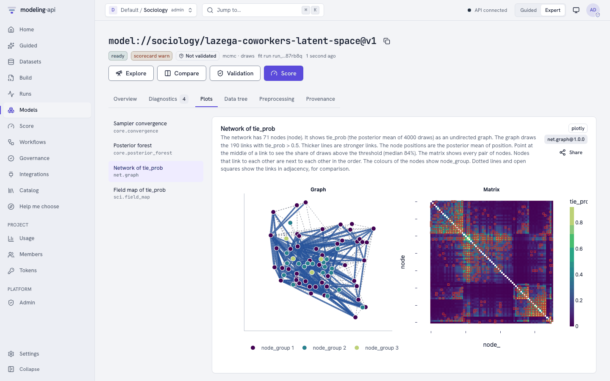

# E21 law-firm network latent space

This tutorial does the work of the pymc-challenges notebook `E21_network_models.py` in the web
app. You use the model `sci.network_latent_space@1`. You do not write PyMC code.

**You need:**

- The platform (start it with `make dev`) and a project that you can upload datasets to. This
  tutorial uses the project `sociology`. If your project has a different name, change the
  project part of each `dataset://` and `model://` reference, and `metadata.project` in the
  spec.
- A local copy of pymc-challenges. The export command reads two files from its `data/`
  directory.
- About 20 minutes. Each fit takes less than one minute of sampler time.

## 1. The question

From 1988 to 1991, the sociologist Emmanuel Lazega studied a corporate law firm in New England.
The firm had 71 lawyers (36 partners and 35 associates) in three offices: Boston, Hartford and
Providence. Each lawyer marked the colleagues that they worked with in the last year. The
network has a tie between two lawyers when they worked together. It has 378 ties in 2,485
pairs.

A pair of lawyers is a **dyad**. A logistic regression with one row for each dyad treats the
2,485 dyads as independent. They are not independent: each lawyer is in 70 dyads. A busy partner
increases the tie probability of all 70 pairs. Two coworkers of one lawyer also work together
much more often than two random lawyers.

The notebook asks these questions:

1. **Do shared traits explain the ties?** Same office, same practice, same status, same gender,
   same law school and the gap in years with the firm. (Notebook section 2, models a0 and a.)
2. **What does a regression of independent dyads get wrong?** (Section 2, model b with a
   sociality effect for each lawyer.)
3. **Who works with whom, after the traits?** A latent space gives each lawyer a position on a
   hidden map. (Section 3, model c, and the Procrustes alignment.)
4. **Does the model make networks like the real one?** (Section 5, the posterior predictive
   checks of the whole graph.)
5. **Which model predicts the ties best?** (Section 6, leave-one-dyad-out LOO.)

The notebook ends with this decision. Most of the network comes from homophily on office and
practice and from the different activity of each lawyer (sociality). The latent space adds
almost nothing to the prediction when the model has the traits and the sociality. Use the
sociality model to measure the effects of the traits. Use the latent space to find structure
that the traits do not show, and as a check that nothing large is missing.

**What you will get**, and the notebook section that each item replaces:

| In the web app | Notebook |
|---|---|
| The effect of each shared trait, `sigma_s` and `sigma_z` (**Parameters**, `core.posterior_forest`) | Section 2, the table of the homophily effects, and section 3 |
| The tie probability of each pair, with mean, sd and draws (**Fields**, `sci.field_map`) | Section 3, the tie probabilities of model c |
| The network on the latent map, coloured by office, with the observed ties (`net.graph`) | Section 3, the latent map |
| Convergence on the aligned positions (**Diagnostics**, `core.convergence`) | Section 3, the r_hat before and after Procrustes |
| `elpd_loo` of each kind (**Metrics**, and the recipe `sci_network_ladder`) | Section 6, the LOO table |
| Simulated networks and their statistics (**Score**, mode Simulate, `graph_stat`) | Section 5, the table of the graph statistics |

See [Differences from the notebook](#10-differences-from-the-notebook) for the parts that the
port leaves out. The block models of section 4 are one of them.

## 2. Get the data

The export command reads `lazega_cowork.txt` (the 71 × 71 table of ties) and
`lazega_attributes.txt` (the traits of each lawyer). It makes the six pair covariates of the
notebook. Run the command from the root of the modeling-api repository:

```bash
uv run python -m mapi_plugin_science.export e21 \
    --challenges <path to pymc-challenges>/data \
    --out lazega_coworkers.nc --spec lazega_coworkers.yaml
```

The command writes:

```text
wrote lazega_coworkers.nc (variables cowork, homophily, office on lawyer=71, lawyer_=71, covariate=6)
upload it as dataset sociology/lazega_coworkers and fit sci.network_latent_space
wrote the suggested spec to lazega_coworkers.yaml
```

The file holds one dataset:

| Name | Dims | Type | Meaning |
|---|---|---|---|
| `lawyer` | 71 | integer, policy `fixed` | The lawyers, 1 to 71. Lawyers 1 to 36 are partners |
| `lawyer_` | 71 | integer, policy `fixed` | The second lawyer of a pair, with the same labels |
| `covariate` | 6 | categorical, policy `fixed` | `same_office`, `same_practice`, `same_status`, `same_gender`, `same_school`, `years_gap` |
| `cowork` | `lawyer, lawyer_` | float64, target, missing values allowed | 1 when the two lawyers worked together, else 0. The table is symmetric, and the diagonal is 0 |
| `homophily` | `lawyer, lawyer_, covariate` | float64, covariate | 1 when the two lawyers share the trait, else 0. `years_gap` is the gap in years with the firm ÷ 10 |
| `office` | `lawyer` | int64, constant | The office: 1 Boston (48 lawyers), 2 Hartford (19), 3 Providence (4) |

The dataset has no missing ties. The degree (the number of coworkers) of a lawyer is from 0 to
28. Lawyer 8 has no tie. The attribute `mapi_schema` gives each variable its role, so you do not
map columns.

!!! tip "No pymc-challenges copy?"
    `--synthetic` writes a network that the model's own process simulates: 30 nodes in three
    offices, with three covariates (`same_office`, `same_practice` and `years_gap`) and known
    parameters. Use it to try the steps. The numbers in this tutorial are for the law firm.

    ```bash
    uv run python -m mapi_plugin_science.export e21 --synthetic --out coworkers_synthetic.nc
    ```

## 3. Upload the dataset

1. Open **Datasets** in the sidebar.
2. Click **New dataset**.
3. Type `lazega_coworkers` in **Name**. Type a description, for example "Coworker ties of the
   71 lawyers of the Lazega law firm".
4. Click **Create dataset**. The upload panel opens.
5. Click **Choose files** and select `lazega_coworkers.nc`.
6. Make sure that the format is **netCDF (or HDF5 written by xarray)**.
7. Optional: click **Preview structure**. The panel shows **Structure of the file**. Make sure
   that it shows `cowork` on `lawyer` and `lawyer_`, `homophily` on three dims, and `office` on
   `lawyer`.
8. Optional: type a message in **Version message (optional)**.
9. Click **Upload and ingest**.

The ingest run reads the file in the sandbox. When it is done, the version page shows the tabs
Schema, Coordinates, Missingness, Preview and About. On **Schema**, `cowork` has the role
`target`, `homophily` has the role `covariate` and `office` has the role `constant`.

The file is one plain dataset. You do not need the tree fields ("Put this file in a node of a
tree (optional)") or the HDF5 path.

## 4. Build the spec

1. Open **Build** and click **New spec**. The editor opens with the geo MMM template.
2. Set the **Editor view** to **YAML**.
3. Open the **Insert** panel on the right.
4. Open the **Datasets** section and select `lazega_coworkers`. The toast "Dataset set" shows.
5. Type `network` in the search field. Under **Models**, select **Who works with whom in a
   network** (`sci.network_latent_space@^1`). The toast "Model set" shows.
6. Select all the text in the editor and paste the full spec below. The template has other
   blocks (a pipeline, a split and the MMM plots), so the spec must replace all of it.
7. Click **Validate**. The status shows `valid`.
8. Click **Save spec**. The spec gets its name `lazega-coworkers-latent-space` from `metadata.name`.

This is the full spec:

```yaml
apiVersion: mapi/v1
kind: ModelSpec
metadata: {name: lazega-coworkers-latent-space, project: sociology}
data:
  dataset: dataset://sociology/lazega_coworkers@latest
  bind:
    dims: {node: lawyer, node_: lawyer_, cov: covariate}
    vars: {tie: cowork, dyad_cov: homophily, node_group: office}
model:
  use: sci.network_latent_space@^1
  settings: {kind: latent_space, covariates: true, node_groups: true, latent_dims: 2}
  fit: {mode: train_only, seed: 1991, tune: 2000, draws: 1000, chains: 4,
        target_accept: 0.95, engine: nutpie}
evaluate: {metrics: [elpd_loo]}
outputs:
  plots: [core.convergence, core.posterior_forest, net.graph, sci.field_map]
```

The model calls the nodes `node` and `node_`, the covariate dim `cov`, the target `tie`, the
pair covariates `dyad_cov` and the group code `node_group`. The `bind` block connects them to
the names in the dataset.

The spec has no split. The fit uses all 2,485 dyads, as the notebook does in sections 2 to 5.
`elpd_loo` is leave-one-dyad-out: the model keeps the log-likelihood of each dyad. The
suggested spec of the export (`lazega_coworkers.yaml`) is the same spec with `tune: 1000` and
without `target_accept`.

The settings for this question:

| Setting | Value | What it means here |
|---|---|---|
| `kind` | `latent_space` | The log odds of a tie add the pair covariates, a sociality effect for each lawyer (`s_i + s_j`) and minus the distance between the two positions on the hidden map. This is model c of the notebook. `sociality` is model b, and `covariates` is model a |
| `covariates` | true | Use the six shared traits in `homophily`. With `false`, the model has no traits. `kind: covariates` with `covariates: false` is the Erdős-Rényi graph (model a0). `kind: latent_space` with `covariates: false` is model c0 |
| `node_groups` | true | The dataset has `office`. The plots colour the lawyers by office |
| `latent_dims` | 2 (default) | The dimensions of the hidden map. The notebook uses 2 |
| `alpha_mu`, `alpha_sigma` | -2, 2 (default) | The normal prior of the intercept. It puts the density between about 1% and 50% |
| `beta_sigma` | 1 (default) | The prior sd of each trait effect. A shared trait can multiply the odds by up to about 7, or divide them by 7 |
| `sociality_scale` | 1 (default) | The half-normal scale of `sigma_s`, the sd of the sociality effects |
| `latent_scale` | 2 (default) | The half-normal scale of `sigma_z`, the spread of the positions on the map |
| `procrustes_iters` | 10 (default) | The passes of the Procrustes alignment after the fit |

The fit block uses `tune: 2000` and `target_accept: 0.95`. The scale `sigma_z` of the hidden map
mixes slowly when the model has the covariates. The notebook also reports this. More warm-up
steps and smaller steps make the fit more stable. They do not remove the problem.

!!! note "Why the positions converge"
    The distances do not change when the map turns, flips or moves. Thus the raw positions
    `z_raw` of the sampler do not converge, but each distance converges. After the fit, the
    model turns each draw onto one reference map (Procrustes analysis). The posterior keeps
    only the aligned `position`. The convergence check then uses only quantities that the data
    identify.

## 5. Fit and watch the run

1. Click **Fit**. The app opens the run page.
2. The badge shows **Live** while the run sends events.
3. The **Progress** card shows the progress of the sampler. The **Events** card shows the
   stages of the run and, at the end, the diagnostics. The **Logs** card stays empty when
   the model writes no output.
4. When the run is done, the **Result** card shows **Inspect
   model://sociology/lazega-coworkers-latent-space@v1**. Click it.

In our test, the fit took about 40 s with nutpie. After the fit, the run aligns the
positions, calculates the tie probability of each pair for each draw, the plots and the
explorer views.

You can also find the run under **Runs**. Filter it with the kind `fit`.

## 6. Read the result

On the model version page, the tabs are **Overview**, **Diagnostics**, **Plots**, **Data
tree**, **Preprocessing** and **Provenance**. Click **Explore** to open the Model Explorer.

### 6.1 Can you trust the fit?

Open **Diagnostics** in the Model Explorer, or the plot **Sampler convergence** on the
**Plots** tab. In our fit, 3 of the 2,000 checked parameters do not pass: `sigma_z`, `alpha` and
one coordinate of one position. The largest R-hat is 1.015 (`sigma_z`), and the bulk ESS of
`sigma_z` is about 140. There are no divergent transitions. The trait effects have
R-hat below 1.003 and an ESS of more than 1,800.

This agrees with the notebook. `sigma_z` is wide and mixes slowly when the traits are in the
model, because what is left for the map is a weak signal. Trust the trait effects and the tie
probabilities. Do not report `sigma_z` to two digits.

!!! caution "Use more draws if the warning is larger"
    If R-hat of `sigma_z` is more than 1.05, set `draws: 2000` and fit again. The sampler is
    random, so a second fit can show a larger warning than ours. With `tune: 1000`, one of our
    fits had R-hat 1.08 and 4 divergent transitions.

### 6.2 Do shared traits explain the ties?

Open **Parameters** in the Model Explorer, or the plot **Posterior forest** on the **Plots**
tab. Each trait has one row `beta[<trait>]`. A positive value makes a tie more probable. In our
fit, the posterior means and the 94% HDIs are:

| Effect | Mean | 94% HDI |
|---|---|---|
| `beta[same_office]` | 2.55 | 2.22 to 2.89 |
| `beta[same_practice]` | 2.08 | 1.82 to 2.39 |
| `beta[same_status]` | -0.60 | -0.92 to -0.30 |
| `beta[same_gender]` | 0.39 | 0.10 to 0.73 |
| `beta[same_school]` | 0.33 | 0.08 to 0.58 |
| `beta[years_gap]` | 0.21 | -0.01 to 0.42 |
| `sigma_s` | 0.90 | |
| `sigma_z` | 0.92 | |

Read the table as the notebook does:

- Two lawyers in the same office have about e^2.5 ≈ 13 times the odds of a tie. The
  same practice multiplies the odds by about 8.
- Two partners, or two associates, work together *less* often than a partner and an associate.
  The firm works in teams of partners and associates.
- `sigma_s` ≈ 0.9: a lawyer one sd above the average has about e^0.9 ≈ 2.5 times the
  odds of a tie with anyone.

The rows `sociality[<lawyer>]` give the activity of each lawyer after the traits. In our fit,
lawyer 15 has the highest sociality (2.1) and lawyer 8, who has no tie, has the lowest (-1.9).
Lawyer 22 has the most ties (28), but a lower sociality (1.3), because the traits explain part
of these ties.

### 6.3 The tie probability of each pair

Open **Fields** in the Model Explorer. The model has 1 output on a grid: `tie_prob`, the
probability of a tie between two lawyers. The rows are `lawyer` and the columns are `lawyer_`.
The diagonal is 0.

1. Select **Mean** in **Statistic**. A bright cell is a pair that probably works together.
2. Select **Std. dev.** to see where you are not sure of the probability.
3. Select **Draws** and click **Play the draws** to see possible tables that agree with the
   data.
4. Move the pointer over a cell to read its values. For example, the pair of lawyers 15 and 28
   has a mean of about 0.66, and the pair of lawyers 1 and 8 has 0.02.

The lawyers are in the order of their numbers, so partners (1 to 36) are at the top and the
left. Blocks of bright cells show the offices and the practices. The plot **Field map of
tie_prob** on the **Plots** tab shows the same output as two panels (mean and sd).

### 6.4 The latent map

Open the plot **Network of tie_prob** (`net.graph`) on the **Plots** tab.

{ .mapi-shot }

- The node positions are the posterior mean of `position`, the aligned map.
- The colour of a node is its office.
- A solid line is a pair with a mean `tie_prob` above 0.5. In our fit, 190 pairs pass. Thicker
  lines are more probable ties. Point at the middle of a line to see the share of the draws
  above 0.5.
- Dotted lines show the observed ties (378), for comparison.
- The matrix panel shows each pair. Lawyers that link to each other are next to each other.

In this model, the map shows only what the traits do not explain. Thus the offices and the
practices are mixed on the map: the centres of the six groups (office × practice) are all
within 0.4 of the middle. The direction of the map has no meaning: it is the direction of the
Procrustes reference.

To see what the map finds without the traits (notebook model c0), fit the spec again with
`covariates: false`. Then the plot shows these features, as in the notebook:

- The four groups of Boston and Hartford (litigation and corporate in each office) are in four
  different areas of the map.
- The 3 Providence corporate lawyers are near the Boston corporate lawyers.
- `sigma_z` is about 2.3, not 0.9.

The model c0 was told nothing about the offices, but it finds them. Most of what the map finds
alone *is* office and practice.

### 6.5 What a regression of independent dyads gets wrong

Fit the spec two more times to get models a and b of the notebook:

1. In **Build**, open the spec `lazega-coworkers-latent-space`.
2. Change `kind: latent_space` to `kind: sociality`.
3. Click **Validate**, then **Save revision**, then **Fit**.
4. Do steps 2 and 3 again with `kind: covariates`.

Each fit makes a new version of the model. Compare the trait effects in **Parameters**:

| Effect | `covariates` (model a) | `sociality` (model b) |
|---|---|---|
| `beta[same_office]` | 1.61 (89%: 1.39 to 1.84) | 2.44 (89%: 2.14 to 2.74) |
| `beta[same_practice]` | 1.59 (89%: 1.38 to 1.81) | 2.01 (89%: 1.76 to 2.26) |
| `beta[same_status]` | -0.50 | -0.54 |

The intervals of the office effect do not overlap. Model a is wrong with confidence, in two
ways:

- **Attenuation.** A logistic model without the sociality effects moves the effects toward
  zero. The busy partners, who work with everyone, make the contrast between the offices
  smaller.
- **Pseudo-replication.** Model a thinks that it has 2,485 independent observations. Its
  intervals are too narrow.

### 6.6 Which model predicts the ties best?

The **Metrics** card of the **Overview** tab shows `elpd_loo` of each version. A larger value
is better. The recipe of step 8 makes the same comparison in one run.

| Model | Notebook | This port |
|---|---|---|
| a0, Erdős-Rényi (`kind: covariates`, `covariates: false`) | -1060.5 | -1060.5 |
| a, covariates (`kind: covariates`) | -894.2 | -894.3 |
| b, sociality (`kind: sociality`) | -763.4 | -763.7 |
| c0, latent space without covariates (`kind: latent_space`, `covariates: false`) | -795.7 | -796.2 |
| c, latent space (`kind: latent_space`) | -761.6 | -761.0 |

The fit of c0 shows the warning `PARETO_K_HIGH`: for 7 dyads, the LOO estimate is not
reliable. The notebook also finds such dyads for c0.

The difference between c and b is about 2.7, and its standard error is about
2.6. (We calculated the standard error with ArviZ `az.compare` on the two fits. The web app
does not show it.) A difference of about one standard error is not a real difference: the two
models are equal. Both models are far better than model a, which has no sociality.

### 6.7 The numbers of the notebook and of this port

| Quantity (model c) | Notebook | This port |
|---|---|---|
| `beta[same_office]` | 2.54 | 2.55 |
| `beta[same_practice]` | 2.08 | 2.08 |
| `beta[same_status]` | -0.59 | -0.60 |
| `beta[same_gender]` | 0.38 | 0.39 |
| `beta[same_school]` | 0.33 | 0.33 |
| `beta[years_gap]` | 0.21 | 0.21 |
| `sigma_s` | 0.90 | 0.90 |
| `sigma_z` | 0.88 | 0.92 (sd 0.29) |
| `elpd_loo` | -761.6 | -761.0 |

Your numbers can be slightly different if the sampler or its version is different. `sigma_z`
changes most from one fit to the next.

### 6.8 Make the decision

Use these outputs to make the decisions of the notebook:

1. **Do not use a regression of independent dyads.** Compare the trait effects of `covariates`
   and `sociality` (section 6.5). If they are different, the sociality is necessary.
2. **Choose the model for the trait effects.** Compare `elpd_loo` (section 6.6). If the latent
   space is better by less than two standard errors, use the simpler `sociality` model to
   report the effects. For the law firm, the two models give the same effects to two digits.
3. **Use the latent space to find structure.** Fit `latent_space` with `covariates: false`
   and look at the map in **Network of tie_prob**. If the map shows groups that you know (the
   offices, the practices), the traits that you have capture the structure. A group that no
   trait explains is a reason to look for a new trait.
4. **Do a check of the whole graph.** Simulate networks (step 7.2) and compare their statistics
   with the real network. A statistic far outside the simulations shows what the model does
   not make.

## 7. Score the model

A score needs a dataset with the dims `lawyer` and `lawyer_`, and `homophily` for each pair.
Send the dataset that you fitted. The node set is fixed: a lawyer that the fit did not see
stops the score with `UNSEEN_LEVELS`.

### 7.1 Predict: the tie probabilities and the degrees

1. On the model version page of `lazega-coworkers-latent-space`, click **Score**.
2. In **What do you want to do?**, select **Predict**.
3. In **Values to score**, select **Use a dataset**. Select `lazega_coworkers`.
4. Open **Advanced**. Set **Seed (optional)** to `21`. Type `tie_prob, degree, sociality` in
   **Variables (optional)**.
5. Click **Predict**.

The request that the page sends (`POST /v1/models/{model_id}/versions/{v}:score`) is:

```json
{
  "apiVersion": "mapi/v1",
  "kind": "ScoreRequest",
  "model": "model://sociology/lazega-coworkers-latent-space@latest",
  "mode": "predict",
  "data": "dataset://sociology/lazega_coworkers@latest",
  "output": {
    "kind": "expected",
    "summary": ["mean", "hdi_90"],
    "vars": ["tie_prob", "degree", "sociality"]
  },
  "seed": 21
}
```

The result has `tie_prob(lawyer, lawyer_)`, `degree(lawyer)` (the expected number of coworkers)
and `sociality(lawyer)`. In our fit, half of the sum of the expected degrees is 378.5. The
network has 378 ties. Lawyer 22 has the largest expected degree (26.3).

To score a part of the firm, send a dataset with fewer lawyers. `degree` then counts only the
ties inside that part.

### 7.2 Simulate: networks for a check of the whole graph

1. In **What do you want to do?**, select **Simulate**.
2. In **Values to score**, select **Use a dataset**. Select `lazega_coworkers`.
3. Open **Advanced**. Set **Quantity** to **Predictive**. Set **Draws** to `500`.
4. Type `graph_stat, degree` in **Variables (optional)**.
5. Click **Simulate**.

```json
{
  "apiVersion": "mapi/v1",
  "kind": "ScoreRequest",
  "model": "model://sociology/lazega-coworkers-latent-space@latest",
  "mode": "simulate",
  "data": "dataset://sociology/lazega_coworkers@latest",
  "output": {
    "kind": "predictive",
    "summary": ["mean", "hdi_90"],
    "draws": 500,
    "vars": ["graph_stat", "degree"]
  },
  "seed": 21
}
```

Each draw is one simulated network of the 71 lawyers. `graph_stat(statistic)` gives nine
statistics of each network. Compare them with the real network:

| Statistic | Real network | Simulated, mean | Simulated, 90% HDI |
|---|---|---|---|
| `density` | 0.152 | 0.152 | 0.138 to 0.165 |
| `sd_degree` | 5.74 | 5.93 | 5.25 to 6.66 |
| `max_degree` | 28 | 29.4 | 24 to 34 |
| `isolates` | 1 | 0.32 | 0 to 1 |
| `triangles` | 493 | 485 | 364 to 608 |
| `transitivity` | 0.307 | 0.294 | 0.261 to 0.325 |
| `esp0` | 12 | 23.5 | 12 to 33 |
| `mean_geodesic` | 2.10 | 2.11 | 2.04 to 2.19 |
| `unreachable` | 0.028 | 0.009 | 0 to 0.028 |

The web app does not calculate the statistics of the real network. The values in the second
column are from the notebook's functions.

- The model makes the spread of the degrees and the transitivity of the real network.
- `esp0` is the number of ties whose two lawyers have no coworker in common. The real network
  has 12. In our simulations, 97% of the networks have 12 or more. As in the notebook, the
  real collaboration is more *closed* than the model makes.
- The real network has one isolate (lawyer 8). The simulations have fewer.

!!! caution "Send all the lawyers for graph_stat"
    Send a dataset with all 71 lawyers in `lawyer` and `lawyer_`, and use **Simulate** or
    **Predictive**. Otherwise the score stops with `CAPABILITY_UNSUPPORTED`. A statistic of the
    whole graph needs the whole graph.

If you promote the version to an endpoint, **Integrations** → the endpoint → **Schema and Try
it** sends the same requests.

## 8. Run a workflow recipe

### 8.1 The network ladder

The recipe `sci_network_ladder` ("Network ties: which model?") does sections 2, 3, 5 and 6 of
the notebook in one run:

1. It fits the three kinds `covariates`, `sociality` and `latent_space` on the same dyads.
2. It ranks them by `elpd_loo` (node `compare`) and calculates their stacking weights (node
   `weights`).
3. It keeps the model with the best `elpd_loo` (node `best`).
4. It shows `alpha` and the trait effects of that model (node `effects`).
5. It draws the network with `net.graph` (node `graph`).
6. It simulates networks from that model (node `simulate`) and plots the spread of their
   density and transitivity with `core.ridge` (node `ppc`).
7. It writes a report.

The defaults of the recipe fit the dataset of the e21 export. You do not change the binding.

1. Set the header to **Guided** and open **Recipes**. In **Expert** mode, open **Workflows**
   and the **Templates** tab.
2. Find the card **Network ties: which model?** and click **Run on my data**.
3. In **1. Your data**, select `lazega_coworkers` in **Dataset**.
4. Open **Fine-tune (optional: the defaults are correct for most data)**. Set **Engine** to
   `nutpie`. Set **Tune** to `2000` and **Target accept** to `0.95`, as in step 4.
5. Click **Run this recipe**.

The monitor of the run has the tabs **Graph**, **Steps**, **Decisions**, **Outputs** and
**Events**. **Outputs** has the comparison table, the stacking weights, the effects, the network
plot, the plot of the simulated statistics and the report.

What to look for:

- The comparison table ranks `latent_space` first, `sociality` second and `covariates` last.
- The stacking weights put most of the weight on `latent_space`. In our fits with ArviZ, the
  weights are about 0.91, 0.08 and 0.01.
- `best` selects `latent_space`, because it has the largest `elpd_loo`.

!!! caution "The best rung is not always the model to report"
    `select.best` uses only the value of `elpd_loo`. It does not use the standard error of the
    difference. For the law firm, the difference between `latent_space` and `sociality` is
    about one standard error (section 6.6). Read the table before you report the
    effects of `best`. The notebook reports the sociality model.

!!! note
    The recipe fits the model three times and simulates 500 networks. With nutpie, the run takes
    a few minutes. With the default engine `pymc`, it takes longer.

### 8.2 Other recipes

- `bayes_workflow_audit` ("Bayesian workflow audit") does the checks of a Bayesian workflow on
  one model. In **2. What the recipe needs to know**, type `sci.network_latent_space@^1` in
  **Model**. In **Fine-tune**, type `{"kind": "sociality", "node_groups": true}` in
  **Settings** and the `bind` of step 4 as JSON in **Bind**. The recovery check simulates each
  graph from the posterior predictive of the model, so each tie is 0 or 1. It fits the model
  many times, so it takes longer.
- `sci_spatial_ladder`, `sci_phylo_signal`, `sci_calibrate_then_design` and
  `sci_image_model_check` are for other science models. They do not apply to this model.

## 9. The same with the CLI and the Python client

=== "CLI"

    ```bash
    mapi use <tenant>/sociology
    mapi datasets upload lazega_coworkers.nc --name lazega_coworkers
    mapi check lazega-coworkers-latent-space.yaml --remote @   # the server's static validation
    mapi fit lazega-coworkers-latent-space.yaml --remote @     # create or revise the spec, fit, follow
    mapi explore model lazega-coworkers-latent-space -s params -s diagnostics

    cat > simulate-networks.yaml <<'EOF'
    apiVersion: mapi/v1
    kind: ScoreRequest
    model: model://sociology/lazega-coworkers-latent-space@latest
    mode: simulate
    data: dataset://sociology/lazega_coworkers@latest
    output: {kind: predictive, summary: [mean, hdi_90], draws: 500, vars: [graph_stat, degree]}
    seed: 21
    EOF
    mapi score simulate-networks.yaml --remote @ --model <model id> --version 1 \
      -o simulate-networks.zarr.zip

    mapi workflows init sci_network_ladder --name coworker-ladder   # writes coworker-ladder.yaml
    mapi workflows apply coworker-ladder.yaml
    mapi workflows run coworker-ladder \
      -i data=dataset://sociology/lazega_coworkers@latest \
      -p engine=nutpie -p tune=2000 -p target_accept=0.95 --watch
    RUN=$(mapi --json workflows runs coworker-ladder -n 1 | jq -r '.[0].run_id')
    mapi workflows node "$RUN" compare    # the kinds, best first
    mapi workflows node "$RUN" effects    # alpha and beta[...] of the best kind
    mapi workflows output "$RUN" simulate scores --out graph_stats.zarr.zip
    ```

    `lazega-coworkers-latent-space.yaml` is the spec of step 4. The CLI has no `models`
    command. Take the model id from the run (`mapi runs get <run>`) or from **Models** in the
    web app.

=== "Python"

    ```python
    from mapi_client import Client

    api = Client(project="<tenant>/sociology")
    version = api.datasets.upload("lazega_coworkers.nc", dataset="lazega_coworkers")
    print(version.ref, version.status.value)

    with open("lazega-coworkers-latent-space.yaml", encoding="utf-8") as fh:
        spec_yaml = fh.read()
    check = api.specs.validate(spec_yaml)
    print("valid" if check.valid else [(i.code, i.pointer) for i in check.issues])
    revision = api.specs.upsert(spec_yaml)
    run = api.runs.fit(revision.spec_id, revision.revision)
    run = api.runs.wait(run.id, raise_on_failure=True)

    model = next(m for m in api.models.list() if m.name == "lazega-coworkers-latent-space")
    result = api.models.score(
        model.id,
        model.latest_version,
        {
            "model": "model://sociology/lazega-coworkers-latent-space@latest",
            "mode": "simulate",
            "data": "dataset://sociology/lazega_coworkers@latest",
            "output": {
                "kind": "predictive",
                "summary": ["mean", "hdi_90"],
                "draws": 500,
                "vars": ["graph_stat"],
            },
            "seed": 21,
        },
    )
    summary = result.tree["summary"]  # an xr.DataTree (needs the `xarray` extra)
    print(summary["graph_stat"].sel(stat="mean").to_series())

    workflow = api.workflows.create(template="sci_network_ladder")
    ladder = api.workflows.run(
        workflow.id,
        inputs={"data": "dataset://sociology/lazega_coworkers@latest"},
        params={"engine": "nutpie", "tune": 2000, "target_accept": 0.95},
        wait=True,
    )
    nodes = {n.node_id: n for n in ladder.nodes}
    print(nodes["best"].result["reason_plain"])
    print(nodes["effects"].result["params"]["beta[same_office]"])
    ```

## 10. Differences from the notebook

The port keeps the models a0, a, b, c and c0 of sections 2 and 3 and the Procrustes alignment.
It also keeps the latent map, the graph checks of section 5 and the leave-one-dyad-out LOO of
section 6. It leaves out these parts:

- **The block models (section 4).** The port has no stochastic block model and no
  mixed-membership block model. Thus it does not give the probability that two lawyers are in
  the same block.
- **The held-out split with AUC (section 6).** The port has no AUC metric and no ROC curve. A
  `mask_block` split over `[node, node_]` holds out random cells, and a dyad is out of the fit
  when one of its two cells is out. The metrics of such a split count the diagonal cells, so
  use `elpd_loo` to compare the kinds.
- **The figures of the raw positions (section 3).** The port aligns the positions after each
  fit. It does not show the turn of the map within a chain, or the r_hat of the raw positions.
- **The details of the latent map.** `net.graph` shows the mean positions coloured by office.
  It does not draw a 50% ellipse for each lawyer or a marker for the practice. Calculate them
  from the draws of `position`.
- **The full histograms (section 5).** `graph_stat` gives `esp0` and `mean_geodesic`, not the
  full distributions of the shared partners and of the geodesics.
- **The statistics of the real network.** The web app does not calculate them. Use
  `graph_stats` from `mapi_plugin_science.network` on `cowork` in Python.
- **Directed ties ("Try it yourself", friendship).** The model accepts only a symmetric table.

**Next steps:**

- Fit `latent_space` with `covariates: false` and compare its map with the offices and the
  practices.
- Fit `latent_dims: 3` and compare `elpd_loo`.
- Read the [workflow cookbook](../../guides/workflow-cookbook.md) to change the network ladder.
- Read the [model reference](../../reference/models.md) for the other science models.
