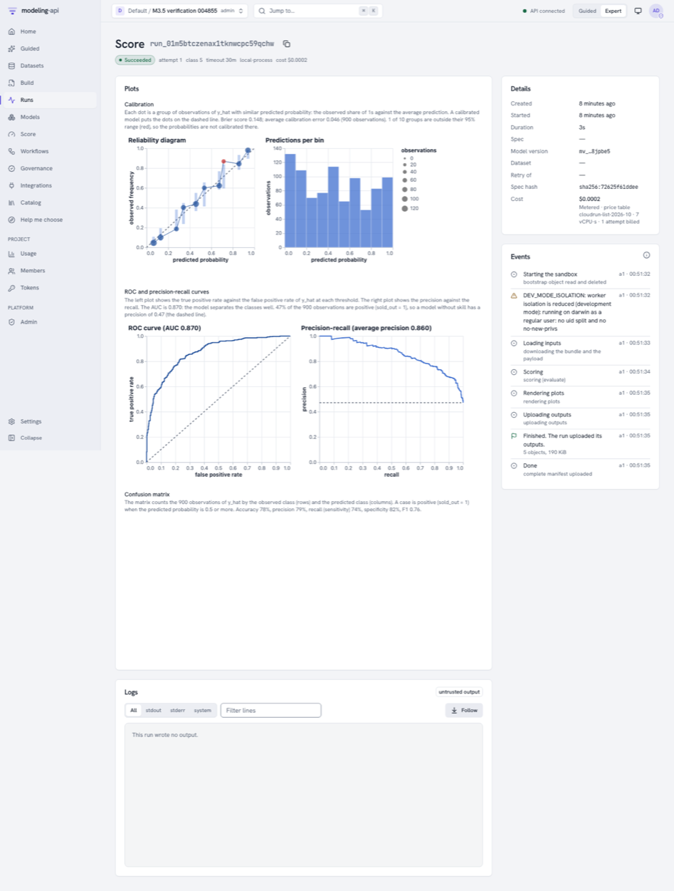
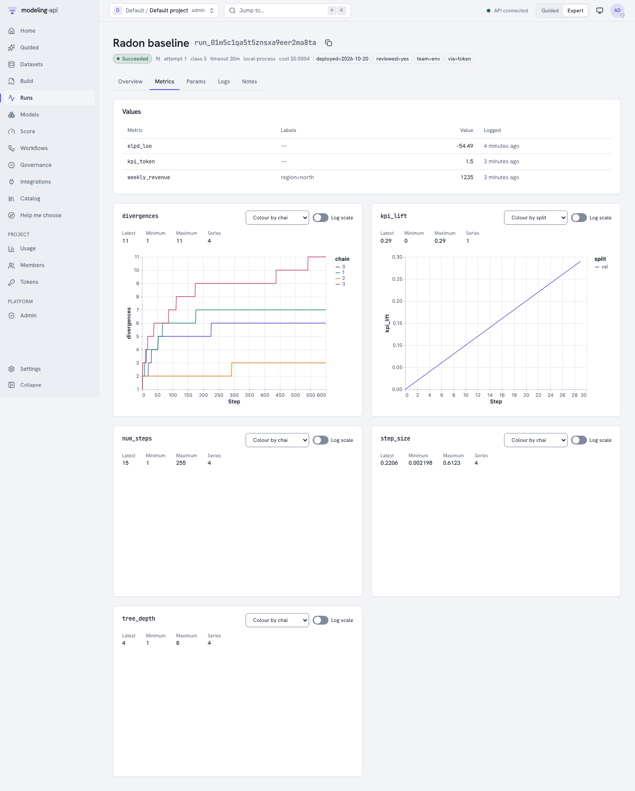
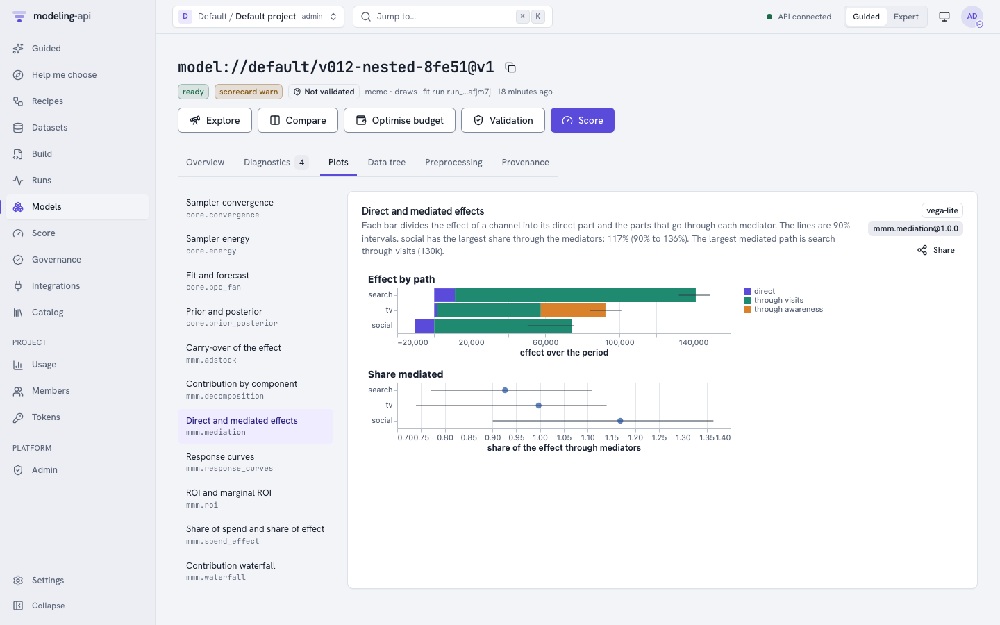
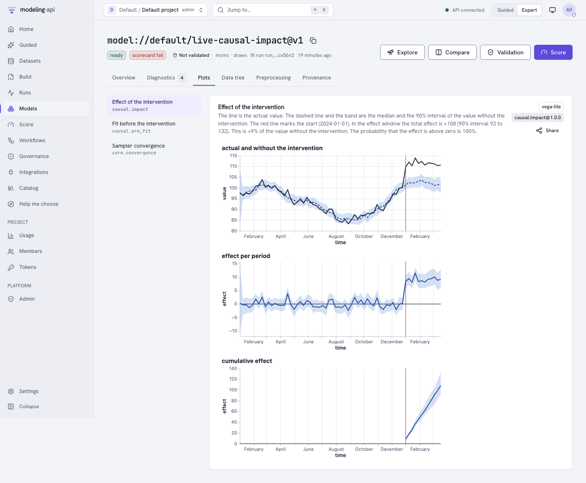
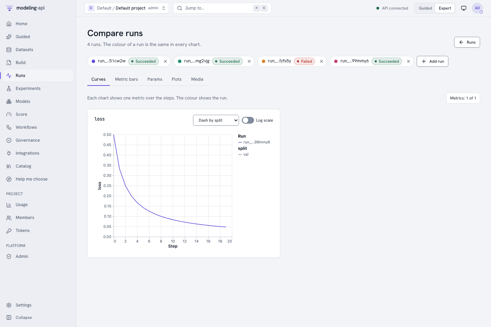
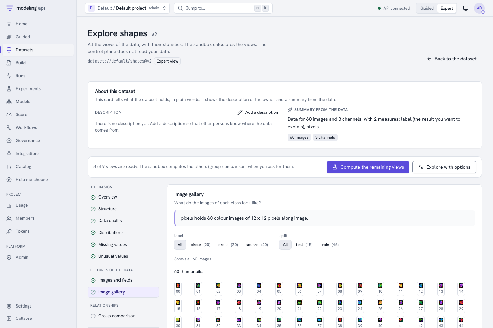
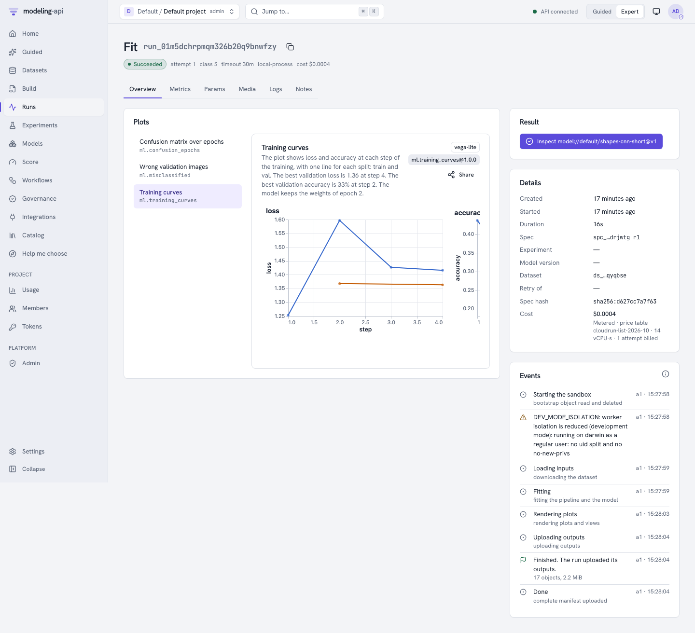
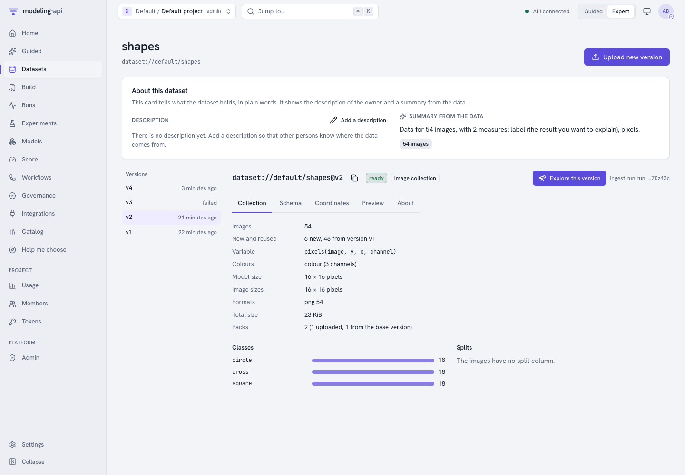

# What's new in 0.10 to 0.15 <span class="mapi-badge">v0.15</span>

**Six releases make the platform a place to train, track and compare models.** Each run now
keeps a log of its metrics, params, tags and images. You can search, compare and group runs.
The marketing-mix models get two new models and the charts that a marketing team asks for.
Three causal models measure the effect of a campaign, a launch or a test. You can upload
images, classify them, and train neural networks, also on a GPU.

This page covers the releases v0.10.0 to v0.15.0. The page
[What's new in 0.9](whats-new-0.9.md) covers the science gallery.

<div class="grid cards" markdown>

-   :material-chart-scatter-plot:{ .lg .middle } **Plots that follow the data** <span class="mapi-badge">v0.10</span>

    ---

    A score run draws each output by its shape: a map for a grid, a fan for a time series.
    Classifiers get ROC, precision-recall and confusion plots, and the metrics `auc` and
    `mase` are now calculated.

    [:octicons-arrow-right-24: Score results by output](#v010-plots-that-follow-the-data)

-   :material-chart-line:{ .lg .middle } **Run tracking** <span class="mapi-badge">v0.11</span>

    ---

    Model code, workflow nodes and you can log metrics, params, tags, notes and log lines
    to a run. The run page shows live curves and a lane for each chain.

    [:octicons-arrow-right-24: Track metrics, params and tags](guides/tracking.md)

-   :material-bullhorn-outline:{ .lg .middle } **The MMM pack** <span class="mapi-badge">v0.12</span>

    ---

    `mmm.nested` and `mmm.multivariate`, channel effects that change over time, counts and
    shares as the result, and ten new plot recipes, for example ROI with mROAS.

    [:octicons-arrow-right-24: Marketing-mix models](models/mmm-framework.md)

-   :material-scale-unbalanced:{ .lg .middle } **Causal models and BSTS** <span class="mapi-badge">v0.13</span>

    ---

    `causal.impact`, `causal.synthetic_control` and `causal.did` compare the actual values
    with the values without the change. `ts.bsts` forecasts from level, trend, seasons and
    drivers.

    [:octicons-arrow-right-24: Measure the effect of a change](guides/causal.md)

-   :material-compare-horizontal:{ .lg .middle } **Run comparison and images** <span class="mapi-badge">v0.14</span>

    ---

    Filter and sort runs by their metrics, save the search as a view and compare 2 to 10
    runs side by side. Runs can log images. A zip of small images becomes a dataset that you
    can classify.

    [:octicons-arrow-right-24: Compare runs and use experiments](guides/run-comparison.md)

-   :material-brain:{ .lg .middle } **Deep learning** <span class="mapi-badge">v0.15</span>

    ---

    `mapi-jax` trains networks for tables and images on JAX and Flax. Image collections hold
    up to 1 000 000 images. The resource class `GPU` gives a run one NVIDIA L4.

    [:octicons-arrow-right-24: Deep learning](guides/deep-learning.md)

</div>

The catalog now has 50 models, 29 steps, 57 plot recipes, 57 workflow nodes, eleven
workflow recipes and eight Guided templates.

## v0.10: plots that follow the data { #v010-plots-that-follow-the-data }

**A score run now draws each output by its shape.** A gridded output, for example the
intensity of `sci.lgcp_grid`, shows as a map with a slider over the periods of the forecast.
Before, it showed as a forecast fan of the sum over the grid.

| Output | Default score plot | View on the **Score** page |
|---|---|---|
| A grid (`grid` attr) | `sci.field_map`, or `sci.vector_field` when the output has a `component` of size 2 | A map with a frame slider |
| A time series that is not a grid | `core.ppc_fan` | A line with a band |
| Areas (an area dim with geometry) | `sci.area_map` | A map of areas |
| Probabilities over a `state` or `regime` dim | `core.state_sequence` | – |
| An evaluate run with a 0/1 target | `core.calibration`, `core.roc_pr`, `core.confusion` | A classification view |

A score run of a model with grid outputs also writes `ui/fields.json`, the same field view as
the Model Explorer. `job.plots` still replaces the defaults.

**More models get their standard plots and metrics.** Each model declares its standard plots,
and the **Insert** panel of the spec editor shows them first. A fit draws only the plots in
`outputs.plots`.

- Four new core recipes: `core.roc_pr`, `core.confusion`, `core.loss_curve` and
  `core.loo_pit`.
- New metrics: `auc`, and binary `brier`, `log_score` and `accuracy`. `mase` is calculated
  for a fit with a time holdout.
- An ADVI fit keeps its loss in the bundle group `fit_history`, and `core.loss_curve` draws it.
- `metrics.json` keeps the PSIS Pareto k of each observation.
- The run page has a **Plots** card. **Compare** in the Model Explorer has the card *Which
  version predicts new data best?*.

v0.10 also repairs a classifier fit that calculated no metric, and an evaluate run from the
**Score** page that drew no plots. See the [sklearn guide](guides/sklearn.md#default-plots-and-metrics).

<figure markdown>
{ .mapi-shot loading=lazy }
<figcaption>v0.10: an evaluate run of a classifier draws calibration, ROC and confusion plots.</figcaption>
</figure>

**The Data Explorer shows scientific data.** It finds the structure of the data: images,
profiles, maps, networks, trees, directions and points. Seven new picture sections show the
data, and the list shows only the sections that apply. See
[Scientific data](guides/data-explorer.md#scientific-data).

## v0.11: run tracking { #v011-run-tracking }

**Each run now keeps a log of what happened in it.** The log has metrics (curves and single
values), params, tags, a name, a note and structured log lines.

- **Model code** logs with `ctx.log_metric`, `log_metrics`, `log_param`, `set_tag` and
  `log_line`. The same methods are on the fit, score and workflow node contexts.
- **The platform** logs the params of each spec, the progress of each chain (nutpie, the PyMC
  NUTS sampler and `mmm.bayesian`), the step size and the divergences, and the ADVI loss.
- **`search.grid`** logs each grid point. **`model.backtest`** logs the metrics of each fold.
- **You** can log to a run from a notebook, a script or the command line, also after the run
  finished. For example, log a business KPI after a deployment.

Metric keys keep the pattern `^[a-z][a-z0-9_]{0,63}$`. Labels give the qualifiers, for
example `loss` with `{"split": "val"}`.

```bash
mapi runs log-metric <run_id> revenue_lift 0.042 --label region=north
mapi runs ls --filter 'metric.rmse < 0.5' --order-by -metric.rmse --column metric.rmse
```

The run page has the tabs **Overview**, **Metrics**, **Params**, **Logs** and **Notes**. An
operator can set `MAPI_TRACKING_RETENTION_DAYS` to delete old metric points and log lines.

<figure markdown>
{ .mapi-shot loading=lazy }
<figcaption>v0.11: the Metrics tab shows each curve, coloured by a label.</figcaption>
</figure>

[:octicons-arrow-right-24: Track metrics, params and tags](guides/tracking.md)

## v0.12: the MMM pack { #v012-the-mmm-pack }

**The marketing-mix models get two new models and two new kinds of result.**

| Model | What it measures |
|---|---|
| `mmm.nested` | Effects that go through an intermediate measure, for example visits or awareness. Each channel has a direct and an indirect effect. |
| `mmm.multivariate` | Effects on two or more results at the same time, with halo or cannibalization effects between them |
| `mmm.bayesian` 1.1.0 | Channel effects that change over time (`time_varying.channels`), and the likelihoods `poisson`, `negative_binomial` and `beta` for counts and shares |

Ten new plot recipes: `mmm.roi` (ROI with mROAS), `mmm.adstock`, `mmm.waterfall`,
`mmm.spend_effect`, `mmm.lift_tests`, `mmm.effectiveness`, `mmm.mediation`,
`mmm.cross_effects`, `core.energy` and `core.prior_posterior`. Each MMM fit logs its ROI,
mROI and contribution share for each channel. Two new Guided templates use the new models:
*Marketing mix with an intermediate measure* and *Marketing mix for related products*.

<figure markdown>
{ .mapi-shot loading=lazy }
<figcaption>v0.12: `mmm.mediation` divides the effect of each channel into its paths.</figcaption>
</figure>

[:octicons-arrow-right-24: The nested model](models/mmm-framework.md#nested) ·
[The multivariate model](models/mmm-framework.md#multivariate) ·
[Effects that change over time](models/mmm-framework.md#time-varying-effects)

## v0.13: causal models and BSTS { #v013-causal-models-and-bsts }

**The platform can now measure the effect of a campaign, a launch or a test.** The new
package `mapi-plugin-causal` has three models. Each model compares the actual values with a
prediction of the values without the change, and writes the effect to the bundle group
`impact`.

| Model | Data | Method |
|---|---|---|
| `causal.impact` | One series, with optional control series | CausalImpact on the `ts.bsts` core |
| `causal.synthetic_control` | Test markets and other markets | A Bayesian synthetic control for geo-lift tests |
| `causal.did` | Units with and without a change | Difference-in-differences and event study |

The package `mapi-plugin-ts` has a new model, `ts.bsts`: a Bayesian structural time series
with level, trend, seasons and drivers, for one series. `causal.impact` uses it as its core.

- Four new plot recipes: `causal.impact`, `causal.pre_fit`, `causal.donor_weights` and
  `causal.event_study`.
- The workflow node `model.lift_test` makes a lift test for `mmm.bayesian` from a causal
  model. The workflow recipe `geo_lift_mmm` does a geo-lift test, makes the lift test and
  calibrates the MMM with it.
- Two new Guided templates: *Effect of a campaign* (`campaign_impact`) and *Geo-lift test*
  (`geo_lift`). *Help me choose* has the new goal "Measure the effect of a campaign, a launch
  or a test".

<figure markdown>
{ .mapi-shot loading=lazy }
<figcaption>v0.13: `causal.impact` shows the effect in each period and the cumulative effect.</figcaption>
</figure>

[:octicons-arrow-right-24: Measure the effect of a change](guides/causal.md) ·
[Causal models and BSTS](models/causal.md)

## v0.14: run comparison, media, image data and classification { #v014-run-comparison-media-and-image-data }

**You can now compare runs and group them.** The runs table shows metrics, params and tags as
columns. You can filter, sort and save the search as a view. The compare page shows 2 to 10
runs side by side: curves, metric bars, param differences, plots and images with a step
slider. An **experiment** is a named group of runs.

```bash
mapi experiments create lr-search --description "Learning rates for the shapes CNN"
mapi fit shapes.yaml --remote @ --experiment lr-search
mapi runs ls --experiment lr-search --column metric.accuracy
mapi runs compare <run_a> <run_b> --key loss --agg min
```

**A run can log images, figures and small tables** with `ctx.log_image`, `ctx.log_figure`
and `ctx.log_table`. The run page has a **Media** tab. `mapi runs log-image` adds an image from
the command line.

<figure markdown>
{ .mapi-shot loading=lazy }
<figcaption>v0.14: the compare page. The colour of a run is the same in each chart.</figcaption>
</figure>

**Image data, stage 1.** The upload format `image_folder` takes a zip of PNG, JPEG or TIFF
images and a manifest table. The ingest writes `pixels(image, y, x, channel)` and the target
`label(image)`. The Data Explorer has an image gallery with an even sample for each label and
split. The new split kinds `column` and `stratified` hold out a test set.

**The classification pack.**

- `sklearn.multiclass_classifier` gives the probability of each class.
- The estimators `sklearn.HistGradientBoostingClassifier`, `lightgbm.LGBMClassifier` and
  `catboost.CatBoostClassifier` (the extra `mapi-sklearn[gbm]`).
- `core.roc_pr` and `core.confusion` accept a multiclass target. The metric `auc` accepts
  multiclass predictions.
- `tabular.hierarchical_glm` 1.1.0 has six new families, for example `negative_binomial`,
  `beta` and `ordinal`.
- `tabular.image_logistic` is a Bayesian multinomial logistic regression on the main
  patterns of small images.

<figure markdown>
{ .mapi-shot loading=lazy }
<figcaption>v0.14: the image gallery, with filters for each label and split.</figcaption>
</figure>

[:octicons-arrow-right-24: Compare runs and use experiments](guides/run-comparison.md) ·
[Log images, figures and tables](guides/tracking.md#log-images-figures-and-tables) ·
[Image data](guides/image-data.md) ·
[Multiclass classification](guides/sklearn.md#multiclass)

## v0.15: deep learning and image collections { #v015-deep-learning-and-image-collections }

**You can now train neural networks on the platform.** The new package `mapi-jax`
(Apache-2.0) uses JAX, Flax and Optax.

| Item | What it does |
|---|---|
| `dl.mlp` | A network for tables |
| `dl.cnn_classifier` | An image classifier (a small ResNet) |
| `dl.finetune_classifier` | An image classifier that starts from pretrained weights |
| `dl.embed` (a step) | Image features from a frozen pretrained network, for example for `tabular.image_logistic` |

The trainer logs `loss` and `accuracy` (or `rmse`) with the label `split`. It logs images of
the predictions and the confusion matrix as media. It stops early, saves checkpoints each N
epochs (`fit.checkpoint.every_epochs`) and gives the same result for the same seed. The
models give draws from a last-layer Laplace approximation or from MC dropout. Three new plot
recipes show the training: `ml.training_curves`, `ml.confusion_epochs` and
`ml.misclassified`.

<figure markdown>
{ .mapi-shot loading=lazy }
<figcaption>v0.15: the training curves of a CNN, with one line for each split.</figcaption>
</figure>

**Image collections hold large image sets.** A collection version holds up to 1 000 000
images of different sizes. The client calculates the SHA-256 of each image and uploads only
the images that the base version does not have. An upload that stops can continue.

```bash
mapi datasets missing-images pets ./pets
mapi datasets upload-images pets ./pets --label-from-folder --state pets.upload.json --wait
mapi datasets upload-weights resnet18 ./resnet18.safetensors
```

In the web app, the upload step **Folder of images** does the same.

<figure markdown>
{ .mapi-shot loading=lazy }
<figcaption>v0.15: a collection version. The client uploaded only the 6 new images.</figcaption>
</figure>

**The resource class `GPU`** gives a run one NVIDIA L4, 8 vCPU and 32 GiB of memory. Use
`execution: {resource_class: GPU}` in the spec, or `mapi fit spec.yaml --remote @ --resource-class GPU`. The
Docker executor asks for a GPU when `MAPI_DOCKER_GPUS=true`. Otherwise, a GPU run uses the
CPU and shows the warning `GPU_UNAVAILABLE`.

[:octicons-arrow-right-24: Deep learning](guides/deep-learning.md) ·
[Large image sets: collections](guides/image-data.md#large-image-sets-collections) ·
[GPU jobs on Cloud Run](operations/cloud-run.md#gpu-jobs)

## Upgrading from 0.9

- **Upgrade the CLI and `mapi-client`** to the version of the server. A v0.12 client cannot
  read the list of Guided templates from a v0.13 server. Older clients ignore the new fields
  of experiments, media, collections and weights.
- **Install the new packages** that you need: `mapi-plugin-causal` for the `causal.*` models,
  `mapi-jax` for the `dl.*` models, and `mapi-sklearn[gbm]` for LightGBM and CatBoost.
  `mapi-plugin-ts` now depends on pymc-extras. The `pathfinder` engine needs
  `mapi-pymc[pathfinder]`.
- **Sweeps.** The server refuses new `Sweep` documents (`422 SCHEMA_INVALID`). Stored
  documents still load. Use a workflow with a `search.grid` node.
- **Run search.** `GET /v1/runs` gives `422 SCHEMA_INVALID` for a `filter`, `order_by` or
  `column` that is not correct.
- **Logs.** `GET /v1/runs/{run_id}/logs` sends the structured `user` lines only with
  `stream=user` or `include_user=true`.
- **Permissions.** Writes to the tracking data need the token scope `runs:write` and the
  permission `update` on `run`.
- **Checkpoints.** A checkpoint has exactly one of `every_draws` and `every_epochs`. Documents
  with `every_draws` do not change.
- **Quotas.** A quota with a maximum class below `GPU` refuses the GPU class. The retry ladder
  goes through the CPU classes only.
- **Runner images.** `mapi/base-forecast` has pymc-extras and `mapi-plugin-causal`.
  `mapi/base-ml` has LightGBM and CatBoost. `mapi/base-bayes` and `mapi/base-ml` have
  `mapi-jax` for the CPU. The new image `mapi/base-dl` has `mapi-jax[cuda12]`.

## What is not in 0.15 yet { #what-is-not-in-015-yet }

- **The GPU path is not tested.** The Cloud Run GPU jobs and the `mapi/base-dl` CUDA image
  did not run on Google Cloud or on a GPU. On a laptop, a GPU run uses the CPU.
- One GPU for each run. There is no training on more than one GPU or more than one machine.
- Pretrained weights must use the `mapi-jax` ResNet layout. There is no conversion from
  PyTorch checkpoints.
- Collections take no pipeline steps (with a model that trains on batches) and no time
  splits. Workflows and side tables do not take collections. Deduplication is only against a
  base version of the same dataset.
- The platform keeps media and image packs until you delete the tenant. There is no retention
  setting for them.
- A workflow schedule or trigger starts its runs in no experiment.
- `mmm.nested` and `mmm.multivariate` use national data only and take no control variables.
  `mmm.multivariate` has no lift-test calibration.
- `ts.bsts` takes one series. `causal.synthetic_control` has no placebo tests and does not
  design a test.
- There is no calibration plot for multiclass predictions.

We did the web journeys of v0.14 and v0.15 on a local dev stack, in a browser. As for the
earlier releases, we did not run these releases on real Google Cloud.

## What comes next

The next planned release is v1.0. It is planned to add an MLflow export of runs and
experiments, system metrics (CPU, memory and GPU) for each run, retention and partitions for
the tracking data, and hardening. See the [roadmap](roadmap/index.md).

The sections `[0.10.0]` to `[0.15.0]` of `CHANGELOG.md`, in the root of the repository, give
the full list of changes and repairs.
