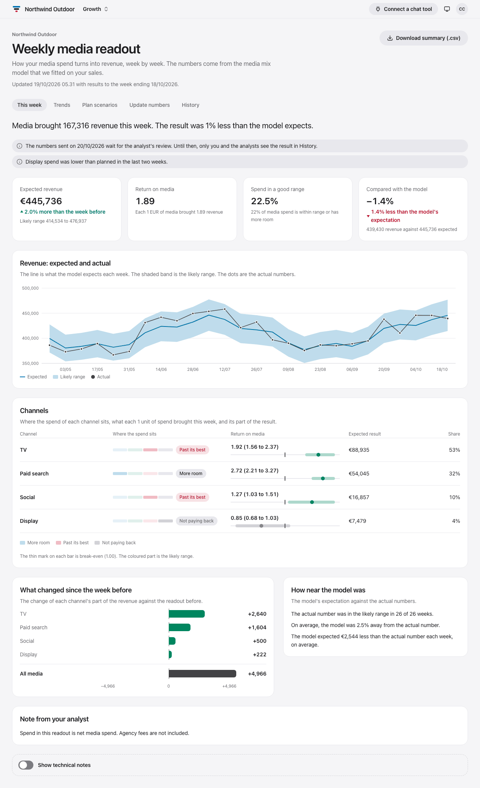
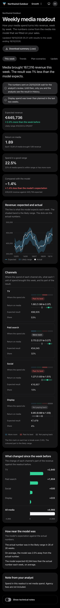

# What's new in 0.16 v0.16

**You can now show your model results to your clients.** An analyst makes a dashboard from
a fitted model or an endpoint and publishes it. Client users sign in and see only the
dashboards that you give them. Other persons open a share link, with an optional passcode
and an expiry. Each dashboard keeps a history of readouts. Clients can try other spend,
upload new numbers and ask for a refit. The model changes only when an analyst approves.

The web app also has a new look: the MEI / ODS colours, the Inter font, a new type scale and
a dark theme from the same tokens.

-   :material-view-dashboard-outline:{ .lg .middle } **Client dashboards**

    ---

    A fixed planner layout: key numbers, a channel scorecard, trends, plan scenarios, an
    upload tab and the history. The words are plain. The technical notes are behind a toggle.

    [:octicons-arrow-right-24: Build a client dashboard](guides/client-dashboards.md)

-   :material-account-tie-outline:{ .lg .middle } **The `client` role**

    ---

    A project role below `viewer`. A client sees the portal at `/c` and nothing else of the
    app. The server enforces this with an allow-list of operations.

    [:octicons-arrow-right-24: Client dashboards (concepts)](concepts/client-dashboards.md)

-   :material-link-lock:{ .lg .middle } **Share links**

    ---

    Links that you can revoke, with an expiry and an optional passcode of 8 or more
    characters. New links are read-only. The token is in the URL fragment, so it never gets
    to a server log.

    [:octicons-arrow-right-24: Share dashboards securely](guides/sharing-dashboards-securely.md)

-   :material-history:{ .lg .middle } **Continuous readouts**

    ---

    Each publish, refresh, upload and saved scenario adds a readout. Workflow runs and
    endpoint promotions refresh a dashboard without a new scheduler.

    [:octicons-arrow-right-24: Readouts and refresh](concepts/client-dashboards.md#readouts)

-   :material-tune-variant:{ .lg .middle } **Inputs that do not refit**

    ---

    What-if sliders on the response grid (free, in the browser), exact results as a score
    run, and uploads of new actuals that the model compares with its prediction.

    [:octicons-arrow-right-24: Inputs](guides/client-dashboards.md#inputs)

-   :material-palette-outline:{ .lg .middle } **A new look**

    ---

    The MEI / ODS theme in light and dark, Inter, a 14 px body text and a visible focus
    ring (`#2954FF`). Plots in the sandbox use the same palette.

    [:octicons-arrow-right-24: Web app and plot sandbox](reference/web-app.md#theme)

## Client dashboards

An editor or an admin makes a dashboard on the **Dashboards** page. A dashboard reads a
model version or an endpoint. The **Setup** tab sets the title, the KPI, the channels, the
tiles and the tabs. The **Inputs** tab sets what clients can do. The **Access** tab gives the
dashboard to client users and makes share links. **Publish** pins the spec and the model
version as a revision. Clients see only published revisions, so a change in the draft never
shows before you publish it.

Publishing needs the `runner` role, because live inputs run as you and use the compute of
your project. The first readout starts when you publish.

[:octicons-arrow-right-24: Build a client dashboard](guides/client-dashboards.md) ·
[:octicons-arrow-right-24: For clients: read your dashboard](guides/for-clients.md)

## The client role and the portal

{ width="320" }

`client` is a new project role at the bottom of the order
(`client` < `viewer` < `editor` < `runner` < `admin`). A client can only read dashboards and
use their inputs. The server also has an allow-list (`CLIENT_OPERATIONS`). If a client calls
any other operation, the answer is `404`. A client role is always for one project. It cannot
be tenant-wide.

When the current project role is `client`, the web app shows the portal (`/c`) in place of
the full app: no navigation, no command palette and no expert page. A person who is a client
in one project and a viewer in a different project keeps the viewer pages in that project.

[:octicons-arrow-right-24: Tenancy and authentication](concepts/tenancy-and-auth.md#the-client-role)

## Share links

A share link is `https://<app>/s#mpd_…`. The token is in the fragment, thus the browser
never sends it in a URL. The page removes it from the address bar, and sends it one time in
a POST body for a session of 30 minutes. The session stays in memory only. Revocation and
expiry apply on the next request.

- New links are read-only. You select what-ifs or uploads for each link.
- A passcode needs 8 to 128 characters. After 5 wrong passcodes, the link locks for 15
  minutes.
- You cannot change a passcode. Revoke the link and make a new link.

[:octicons-arrow-right-24: Share dashboards securely](guides/sharing-dashboards-securely.md)

## Inputs, readouts and refit requests

- **Plan scenarios.** Sliders move the spend of each channel on the response grid of the
  model. The browser calculates the result. No run starts. "Get exact result" starts a score
  run if the dashboard offers exact results.
- **Update numbers.** A client uploads a CSV file of new actuals. A marketing-mix model
  compares the numbers with its prediction. A model that can use actuals in a forecast
  (`conditions_on_actuals`) uses them. The model itself does not change.
- **Refit requests.** If the analyst sets a refit workflow, the uploader can ask for a refit.
  An editor with the `runner` role approves the request. The approval adds the numbers as a
  new dataset version and starts the workflow as the approver.
- **Refresh.** A successful run of a linked workflow, an endpoint promotion or **Refresh
  now** adds a readout.

By default, uploads wait for review (`pending_review`). The uploader sees the result at
once. An editor publishes it into the history.

[:octicons-arrow-right-24: Refit requests](guides/client-dashboards.md#refit-requests)

## A tool surface for v0.17

`mapi_spec.dashboard_tools` declares eight read-only tools, for example `get_latest_readout`
and `evaluate_whatif`. The member, client and share routes already call them. A later
release adds a chat explainer and an MCP server on top of the same tools
([Planned for v0.18](roadmap/expert-plugins.md#planned-for-v018)).

## API, client and configuration

- 37 new routes: [HTTP API: client dashboards](reference/http-api.md#v016).
- `client.dashboards` in the Python client (sync and async), with `open_share()` for share
  links: [The Python client](guides/python-client.md#client-dashboards).
- New settings `MAPI_SHARE_*`, `MAPI_CLIENT_RUN_RATE_PER_HOUR` and `MAPI_DASHBOARD_*`:
  [Configuration reference](operations/configuration.md).
- Migration `0018_client_dashboards` adds five tables with row-level security.
- The webhook event `dashboard.readout.published`.

## Known gaps

- A marketing-mix model compares uploaded actuals. It does not condition on them. A refit
  needs a refit request and an analyst.
- You cannot put a dashboard in an iframe (`frame-ancestors 'none'`).
- The plot sandbox renders in the system font, not in Inter.
- There is no scheduled re-optimisation, and no optimise input on a dashboard.
- You cannot change the passcode of a link. Replace the link.
