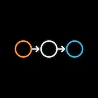
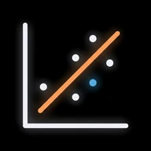
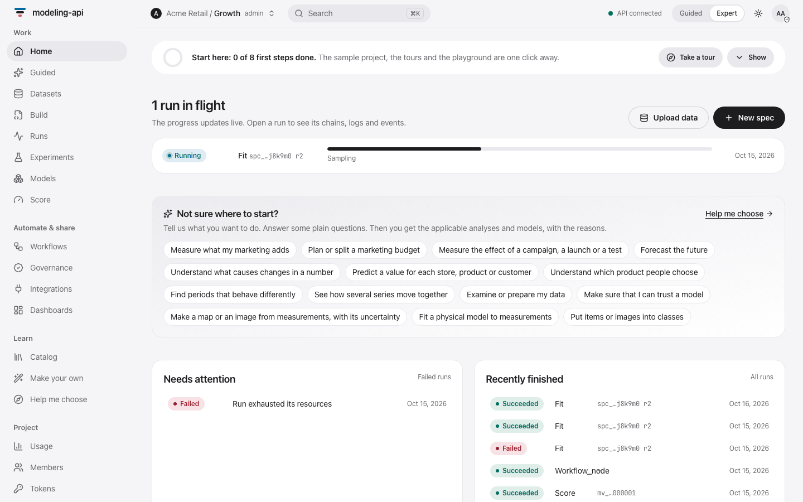
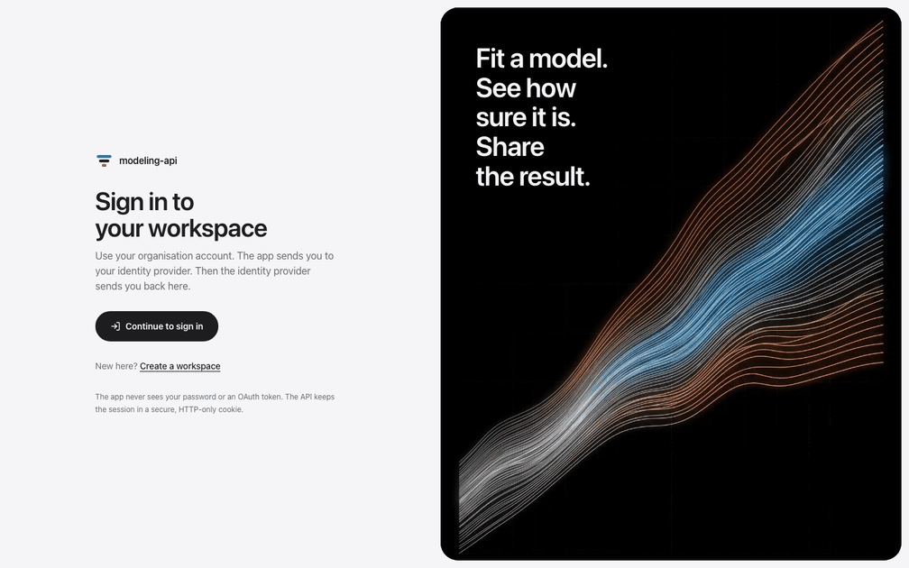
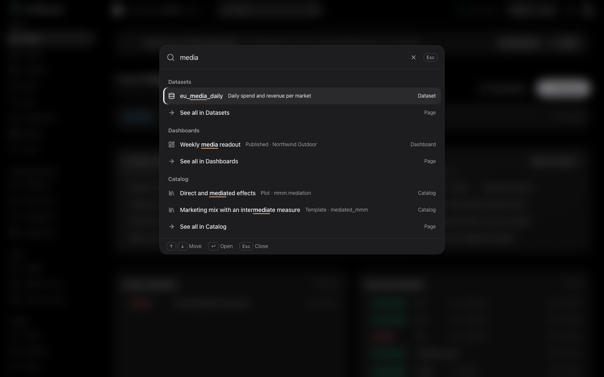
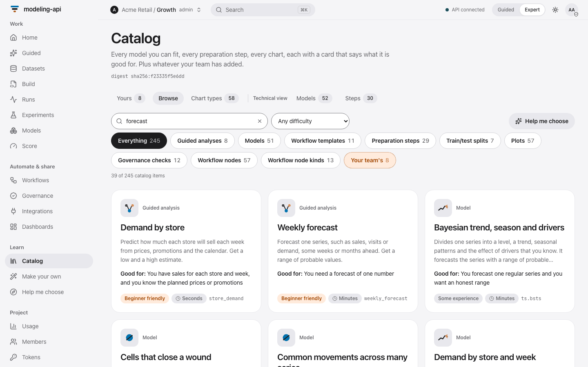
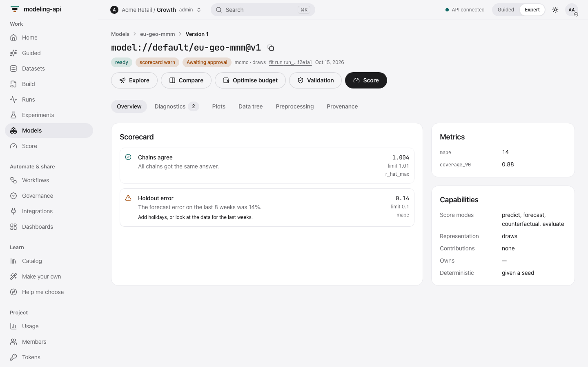
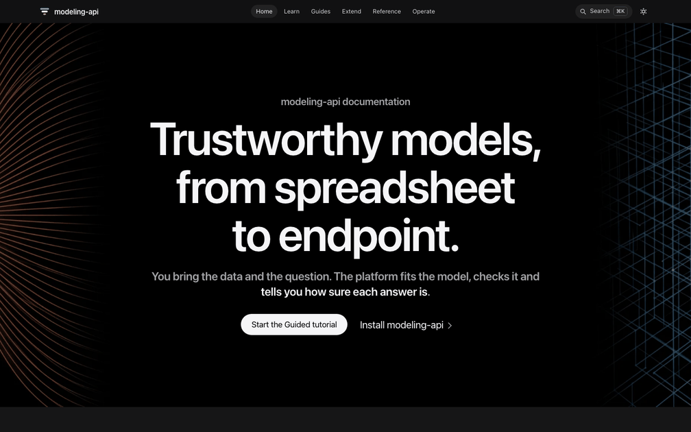
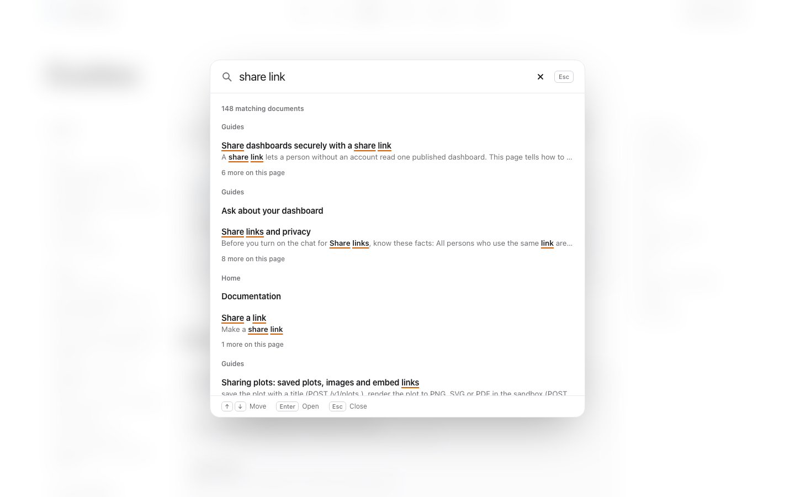

# What's new in 0.21 v0.21

The web app and this documentation now have one look, and you find things faster in the two.
No page moved and no feature went away. Your data, models and dashboards do not change.

-   { .mono-icon }

    ## One look

    Monochrome controls, colour for data, in light and dark.

    [See the new look](#the-new-look){ .mono-more }

-   { .mono-icon }

    ## One search in the app

    One box finds pages, your work by name, ids and docs pages.

    [Search in the app](#search-in-the-app){ .mono-more }

-   { .mono-icon }

    ## Know where you are

    Breadcrumbs on each detail page, a Help group, and a search field on each list.

    [Find your way in the app](#find-your-way-in-the-app){ .mono-more }

-   { .mono-icon }

    ## Docs in six tabs

    A home page by role and by task, and a landing page for the guides and the reference.

    [See the new docs layout](#the-docs){ .mono-more }

-   { .mono-icon }

    ## Search in the docs

    Task pages come first, and each result names its section.

    [Search the docs](#search-the-docs){ .mono-more }

-   { .mono-icon }

    ## New chart colours

    One palette for all charts, made for readers with colour blindness.

    [See what changes](#chart-colours){ .mono-more }

## The new look { #the-new-look }

One rule makes the look: controls are monochrome, and colour is for data.

| Part | What you see |
|---|---|
| Controls | Buttons, links, tabs and the navigation are ink on the background |
| Colour | Each colour has one meaning. Orange is new or needs your attention. Blue is information. Green is good. Red is a problem |
| Light and dark | The two themes come from the same tokens. The app follows your system until you select **Light** or **Dark** in the **Theme** menu. The docs have a switch in the header |
| Fonts | The text uses the font of your system. Where the system has none, it uses Inter and JetBrains Mono from the site itself |
| Other hosts | The docs load no font, script or image from a different site. The diagram library is now a file of the docs site. The app had this rule before |

{ .mapi-shot loading=lazy }

The sign-in page, Start here, the page for an address that does not exist and the empty lists
have new line art. Each image was generated for this project and is in the repository.

{ .mapi-shot loading=lazy }

## Search in the app { #search-in-the-app }

The command palette of earlier versions is now a search for the full app.

Press ++cmd+k++ (++ctrl+k++ on Windows and Linux) or ++slash++, or select **Search** in the
top bar. The field says **Find a page, a name or an id**.

{ .mapi-shot loading=lazy }

### With an empty field

You see three groups:

| Group | What it shows |
|---|---|
| **Recent** | The last 8 items that you opened, for each project. An item goes into the list when you open it from the search and when you open its page. The list stays in your browser until you sign out. **Clear recent items** removes the items of the project. Before you open an item, the group **Try** shows three examples |
| **Go to** | The pages of your sidebar |
| **Actions** | **New spec**, **Use dark theme**, **Use light theme** and one action for each of your other projects |

### When you type

The search finds these things, in this sequence:

| Group | What it finds |
|---|---|
| **Go to** | Pages. A pasted id (`run_…`, `ds_…`, `spc_…`, `mdl_…`, `dsh_…`, `exp_…`, `wf_…`, `val_…`, `pol_…`, `whk_…`, `plg_…` or `lib_…`) opens its page |
| **Datasets**, **Models**, **Specs**, **Runs**, **Experiments**, **Dashboards**, **Workflows**, **Endpoints** | Your items, by name. An item shows only when its name has each word of your text, as on the list page |
| **Catalog** | The About cards of the catalog, by title or id |
| **Make your own** | Your recipes, presets and templates, by name or title |
| **Actions** | The actions that have your text at the start of a word or as a part of a word. The actions come after the pages and the items, so ++enter++ on the first result does not switch the project |
| **Docs** | Pages and headings of this documentation. A result opens in a new tab. The last row, **Search the docs for** your text, opens the search of the documentation |

Each group shows at most 5 results. **See all in** opens the list page of the group with your
text in its search field. The matched letters have an orange underline. The field takes at
most 200 characters. With one letter, the search shows pages and actions only, and it tells
you to type one more letter to find items by name.

The result that you moved to with the keys or the pointer stays selected when a slower group
arrives. Below 640 px, a **Close** button shows next to the field.

### Keys

| Key | What it does |
|---|---|
| ++arrow-up++ and ++arrow-down++ | Move in the results |
| ++home++ and ++end++ | Go to the first and the last result |
| ++enter++ | Open the result |
| ++cmd+enter++ or ++ctrl+enter++ | Open the result in a new tab |
| ++esc++ | Close the search. The focus goes back to where it was |

### Limits

- The search follows the rules of your sidebar. It does not show a page, a group or an id
  that your mode or your role hides. The server checks your role on each request.
- For datasets, models, specs, dashboards, workflows and endpoints, the search reads the
  first 200 items of each kind in the project. It does not find an item after these. Runs,
  experiments and Make your own have no such limit, because the server does that search.
- The group **Docs** shows only when the build of the app has the address of the docs
  (`VITE_DOCS_URL`). Read [Known gaps](#known-gaps).
- Clients in the portal and readers of a share link have no search.

[The Expert web app](guides/web-ui.md#the-shell) describes each part of the shell.

## Search a list { #search-a-list }

Each list page has one toolbar: a search field first, then the filters of the page. The pages
are Datasets, Build, Runs, Models, Experiments, Workflows, Dashboards, Integrations, Catalog
and Make your own.

{ .mapi-shot loading=lazy }

- The text of the search is in the address of the page (`?q=`). You can copy the address, and
  the Back button of the browser keeps your search.
- While you search, a line below the toolbar counts the results, for example 3 of 41
  datasets.
- When no item matches, the page says so. **Clear the search** shows the full list again.
- When a list has more items than the page loaded, the search looks only in the loaded items,
  and the line says so.
- On Runs, the search finds a run by its name, and the filter bar stays below the toolbar.
  The address of Runs has `name=`. Runs reads `?q=` as the name too.
- The filters of Catalog (`?kind=` and `?difficulty=`) and **Show archived** on Make your own
  (`?archived=true`) are in the address too.
- The toolbar shows while the list loads and when the list is empty.

## Find your way in the app { #find-your-way-in-the-app }

| Part | What changed |
|---|---|
| Breadcrumbs | Each detail page shows its path above the title, for example Models, then the model, then the version. Select a part to go up. The back links that these pages had are gone |
| Account menu | Select your initials in the top bar. Below **Help** you find **Read the docs** (when your operator set the address of the docs), **Keyboard shortcuts** and the tours |
| Page header | Each page has the same header: the breadcrumbs, the title, one sentence, and the actions at the right |
| Shell | The sidebar and the top bar are one surface. The page that you are on has a grey pill in the sidebar |
| Shortcuts | A ++g++ shortcut goes only to a page that your sidebar shows. **Keyboard shortcuts** lists only the shortcuts that work in your navigation mode |

{ .mapi-shot loading=lazy }

## The docs { #the-docs }

The docs have six tabs. Each page has the same address as before.

| Tab | What is in it |
|---|---|
| Home | The home page, the reasons for the platform, use cases, the releases, the roadmap and the project pages |
| Learn | Install, your first model, the tutorials and the concepts |
| Guides | One guide for each task, for analysts, data scientists and clients |
| Extend | Add your own models, steps, plots and workflows |
| Reference | The spec, the catalogs, the API, the CLI and the settings |
| Operate | Install, secure and monitor the platform, and manage teams |

{ .mapi-shot loading=lazy }

- The [home page](index.md) has a path for each role (analyst, developer, operator and
  client) and links to the tasks that readers look for most.
- [Guides](guides/index.md) and [Reference](reference/index.md) open on a page that lists
  all their pages, with one line for each.
- Breadcrumbs show at the top of each page.
- Nine page titles now say what the page does. For example, the guide with the title
  Authentication is now Sign in. The address of each page did not change.

## Search the docs { #search-the-docs }

Press ++slash++ or ++cmd+k++ (++ctrl+k++ on Windows and Linux), or select **Search** in the
header. The field says **Search guides, concepts and reference**.

{ .mapi-shot loading=lazy }

- With an empty field, the list **Try** shows the pages that readers open most.
- Each result shows its section above the title: Home, Learn, Guides, Extend, Reference or
  Operate.
- Task pages and guides come before the generated reference pages and the old releases.
- A result title does not show version badges. The changelog is not in the results, because
  it repeats the release pages.
- You can type a name in parts. The words `share link` find `share_link`, and `calendar`
  finds `core.calendar`.

## Chart colours { #chart-colours }

All charts use one new palette: blue, orange, green and red first, then four more colours.
The sequence was tested with a simulation of red-green colour blindness. Bands, estimates,
alerts and reference lines have fixed colours in the two themes.

What changes for a chart that you made before:

| Chart | What you see now |
|---|---|
| Charts that the app draws itself, for example the readouts of a dashboard | The new colours, immediately |
| Plots of a model version that the platform stored before 0.21 | The new colours in the two themes. The stored plot keeps its old values. When the app draws the plot, each old fixed colour (a band, an estimate, an alert) becomes the new colour of the same role |
| Plots that you make after the upgrade | The new colours in the two themes |

You do not have to fit a model again to get the new colours.

## For developers

- `mapi_plots.palette` (in `mapi-plots`, Apache-2.0) has new colour values for each swatch.
  The names of the swatches and the functions do not change. If your plot recipe uses the
  names, you do nothing. If it copies a hex value, change the value.
- The web app does not use the Bricolage Grotesque font. The dependency is removed.
- The docs site loads Inter, JetBrains Mono and mermaid from its own files. Read
  [Licensing](project/licensing.md#the-docs-site-and-the-art) for their licences.
- The search separator of the docs changed, and nine page titles changed. If you link to a
  docs page by its title, read the list in the [changelog](project/changelog.md).
- The app has new modules for the search (`apps/web/src/features/search/`) and a script that
  makes its index of the docs (`scripts/gen_docs_search_index.py`). `make web-check` fails
  when the index is not current.
- [The docs theme](project/docs-theme.md) tells contributors how to use the building blocks,
  how to add a page to the search and how to add art.

## Known gaps

- The app has no search endpoint on the server. For datasets, models, specs, dashboards,
  workflows and endpoints, the search reads the first 200 items of each kind. It does not
  search the names of the items after these.
- **See all in** and the search field of a list show an item only when the item has each
  word of your text.
- The recent items of the search are the items that you opened from the search and the
  pages that you visited. They stay in your browser until you sign out. They do not follow
  you to a different browser.
- **Read the docs** and the group **Docs** of the search show only when the build of the
  app has the address of the docs (`VITE_DOCS_URL`, in
  [Configuration](operations/configuration.md)). No build that comes with the platform sets
  this address.
- 25 screenshots in the docs show the look of earlier versions: 13 screenshots of the
  science models, 5 of the 8 screenshots of release 0.15, and the 7 screenshots of
  [Your first model in the web app](guides/first-model-in-the-ui.md). All other screenshots
  show the new look. In the dark scheme, a screenshot of the light theme shows as a light
  panel.
- The pictures of the plot recipes catalog have the new fixed colours (bands, estimates,
  alerts). Their series have the default colours of the renderer, not the series colours
  of the app.
- The account chooser of the development IdP and the HTML page of an evidence pack do not
  have the new look.
- The [OpenAPI explorer](reference/openapi.md) (Redoc) stays light in the dark scheme.
- The new look was checked in Chromium only. Safari and Firefox were not checked.
- In the docs, the tabs move into the menu below a width of 1220 px.

## Read more

- [**The Expert web app** Each part of the shell, with the search and its keys. *Guide*](guides/web-ui.md)
- [**Web app and plot sandbox** The tokens of the theme and the tests that guard them. *Reference*](reference/web-app.md#theme)
- [**The docs theme** The building blocks, the search settings and the art rules. *Project*](project/docs-theme.md)
- [**Changelog** Each change of this release, with the known gaps. *Project*](project/changelog.md)

