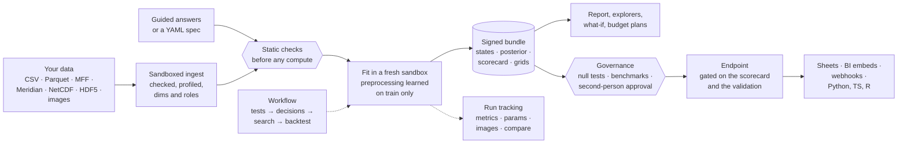
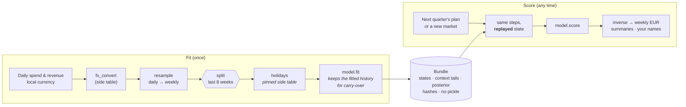

# Why modeling-api?

Most statistical models that are important to a business start in a notebook. Someone
explains them in a slide deck, and then the work stops. To make the models useful, a second
project is necessary, and most of it is plumbing. The project must put the models in front of
the persons who make decisions. It must keep the models honest after the data changes. It
must prove that they learned something real, and let other tools use them.

modeling-api is that second project, done one time, for a specific type of model: **Bayesian
and classical models of labelled, multi-dimensional data** (panels, time series,
hierarchies). The preprocessing and uncertainty of these models must stay correct in
production. Their analysis must be repeatable and defensible.

## The problems it solves

| The problem | What usually happens | What modeling-api does |
|---|---|---|
| **The preprocessing at score time is not the preprocessing at fit time** | Someone writes the scaling, lags and currency conversion again in the service. Or they fit them again on the new data, or they forget them | Steps store what they learned at fit time and **replay** it at score time. This includes the look-back tail of each group. Inverse transforms bring answers back to your units ([Pipelines](concepts/pipelines.md)) |
| **Data is positional** | Column 7 changes meaning. A new market is "row 12". The lags of a forecast start from the wrong week | Data is an `xr.Dataset` with named dims. Each dim declares what can occur at score time (`fixed`, `extend`, `new_levels`). The platform checks requests against it before any compute ([Labelled data](concepts/labelled-data.md)) |
| **The analysis is only in the head of one person** | "I ran ADF, it looked non-stationary, so I differenced and tried a few ARIMAs". This occurs one time, by hand, and nobody writes it down | A **workflow** runs the tests and makes the decisions by stated rules. It searches the orders, backtests against naive forecasts and records each value that it read. It runs again on a schedule or when the data changes. It uses the unchanged steps again ([How workflows work](concepts/workflows.md)) |
| **A model goes live because it looks good** | The fit looks good, and there is an R² on the training data. Nobody checks if noise can give the same result | **Governance policies**: the model must be better than the same model fitted on shuffled results. It must give no credit to fake noise drivers. It must be better than naive benchmarks out of sample. A second person approves, and endpoints refuse versions that are not validated ([Null tests explained](guides/null-tests.md)) |
| **Uncertainty is lost or added incorrectly** | A point estimate controls a budget decision. Someone adds the 90% quantiles of 40 stores | Each output has its **representation** (draws, quantiles, interval, point, moments). The platform gives only the valid summaries and aggregations ([Representations](concepts/representations.md)) |
| **Each scenario needs the data scientist** | The analyst asks "what if we move 20% to search?" and waits a week | Guided mode has templates, beliefs in business terms and a report in plain language. It has instant what-if sliders over a response curve for each draw, and budget plans from the posterior ([Guided mode](concepts/guided-mode.md)) |
| **To choose a model, you need a statistician** | The analyst uses the model of the last project, or the model with the most interesting name | Each model, step, node and check has an **About card** in plain words. **Help me choose** asks some questions and gives a ranked shortlist with reasons ([Choosing a model](guides/choosing-a-model.md)) |
| **The Bayesian checks stay in a notebook** | R-hat, the predictive check and the LOO comparison run one time, by hand, for one model. Nobody runs them again on the next version | Posterior summaries, posterior predictive checks, stacking weights and plots are **workflow nodes**. The `bayes_workflow_audit` recipe runs the checks of a careful Bayesian workflow for each model that gives draws. Model ladders compare variants by `elpd_loo` ([Complex workflows](tutorials/complex-workflows.md)) |
| **Nobody knows which run was the best** | The loss curves are in the output of a notebook. The settings of the best run are in the memory of one person | Each run keeps its **metrics, params, tags, notes and images**. Model code, workflow nodes and you can log to it. Filter and sort the runs by a metric, save the search as a view, compare 2 to 10 runs side by side and group them in experiments ([Track metrics](guides/tracking.md), [Compare runs](guides/run-comparison.md)) |
| **Nobody can tell if the campaign worked** | Someone compares the weeks before and after the campaign, and the season gives the "effect" | **Causal models** compare the actual values with a prediction of the values without the change, with a range: CausalImpact, a synthetic control for geo-lift tests, and difference-in-differences. The result of a geo-lift test becomes a lift test for the MMM ([Measure the effect of a change](guides/causal.md)) |
| **You find data problems after the model** | Gaps, a constant driver or a series that wanders show in the residuals one week later | The **Data Explorer** makes a profile of each upload in the sandbox. It shows quality warnings, the stationarity of each series, cross-correlation with the KPI by lag, STL and collinearity ([Explore a dataset](guides/data-explorer.md)) |
| **Nobody knows if they can trust the model** | Convergence warnings are in a log that nobody reads | A **sanity scorecard** (convergence, holdout error and coverage, plausibility, data) in plain words, and a promotion gate that uses it ([Scorecard](concepts/guided-mode.md#scorecard)) |
| **Other tools need the model** | A Flask app for each model, a shared pickle, or a CSV file in an e-mail each Monday | **Endpoints** with aliases, history and rollback. Scoped tokens, generated snippets, signed webhooks and charts that you can embed ([Integrations](concepts/integrations.md)) |
| **Many teams, untrusted code and data** | One shared server where all code can read all data | Tenants with row-level security and a new sandbox for each run. Outputs that the platform verifies against the checksums of the storage and signs. Quotas and a kill switch ([Security model](concepts/security.md)) |

## Two ways in, one model

<div class="mapi-personas" markdown>
<div class="mapi-persona" markdown>

### :material-compass-outline: Analysts

<p class="mapi-promise">From an upload to a report and a scenario in minutes, with honest uncertainty.</p>

- Select what you want to learn. Answer questions such as "which column is revenue?". The
  platform suggests the answer and tells you why.
- Tell what you already believe ("TV returns 1.5 to 4 per euro"), or enter a lift test.
- Read a report in plain words. A **sanity scorecard** tells you if you can trust it.
- Move the **what-if sliders**. Your browser gives the answers. The range stays honest when
  some channels move at the same time. "Run exact" asks the full model.
- Share a live chart, or put the model in a Google Sheet.
- Measure the effect of a campaign or a geo-lift test with the *Effect of a campaign* and
  *Geo-lift test* templates. Use the result as a lift test for your marketing mix.
- If you are not sure which model to use, use **Help me choose**. It asks some questions and
  explains its recommendations. Each option has an *About* card in plain words.

Start with [Your first MMM in Guided mode](guides/guided-tutorial.md).

</div>
<div class="mapi-persona mapi-persona--expert" markdown>

### :material-code-braces: Data scientists

<p class="mapi-promise">Any PyMC, scikit-learn, JAX or forecasting model. The same preprocessing, exactly. Endpoints in one click.</p>

- A PyMC model is one `build()` method. An sklearn model is one `estimator()`. Built-in
  marketing-mix, forecasting, causal, demand, choice and classification models are ready to
  use. So are 15 science models and three neural networks for tables and images.
- Each run logs its **metrics, params, tags and images**. Log your own from model code, a
  notebook or `mapi runs log-metric`. Filter, sort and compare 2 to 10 runs side by side,
  and group them in **experiments**.
- Steps **learn on the training data only**. At score time, the platform **replays** them
  and does not fit them again. This applies to forecasts, new markets and counterfactuals.
- Uncertainty is a primary part of each result: draws, quantiles or intervals. Each one has
  the aggregations that are valid for it.
- Promote a version to an **endpoint** through the scorecard gate. Copy a snippet for
  Python, TypeScript, curl, R, Apps Script or a notebook.
- Automate the statistics with **workflows** of tests, branches, searches, backtests and
  governance checks. Posterior summaries, predictive checks, stacking weights and plots are
  nodes too. Run them live from `mapi workflows run --watch` or `api.workflows`.

Start with the [Quickstart](getting-started/quickstart.md). Then read the
[Workflow cookbook](guides/workflow-cookbook.md), [Track metrics, params and tags](guides/tracking.md)
and the [science tutorials](tutorials/pymc-challenges/index.md).

</div>
</div>

The two groups edit the same `ModelSpec`. Each Guided screen has **View as YAML**. The
changes of an expert come back to Guided mode with no loss.
[When to use something else](#when-to-use-something-else) tells who the platform is not for.

## How it works



1. **Your data stays labelled.** The upload becomes an `xr.Dataset` with named dims, roles and
   units. No later part of the process uses the position of the data.
2. **Mistakes fail early.** Examples are a spec that leaks the holdout, a forecast past the
   limit of the model, or a market that the model did not see. You get typed errors before
   any compute.
3. **The fit learns, and the score replays.** Each preprocessing step stores what it learned.
   Thus a forecast or a new market goes through exactly the same transformations. Then the
   result goes back into your units.
4. **The platform checks results two times.** It compares the outputs with the checksums of
   the storage, and it signs them. The scorecard checks convergence, holdout error and
   plausibility.
5. **Models must show that they are good.** A governance policy applies null tests and
   benchmarks to each version and records the evidence. If you ask, it waits for a second
   person. Endpoints can refuse all versions that are not validated.
6. **Other tools connect to an endpoint, not to a file.** Promote a better model, and all
   integrations use it. Roll back with one call.
7. **Full analyses repeat automatically.** A workflow runs the tests, decisions, fits and
   checks again each Monday, or when the data changes. It uses again each step whose inputs
   did not change.
8. **Each run keeps its record.** A run logs its metrics, params, tags and images while it
   runs. You can search the runs, compare them side by side and group them in experiments.

## The core idea: fit with preprocessing, score with the *same* preprocessing

The same pipeline object runs at fit time and at score time. At fit time, each step
**learns** its state from the training data. At score time, it **replays** that state. Steps
that look back in time store a small tail for each group. Thus a forecast sees exactly the
history that the model used for the fit.



=== "What you write"

    ```yaml
    pipeline:
      - {id: to_eur, use: core.fx_convert@^1, with: {vars: [y, spend], table: fx, ...}}
      - {id: weekly, use: core.resample@^1,   with: {dim: time, freq: W-SUN, how: sum}}
      - {id: hols,   use: core.holidays@^1,   with: {table: holidays, along: time}}
    model:
      use: mmm.bayesian@^1                 # mmm-framework: scaling and carry-over inside
      settings: {hierarchy: {pool_over: [geo]}, new_levels: hyperprior}
      fit: {mode: evaluate_then_refit}
    ```

=== "What the platform does"

    1. The platform checks the full spec **statically**. It checks names, dims, settings and
       units at each stage. It also checks where the split occurs, and if a step can learn
       from the holdout (`LEAKAGE_RISK`).
    2. It fits each stateful step on the **training weeks only**, and then fits the model.
       Then it scores the holdout **through the same path that a forecast uses** and records
       the metrics.
    3. It fits again on all weeks, so that forecasts start from the latest data. Then it
       writes a bundle with each state, context tail and hash.

=== "What you get back"

    - Forecasts in **weekly EUR**, not in "model units". The model reports its own units. The
      units stop at the weekly resample, because you cannot get daily values back from weekly
      sums. The `output_space` (`model-owned`) and `units` attributes of the output tell this.
    - A new market that comes from the fitted **hyperprior**. Its range is honestly wider than
      the range of a known market.
    - What-if deltas that share their noise with the baseline (common random numbers). Thus
      the delta shows the change, not the sampling noise.

This is the same model in plain Python, without a server. The test suite runs each snippet
on this site:

```python
--8<-- "quickstart.py:fit"
```

```python
--8<-- "quickstart.py:errors"
```

## Compared with notebooks and an ad-hoc Flask app

This is the most usual alternative. It is a good alternative for one model and one team.

| | Notebook + a small web app | modeling-api |
|---|---|---|
| How to start | Minutes: you already have the notebook | A spec or a `build()` method. Guided templates and workflow recipes need no code |
| Freedom | Any library, any code | Any PyMC or scikit-learn model through the plugin contract. Built-in models for MMM (mmm-framework), twelve statsmodels time-series models, forecasting, causal effects, demand, choice and classification, 15 science models for images, fields, maps and graphs, and neural networks on JAX for tables and images. Your own plugins run now on a deployment that you control (installed into its runner). Upload to a shared deployment is planned for a later release, first for allow-listed teams ([roadmap](roadmap/index.md)) |
| Preprocessing at score time | Someone copies it into the app by hand, or pickles it with the model | Declared steps with fitted state that the platform replays exactly. Static checks find leakage |
| Forecasts and new groups | The result depends on what the code does with a row or date that it did not see | Declared for each dim and checked before compute, with typed errors (`UNSEEN_LEVELS`, `HORIZON_EXCEEDS_FIT`, …) |
| Run history | Cell outputs that the next run replaces | Metrics, params, tags, notes and images of each run, with search, saved views, experiments and a compare page |
| How to repeat the analysis | Run the cells again, and hope that the sequence is correct | A versioned workflow with typed ports. The platform validates it before it runs. A schedule or new data starts it. It records each decision |
| How to validate the model | A holdout number in a slide, if someone asks | Null tests, benchmarks, residual checks and stability checks under a versioned policy. The approval of a second person. An evidence pack for the auditor |
| Model versions | File names, and a model registry if you set one up | Immutable spec revisions, signed bundles, lineage, and endpoints with history and rollback |
| Who can use it | Persons who can run the notebook or call the app | Analysts in Guided mode. Other apps through endpoints, sheets, BI embeds and webhooks |
| Security | It depends on the app. Often there is pickle and an open port | Sign-in, roles, scoped tokens, sandboxed runs, no pickle, verified outputs |
| How to operate it | You own the server | You own the deployment (a laptop, Docker Compose or Google Cloud). It is multi-tenant from the start |

Use the notebook when the model is a single analysis that nobody else must call or check.
Move to modeling-api when a second person, a second model or a second application needs the
model. Also move when someone asks "how do we know this is not noise?".

## Compared with workflow orchestrators

Airflow, Prefect, Dagster and similar tools are very good when you must run any type of
task on a schedule across systems. The workflows of modeling-api are narrower on purpose. They
are the *statistics* of one analysis, not a data pipeline.

| | General-purpose orchestrator | modeling-api workflows |
|---|---|---|
| A step is | Any Python function or container | A node from a catalog (57 nodes: 17 statistical tests, transforms, 7 train/test plans, order searches, fits, backtests, scores, posterior summaries, predictive checks, comparisons and stacking weights, lift tests from causal models, governance, reports and plots) or a saved sub-workflow |
| Between steps | The data that the code sends | Typed ports (`dataset`, `test_result`, `split_plan`, `model_version`, …). The platform checks them before the run starts, with a JSON pointer to each problem |
| Decisions | Python `if` statements | Branch conditions in a small, safe expression language (never `eval`). The run records the values that each condition read |
| Where user data is read | The location where the task runs | In a new sandbox without network. The orchestrator sees only JSON results |
| Reuse | A task cache that you configure | The identity of each node is its implementation, its parameters and the content of its inputs. The platform uses unchanged steps again automatically |
| Output | The data that the tasks write | Verdicts in plain language, a report with plots, governance evidence and a model version that is ready to validate and promote |

Use an orchestrator to move data between systems and to call modeling-api. Use a workflow
for the analysis. The two tools work well together. For example, an orchestrator uploads the
data of the new week, and the dataset trigger runs the workflow.

## Compared with experiment trackers

MLflow Tracking, Weights & Biases and similar tools are very good at the log of an
experiment. They work with almost any code and any framework. In modeling-api, run tracking
is part of the platform. It is not a separate server.

| | Experiment tracker | modeling-api run tracking |
|---|---|---|
| What logs | Your code, with the client of the tracker | The platform logs the params of each spec, the progress of each chain, the loss and the holdout metrics. Model code, workflow nodes and you can add metrics, params, tags, notes and images |
| Where the run occurs | Where your code runs | In a new sandbox. The run sends its log through the run protocol, with budgets for each run |
| Link to the model | An artifact that you log | The run makes a signed model version. The same version goes to the scorecard, governance and endpoints |
| Compare runs | Yes | Yes: filters, saved views, experiments and a compare page for 2 to 10 runs |
| Export | Native | An MLflow export is planned for v1.0 |

Use a tracker for code that runs outside the platform. Use run tracking for the models that
the platform fits and serves.

## Compared with marketing-mix vendors and libraries

Marketing-mix models are the first domain pack, thus users ask about this comparison most.
modeling-api is **not** a new MMM methodology. It does not compete with the statistics of the
established libraries. It is a platform that runs MMMs, applies governance checks to them and
puts them in front of planners.

**Open-source MMM libraries** (for example, Google's Meridian and Meta's Robyn) are
very good at the model. But they are libraries, and you run them in a notebook. You must
supply the serving, the scenario tools for analysts, the validation, the versions and the
access control.

- The built-in MMMs run on [mmm-framework](models/mmm-framework.md). This is an open-source
  (Apache-2.0) Bayesian MMM framework on PyMC. Business priors become its ROI priors. Lift
  tests become its experiment likelihoods. Its `planning` module optimises budgets from the
  posterior ([MMM guide](guides/mmm.md)).
- The ingest recognises Meridian-shaped tables (`time`, `geo`, `kpi`, `<channel>_spend`).
  The Meridian model is not part of the platform, because it needs TensorFlow.
- The platform does not support Robyn (R).

**Managed MMM services** usually supply data collection from ad platforms, a methodology,
models as a service and planning dashboards. modeling-api does **not** collect data from ad
platforms, and it gives no consulting. But you own the spec, the data and the fitted
posterior. You can read each prior and each check. You can run models other than MMM on the
same platform, and connect the result to your own tools.

| | Typical managed MMM service | Open-source MMM library | modeling-api |
|---|---|---|---|
| Data collection from ad platforms | Often included | No | No: upload CSV, Parquet, MFF or Meridian-shaped tables |
| The model | The model of the vendor | Your model, in code | The Bayesian (or fast frequentist) MMM of mmm-framework, national or pooled over geos and products. Also effects through an intermediate measure (`mmm.nested`), several related results (`mmm.multivariate`) and effects that change over time. Or your own plugin |
| Priors and calibration | Different for each vendor, frequently hidden | Your priors, in code | Business priors as ROI or share ranges, and lift tests. A geo-lift test on the platform can make the lift test. You can see all of them in the spec |
| Proof that it does not fit noise | Not frequently shown | You must do it | Shuffled-sales and fake-channel null tests, effect signs, holdout accuracy and prior sensitivity, with evidence and the approval of a reviewer |
| Analyst scenarios | Dashboards | You build them | What-if sliders with joint uncertainty, "Run exact", forecasts and counterfactuals |
| Budget optimisation | Usually included | Library functions | `optimize` runs in the sandbox on mmm-framework planning: bounds, groups, risk objectives (P10, CVaR) and the efficient frontier |
| Other models on the same platform | No | No | Forecasting, causal effects, macro systems (VAR/VECM), store demand, customer choice, classification, science models, neural networks, your own |
| Who owns the posterior | The vendor | You | You |

## Compared with generic ML model serving

MLflow, BentoML, KServe, Seldon and the endpoints of the cloud providers are very good at
their task. They package a trained model from almost any framework. They serve it with low
latency and autoscaling. modeling-api is for a narrower problem, and it makes different
trade-offs.

<div class="mapi-compare" markdown>

| | Generic model serving | modeling-api |
|---|---|---|
| Input contract | Column or tensor signatures: names and shapes, but no dimensions | `xr.Dataset` with named dims, coordinates, roles, units and a score policy for each dim |
| Preprocessing at score time | You must do it. Put it in the artifact, or write it again | Declared steps with **fitted state** that the platform replays exactly. Splits that know the stage, and a context tail for each group |
| New groups and horizons | The result depends on what the model does with a row that it did not see | Declared for each dim (`fixed`, `extend`, `new_levels` + strategy) and checked before compute |
| Uncertainty | Point predictions by default. Intervals are a custom output | A primary **representation** that decides which summaries and aggregations are valid |
| Units of the answer | The space that the model used for training | Inverted to original units. Each variable records its output space |
| Serialization | Native to the framework. Pickle and cloudpickle are usual | Zarr zip + JSON, skops or xgboost JSON. The platform **rejects pickle** on write and on read |
| Promotion | Usually manual, or a CI job | A sanity scorecard is the gate. When a policy tells so, a governance validation is also a gate. It has null tests and the approval of a second person |
| Latency | Milliseconds, warm replicas, autoscaling, GPUs | Batch: one sandboxed run for each call (seconds, plus cold start in the cloud). Instant what-if from grids that the platform calculates before. A `GPU` class gives a training run one GPU. No warm scorers yet |
| Frameworks | Almost any | PyMC, scikit-learn, xgboost, LightGBM, CatBoost, statsmodels, mmm-framework, JAX and Flax, and hand-written models through the plugin contract |
| Who it is for | ML engineers who serve many types of model | Statisticians, data scientists, and the analysts and apps that use their models |

</div>

## When to use something else

- **You need answers from the exact model in less than one second**, or thousands of
  requests each second. Use a model server. modeling-api answers sliders immediately from
  grids that it calculates before. But an exact score is a sandboxed run.
- **Large deep learning.** The platform trains small networks on JAX, with one GPU for each
  run. It does not train on more than one GPU or more than one machine, and it does not read
  PyTorch checkpoints. Use a training platform for large networks.
- **General data pipelines** (move data between systems, join across databases, call APIs).
  Use an orchestrator. Workflows are for the statistics of an analysis. They use catalog
  nodes, and they run without network access.
- **Your model needs the network at run time** (an API, a database). Runs have no egress, by
  design.
- **You want to upload public code to a hosted platform now**. On a shared deployment,
  uploaded plugins are planned first for allow-listed teams, in a later release. They come to the public only after
  an external penetration test. On a deployment that you control, you can install and run
  your own plugins now.

## Where it stands

v0.15 is complete, and we tested it on a laptop. We did the web journeys of v0.10 to v0.15
(run tracking, run comparison, the MMM pack, the causal templates, image data and deep
learning) in a browser on a local dev stack, with real fits in the sandboxed runner. The
GPU path is not tested: the project has no GPU and no Google Cloud project to test it. On a
laptop, a GPU run uses the CPU. We did the E18, E51 and E21 science tutorials of v0.9 in the
web app with the real data of the notebooks. The v0.5 workflow, governance, mmm-framework,
explorer and CLI journeys passed end to end against a live stack. The numbers in
[Measured, not promised](#measured-not-promised) come from those runs.

Two items are still open. We test the cloud controls against fakes until they meet a real
Google Cloud project. Also, the study with five non-technical testers did not run yet. See
[What's new in 0.10 to 0.15](whats-new-0.15.md#what-is-not-in-015-yet),
[What's new in 0.9](whats-new-0.9.md#what-is-not-in-09-yet),
[M3.5 verification](operations/m35-verification.md), [M3 verification](operations/m3-verification.md)
and the [roadmap](roadmap/index.md).

## Measured, not promised

The v0.9 values come from fits of the real data of the pymc-challenges notebooks. We got the
first two values in the web app on a local dev stack, with the sandboxed runner
([E18 tutorial](tutorials/pymc-challenges/e18-scottish-lip-cancer.md)):

<div class="mapi-stats" markdown>
<div class="mapi-stat"><strong>46 s</strong><span>the sci_spatial_ladder recipe on the 56 districts of Scotland: three spatial models, the comparison, the stacking weights, two refits with other priors and the report</span></div>
<div class="mapi-stat"><strong>−153.0</strong><span>the elpd_loo of the BYM2 disease map in the web app. The notebook gives −152.7.</span></div>
<div class="mapi-stat"><strong>129.9</strong><span>the elpd_loo of Pagel's lambda, the model that sci_phylo_signal selects for 186 primates. The notebook gives 130.</span></div>
</div>

We measured the values below on an 8-core laptop against the full stack. The fits were real
fits in the sandboxed runner. The v0.5 journeys used the data and settings of [M3.5 verification](operations/m35-verification.md):

<div class="mapi-stats" markdown>
<div class="mapi-stat"><strong>37–40 s</strong><span>the canonical workflow: 19 nodes from unit-root tests to governance, through the orchestrator and the sandboxed runner</span></div>
<div class="mapi-stat"><strong>p = 0.7–0.95</strong><span>an ARIMAX fitted on pure noise, compared with 19 fits on shuffled data. The validation fails. Promotion gives NOT_VALIDATED.</span></div>
<div class="mapi-stat"><strong>0.1 %</strong><span>of the result that a model fitted on real signal gave to three fake noise drivers</span></div>
<div class="mapi-stat"><strong>26 s</strong><span>a validation with the null tests: 19 fits on shuffled data plus 3 fake drivers</span></div>
<div class="mapi-stat"><strong>10–16 s</strong><span>an mmm-framework budget plan with a 5-point efficient frontier, in the sandbox</span></div>
</div>

These runs found eight defects that unit, integration and mocked-browser tests did not find.
We repaired each defect and added a regression test before the release. The v0.4 journey used
the data of [M3 verification](operations/m3-verification.md):

<div class="mapi-stats" markdown>
<div class="mapi-stat"><strong>135 s</strong><span>from upload to report to scenario, done by a script. The fit used 79 s.</span></div>
<div class="mapi-stat"><strong>0.08 %</strong><span>the difference between the instant slider and the exact model, for TV at half budget (−454,590 vs −454,241, exact sd 14,003)</span></div>
<div class="mapi-stat"><strong>0.01 %</strong><span>the difference between "TV off" from the grid and an exact counterfactual run (−1,046,519 vs −1,046,414)</span></div>
<div class="mapi-stat"><strong>76–81 %</strong><span>of each translated prior is in the 80% ROI range that the analyst gave</span></div>
<div class="mapi-stat"><strong>0 objects</strong><span>stay in five buckets after a tenant deletion (285 before). The platform keeps only the audit log and the cost ledger.</span></div>
</div>

We did not measure these items yet: real testers, a real Google Cloud project and public
workspaces with Docker isolation ([what remains](operations/m3-verification.md#what-remains-unverified)).
